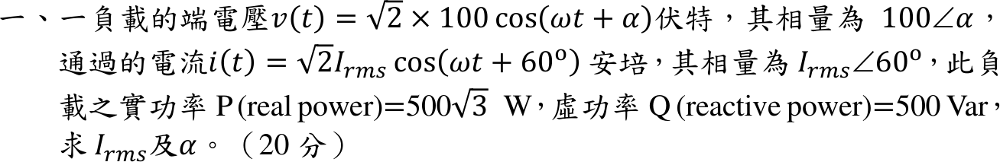
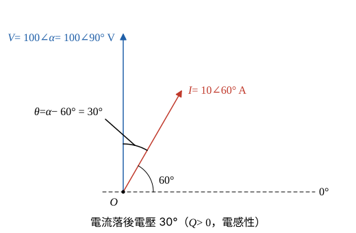

# 114 年電力系統第 1 題｜負載相量與複功率

## 已知與所求

\(v(t)=\sqrt2\times100\cos(\omega t+\alpha)\) V，相量 \(100\angle\alpha\)；\(i(t)=\sqrt2I_{rms}\cos(\omega t+60^\circ)\) A，相量 \(I_{rms}\angle60^\circ\)；\(P=500\sqrt3\) W、\(Q=500\) var。求 \(I_{rms}\) 與 \(\alpha\)。

## 考場標準作答

### 步驟 1：組成複功率

\(v(t)=\sqrt2\times100\cos(\omega t+\alpha)\) 的 \(\sqrt2\times100\) 是峰值，相量 \(100\angle\alpha\) 的 100 V 即有效值；單相負載吸收的複功率 \(S=VI^*=P+jQ\)：

\[
S=P+jQ=500\sqrt3+j500\ \mathrm{VA}
\]
並寫出 \(S=VI^*\) 的極式（題給相量）：
\[
S=VI^*=(100\angle\alpha)(I_{rms}\angle60^\circ)^*=(100\angle\alpha)(I_{rms}\angle-60^\circ)=100I_{rms}\angle(\alpha-60^\circ)
\]
兩式的大小、角度分別相等，即得兩條方程。

### 1. 電流有效值 \(I_{rms}\)

視在功率大小：
\[
|S|=\sqrt{P^2+Q^2}=\sqrt{(500\sqrt3)^2+500^2}=\sqrt{750000+250000}=\sqrt{1000000}=1000\ \mathrm{VA}
\]
由 \(|S|=100I_{rms}\)：
\[
\boxed{I_{rms}=|S|/|V|=1000/100=10\ \mathrm A}
\]

### 2. 電壓相角 \(\alpha\)

複功率的角度等於電壓角減電流角（因電流取共軛），電流角 \(60^\circ\) 已知。

\(S\) 的角度（\(P>0\)、\(Q>0\)，位於第一象限）：
\[
\angle S=\tan^{-1}\frac{Q}{P}=\tan^{-1}\frac{500}{500\sqrt3}=\tan^{-1}\frac{1}{\sqrt3}=30^\circ
\]
由步驟 1 的極式 \(\angle S=\alpha-60^\circ\)：
\[
30^\circ=\alpha-60^\circ
\]
\[
\alpha=30^\circ+60^\circ\Rightarrow\boxed{\alpha=90^\circ}
\]

## 驗算

回代相量：\((100\angle90^\circ)(10\angle-60^\circ)=1000\angle30^\circ=866.03+j500.00\ \mathrm{VA}\)，\(500\sqrt3=866.03\)，與題給 \(P,Q\) 相符；\(Q>0\) 對應電流落後電壓 \(30^\circ\)。

## 失分點

- 漏取電流共軛，寫成 \(\angle S=\alpha+60^\circ\) 會得 \(\alpha=-30^\circ\)。
- 題目已寫 \(\sqrt2\times100\)，100 V 即有效值；再除以 \(\sqrt2\) 會得 \(I_{rms}=14.14\ \mathrm A\)。
