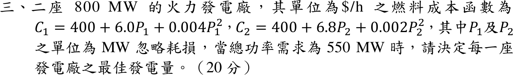

# 114 年電力系統第 3 題｜經濟調度

## 已知與所求

\(C_1=400+6.0P_1+0.004P_1^2\)、\(C_2=400+6.8P_2+0.002P_2^2\)（\(\$/\mathrm h\)，\(P\) 以 MW 計），兩廠各 800 MW，總需求 550 MW，忽略耗損。求兩廠最佳發電量。

## 考場標準作答

觀念：忽略耗損、兩機都在容量內運轉時，總成本最低的條件是「等增量成本」——各機增量成本 \(dC_i/dP_i\) 相等並等於系統 \(\lambda\)，再加上功率平衡 \(P_1+P_2=550\)。成本函數為凸（二次項係數為正），所以這個駐點就是全域最小。

### 1. 增量成本與功率平衡

各機增量成本（對 \(P\) 微分，二次項係數乘 2）：
\[
\frac{dC_1}{dP_1}=6+2(0.004)P_1=6+8.00\times10^{-3}P_1,\qquad
\frac{dC_2}{dP_2}=6.8+2(0.002)P_2=6.8+4.00\times10^{-3}P_2
\]
等增量成本與功率平衡：
\[
6+8.00\times10^{-3}P_1=6.8+4.00\times10^{-3}P_2,\qquad P_1+P_2=550
\]

### 2. 解兩機出力

代入 \(P_2=550-P_1\)：
\[
6+8.00\times10^{-3}P_1=6.8+4.00\times10^{-3}(550-P_1)
\]
展開右側 \(4.00\times10^{-3}\times550=2.20\)，得 \(6+8.00\times10^{-3}P_1=9-4.00\times10^{-3}P_1\)。

移項合併：
\[
12.00\times10^{-3}P_1=3\Rightarrow P_1=\frac{3}{12.00\times10^{-3}}
\]
\[
\boxed{P_1=250\ \mathrm{MW}},\qquad P_2=550-250\Rightarrow\boxed{P_2=300\ \mathrm{MW}}
\]

### 3. 檢查限制

共同增量成本：
\[
\lambda=6+8.00\times10^{-3}(250)=8\ \$/\mathrm{MWh}
\]
\(0\le250,300\le800\ \mathrm{MW}\)，兩解均在容量限制內，故上述等增量解即為最佳調度。

## 驗算

\(6.8+4.00\times10^{-3}(300)=8=\lambda\)，\(250+300=550\)。

## 失分點

- 兩個二次項都漏乘 2（寫成 \(6+0.004P_1=6.8+0.002P_2\)）會得 \(P_1=316.67,\ P_2=233.33\ \mathrm{MW}\)。
- 平均分配 275／275 MW 時 \(\lambda_1=8.20\neq\lambda_2=7.90\)，不是最佳解。
