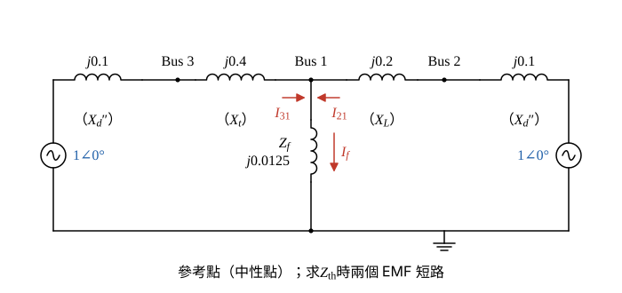

# 114 年電力系統第 4 題｜經故障阻抗之三相短路

## 已知與所求

匯流排 3 發電機 \(X_d''=j0.1\)，經變壓器 \(jX_t=j0.4\) 至匯流排 1；匯流排 1–2 線路 \(jX_L=j0.2\)；匯流排 2 發電機 \(X_d''=j0.1\)。無載、電勢均為 \(1\angle0^\circ\) pu。匯流排 1 經 \(Z_f=j0.0125\) pu 三相短路。求（一）戴維寧阻抗與故障電流；（二）故障期間匯流排電壓與線路電流。

## 考場標準作答

**解題邏輯**：三相平衡故障只需正序網路。先把單線圖畫成每相電抗圖，從故障點 Bus 1 看入、所有 EMF 短路求戴維寧阻抗 \(Z_{th}\)，由「\(V^{(0)}\) 串 \(Z_{th}+Z_f\)」的單一迴路求 \(I_f\)；再回到原網路，以 \(V_1=I_fZ_f\) 及兩支路的 KVL 求線路電流與其餘匯流排電壓。共用前提：無載且 EMF 同相，故障前各匯流排電壓都等於 EMF，\(V^{(0)}=1\angle0^\circ\) pu。

### 步驟 1：畫正序電抗圖

- Bus 3 發電機：EMF \(1\angle0^\circ\) 串 \(jX_d''=j0.1\) 接 Bus 3；Bus 3 經變壓器 \(jX_t=j0.4\) 到 Bus 1。
- Bus 2 發電機：EMF \(1\angle0^\circ\) 串 \(jX_d''=j0.1\) 接 Bus 2；Bus 2 經線路 \(jX_L=j0.2\) 到 Bus 1。
- 故障：Bus 1 經 \(Z_f=j0.0125\) 接到參考點（中性點）。
- 電流參考方向：題圖未指定，取兩支路電流都「流向故障匯流排 1」。

### （一）戴維寧阻抗與故障電流（10 分）

**邏輯**：戴維寧定理——EMF 短路後 Bus 1 看入是左、右兩條支路並聯；開路電壓是故障前電壓 \(1\angle0^\circ\)，再串 \(Z_f\) 形成單一迴路求 \(I_f\)。

左支路（Bus 1 → 變壓器 → Bus 3 → 發電機 → 參考點）：
\[
Z_{左}=jX_t+jX_d''=j(0.4+0.1)=j0.50
\]
右支路（Bus 1 → 線路 → Bus 2 → 發電機 → 參考點）：
\[
Z_{右}=jX_L+jX_d''=j(0.2+0.1)=j0.30
\]
兩支路並聯：
\[
Z_{th}=\frac{Z_{左}Z_{右}}{Z_{左}+Z_{右}}=j\frac{0.50\times0.30}{0.50+0.30}=j\frac{0.15}{0.80}=j\frac{3}{16}
\]
\[
\boxed{Z_{th}=j\tfrac{3}{16}\approx j0.19\ \mathrm{pu}}
\]
故障電流（戴維寧電源串 \(Z_{th}\) 與 \(Z_f\)）：
\[
I_f=\frac{V^{(0)}}{Z_{th}+Z_f}
\]
分母以完整精度相加：
\[
Z_{th}+Z_f=j\left(\frac{3}{16}+0.0125\right)=j(0.1875+0.0125)=j0.20
\]
\[
I_f=\frac{1\angle0^\circ}{j0.20}=\frac{1}{0.20}\angle-90^\circ=5.00\angle-90^\circ
\]
\[
\boxed{I_f=-j5.00\ \mathrm{pu}}
\]

### （二）故障期間的匯流排電壓與線路電流（10 分）

**邏輯**：Bus 1 經 \(Z_f\) 接地，其電壓就是 \(I_f\) 在 \(Z_f\) 上的壓降；每條支路兩端分別是 EMF \(1\angle0^\circ\) 與 \(V_1\)，支路電流 = 電壓差 ÷ 支路阻抗；Bus 3、Bus 2 電壓再由 EMF 減發電機電抗壓降求得。

**Bus 1 電壓**：
\[
V_1=I_fZ_f=(-j5.00)(j0.0125)=5.00\times0.0125\times(-j)(j)=0.0625
\]
\[
\boxed{V_1=\tfrac{1}{16}=0.0625\ \mathrm{pu}}
\]

**線路電流**：題圖未指定線路電流正方向；以下定義 \(I_{31}\) 為匯流排 3 經變壓器流向故障匯流排 1，\(I_{21}\) 為匯流排 2 經線路流向匯流排 1（見圖 1）。兩支路兩端電壓差相同：
\[
1-V_1=1-\frac{1}{16}=\frac{15}{16}\approx0.94
\]
左支路：
\[
I_{31}=\frac{1-V_1}{Z_{左}}=\frac{15/16}{j0.50}=\frac{15}{16}\times\frac{1}{0.50}\angle-90^\circ=-j\frac{15}{8}
\]
右支路：
\[
I_{21}=\frac{1-V_1}{Z_{右}}=\frac{15/16}{j0.30}=\frac{15}{16}\times\frac{1}{0.30}\angle-90^\circ=-j\frac{25}{8}
\]
\[
\boxed{I_{31}=-j1.88\ \mathrm{pu}},\qquad \boxed{I_{21}=-j3.13\ \mathrm{pu}}
\]
若採由故障點向外為正方向，則 \(I_{13}=+j1.88\) pu、\(I_{12}=+j3.13\) pu，只是參考方向反轉。

**Bus 3、Bus 2 電壓**（EMF 減發電機電抗壓降）：

發電機電抗壓降：
\[
(j0.1)I_{31}=(j0.1)\left(-j\tfrac{15}{8}\right)=\frac{1.5}{8}=\frac{3}{16},\qquad
(j0.1)I_{21}=(j0.1)\left(-j\tfrac{25}{8}\right)=\frac{2.5}{8}=\frac{5}{16}
\]
\[
V_3=1-\frac{3}{16}=\frac{13}{16}\Rightarrow\boxed{V_3=0.81\ \mathrm{pu}}
\]
\[
V_2=1-\frac{5}{16}=\frac{11}{16}\Rightarrow\boxed{V_2=0.69\ \mathrm{pu}}
\]
（三個電壓皆為 \(\angle0^\circ\)；純電抗網路且 EMF 同相，各量同相。）

## 驗算

- KCL：\(I_{31}+I_{21}=-j\dfrac{15}{8}-j\dfrac{25}{8}=-j5.00=I_f\)。
- 沿支路 KVL：\(V_3-V_1=(j0.4)\left(-j\frac{15}{8}\right)=\frac{3}{4}=0.75=\frac{13}{16}-\frac{1}{16}\)；\(V_2-V_1=(j0.2)\left(-j\frac{25}{8}\right)=\frac{5}{8}=0.625=\frac{11}{16}-\frac{1}{16}\)。
- 疊加法：\(\Delta V_i=-Z_{i1}I_f\)，\(Z_{11}=j\dfrac{3}{16}\) 給出 \(V_1=1-\dfrac{3}{16}\times5=1-\dfrac{15}{16}=0.0625\)，與上同。

## 失分點

- 漏掉左側變壓器 \(j0.4\)，左支路誤用 \(j0.1\)，\(Z_{th}\) 與 \(I_f\) 全部錯誤。
- 有 \(Z_f\) 時 \(V_1\neq0\)；直接令 \(V_1=0\) 會使兩支路電流都偏大。
- 未先宣告方向就混用 \(I_{31}\) 與 \(I_{13}\)，答案會差一個負號。
