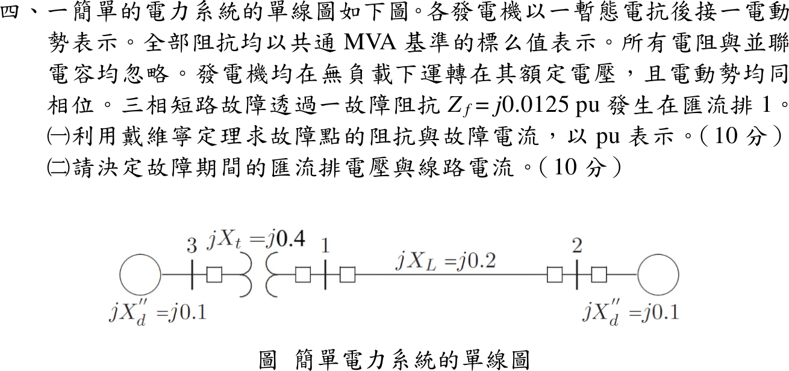

# 114 年電力系統第 4 題｜經故障阻抗之三相短路

## 已知與所求

匯流排 3 發電機 \(X_d''=j0.1\)，經變壓器 \(jX_t=j0.4\) 至匯流排 1；匯流排 1–2 線路 \(jX_L=j0.2\)；匯流排 2 發電機 \(X_d''=j0.1\)。無載、電勢均為 \(1\angle0^\circ\) pu。匯流排 1 經 \(Z_f=j0.0125\) pu 三相短路。求（一）戴維寧阻抗與故障電流；（二）故障期間匯流排電壓與線路電流。

## 考場標準作答

### （一）戴維寧阻抗與故障電流

觀念：戴維寧定理——從故障點 Bus 1 看入，所有電源（EMF）短路後得等效阻抗 \(Z_{th}\)，開路電壓為故障前電壓 \(1\angle0^\circ\)；故障電流由戴維寧電源串 \(Z_{th}\)、\(Z_f\) 的單一迴路決定。畫法：把兩個發電機 EMF 短路接地，從 Bus 1 向左是 Bus 3 發電機串變壓器，向右是線路串 Bus 2 發電機，兩支路並聯。

\[
Z_{左}=j(0.1+0.4)=j0.5,\qquad Z_{右}=j(0.2+0.1)=j0.3
\]
\[
Z_{th}=Z_{左}\parallel Z_{右}=j\frac{0.5\times0.3}{0.5+0.3}=j\frac{0.15}{0.8}
\]
\[
\boxed{Z_{th}=j\frac{3}{16}=j0.19\ \mathrm{pu}}
\]
\[
I_f=\frac{1\angle0^\circ}{Z_{th}+Z_f}=\frac{1}{j\left(\frac{3}{16}+0.0125\right)}=\frac{1}{j0.2}
\]
（分母以完整精度相加為 \(j0.2\)。）
\[
\boxed{I_f=-j5.00\ \mathrm{pu}}
\]

### （二）匯流排電壓與線路電流

觀念：故障期間 Bus 1 電壓就是故障電流流過 \(Z_f\) 的壓降；兩支路電流由「發電機 EMF 減 Bus 1 電壓」除以該支路阻抗，其餘匯流排電壓再由 EMF 減發電機電抗壓降求得。

\[
V_1=I_fZ_f=(-j5.00)(j0.0125)=5.00\times0.0125
\]
\[
\boxed{V_1=6.25\times10^{-2}\ \mathrm{pu}}
\]
題圖未指定線路電流正方向；以下定義 \(I_{31}\) 為匯流排 3 經變壓器流向故障匯流排 1，\(I_{21}\) 為匯流排 2 經線路流向匯流排 1。支路電壓：\(1-V_1=\dfrac{15}{16}=0.94\)，故
\[
I_{31}=\frac{1-V_1}{j0.5}=\frac{15/16}{j0.5}=-j\frac{15}{8},\qquad
I_{21}=\frac{1-V_1}{j0.3}=\frac{15/16}{j0.3}=-j\frac{25}{8}
\]
\[
\boxed{I_{31}=-j1.88\ \mathrm{pu}},\qquad \boxed{I_{21}=-j3.13\ \mathrm{pu}}
\]
若採由故障點向外為正方向，則 \(I_{13}=+j1.88\) pu、\(I_{12}=+j3.13\) pu，只是參考方向反轉。

發電機端匯流排電壓，先算發電機電抗上的壓降：\((j0.1)I_{31}=(j0.1)\left(-j\frac{15}{8}\right)=\frac{3}{16}=0.19\)、\((j0.1)I_{21}=(j0.1)\left(-j\frac{25}{8}\right)=\frac{5}{16}=0.31\)。
\[
V_3=1-0.19=\boxed{0.81\ \mathrm{pu}},\qquad V_2=1-0.31=\boxed{0.69\ \mathrm{pu}}
\]

## 驗算

- KCL：\(I_{31}+I_{21}=-j\dfrac{15}{8}-j\dfrac{25}{8}=-j5.00=I_f\)。
- 沿支路 KVL：\(V_3-V_1=(j0.4)\left(-j\frac{15}{8}\right)=0.75=0.81-0.06\)；\(V_2-V_1=(j0.2)\left(-j\frac{25}{8}\right)=\frac{5}{8}=0.63=0.69-0.06\)。
- 疊加法：\(\Delta V_i=-Z_{i1}I_f\)，\(Z_{11}=j\dfrac{3}{16}\) 給出 \(V_1=1-\dfrac{3}{16}\times5=1-\dfrac{15}{16}=6.25\times10^{-2}\)，與上同。

## 失分點

- 漏掉左側變壓器 \(j0.4\)，左支路誤用 \(j0.1\)，\(Z_{th}\) 與 \(I_f\) 全部錯誤。
- 有 \(Z_f\) 時 \(V_1\neq0\)；直接令 \(V_1=0\) 會使兩支路電流都偏大。
- 未先宣告方向就混用 \(I_{31}\) 與 \(I_{13}\)，答案會差一個負號。
