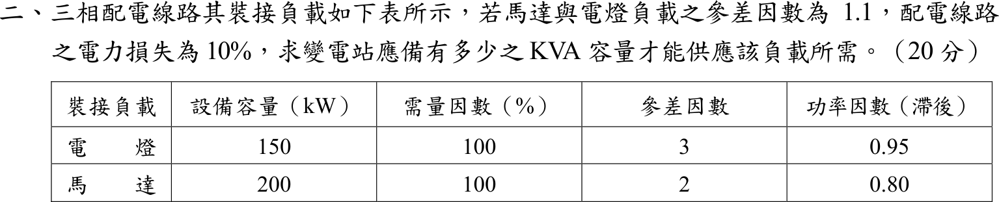
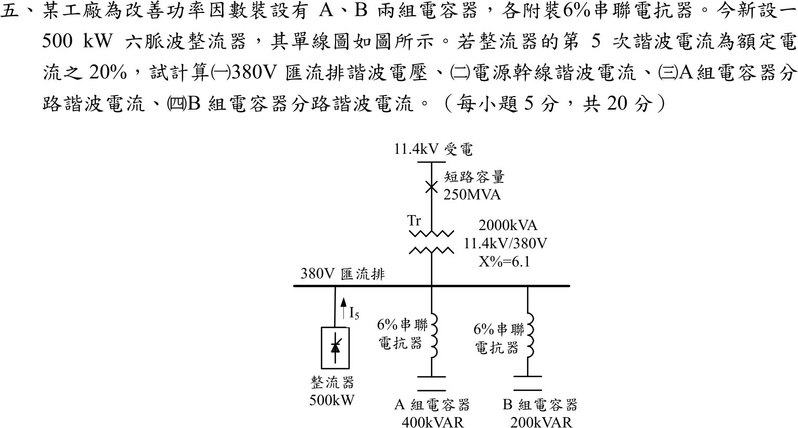

# 104 年電機工程技師｜工業配電逐題詳解

> 本頁由題級 canonical 筆記組合；每題保留官方裁切圖、校驗狀態與可追溯的推導。

## 題目導覽
- [[#一、104 年第 1 題｜供電方式與責任分界（規章版校驗）|第 1 題：供電方式與責任分界（規章版校驗）]]
- [[#二、104 年工業配電第 2 題｜參差因數與線路損失容量設計|第 2 題：參差因數與線路損失容量設計]]
- [[#三、104 年工業配電第 3 題｜電弧爐熔化期電壓變動|第 3 題：電弧爐熔化期電壓變動]]
- [[#四、104 年工業配電第 4 題｜短路容量與對稱成分等效阻抗|第 4 題：短路容量與對稱成分等效阻抗]]
- [[#五、104 年工業配電第 5 題｜六脈波整流器第 5 次諧波|第 5 題：六脈波整流器第 5 次諧波]]

---

## 一、104 年第 1 題｜供電方式與責任分界（規章版校驗）

> 題級識別：EE-104-06-1
> canonical 來源：[[canonical/EE-104-06-1.md]]
> 題級校驗狀態：verified

### 已知與所求

（一）說明台電高壓及特高壓用戶的供電方式，以及供電方式依什麼決定（16 分）；（二）說明責任分界點（4 分）。

### 考場標準作答

#### （一）供電方式與決定因素（16 分）

供電方式包括供電電壓等級與線路型式（一般／專用、單回／雙回），電壓分類如下：

| 類別 | 常見電壓（三相三線） | 用戶端設備 |
| --- | --- | --- |
| 高壓 | 11.4 kV、22.8 kV（部分地區 3.3 kV） | 自備受電站與主變壓器，降至 380／220 V 或其他利用電壓 |
| 特高壓 | 69 kV、161 kV 以上 | 自備變電所（一次變電），多採專用線路 |

供電方式由下列條件綜合核定，非單看一個容量門檻（門檻數值隨規章版本改變）：

1. **契約容量與最大需量**：容量愈大，愈需提高供電電壓或設專用線路。
2. **負載特性**：大型馬達啟動、電弧爐等衝擊負載，以及功率因數、電壓變動、諧波要求，可能須提高電壓等級或設專用饋線。
3. **供電地區與系統條件**：附近線路電壓與容量、短路容量、路權、工程成本與期程。
4. **可靠度需求**：單路、雙路、備用或二次側經常並聯等，由供電契約與核准圖說載明。

\[
\boxed{\text{供電方式}=f(\text{契約容量、負載特性、地區系統條件、可靠度})}
\]

#### （二）責任分界點（4 分）

責任分界點是台電供電設備與用戶用電設備在**所有權、操作維護與事故責任**上的界面：上游（電源側）由台電負責，下游（負載側）由用戶負責，並須設置可安全隔離的開關設備。實際位置依供電契約與核准單線圖而定，常見於引接線終端、受電站進線開關或計量設備端子。

\[
\boxed{\text{責任分界點}=\text{台電與用戶設備在所有權、操作維護與事故責任上的界面}}
\]

### 驗算

以功因 0.90 概估線電流 \(I=P/(\sqrt3V_{LL}\mathrm{PF})\)，歷史參考門檻（11.4 kV、5,000 kW；22.8 kV、10,000 kW）對應的電流相同：
\[
\frac{5000}{\sqrt3(11.4)(0.90)}=\frac{10000}{\sqrt3(22.8)(0.90)}=281.36\ \mathrm{A}
\]
可見提高電壓等級是為了讓線路電流與電壓降維持在可供電範圍，與「容量、負載特性」決定供電方式的敘述一致。

### 失分點

- 只列電壓等級而未說明「契約容量、負載特性、地區條件、可靠度」才是決定因素。
- 把責任分界點寫成固定的「電表位置」，未說明以契約與核准圖說為準，也未交代上、下游的責任歸屬。

### 條件與疑義

本題屬規章申論，容量門檻隨公告版本、地區網路與特殊負載條款變動，不可脫離當年度規章硬套；分界點的實際位置因供電方式與契約而異。因此作答採規章中性答案，不寫唯一的門檻數字或位置。

---

## 二、104 年工業配電第 2 題｜參差因數與線路損失容量設計

> 題級識別：EE-104-06-2
> canonical 來源：[[canonical/EE-104-06-2.md]]
> 題級校驗狀態：needs_manual_review
> [!WARNING] 本題仍有官方資料缺口或事件定義歧義；請以 canonical 條件式解答為準。

### 已知與所求

三相配電線路，馬達與電燈負載間參差因數 \(1.1\)，配電線路電力損失 \(10\%\)。裝接負載表：

| 負載 | 設備容量 | 需量因數 | 參差因數 | 功因（滯後） |
| --- | --- | --- | --- | --- |
| 電燈 | 150 kW | 100% | 3 | 0.95 |
| 馬達 | 200 kW | 100% | 2 | 0.80 |

求變電站應備 kVA 容量（20 分）。

### 考場標準作答

#### 步驟 1：各類負載的最大需量

表內參差因數 3、2 為各類負載內部的參差因數（個別最大需量和 ÷ 群組同時最大需量），類別最大需量：
\[
P=\frac{P_{inst}\times DF}{F_d}
\]
電燈（150 kW、需量因數 100%、參差因數 3、功因 0.95）：
\[
P_L=\frac{150\times1.0}{3}=50\ \mathrm{kW}
\]
\[
\tan(\cos^{-1}0.95)=\frac{\sqrt{1-0.95^2}}{0.95}=\frac{0.31225}{0.95}=0.32868
\]
\[
Q_L=P_L\tan(\cos^{-1}0.95)=50\times0.32868=16.434\ \mathrm{kvar}
\]
馬達（200 kW、需量因數 100%、參差因數 2、功因 0.80）：
\[
P_M=\frac{200\times1.0}{2}=100\ \mathrm{kW}
\]
\[
\tan(\cos^{-1}0.80)=\frac{0.60}{0.80}=0.75
\]
\[
Q_M=P_M\tan(\cos^{-1}0.80)=100\times0.75=75\ \mathrm{kvar}
\]

#### 步驟 2：兩類需量的複數功率和

兩類功因不同，\(P\)、\(Q\) 分別相加再取 \(|S|\)：
\[
P_{sum}=P_L+P_M=50+100=150\ \mathrm{kW}
\]
\[
Q_{sum}=Q_L+Q_M=16.434+75=91.434\ \mathrm{kvar}
\]
大小：
\[
S_{sum}=\sqrt{P_{sum}^2+Q_{sum}^2}=\sqrt{150^2+91.434^2}=\sqrt{22\,500+8360.2}=\sqrt{30\,860.2}=175.671\ \mathrm{kVA}
\]
角度（合成功因）：
\[
\theta=\tan^{-1}\frac{91.434}{150}=31.36^\circ,\qquad \cos\theta=\frac{150}{175.671}=0.8539
\]

#### 變電站應備 kVA 容量（20 分）

兩類之間的同時最大需量（保留 6 位有效數字，避免最後一位進位誤差）：
\[
S_{coin}=\frac{S_{sum}}{F_{d,LM}}=\frac{175.671}{1.1}=159.701\ \mathrm{kVA}
\]
線路損失 10% 取變電站輸出的 10%，負載只得到輸出的 90%，計入線路損失：
\[
S_{sub}=\frac{S_{coin}}{1-0.10}=\frac{159.701}{0.90}=177.446\ \mathrm{kVA}
\]
\[
\boxed{S_{sub}=177.45\ \mathrm{kVA}}
\]
選用時向上取標準容量（例如 200 kVA）。

### 驗算

分別算 kW 與 kvar（\(1.1\times0.90=0.99\)）：\(P=150/0.99=151.52\ \mathrm{kW}\)，\(Q=91.434/0.99=92.358\ \mathrm{kvar}\)，\(\sqrt{151.52^2+92.358^2}=177.45\ \mathrm{kVA}\)，與主解相同。
上限檢查：各類 kVA 直接相加 \((50/0.95+100/0.80)/0.99=(52.632+125)/0.99=179.43\ \mathrm{kVA}\) 大於 177.45，符合「相量和不大於算術和」。

### 失分點

- 漏用表內參差因數 3 與 2、以 350 kW 的設備容量直接計算，會得 406.84 kVA，為正確值的 2.29 倍。
- 將電燈與馬達的 kVA 以算術和相加（\(50/0.95+100/0.80\)，再除 \(1.1\times0.90\) 得 179.43 kVA），忽略兩者功因角不同，結果偏大。
- 1.1 是參差因數，須除而非乘；誤乘會得 \(175.671\times1.1/0.90=214.71\ \mathrm{kVA}\)，反而偏大。

### 條件與疑義

1. 題目未定義表內「參差因數 3、2」；本解採通用定義：參差因數 \(=\) 各負載最大需量總和 \(\div\) 該群同時最大需量，故表內值為各類負載內部的參差因數，1.1 為電燈與馬達兩群之間的參差因數。
2. 「電力損失 10%」未說明分母。本解取變電站輸出的 10%（\(\div0.90\)）；若指負載端需量的 10%（\(\times1.1\)），則為 \(159.701\times1.1=175.67\ \mathrm{kVA}\)。

---

## 三、104 年工業配電第 3 題｜電弧爐熔化期電壓變動

> 題級識別：EE-104-06-3
> canonical 來源：[[canonical/EE-104-06-3.md]]
> 題級校驗狀態：verified

### 已知與所求

30 噸煉鋼電弧爐；主變壓器 \(15\,\mathrm{MVA}\)、\(X=6.7\%\)、\(69/11.4\,\mathrm{kV}\)；爐用變壓器 \(12.5\,\mathrm{MVA}\)、\(X=6.1\%\)，二次側以下電抗 \(44\%\)。69 kV 饋線 477 MCM 鋁線、\(0.131+j0.405\,\Omega/\mathrm{km}\)、長 430 m；電源端短路容量 \(1230\,\mathrm{MVA}\)。熔化期電弧爐電阻在爐變一次側量測為 \(0\sim10\,\Omega\)。求熔化期電壓變動百分標么值。

### 考場標準作答

#### 步驟 1：共同基準

設電源電動勢固定為 \(E=1\angle0^\circ\,\mathrm{pu}\)，忽略電弧爐以外的負載電流；饋線上其他用戶未給負載資料，不納入模型；「30 噸」「477 MCM 鋁線」不參與計算。取主變容量 \(S_b=15\,\mathrm{MVA}\)，阻抗基準 \(Z_b=V_b^2/S_b\)：
\[
Z_{b,69}=\frac{69^2}{15}=\frac{4761}{15}=317.4\,\Omega
\]
\[
Z_{b,11.4}=\frac{11.4^2}{15}=\frac{129.96}{15}=8.664\,\Omega
\]

（本題兩個電壓相減，差值只有約 0.088；此計算鏈的四捨五入中間值保留 5 位有效數字，4 位會使結果末位差 0.01。）

#### 步驟 2：上游阻抗 \(Z_{up}\)

線路長 430 m \(=0.43\,\mathrm{km}\)：
\[
Z_{line}=0.43(0.131+j0.405)=0.05633+j0.17415\,\Omega
\]
換成標么（69 kV 基準）：
\[
R_{line}=\frac{0.05633}{317.4}=1.7747\times10^{-4}\ \mathrm{pu}
\]
\[
X_{line}=\frac{0.17415}{317.4}=5.4868\times10^{-4}\ \mathrm{pu}
\]
電源電抗由短路容量換算：
\[
X_S=\frac{S_b}{S_{sc}}=\frac{15}{1230}=0.012195\ \mathrm{pu}
\]
主變 15 MVA 與 \(S_b\) 相同，直接取 \(X_{T1}=0.067\ \mathrm{pu}\)。電阻只有線路有（電源與主變只給電抗）：
\[
R_{up}=R_{line}=1.7747\times10^{-4}\ \mathrm{pu}
\]
電抗三者串聯：
\[
X_{up}=X_{line}+X_S+X_{T1}=5.4868\times10^{-4}+0.012195+0.067=0.079744\ \mathrm{pu}
\]
\[
Z_{up}=R_{up}+jX_{up}=1.7747\times10^{-4}+j0.079744\ \mathrm{pu}
\]

#### 步驟 3：爐側阻抗 \(X_{down}\) 與 \(R_{pu}\)

爐變漏抗 6.1% 與其二次側以下電抗 44% 都在 12.5 MVA 基準，先相加再換到 15 MVA：
\[
X_{down}=(0.061+0.44)\frac{15}{12.5}=0.501(1.2)=0.6012\ \mathrm{pu}
\]
電弧電阻在爐變一次側（11.4 kV）量測，用 \(Z_{b,11.4}\) 換算：
\[
R_{pu}=\frac{R}{Z_{b,11.4}}=\frac{R}{8.664}
\]
\[
R=0:\ R_{pu}=0,\qquad R=10\,\Omega:\ R_{pu}=\frac{10}{8.664}=1.1542\ \mathrm{pu}
\]

畫法：電源 \(E\) 左側，上方導線串 \(R_{up}\)、\(jX_{up}\) 到 11.4 kV 匯流排；匯流排對回路線接 \(R_{pu}\)（可變）串 \(jX_{down}\)；量測電壓 \(V\) 取匯流排對回路線。

#### 熔化期電壓變動（20 分）

電壓變動為電弧電阻由 0 變到 10 Ω 時，爐變一次側（11.4 kV）匯流排電壓大小之差。分壓公式（\(E=1\)）：
\[
|V(R)|=\frac{|R_{pu}+jX_{down}|}{|Z_{up}+R_{pu}+jX_{down}|}
\]

\(R=0\)：分母的實部與虛部
\[
Z_{up}+jX_{down}=1.7747\times10^{-4}+j(0.079744+0.6012)=1.7747\times10^{-4}+j0.68094
\]
\[
|Z_{up}+jX_{down}|=\sqrt{(1.7747\times10^{-4})^2+0.68094^2}=0.68094
\]
\[
|V(0)|=\frac{0.6012}{0.68094}=0.88290\ \mathrm{pu}
\]

\(R=10\,\Omega\)：分子
\[
|1.1542+j0.6012|=\sqrt{1.1542^2+0.6012^2}=\sqrt{1.3322+0.36144}=1.3014
\]
分母的實部與虛部
\[
Z_{up}+R_{pu}+jX_{down}=(1.7747\times10^{-4}+1.1542)+j0.68094=1.1544+j0.68094
\]
\[
|1.1544+j0.68094|=\sqrt{1.1544^2+0.68094^2}=\sqrt{1.3326+0.46368}=1.3403
\]
\[
|V(10)|=\frac{1.3014}{1.3403}=0.97098\ \mathrm{pu}
\]

電壓變動：
\[
\Delta V=|V(10)|-|V(0)|=0.97098-0.88290=0.08808\ \mathrm{pu}
\]
\[
\boxed{\Delta V=8.81\%}
\]

### 驗算

歐姆法（全部在 11.4 kV 側，乘 \(Z_{b,11.4}=8.664\,\Omega\)）：\(Z_{up}=1.5376\times10^{-3}+j0.69090\,\Omega\)，\(X_{down}=5.2088\,\Omega\)。
\[
|V(0)|=\frac{5.2088}{|1.5376\times10^{-3}+j5.8997|}=\frac{5.2088}{5.8997}=0.88289
\]
\[
|V(10)|=\frac{|10+j5.2088|}{|10.0015+j5.8997|}=\frac{11.275}{11.612}=0.97098
\]
差值 \(0.08809\ \mathrm{pu}=8.81\%\)，與標么法一致。忽略線路電阻只取 \(jX_{up}\) 時 \(\Delta V=8.82\%\)，相差 0.01 個百分點，線路電阻影響可忽略但保留較完整。

### 失分點

- 430 m 未換成 0.43 km；短路容量 1230 MVA 直接當阻抗，未用 \(X=S_b/S_{sc}\)。
- 44% 與 6.1% 只取其一；兩者皆為爐用變壓器（12.5 MVA）基準，須同乘 \(15/12.5\) 後相加。
- 10 Ω 以 69 kV 側基準換算，或只比較電壓的實部而未取大小。

### 條件與疑義

量測點取爐變一次側（主變 11.4 kV 側）匯流排；電源視為理想電壓源串聯短路電抗，忽略電弧爐以外的負載電流；電壓變動定義為 \(R=10\,\Omega\) 與 \(R=0\) 兩端的電壓大小差。電抗與電阻依題意視為「44% 在爐變二次側以下」且「電阻在爐變一次側量測」，若改以 44% 已含爐變漏抗，結果會不同（約 10.41%）。

題幹提到 69 kV 饋線上尚有其他用戶，若改以 69 kV 受電點（公共耦合點，電源電抗之後、線路之前）計算，\(|V(0)|=0.9821\)、\(|V(10)|=0.9954\)，\(\Delta V\approx1.33\%\)。本解取 11.4 kV 匯流排為主解，因為電弧電阻在爐用變壓器一次側量測，該匯流排即爐變供電點，也是電弧爐電壓閃爍最直接的量測位置。

---

## 四、104 年工業配電第 4 題｜短路容量與對稱成分等效阻抗

> 題級識別：EE-104-06-4
> canonical 來源：[[canonical/EE-104-06-4.md]]
> 題級校驗狀態：verified

### 已知與所求

供電電壓 \(22.8\,\mathrm{kV}\)，三相短路容量 \(448\,\mathrm{MVA}\)，單相（接地）短路容量 \(470\,\mathrm{MVA}\)；電阻忽略。求正序、負序、零序等效阻抗。

### 考場標準作答

#### 步驟 1：故障容量與序網路的關係

設電阻忽略、故障前無載、電源電壓為額定 22.8 kV、故障阻抗為零，各序阻抗 \(Z_k=jX_k\)；以下推導用電抗大小 \(X_k\)，框答寫成 \(Z_k=jX_k\)。

- 三相短路：電源相電壓 \(V_\phi\) 只接正序電抗 \(jX_1\) 後短路，\(I_{3\phi}=V_\phi/X_1\)（大小）。
- 單相接地短路：正、負、零序網路首尾串聯，\(I_{a1}=I_{a2}=I_{a0}=V_\phi/(X_1+X_2+X_0)\)，故障電流 \(I_f=3I_{a0}\)。

三相短路容量（\(V_\phi=V_{LL}/\sqrt3\)）：
\[
S_{3\phi}=\sqrt3\,V_{LL}I_{3\phi}=\sqrt3\,V_{LL}\cdot\frac{V_{LL}}{\sqrt3\,X_1}=\frac{V_{LL}^2}{X_1}
\]
單相短路容量：
\[
S_{1\phi}=\sqrt3\,V_{LL}I_f=\sqrt3\,V_{LL}\cdot\frac{3V_{LL}/\sqrt3}{X_1+X_2+X_0}=\frac{3V_{LL}^2}{X_1+X_2+X_0}
\]
共用的電壓平方（kV 與 MVA 相除得 Ω）：
\[
V_{LL}^2=22.8^2=519.84\ \mathrm{kV^2}
\]

#### 正序與負序阻抗

供電網路為靜止元件，正、負序阻抗相同 \(Z_2=Z_1\)：
\[
X_1=\frac{V_{LL}^2}{S_{3\phi}}=\frac{519.84}{448}=1.1604\ \Omega
\]
\[
\boxed{Z_1=Z_2=j1.16\ \Omega}
\]

#### 零序阻抗

三序電抗和：
\[
X_1+X_2+X_0=\frac{3V_{LL}^2}{S_{1\phi}}=\frac{3\times519.84}{470}=\frac{1559.52}{470}=3.3181\ \Omega
\]
正序與負序合計：
\[
X_1+X_2=2\times1.1604=2.3208\ \Omega
\]
零序電抗：
\[
X_0=3.3181-2.3208=0.9973\ \Omega
\]
\[
\boxed{Z_0=j1.00\ \Omega}
\]

### 驗算

故障電流反推容量：\(V_\phi=22.8/\sqrt3=13.164\ \mathrm{kV}\)，\(I_{a0}=13.164/3.3181=3.9673\ \mathrm{kA}\)，\(I_f=3\times3.9673=11.902\ \mathrm{kA}\)，\(S_{1\phi}=\sqrt3\times22.8\times11.902=470.02\ \mathrm{MVA}\)，與題給 470 MVA 一致。

標么法（\(S_b=100\,\mathrm{MVA}\)、\(Z_b=22.8^2/100=5.1984\,\Omega\)）：\(X_1=100/448=0.22321\ \mathrm{pu}\)，\(X_0=300/470-2\times0.22321=0.63830-0.44642=0.19188\ \mathrm{pu}\)；換回歐姆 \(X_1=0.22321\times5.1984=1.1603\,\Omega\)、\(X_0=0.19188\times5.1984=0.9975\,\Omega\)，與歐姆法一致。

### 失分點

- 單相短路容量漏掉因數 3（寫成 \(V^2/S_{1\phi}\)），會得 \(X_1+X_2+X_0=1.11\,\Omega<2X_1=2.32\,\Omega\)，零序為負值，不合理。
- 把三相短路容量用 \(V_{LL}^2/S\) 時誤用相電壓。
- 忘記負序阻抗等於正序，只扣一次 \(X_1\)。

### 條件與疑義

單相短路容量依 \(S_{1\phi}=\sqrt3V_{LL}I_f\) 定義，其中 \(I_f\) 為單相接地短路電流。

---

## 五、104 年工業配電第 5 題｜六脈波整流器第 5 次諧波

> 題級識別：EE-104-06-5
> canonical 來源：[[canonical/EE-104-06-5.md]]
> 題級校驗狀態：needs_manual_review
> [!WARNING] 本題仍有官方資料缺口或事件定義歧義；請以 canonical 條件式解答為準。

### 已知與所求

380 V 匯流排；電源 11.4 kV、短路容量 \(250\,\mathrm{MVA}\)；變壓器 \(2000\,\mathrm{kVA}\)、\(11.4\,\mathrm{kV}/380\,\mathrm V\)、\(X=6.1\%\)；A 組電容器 \(400\,\mathrm{kvar}\)、B 組 \(200\,\mathrm{kvar}\)，各串聯 6% 電抗器；新設 500 kW 六脈波整流器，第 5 次諧波電流為額定電流的 20%。求（一）匯流排諧波電壓、（二）電源幹線諧波電流、（三）A 組、（四）B 組分路諧波電流（各 5 分）。

基準分支（題目未給功因與效率，詳見「條件與疑義」）：500 kW 為 AC 側有功輸入、\(\mathrm{pf}_1=1\)，電阻忽略。

### 考場標準作答

#### 步驟 1：標么基準

電阻忽略。取 \(S_b=2\,\mathrm{MVA}\)（變壓器額定）、\(V_b=380\,\mathrm V\)：
\[
I_b=\frac{S_b}{\sqrt3\,V_b}=\frac{2\times10^6}{\sqrt3(380)}=3038.69\ \mathrm A
\]

#### 步驟 2：各支路的第 5 次諧波阻抗

電源短路阻抗（\(S_{sc}=250\,\mathrm{MVA}\)）：
\[
X_s=\frac{S_b}{S_{sc}}=\frac{2}{250}=0.008\ \mathrm{pu}
\]
變壓器 \(X_T=6.1\%=0.061\ \mathrm{pu}\)（額定即基準，不必換算）。兩者串聯：
\[
X_s+X_T=0.008+0.061=0.069\ \mathrm{pu}
\]
\[
Z_{up,5}=j\,h(X_s+X_T)=j\,5(0.069)=j0.345\ \mathrm{pu}
\]
A 組電容器與 6% 串聯電抗器（\(X_{L}=0.06X_C\)）：
\[
X_{C,A}=\frac{S_b}{Q_A}=\frac{2}{0.4}=5\ \mathrm{pu},\qquad X_{L,A}=0.06(5)=0.3\ \mathrm{pu}
\]
\[
Z_{A,5}=j\left(hX_{L,A}-\frac{X_{C,A}}{h}\right)=j\left(5(0.3)-\frac{5}{5}\right)=j(1.5-1)=j0.5\ \mathrm{pu}
\]
B 組：
\[
X_{C,B}=\frac{S_b}{Q_B}=\frac{2}{0.2}=10\ \mathrm{pu},\qquad X_{L,B}=0.06(10)=0.6\ \mathrm{pu}
\]
\[
Z_{B,5}=j\left(hX_{L,B}-\frac{X_{C,B}}{h}\right)=j\left(5(0.6)-\frac{10}{5}\right)=j(3-2)=j1\ \mathrm{pu}
\]
兩組在第 5 次都是 \(hX_L>X_C/h\)，為淨感性，三條支路阻抗同為 \(+j\)。

#### 步驟 3：整流器注入的第 5 次電流

500 kW 取為 AC 側有功輸入，額定電流取 AC 側基波線電流（基準分支 \(\mathrm{pf}_1=1\)）：
\[
I_{1,\mathrm{AC}}=\frac{P}{\sqrt3\,V_{LL}}=\frac{500\times10^3}{\sqrt3(380)}=759.67\ \mathrm A
\]
\[
I_5=0.2\,I_{1,\mathrm{AC}}=0.2(759.67)=151.93\ \mathrm A
\]
換成標么（\(I_b\) 與 \(I_{1,\mathrm{AC}}\) 同用 \(\sqrt3(380)\)，比值為精確值）：
\[
I_5=\frac{0.2\times500\ \mathrm{kW}}{2000\ \mathrm{kVA}}=\frac{100}{2000}=0.05\ \mathrm{pu}\quad\Big(=\frac{151.93}{3038.69}\Big)
\]

#### 步驟 4：諧波等效電路與匯流排阻抗

- 整流器畫成電流源 \(I_5\)，由參考點注入 380 V 匯流排。
- 匯流排對參考點並聯三支路 \(Z_{up,5}\)、\(Z_{A,5}\)、\(Z_{B,5}\)；支路電流參考方向一律由匯流排流向參考點。
- 電源電動勢只含基波，對第 5 次諧波視為短路，所以電源支路下端接參考點。

三支路並聯，先加導納再取倒數（三者皆 \(+j\)，可直接以電抗值計算）：
\[
\frac1{Z_{bus,5}}=\frac1{j0.345}+\frac1{j0.5}+\frac1{j1}=-j\left(\frac1{0.345}+2+1\right)
\]
為了讓後續各行照字面對得上，改寫成精確分式：
\[
Z_{bus,5}=j\,\frac{1}{\dfrac1{0.345}+3}=j\,\frac{0.345}{1+3(0.345)}=j\,\frac{0.345}{2.035}=j0.169533\ \mathrm{pu}
\]

#### （一）380 V 匯流排諧波電壓（5 分）

\[
V_5=I_5\,|Z_{bus,5}|=0.05(0.169533)=0.0084767\ \mathrm{pu}
\]
\[
V_5=0.0084767\,V_b=0.0084767(380\ \mathrm V)=3.2211\ \mathrm V
\]
\(V_b=380\ \mathrm V\) 是線電壓基準，所得為第 5 次諧波**線間**電壓（相電壓 \(3.2211/\sqrt3=1.86\ \mathrm V\)）。
\[
\boxed{V_5=3.22\ \mathrm V}
\]

#### （二）電源幹線諧波電流（5 分）

\[
I_{up,5}=\frac{V_5}{|Z_{up,5}|}=\frac{0.0084767}{0.345}=0.024570\ \mathrm{pu}
\]
\[
I_{up,5}=0.024570\,I_b=0.024570(3038.69\ \mathrm A)
\]
\[
\boxed{I_{up,5}=74.66\ \mathrm A}
\]

#### （三）A 組電容器分路諧波電流（5 分）

\[
I_{A,5}=\frac{V_5}{|Z_{A,5}|}=\frac{0.0084767}{0.5}=0.0169534\ \mathrm{pu}
\]
\[
I_{A,5}=0.0169534\,I_b=0.0169534(3038.69\ \mathrm A)
\]
\[
\boxed{I_{A,5}=51.52\ \mathrm A}
\]

#### （四）B 組電容器分路諧波電流（5 分）

\[
I_{B,5}=\frac{V_5}{|Z_{B,5}|}=\frac{0.0084767}{1}=0.0084767\ \mathrm{pu}
\]
\[
I_{B,5}=0.0084767\,I_b=0.0084767(3038.69\ \mathrm A)
\]
\[
\boxed{I_{B,5}=25.76\ \mathrm A}
\]

三條支路在第 5 次均為感性，電流同相，大小可直接相加（見驗算）。

### 驗算

KCL：\(I_{up,5}+I_{A,5}+I_{B,5}=74.66+51.52+25.76=151.94\ \mathrm A\approx I_5=151.93\ \mathrm A\)（差 0.01 A 為各值兩位小數捨入）。
電流分配法：\(I_{A,5}=I_5\dfrac{|Z_{bus,5}|}{|Z_{A,5}|}=151.934\left(\dfrac{0.169533}{0.5}\right)=51.52\ \mathrm A\)，與（三）一致。

### 失分點

- 6% 串聯電抗器在第 5 次使 \(hX_L>X_C/h\)（A 組 \(5X_{L,A}=1.5>X_{C,A}/5=1\)），支路為淨感性 \(j0.5\ \mathrm{pu}\)；若把支路當純電容 \(-jX_C/5\)，符號與大小皆錯。
- 電源側阻抗須乘 \(h=5\)（\(0.069\to0.345\ \mathrm{pu}\)），且要含電源短路阻抗 \(X_s=0.008\ \mathrm{pu}\)，不可只用變壓器 \(X_T\)。
- 電流基準要用 380 V 側 \(I_b=3038.69\ \mathrm A\)；誤用 11.4 kV 側基準電流會小 30 倍（電壓比 \(11.4/0.38=30\)）。

### 條件與疑義

題目沒有說明 500 kW 是整流器 DC 輸出或 AC 側有功輸入，也未給基波功因 \(\mathrm{pf}_1\) 與效率 \(\eta\)，更未明定「額定電流」的分母是 AC 基波、AC 總 RMS 或 DC 額定電流。上列為「500 kW 為 AC 側有功、\(\mathrm{pf}_1=1\)」的基準分支。

500 kW 若為 DC 輸出，由 DC 功率反推的仍是 AC 輸入側線電流，不是 DC 電流：
\[
I_{L,\mathrm{AC,in}}^{(P_{DC})}=\frac{500\,\mathrm{kW}}{\eta\,\mathrm{pf}_1\sqrt3(380\,\mathrm V)},\qquad I_5=0.2I_{L,\mathrm{AC,in}}^{(P_{DC})}
\]
因網路與支路阻抗不變，所有四個輸出依同一比例縮放。（500 kW 為 AC 側有功時除以 \(\mathrm{pf}_1\)；為 DC 輸出時除以 \(\eta\,\mathrm{pf}_1\)。）令基準向量 \(\mathbf y_0=(|V_5|,|I_{up,5}|,|I_{A,5}|,|I_{B,5}|)=(3.2211,74.6606,51.5158,25.7579)\)，則
\[
\mathbf y=\frac{\mathbf y_0}{\mathrm{pf}_1}\ \ (\text{AC 側有功}),\qquad
\mathbf y=\frac{\mathbf y_0}{\eta\,\mathrm{pf}_1}\ \ (\text{DC 輸出})
\]
即所有輸出乘 \(1/\mathrm{pf}_1\) 或 \(1/(\eta\,\mathrm{pf}_1)\)。例：500 kW 為 AC 側有功、\(\mathrm{pf}_1=0.95\) 時為 \((3.3907\ \mathrm V,\,78.5901,\,54.2272,\,27.1136\ \mathrm A)\)；500 kW 為 DC 輸出、\(\eta=0.90\)、\(\mathrm{pf}_1=0.95\) 時為 \((3.7674\ \mathrm V,\,87.3223,\,60.2524,\,30.1262\ \mathrm A)\)。

另一個題面未定的量是電容器標示 kvar：本解取 \(X_C=V^2/Q_C\)；若 400／200 kvar 為串聯電抗器後的淨輸出（\(X_C-X_L=V^2/Q\)），\(Z_{A,5}=j0.5319\)、\(Z_{B,5}=j1.0638\)，基準分支的輸出約為 \(3.32\ \mathrm V\)、\(77.0\)、\(49.9\)、\(25.0\ \mathrm A\)。

因上述條件未唯一指定，維持人工複核。

---
