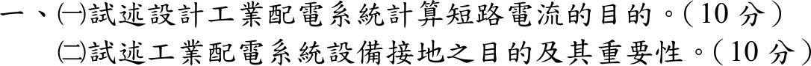
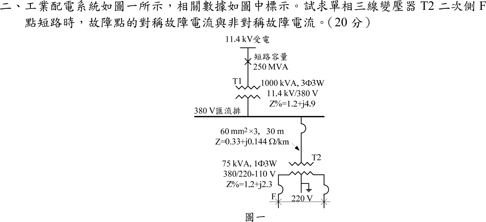
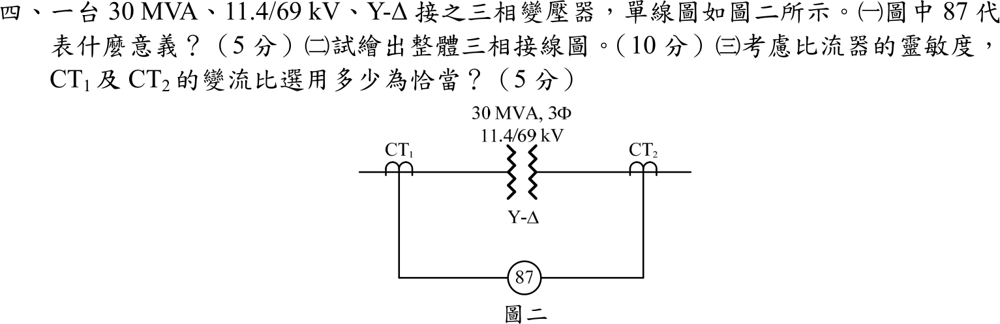
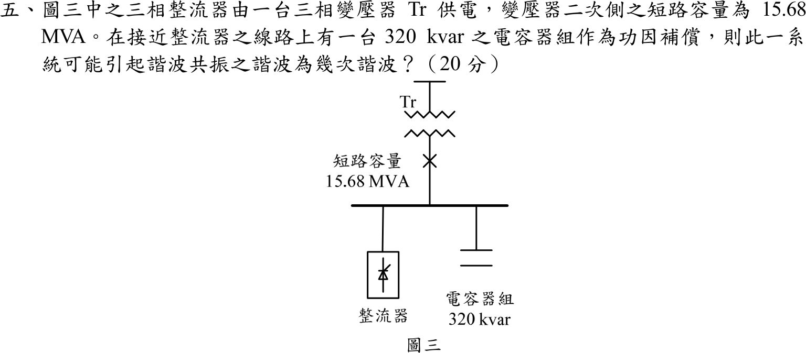

# 106 年電機工程技師｜工業配電逐題詳解

> 本頁由題級 canonical 筆記組合；每題保留官方裁切圖、校驗狀態與可追溯的推導。

## 題目導覽
- [[#一、106 年工業配電第 1 題｜短路電流計算與設備接地|第 1 題：短路電流計算與設備接地]]
- [[#二、106 年第 2 題｜單相三線變壓器 F 點短路（參考書主解）|第 2 題：單相三線變壓器 F 點短路（參考書主解）]]
- [[#三、106 年工業配電第 3 題｜三相變壓器組接線與分接頭選擇|第 3 題：三相變壓器組接線與分接頭選擇]]
- [[#四、106 年工業配電第 4 題｜Y–Δ 變壓器差動保護與 CT 比選定|第 4 題：Y–Δ 變壓器差動保護與 CT 比選定]]
- [[#五、106 年工業配電第 5 題｜電容器與系統諧波共振|第 5 題：電容器與系統諧波共振]]

---

## 一、106 年工業配電第 1 題｜短路電流計算與設備接地

> 題級識別：EE-106-06-1
> canonical 來源：[[canonical/EE-106-06-1.md]]
> 題級校驗狀態：verified



### 已知與所求

申論題，無數據。（一）試述設計工業配電系統計算短路電流的目的（10 分）；（二）試述設備接地之目的及其重要性（10 分）。

### 考場標準作答

**解題邏輯**：兩小題都是申論，作答主線是「這個計算／這個措施保護什麼、用在哪個設計決定」。（一）短路電流是選設備額定與整定保護的輸入：最大故障電流決定遮斷容量與熱、動穩定，最小故障電流決定保護能否動作，故依「選設備 → 保護協調 → 導體耐受 → 電壓與安全 → 擴充」條列。（二）設備接地的核心是故障時外殼電位 \(V=I_gR_g\)：接地要讓 \(V\) 夠低（人身安全），又要讓 \(I_g\) 夠大（保護動作），再補上突波洩放與系統穩定。

#### （一）計算短路電流的目的（10 分）

**邏輯**：短路電流是設備遮斷／耐受額定與保護整定的共同輸入，三相故障電流 \(I_{sc}=S_{sc}/(\sqrt3V)\) 的大小直接決定選型。

1. **選設備額定**：以最大故障電流選斷路器、保險絲的遮斷容量，及開關、母線、CT 的熱穩定（\(I^2t\)）與動穩定（電磁力）額定。
2. **整定保護協調**：以最大、最小故障電流整定過電流、接地、差動電驛的動作值與時間，使故障點上游保護延時、下游先動作，維持選擇性。
3. **校核導體與變壓器耐受**：確認電纜、母線在保護切除時間內承受短路熱效應，避免絕緣燒毀或變形。
4. **評估電壓驟降與電弧閃絡**：故障期間母線電壓降、電弧能量與人員安全距離，皆以故障電流為輸入。
5. **規劃擴充**：新增電源、電動機回饋或變壓器並聯時，確認既有設備仍不超過額定遮斷能力。

\[
\boxed{\text{目的：選設備遮斷與耐受額定、整定保護協調、校核導體耐受與安全}}
\]

#### （二）設備接地的目的與重要性（10 分）

**邏輯**：絕緣破壞時故障電流 \(I_g\) 經外殼與接地回到電源中性點，外殼對地電位 \(V=I_gR_g\)；接地設計同時決定人摸到的電壓與保護能否動作。


1. **人員安全**：外殼與大地等電位，限制接觸電壓與跨步電壓；絕緣破壞時外殼電位為 \(I_gR_g\)，接地電阻愈低愈安全。
2. **保護動作**：提供低阻抗故障回路，使接地故障電流足以讓保護裝置迅速切除，避免外殼長時間帶電。
3. **過電壓與雷擊**：提供突波、雷擊、靜電泄放路徑，穩定系統對地電位，降低絕緣應力。
4. **系統穩定與設備保護**：控制系統中性點電位，抑制間歇電弧過電壓；導體須具足夠截面與連續性。

\[
\boxed{\text{目的：限制接觸電壓保障人身、使保護迅速動作、洩放雷擊突波與靜電}}
\]

### 驗算

兩項論述各以一個定量關係檢查：（一）三相故障電流 \(I_{sc}=S_{sc}/(\sqrt3V)=250\ \mathrm{MVA}/(\sqrt3\times11.4\ \mathrm{kV})=12.66\,\mathrm{kA}\)，選用斷路器遮斷容量須大於此值；（二）框架電位 \(V=I_gR_g\)，同一接地故障電流下接地電阻由 \(25\,\Omega\) 降到 \(5\,\Omega\)，接觸電壓降為 \(1/5\)。

### 失分點

- 只答「計算短路電流為了選斷路器」，漏掉保護整定協調與設備熱、動穩定校核。
- 把接地說成只為雷擊防護；漏掉使故障電流足以跳脫保護的功能。
- 論述接地電阻愈小愈好，卻未交代還需確認故障迴路阻抗與切除時間。

---

## 二、106 年第 2 題｜單相三線變壓器 F 點短路（參考書主解）

> 題級識別：EE-106-06-2
> canonical 來源：[[canonical/EE-106-06-2.md]]
> 題級校驗狀態：needs_manual_review
> [!WARNING] 本題仍有官方資料缺口或事件定義歧義；請以 canonical 條件式解答為準。



### 已知與所求

圖一：11.4 kV 受電，短路容量 \(250\,\mathrm{MVA}\)；T1 為 \(1000\,\mathrm{kVA}\) 三相三線、\(11.4\,\mathrm{kV}/380\,\mathrm V\)、\(Z\%=1.2+j4.9\)；380 V 匯流排至 T2 的饋線 60 mm²×3、30 m、\(Z=0.33+j0.144\,\Omega/\mathrm{km}\)；T2 為 \(75\,\mathrm{kVA}\) 單相三線、\(380/220\text{-}110\,\mathrm V\)、\(Z\%=1.2+j2.3\)；F 與右側導體各有一個故障符號，以橫線相連並標 \(220\,\mathrm V\)，故為 T2 二次 220 V 線間短路。求故障點的對稱與非對稱故障電流（20 分）。題幹未給非對稱倍率 \(K\)，採低壓慣例 \(K=1.25\)。

### 考場標準作答

**解題邏輯**：F 點是 T2 二次 220 V 線間短路，故障電流由「電源 → T1 → 380 V 饋線 → T2 全繞組 → F」串成的迴路決定。用標么法把各段阻抗換到同一基準（75 kVA、故障側 220 V）再相加；上游三相系統只在兩線間供這個單相故障，迴路要經過兩條線（去＋回），故上游阻抗取正序＋負序 \(Z_1+Z_2=2Z_1\)。前提：故障前無載、電源電壓 1 pu、不計故障電阻；題幹未給非對稱倍率，採低壓慣例 \(K=1.25\)。

#### 步驟 1：基準值

基準取 \(S_b=75\,\mathrm{kVA}\)、\(V_b=220\,\mathrm V\)（故障側），單相基準電流：
\[
I_b=\frac{S_b}{V_b}=\frac{75\,000}{220}=340.91\ \mathrm A
\]
饋線在 380 V 側，其歐姆值用 380 V 的阻抗基準換算：
\[
Z_{b,380}=\frac{380^2}{75\,000}=\frac{144\,400}{75\,000}=1.9253\ \Omega
\]

#### 步驟 2：各元件換到 75 kVA 基準

換基準 \(Z_{new}=Z_{old}\dfrac{S_{b,new}}{S_{b,old}}\)。

電源（短路容量 250 MVA）：
\[
Z_{sys}=j\frac{S_b}{S_{sc}}=j\frac{75}{250\,000}=j0.0003\ \mathrm{pu}
\]
T1（1000 kVA）：
\[
Z_{T1}=(0.012+j0.049)\times\frac{75}{1000}=0.0009+j0.003675\ \mathrm{pu}
\]
饋線（每條導體 30 m）：先求歐姆值，再除以 \(Z_{b,380}\)：
\[
Z_{L,\Omega}=(0.33+j0.144)\times0.03=0.0099+j0.00432\ \Omega
\]
\[
Z_L=\frac{0.0099+j0.00432}{1.9253}=0.005142+j0.002244\ \mathrm{pu}
\]
T2（75 kVA 全繞組，基準相同）：
\[
Z_{T2}=0.012+j0.023\ \mathrm{pu}
\]

#### 步驟 3：故障迴路阻抗

- 等效迴路：電源 → \(Z_{sys}\rightarrow Z_{T1}\rightarrow Z_L\)（去程導體）→ \(Z_{T2}\)（全繞組）→ F 短路 → \(Z_L\rightarrow Z_{T1}\rightarrow Z_{sys}\)（回程導體）回電源。
- 上游三項各出現兩次，所以乘 2；T2 全繞組只出現一次。


上游一次（去程）合計：
\[
R:\ 0.0009+0.005142=0.006042,\qquad X:\ 0.0003+0.003675+0.002244=0.006219
\]
\[
Z_{sys}+Z_{T1}+Z_L=0.006042+j0.006219\ \mathrm{pu}
\]
乘 2（去＋回）：
\[
2(Z_{sys}+Z_{T1}+Z_L)=0.012084+j0.012438\ \mathrm{pu}
\]
加上 T2：
\[
Z_f=Z_{T2}+2(Z_{sys}+Z_{T1}+Z_L)=(0.012+0.012084)+j(0.023+0.012438)
\]
\[
Z_f=0.024084+j0.035438\ \mathrm{pu}
\]
大小：
\[
|Z_f|=\sqrt{0.024084^2+0.035438^2}=\sqrt{0.00058004+0.0012559}=\sqrt{0.0018359}=0.042847\ \mathrm{pu}
\]
角度：
\[
\theta_f=\tan^{-1}\frac{0.035438}{0.024084}=\tan^{-1}1.4714=55.80^\circ
\]

#### 對稱故障電流

**邏輯**：電源 1 pu 加在迴路阻抗上，\(I_{sym}=\dfrac{1}{|Z_f|}\,I_b\)；220 V 線間是單相迴路，基準電流用 \(S_b/V_b\)，不是 \(S_b/(\sqrt3V_b)\)。

\[
I_{sym}=\frac{I_b}{|Z_f|}=\frac{340.91}{0.042847}=7956.4\ \mathrm A
\]
\[
\boxed{I_{sym}=7.96\ \mathrm{kA}}
\]

#### 非對稱故障電流

**邏輯**：非對稱（RMS）電流＝\(K\times\) 對稱電流，\(K\) 計入直流偏移，只乘一次；採低壓慣例 \(K=1.25\)。

\[
I_{asym}=K\,I_{sym}=1.25\times7956.4=9945.5\ \mathrm A
\]
\[
\boxed{I_{asym}=9.95\ \mathrm{kA}}
\]

### 驗算

改用 220 V 側歐姆值（不經標么）：\(Z_{b,220}=220^2/75\,000=0.64533\,\Omega\)，T2 為 \((0.012+j0.023)\times0.64533=0.007744+j0.014843\,\Omega\)。上游在 380 V 側每導體：電源 \(j0.38^2/250=j0.0005776\)、T1 \((0.012+j0.049)\times0.38^2=0.0017328+j0.0070756\)、饋線 \(0.0099+j0.00432\)，合計 \(0.011633+j0.011973\,\Omega\)；去回乘 2 並乘 \((220/380)^2=0.33518\)，即乘 \(0.67036\)，得 \(0.007798+j0.008026\,\Omega\)。迴路 \(Z=0.015542+j0.022869\,\Omega\)，\(|Z|=0.027650\,\Omega\)，\(220/0.027650=7956.6\,\mathrm A=7.96\,\mathrm{kA}\)，與標么法一致。

### 失分點

- 上游未乘 2：把電源、T1、饋線在同一基準直接與 T2 相加，得 \(|Z_f|=0.03434\) pu、\(9.93\,\mathrm{kA}\)，忽略兩線間往返迴路。
- T1 與饋線在 380 V 側、T2 的百分阻抗在 220 V 全繞組（75 kVA）或 110 V 半繞組（37.5 kVA）各有基準，須先換到同一基準再相加。
- 單相三線的線間短路不可套用三相公式 \(S/(\sqrt3V)\)。

### 條件與疑義

參考書（reference_book evidence，not official）將 F 按 220 V 線間短路、由三相 380 V 側換算得 \(Z_f=0.0570\,\mathrm{pu}\)，得對稱 5.98 kA、非對稱 7.48 kA；0.0570 pu 無法由題給阻抗重建（題給數字合成的 \(|Z_f|\) 皆小於此值），僅列為對照，主解採上列題幹數據。對照模型（對稱電流）：

| 模型 | 對稱電流 |
|---|---:|
| 主解：220 V 線間，上游取 \(2Z_1\) 往返迴路 | \(7.96\,\mathrm{kA}\) |
| 上游不加倍，\(Z_{T2,half}+2(Z_{sys,110}+Z_{T1,110}+Z_{L,110})\)（110 V 半繞組框架，等同 \(Z_{T2}+Z_{up}\)） | \(I_{sym,LL}=9.93\,\mathrm{kA}\) |
| F 標在 T2 左側 110 V 導體端，取左 110 V 導體對中性點故障（阻抗是否為每導體或往返值題幹未說明） | \(11.32\,\mathrm{kA}\) |
| 參考書：\(Z_f=0.0570\,\mathrm{pu}\) | 5.98 kA |

\(K=1.25\) 為採用的慣例，不是題給量；非對稱「有效值」隨 \(K\) 線性變化。

---

## 三、106 年工業配電第 3 題｜三相變壓器組接線與分接頭選擇

> 題級識別：EE-106-06-3
> canonical 來源：[[canonical/EE-106-06-3.md]]
> 題級校驗狀態：verified


### 已知與所求

三台相同單相 \(200\,\mathrm{kVA}\) 變壓器，規格 \((3450\text{-}3300\text{-}3150)\,\mathrm V/(110\text{-}220)\,\mathrm V\)，電源側三相 \(3.3\,\mathrm{kV}\)，供三相 \(380\,\mathrm V\) 電動機。求（一）接線圖、極性與電壓；（二）一台故障，借用 \((3450\text{-}3300\text{-}3150)\,\mathrm V/(105\text{-}210)\,\mathrm V\) 單相變壓器代用時，如何選分接頭使二次側三相電壓接近平衡（各 10 分）。

### 考場標準作答

#### （一）Δ–Y 接線

```text
一次側 Δ（3300 V 分接頭）                       二次側 Y（220 V 繞組）
L1 ─┬─ T1[H1 ─ H2] ─┬─ L2     a ── X1[T1]X2 ─┐
L2 ─┬─ T2[H1 ─ H2] ─┬─ L3     b ── X1[T2]X2 ─┼── N（中性點，可接地）
L3 ─┬─ T3[H1 ─ H2] ─┬─ L1     c ── X1[T3]X2 ─┘
減極性：H1 與 X1 同名端；Δ 由 T1.H2→T2.H1、T2.H2→T3.H1、T3.H2→T1.H1 首尾相接
```
一次繞組各承受線電壓 \(3300\,\mathrm V\)，選 3300 V 分接頭；匝比 \(3300/220=15\)。二次三個 220 V 繞組同名端共接成 Y：
\[
\boxed{\text{Δ–Y；一次每繞組 }3300\,\mathrm V，\ V_{\phi}=220\,\mathrm V，\ V_{LL}=\sqrt3(220)=381\,\mathrm V\approx380\,\mathrm V}
\]

#### （二）代用機分接頭

另兩台匝比為 15，代用機的有效匝比也須為 15：

| 一次分接頭 | 二次分接頭 | 匝比 | 3.3 kV 時二次電壓 |
|---|---|---:|---:|
| 3150 V | 210 V | 15.00 | 220 V |
| 3300 V | 210 V | 15.71 | 210 V |
| 3450 V | 210 V | 16.43 | 200.9 V |

\[
\boxed{\text{一次 }3150\,\mathrm V\text{ 分接頭、二次 }210\,\mathrm V\text{ 分接頭}}
\]
3150 V 分接頭承受 3300 V 為額定的 104.8%，仍在一般 105% 容許內。

### 驗算

選 3150 V 一次分接頭、210 V 二次分接頭時，代用機二次電壓 \(3300\times\dfrac{210}{3150}=220\,\mathrm V\)，與另兩台相等，三個相電壓 \(220\,\mathrm V\)、線電壓 \(381\,\mathrm V\) 平衡。若用 3300 V／210 V，一相只有 210 V（低 4.5%），線電壓出現不平衡。

### 失分點

- 一次側接 Y：每繞組只承受 \(3300/\sqrt3=1905\,\mathrm V\)，僅額定的 58%，二次電壓不足。
- 代用機仍選 3300 V 一次分接頭，二次只有 210 V，三相電壓不平衡。
- 把 \(\sqrt3\times220=381\,\mathrm V\) 寫成 \(220\,\mathrm V\) 線電壓；380 V 動力負載要接線電壓端。

---

## 四、106 年工業配電第 4 題｜Y–Δ 變壓器差動保護與 CT 比選定

> 題級識別：EE-106-06-4
> canonical 來源：[[canonical/EE-106-06-4.md]]
> 題級校驗狀態：verified



### 已知與所求

\(30\,\mathrm{MVA}\)、\(11.4/69\,\mathrm{kV}\)、Y–Δ 三相變壓器；\(\mathrm{CT}_1\) 在 11.4 kV 側（Y 繞組），\(\mathrm{CT}_2\) 在 69 kV 側（Δ 繞組），兩者二次接差動電驛 87。求（一）87 的意義（5 分）；（二）整體三相接線圖（10 分）；（三）考慮靈敏度，\(\mathrm{CT}_1\)、\(\mathrm{CT}_2\) 的變流比（5 分）。

### 考場標準作答

**解題邏輯**：差動保護依 KCL 比較保護區兩端電流——正常負載或區外故障時流入＝流出，兩側 CT 二次電流在電驛中相消；區內故障才有差流（一）。Y–Δ 變壓器兩側線電流相差 \(30^\circ\)、大小比為匝比，所以 CT 接法要與變壓器相反（Y 側 CT 接 Δ、Δ 側 CT 接 Y）補償相位，Y 側 CT 接 Δ 同時濾除零序電流（二）。CT 比則由各側額定線電流 \(I=S/(\sqrt3V)\) 決定：一次額定不小於額定電流、額定負載時送進電驛的電流不超過 5 A，取最小標準比以求最高靈敏度；Δ 接 CT 的電驛電流是 CT 二次電流的 \(\sqrt3\) 倍（三）。

#### （一）87 的意義（5 分）

**邏輯**：87 是 IEEE／ANSI 裝置編號的差動電驛；本圖兩側 CT 接到同一個 87，是變壓器差動保護（87T）。

\[
I_d=\left|\dot I_1'-\dot I_2'\right|\ge I_{set}\ \Rightarrow\ \text{跳脫兩側斷路器}
\]
（\(\dot I_1'\)、\(\dot I_2'\) 為兩側 CT 送進電驛的電流。）
\[
\boxed{\text{87 為差動保護電驛（變壓器差動 87T）：比較保護區兩端電流，區內故障時差流超過整定值跳脫兩側斷路器}}
\]

#### （二）三相接線圖（10 分）

**邏輯**：Y–Δ 使兩側線電流相差 \(30^\circ\)；CT 接法取與變壓器相反，Y 側 CT 二次接 Δ 也產生 \(30^\circ\) 移相，兩側送進電驛的電流同相，正常時差流近似為零。Y 側 CT 接 Δ 還有第二個作用：11.4 kV Y 側中性點接地，區外接地故障時 Y 側線電流含零序電流，但 Δ 側線路沒有零序電流；CT 二次接 Δ 時零序電流只在 CT 的 Δ 內環流、不進電驛，否則會造成區外接地故障誤跳。

畫法（前提：11.4 kV Y 繞組中性點接地；主變壓器與 CT 的極性端 ● 如圖）：
- 主電路：11.4 kV 側 A、B、C 三相各經一只 \(\mathrm{CT}_1\) 進變壓器 Y 繞組（中性點接地）；Δ 繞組為 a 相非極性端接 b 相極性端、該接點引出 69 kV A 線，b→c 引出 B 線、c→a 引出 C 線；69 kV 各線再經一只 \(\mathrm{CT}_2\)。兩側 CT 一次極性端都朝向變壓器。
- \(\mathrm{CT}_1\) 二次接 Δ，且與主變壓器 Δ 同一種組合：a 相 CT 非極性端接 b 相 CT 極性端，接點引至 87A；b→c 引至 87B；c→a 引至 87C。這樣 87A 收到的是 \(\dot I_A-\dot I_B\) 形式的電流，與 69 kV A 線電流屬同一相位組合；若 Δ 方向接反（例如 a 接 c），兩側會差 \(60^\circ\)，無法抵消。
- \(\mathrm{CT}_2\) 二次接 Y：三只 CT 的非極性端接成中性點 N（接地），極性端各引至 87A、87B、87C。
- 87 每相一個元件：抑制線圈 \(R_1\)（接 \(\mathrm{CT}_1\) 側）與抑制線圈 \(R_2\)（接 \(\mathrm{CT}_2\) 側）串聯，動作線圈 OP 由兩者中點接回 N。正常負載或區外故障時 \(\dot I_1'=\dot I_2'\)，電流沿 \(R_1\rightarrow R_2\) 環流，OP 無電流；區內故障時差流流經 OP 而動作。


\[
\boxed{\mathrm{CT}_1\ \text{二次接 }\Delta，\ \mathrm{CT}_2\ \text{二次接 }Y}
\]

#### （三）CT 變流比（5 分）

**邏輯**：靈敏度最高＝變比最小；限制為 CT 一次額定 \(\ge\) 額定線電流，且額定負載時電驛電流 \(\le5\,\mathrm A\)。Δ 接的 \(\mathrm{CT}_1\) 送進電驛的是兩只 CT 二次電流的相量差，大小為 \(\sqrt3\) 倍。

額定線電流 \(I=\dfrac{S}{\sqrt3\,V}\)：
\[
I_1=\frac{30\times10^6}{\sqrt3(11\,400)}=\frac{30\times10^6}{19\,745.4}=1519.34\ \mathrm A
\]
\[
I_2=\frac{30\times10^6}{\sqrt3(69\,000)}=\frac{30\times10^6}{119\,511.5}=251.02\ \mathrm A
\]

\(\mathrm{CT}_2\)（Y 接，電驛電流＝CT 二次電流）：標準比 250/5 的一次額定 250 A 小於 251.02 A，取下一級 \(300/5\)：
\[
I_2'=I_2\times\frac{5}{300}=251.02\times\frac{5}{300}=4.184\ \mathrm A\le5\ \mathrm A
\]

\(\mathrm{CT}_1\)（Δ 接）：一次額定 \(N_1\) 須使電驛電流 \(\sqrt3\,I_1\dfrac{5}{N_1}\le5\,\mathrm A\)：
\[
N_1\ge\sqrt3\,I_1=\sqrt3\cdot\frac{S}{\sqrt3\,V_1}=\frac{30\times10^6}{11\,400}=2631.58\ \mathrm A
\]
標準比中大於 2631.58 A 的最小者為 3000，取 \(3000/5\)。CT 二次電流與電驛電流：
\[
I_{1,CT}=I_1\times\frac{5}{3000}=1519.34\times\frac{5}{3000}=2.532\ \mathrm A
\]
\[
I_1'=\sqrt3\,I_{1,CT}=\sqrt3\times2.532=4.386\ \mathrm A\le5\ \mathrm A
\]
\[
\boxed{\mathrm{CT}_1=3000/5,\quad \mathrm{CT}_2=300/5}
\]
兩側電驛電流之比（大小）：
\[
\frac{I_1'}{I_2'}=\sqrt3\cdot\frac{I_1}{I_2}\cdot\frac{300}{3000}=\sqrt3\cdot\frac{69}{11.4}\cdot\frac{1}{10}=\frac{119.51}{114}=1.0483
\]
即差 4.83%，由電驛匹配抽頭吸收。

### 驗算

理想匹配：要使 \(I_1'=I_2'\)，\(\mathrm{CT}_1\) 一次額定須為 \(\sqrt3\times\dfrac{69}{11.4}\times300=3145.04\ \mathrm A\)，標準比 3000/5 最接近，且不使電驛超過 5 A。改選 \(2500/5\)：\(I_1'=2631.58\times5/2500=5.263\,\mathrm A>5\,\mathrm A\)，二次過載；改選 \(2000/5\)：\(I_1'=2631.58\times5/2000=6.579\,\mathrm A\)，比值 \(\sqrt3\cdot\dfrac{69}{11.4}\cdot\dfrac{300}{2000}=\dfrac{119.51}{76}=1.5725\)，失衡 57.25%。

### 失分點

- \(\mathrm{CT}_1\) 選 \(2000/5\)：Δ 接使電驛電流達 6.579 A，超過 5 A 且兩側失衡 57.25%。
- 把 CT 接法與變壓器同型（Y 側接 Y、Δ 側接 Δ），沒有補償 \(30^\circ\)；Y 側 CT 接 Y 時零序電流也會流進電驛，區外接地故障造成誤動作。
- 選 CT 比時忘記 Δ 接多出 \(\sqrt3\)，直接以 \(1519.34/251.02\) 比例配對。

### 條件與疑義

標準 CT 比取 5 A 二次的常用系列（50、100、150、200、250、300、400、500、600、800、1000、1200、1500、2000、2500、3000…）；「恰當」的判準取 CT 一次不小於額定電流、二次不超過 5 A、比值最小。

---

## 五、106 年工業配電第 5 題｜電容器與系統諧波共振

> 題級識別：EE-106-06-5
> canonical 來源：[[canonical/EE-106-06-5.md]]
> 題級校驗狀態：verified



### 已知與所求

變壓器二次側短路容量 \(S_{sc}=15.68\,\mathrm{MVA}\)，功因電容器組 \(Q_c=320\,\mathrm{kvar}\)，整流器為三相（六脈波）非線性負載。求系統可能發生並聯諧波共振的諧波次數。

### 考場標準作答

觀念：整流器注入諧波電流時，從諧波電流源看進去，系統電感（短路容量）與功因電容器在匯流排上並聯；電感抗隨階次 \(h\) 增大、電容抗隨 \(h\) 減小，兩者相等即並聯共振。等效電路畫法：諧波電流源接匯流排，匯流排對地並聯 \(hX_s\)（電源側）與 \(X_c/h\)（電容器）。

共振條件 \(hX_s=X_c/h\)，其中 \(X_s=V^2/S_{sc}\)、\(X_c=V^2/Q_c\)，故：
\[
h_r^2=\frac{X_c}{X_s}=\frac{S_{sc}}{Q_c}\quad\Rightarrow\quad h_r=\sqrt{\frac{S_{sc}}{Q_c}}
\]
單位統一（\(320\,\mathrm{kvar}=0.32\,\mathrm{Mvar}\)）後代入：
\[
\frac{S_{sc}}{Q_c}=\frac{15.68}{0.32}=49,\qquad
h_r=\boxed{\sqrt{49}=7}
\]
最可能共振的是**第 7 次諧波**，正落在六脈波整流器特徵諧波 \(6k\pm1\)（\(k=1\) 得 5、7；\(k=2\) 得 11、13…）之中，會被放大。

### 驗算

\(X_c/X_s=15.68/0.32=49\)；取 \(h=7\)：\(7X_s=X_c/7\Rightarrow X_c/X_s=7\times7=49\)，成立。

### 失分點

- 把 \(320\,\mathrm{kvar}\) 與 \(15.68\,\mathrm{MVA}\) 直接相除，單位差 \(10^3\)。
- 忘記開根號而答第 49 次諧波。

---
