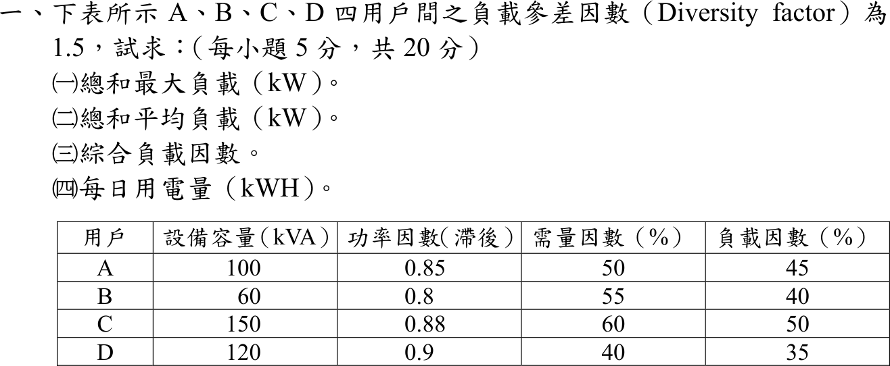
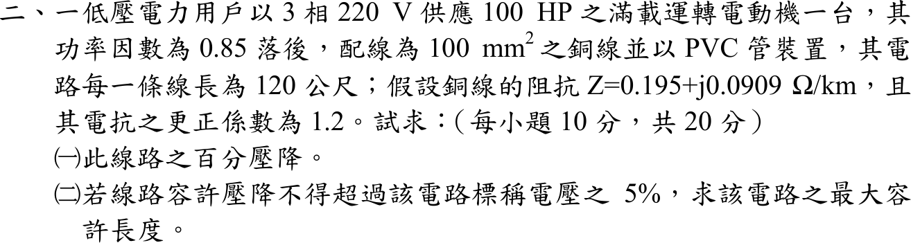
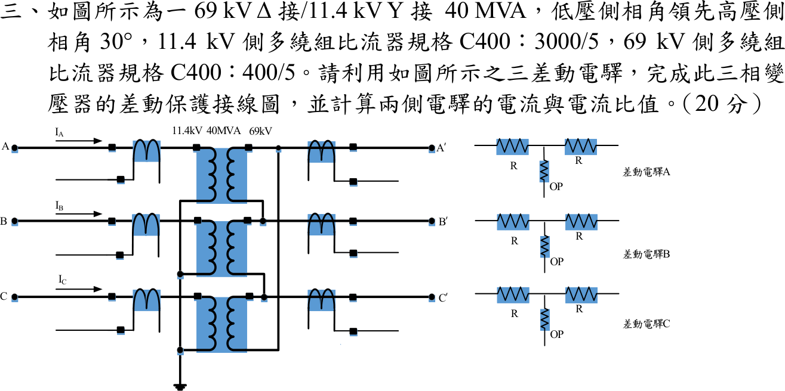
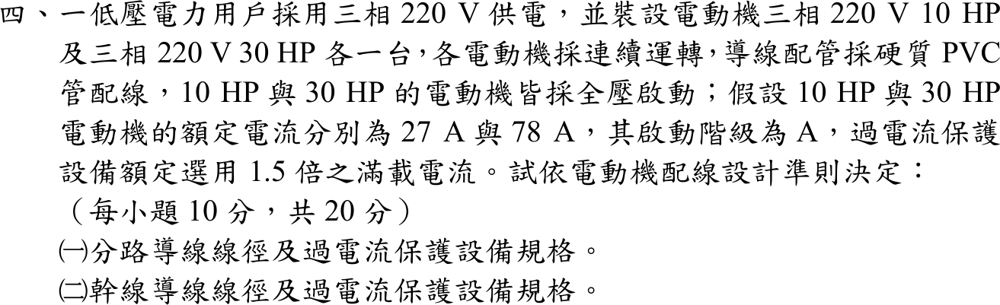
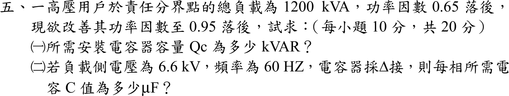

# 107 年電機工程技師｜工業配電逐題詳解

> 本頁由題級 canonical 筆記組合；每題保留官方裁切圖、校驗狀態與可追溯的推導。

## 題目導覽
- [[#一、107 年工業配電第 1 題｜四用戶負載統計|第 1 題：四用戶負載統計]]
- [[#二、107 年工業配電第 2 題｜100 HP 馬達饋線壓降|第 2 題：100 HP 馬達饋線壓降]]
- [[#三、107 年工業配電第 3 題｜Δ–Y 變壓器差動保護|第 3 題：Δ–Y 變壓器差動保護]]
- [[#四、107 年工業配電第 4 題｜多台電動機分路與幹線設計|第 4 題：多台電動機分路與幹線設計]]
- [[#五、107 年工業配電第 5 題｜高壓用戶功率因數改善|第 5 題：高壓用戶功率因數改善]]

---

## 一、107 年工業配電第 1 題｜四用戶負載統計

> 題級識別：EE-107-06-1
> canonical 來源：[[canonical/EE-107-06-1.md]]
> 題級校驗狀態：verified

### 已知與所求

A、B、C、D 四用戶之負載參差因數 \(F_d=1.5\)。設備容量／功率因數（落後）／需量因數／負載因數：A 100 kVA／0.85／50%／45%；B 60／0.80／55%／40%；C 150／0.88／60%／50%；D 120／0.90／40%／35%。求（一）總和最大負載（kW）；（二）總和平均負載（kW）；（三）綜合負載因數；（四）每日用電量（kWh）。

### 考場標準作答

**解題邏輯**：需量因數＝最大需量／設備容量、負載因數＝平均負載／最大需量，而設備容量是 kVA，乘功率因數才是 kW；所以先逐戶求最大需量 \(P_{max,i}\) 與平均負載 \(P_{avg,i}\)（步驟 1），再處理群組：尖峰不同時發生，個別最大需量合計要除以參差因數 \(F_d\) 才是總和最大負載（一）；平均負載是時間平均，直接相加（二）；兩者相除得綜合負載因數（三），平均負載乘 24 h 得日用電量（四）。

#### 步驟 1：各戶最大需量與平均負載

\[
P_{max,i}=S_i\cdot DF_i\cdot\mathrm{pf}_i,\qquad P_{avg,i}=P_{max,i}\cdot LF_i
\]

| 用戶 | \(P_{max,i}=S_i\cdot DF_i\cdot\mathrm{pf}_i\)（kW） | \(P_{avg,i}=P_{max,i}\cdot LF_i\)（kW） |
|---|---:|---:|
| A | \(100(0.50)(0.85)=42.50\) | \(42.50(0.45)=19.125\) |
| B | \(60(0.55)(0.80)=26.40\) | \(26.40(0.40)=10.56\) |
| C | \(150(0.60)(0.88)=79.20\) | \(79.20(0.50)=39.60\) |
| D | \(120(0.40)(0.90)=43.20\) | \(43.20(0.35)=15.12\) |

#### （一）總和最大負載（5 分）

**邏輯**：參差因數 \(F_d=\dfrac{\sum P_{max,i}}{P_{max}}\ge1\)（各戶尖峰不同時發生），故同時最大負載 \(P_{max}=\sum P_{max,i}/F_d\)。

個別最大需量合計：
\[
\sum P_{max,i}=42.50+26.40+79.20+43.20=191.30\ \mathrm{kW}
\]
除以參差因數：
\[
P_{max}=\frac{\sum P_{max,i}}{F_d}=\frac{191.30}{1.5}=127.53\ \mathrm{kW}
\]
\[
\boxed{P_{max}=127.53\ \mathrm{kW}}
\]

#### （二）總和平均負載（5 分）

**邏輯**：平均負載是時間平均，可直接代數相加；參差因數只折減尖峰，不用在平均值。

\[
P_{avg}=P_{avg,A}+P_{avg,B}+P_{avg,C}+P_{avg,D}=19.125+10.56+39.60+15.12
\]
\[
P_{avg}=84.405\ \mathrm{kW}
\]
\[
\boxed{P_{avg}=84.41\ \mathrm{kW}}
\]

#### （三）綜合負載因數（5 分）

**邏輯**：綜合負載因數＝總平均負載／同時最大負載，兩者都取群組值（（二）與（一））。

\[
LF=\frac{P_{avg}}{P_{max}}=\frac{84.405}{127.53}=0.6618
\]
\[
\boxed{LF=0.66=66.18\%}
\]

#### （四）每日用電量（5 分）

**邏輯**：電能＝平均功率×時間，一日 24 h；用（二）的群組平均負載（精確值 84.405 kW）。

\[
E=P_{avg}\times24\ \mathrm h=84.405\times24
\]
\[
\boxed{E=2025.72\ \mathrm{kWh/day}}
\]

### 驗算

逐戶日電量 \(E_i=24P_{avg,i}\)：\(E_A=24(19.125)=459.00\)、\(E_B=24(10.56)=253.44\)、\(E_C=24(39.60)=950.40\)、\(E_D=24(15.12)=362.88\ \mathrm{kWh}\)，合計 \(459.00+253.44+950.40+362.88=2025.72\ \mathrm{kWh}\)，與（四）相同。綜合負載因數另由恆等式 \(LF=F_d\dfrac{\sum P_{avg,i}}{\sum P_{max,i}}=1.5\times\dfrac{84.405}{191.30}=0.6618\)，與（三）相同。

### 失分點

- 把設備容量 kVA 直接當 kW；須乘需量因數與功率因數才是各戶最大有功需量。
- 參差因數方向相反：同時最大負載是個別最大合計**除以** 1.5，不是乘 1.5。
- 平均負載應按各戶自己的負載因數算，不可用群組合計再乘單一 \(LF\)；平均負載也不可再除以 \(F_d\)。

---

## 二、107 年工業配電第 2 題｜100 HP 馬達饋線壓降

> 題級識別：EE-107-06-2
> canonical 來源：[[canonical/EE-107-06-2.md]]
> 題級校驗狀態：reference_book_verified

### 已知與所求

三相 \(220\,\mathrm V\) 供應一台滿載 \(100\,\mathrm{HP}\) 電動機，功率因數 0.85 落後；100 mm² 銅線 PVC 管，每條線長 \(120\,\mathrm m\)；線路阻抗 \(0.195+j0.0909\,\Omega/\mathrm{km}\)，電抗更正係數 1.2。求（一）線路百分壓降；（二）壓降不超過標稱電壓 5% 時的最大容許長度（各 10 分）。題幹未給滿載電流，取值見「條件與疑義」。

### 考場標準作答

**解題邏輯**：題幹沒給滿載電流，主解依參考書（reference_book evidence，not official）取 1 HP≈1 kVA，由 \(S=\sqrt3VI\) 求馬達電流；再以三相短線路壓降近似式 \(\Delta V\approx\sqrt3\,I(R\cos\theta+X\sin\theta)L\) 求線電壓降與百分壓降（一）；電流與功因固定時壓降與線長成正比，以 5% 門檻反求最大長度（二）。前提：100 mm² 線徑與 PVC 管材只決定題給阻抗與電抗更正係數，不另計算；短線路只計串聯阻抗、不計線路電容；受電端電壓取標稱 220 V；電抗先乘更正係數 1.2。

#### 步驟 1：馬達電流

三相視在功率 \(S=\sqrt3\,V I\)，\(S=100\,\mathrm{kVA}\)：
\[
I=\frac{S}{\sqrt3\,V}=\frac{100\,000}{\sqrt3(220)}=\frac{100\,000}{381.05}=262.43\ \mathrm A
\]

#### 步驟 2：每公里的壓降係數 \(K=R\cos\theta+X\sin\theta\)

- 單相等效（每相）：送電端 \(\dot V_s\) 經線路 \((R+jX)L\) 到受電端 \(\dot V_r\)；以 \(\dot V_r\) 為參考，電流 \(\dot I\) 落後 \(\theta\)。
- \(\dot IRL\) 與 \(\dot I\) 同向，\(j\dot IXL\) 超前 \(\dot I\) \(90^\circ\)；兩者投影到 \(\dot V_r\) 方向的長度和 \(I(R\cos\theta+X\sin\theta)L\) 就是相電壓降，乘 \(\sqrt3\) 為線電壓降。

更正後電抗：
\[
X=1.2\times0.0909=0.10908\ \Omega/\mathrm{km}
\]
功率因數角：
\[
\theta=\cos^{-1}0.85=31.79^\circ
\]
功率因數角的正弦：
\[
\sin\theta=\sqrt{1-\cos^2\theta}=\sqrt{1-0.85^2}=\sqrt{0.2775}=0.5268
\]
兩項分量：
\[
R\cos\theta=0.195\times0.85=0.16575\ \Omega/\mathrm{km}
\]
\[
X\sin\theta=0.10908\times0.5268=0.05746\ \Omega/\mathrm{km}
\]
\[
K=R\cos\theta+X\sin\theta=0.16575+0.05746=0.22321\ \Omega/\mathrm{km}
\]

#### （一）百分壓降（10 分）

**邏輯**：短線路、電流落後時，線電壓降 \(\Delta V=\sqrt3\,I\,K\,L\)；百分壓降再除以標稱線電壓 220 V。

先求每公里線電壓降：
\[
\sqrt3\,I=\sqrt3\times262.43=454.54\ \mathrm A
\]
\[
\sqrt3\,I\,K=454.54\times0.22321=101.46\ \mathrm{V/km}
\]
乘線長 \(L=120\,\mathrm m=0.12\,\mathrm{km}\)：
\[
\Delta V=\sqrt3\,I\,K\,L=101.46\times0.12=12.175\ \mathrm V
\]
百分壓降：
\[
\Delta V\%=\frac{\Delta V}{V}\times100\%=\frac{12.175}{220}\times100\%
\]
\[
\boxed{\Delta V\%=5.53\%}
\]

#### （二）最大容許長度（10 分）

**邏輯**：\(I\)、\(K\) 不變，\(\Delta V\) 與 \(L\) 成正比；令 \(\sqrt3\,I\,K\,L_{max}=5\%\times220\,\mathrm V\) 反求 \(L_{max}\)。

容許壓降：
\[
\Delta V_{allow}=0.05\times220=11\ \mathrm V
\]
最大長度：
\[
L_{max}=\frac{\Delta V_{allow}}{\sqrt3\,I\,K}=\frac{11}{101.46}=0.10842\ \mathrm{km}
\]
\[
\boxed{L_{max}=108.42\ \mathrm m}
\]

### 驗算

相量法（不用近似式）：每相 \(V_r=220/\sqrt3=127.02\ \mathrm V\)、\(\dot I=262.43\angle-31.79^\circ\ \mathrm A\)、\((R+jX)L=0.0234+j0.01309\ \Omega\)，\(\dot I(R+jX)L=7.029-j0.3151\ \mathrm V\)，\(|\dot V_s|=|127.02+7.029-j0.3151|=134.05\ \mathrm V\)，線電壓降 \(\sqrt3(134.05-127.02)=12.18\ \mathrm V\)，與近似式 12.175 V 一致。比例檢查：\(108.42\ \mathrm m\times5.53\%\approx120\ \mathrm m\times5\%\)。

### 失分點

- 電抗忘記乘更正係數 1.2，使 \(K\) 偏小（\(K\) 會降為 \(0.16575+0.0909\times0.5268=0.21364\ \Omega/\mathrm{km}\)，壓降低估約 4%）。
- 用 \(\sqrt3IL(R\cos\theta+X\sin\theta)\) 時把長度寫成 120 而非 0.12 km。
- 最大長度不能直接寫 120 m；壓降與長度成正比，應依 \(11\,\mathrm V/101.46\,\mathrm{V/km}\) 反求，且結果小於 120 m（因 120 m 已超過 5%）。

### 條件與疑義

官方裁切沒有列馬達滿載電流、銘牌效率或輸入功率定義；第 152 條只決定馬達負載電流的取值依據：原則上採銘牌全載電流，一般用電動機才可採國家標準值（經濟部 107 年 7 月 17 日歷史版《用戶用電設備裝置規則》第 152 條，<https://law.moea.gov.tw/LawContentHistory.aspx?hid=50617>），因此不能由 100 HP 與功率因數單獨反推出唯一滿載電流。本題的「壓降 5%」是題目給定的壓降門檻，只用來把同一線路模型反算成 \(L_{max}\)，不是由第 152 條法規推導出的電流值。各取值下的結果為：

| 滿載電流取值 | \(I\) | \(\Delta V\%\) | \(L_{max}\) |
|---|---:|---:|---:|
| 參考書 1 HP≈1 kVA（主解） | 262.43 A | 5.53% | 108.42 m |
| 年度詳解常用值 | \(250\,\mathrm A\) | 5.2720% | 113.81 m |
| 107 年歷史表 163-7-3 | \(I=258\,\mathrm{A}\) | 5.4407% | 110.28 m |
| 現行表 258-3（60 HP 以上可採製造廠資料） | \(238\,\mathrm A\) | 5.0189% | 119.55 m |
| 100 HP＝74.6 kW、效率 1 | 230.32 A | 4.8570% | 123.53 m |

各取值下 120 m 的壓降落在 4.86%–5.53%，是否超過 5% 隨取值而變。題圖未指定表號，故 238 A、250 A、258 A 僅為版本交叉檢查，不取代參考書主解與銘牌值。

---

## 三、107 年工業配電第 3 題｜Δ–Y 變壓器差動保護

> 題級識別：EE-107-06-3
> canonical 來源：[[canonical/EE-107-06-3.md]]
> 題級校驗狀態：verified

### 已知與所求

\(69\,\mathrm{kV}\) Δ／\(11.4\,\mathrm{kV}\) Y、\(40\,\mathrm{MVA}\) 三相變壓器，低壓側相角領先高壓側 \(30^\circ\)；\(11.4\,\mathrm{kV}\) 側多繞組 CT C400：\(3000/5\)，\(69\,\mathrm{kV}\) 側 C400：\(400/5\)。用三具差動電驛（各有兩個制動線圈 R 與一個動作線圈 OP）完成差動保護接線圖，並求兩側電驛電流與電流比值。

### 考場標準作答

**解題邏輯**：差動保護依 KCL 比較變壓器兩側電流：正常負載或區外故障時，兩側 CT 送進同一具電驛的電流應同相、等量，在制動線圈 R 間環流而動作線圈 OP 無電流。Y–Δ 變壓器兩側線電流相差 \(30^\circ\)（題給低壓側領先 \(30^\circ\)），所以 CT 接法要與變壓器相反——11.4 kV（Y）側 CT 二次接 Δ、69 kV（Δ）側 CT 二次接 Y——先畫接線圖並以相量確認相位抵消；再由額定線電流 \(I=S/(\sqrt3V)\) 乘 CT 比求兩側電驛電流（Δ 接 CT 多乘 \(\sqrt3\)），最後取比值。前提：三相平衡、正相序 a-b-c、以 40 MVA 額定負載計算；兩側 CT 的 C400 是準確等級（二次端電壓 400 V 內誤差保證），只影響飽和裕度，不進入電流計算。

#### 步驟 1：差動保護接線圖

**邏輯**：題圖主變的 Δ 繞組決定 69 kV 線電流是哪兩個 Y 側電流的差；Y 側 CT 二次接成同一種 Δ 組合，送進電驛的電流才會與 69 kV 側同相。

由題圖讀主變 Δ 接法（● 為各繞組在線端的極性端）：a 相 Δ 繞組極性端接 A′、另一端接 B′；b 相接 B′、C′；c 相接 C′、A′。A′ 點匯集 a 相繞組流出的電流與流入 c 相繞組的電流，故
\[
\dot I_{A'}\propto\dot I_A-\dot I_C
\]
以 \(\dot I_A=1\angle0^\circ\)、\(\dot I_C=1\angle120^\circ\) 檢查相位：
\[
\dot I_A-\dot I_C=1-(-0.5+j0.8660)=1.5-j0.8660
\]
\[
|\dot I_A-\dot I_C|=\sqrt{1.5^2+0.8660^2}=\sqrt{3}=1.732
\]
\[
\angle(\dot I_A-\dot I_C)=\tan^{-1}\frac{-0.8660}{1.5}=-30^\circ
\]
69 kV 線電流滯後 11.4 kV 線電流 \(30^\circ\)，與題給「低壓側領先 \(30^\circ\)」一致。

接法（對照圖 1）：
- 11.4 kV 側 \(\mathrm{CT}_1\)（3000/5）：二次接 Δ，組合與主變 Δ 相同——a 相 CT 極性端接 c 相 CT 非極性端，接點引至 87A，接點與 87A 之間的電流為 \(i_a-i_c\)；同理 \(i_b-i_a\) 引至 87B、\(i_c-i_b\) 引至 87C（\(i_a,i_b,i_c\) 為 \(\mathrm{CT}_1\) 二次電流，參考方向取由 CT 極性端流出；正常負載時一次電流由非極性端流入，實際電流方向如圖 1 的 \(I_{L,r}\)：由 \(R_1\) 流回接點）。三者的相位依序與 \(\dot I_{A'}\)、\(\dot I_{B'}\)、\(\dot I_{C'}\) 相同。
- 69 kV 側 \(\mathrm{CT}_2\)（400/5）：二次接 Y，非極性端共接中性點 N 並接地，極性端分別引至 87A、87B、87C。
- 每具差動電驛：\(\mathrm{CT}_1\) 引線接 \(R_1\)，\(\mathrm{CT}_2\) 引線接 \(R_2\)，\(R_1\)、\(R_2\) 串聯，OP 由兩者中點接回 N。兩側 CT 一次極性端都朝向變壓器，正常時電流由 \(\mathrm{CT}_2\) 經 \(R_2\rightarrow R_1\) 流回 \(\mathrm{CT}_1\) 的 Δ，OP 只流兩者之差。
- 若 \(\mathrm{CT}_1\) 也接 Y，送進 87A 的是 \(i_a\)，與 69 kV 側差 \(30^\circ\)，正常負載即有假差流。

#### 步驟 2：兩側額定線電流

三相額定線電流 \(I=\dfrac{S}{\sqrt3\,V_{LL}}\)：
\[
I_H=\frac{40\times10^6}{\sqrt3(69\,000)}=\frac{40\times10^6}{119\,511.5}=334.70\,\mathrm A
\]
\[
I_L=\frac{40\times10^6}{\sqrt3(11\,400)}=\frac{40\times10^6}{19\,745.4}=2025.79\,\mathrm A
\]

#### 兩側電驛電流

**邏輯**：電驛電流＝線電流 × CT 二次額定 ÷ CT 一次額定；69 kV 側 CT 接 Y，電驛電流就是 CT 二次電流；11.4 kV 側 CT 接 Δ，電驛電流是兩只 CT 二次電流的相量差，大小為 \(\sqrt3\) 倍（步驟 1 的 \(|\dot I_A-\dot I_C|=\sqrt3\)）。

69 kV 側：
\[
I_{H,r}=I_H\times\frac{5}{400}=334.70\times\frac{5}{400}=4.1838\ \mathrm A
\]
\[
\boxed{I_{H,r}=4.18\ \mathrm A}
\]
11.4 kV 側，先求單只 CT 二次電流：
\[
I_{L,CT}=I_L\times\frac{5}{3000}=2025.79\times\frac{5}{3000}=3.3763\ \mathrm A
\]
再乘 \(\sqrt3\)：
\[
I_{L,r}=\sqrt3\,I_{L,CT}=\sqrt3(3.3763)=5.8479\ \mathrm A
\]
\[
\boxed{I_{L,r}=5.85\ \mathrm A}
\]

#### 電流比值

**邏輯**：兩側電驛電流同相（步驟 1），比值只看大小；比值偏離 1 的部分要靠電驛匹配抽頭或輔助 CT 補償。

\[
\frac{I_{L,r}}{I_{H,r}}=\frac{5.8479}{4.1838}=1.3977
\]
\[
\boxed{\frac{I_{L,r}}{I_{H,r}}=1.40}\qquad\left(\frac{I_{H,r}}{I_{L,r}}=\frac{4.1838}{5.8479}=0.72\right)
\]
兩側電驛電流之差：
\[
I_{L,r}-I_{H,r}=5.8479-4.1838=1.6641\ \mathrm A
\]
約為 \(I_{H,r}\) 的 \(1.6641/4.1838=39.77\%\)，須以電驛匹配抽頭或輔助 CT 補償約 1.40 倍，否則正常負載即產生假差流。

### 驗算

比值與變壓器容量無關，可直接由電壓比與 CT 比求（\(I_L/I_H=69/11.4\)）：
\[
\frac{I_{L,r}}{I_{H,r}}=\sqrt3\cdot\frac{5/3000}{5/400}\cdot\frac{69}{11.4}=\sqrt3\cdot\frac{400\times69}{3000\times11.4}=\sqrt3\cdot\frac{27\,600}{34\,200}=1.3978
\]
與上式 1.3977 只差末位的四捨五入，取兩位為 1.40。三相相量計算（\(i_a-i_c\)）亦得電驛 A 兩側電流同相、幅值 5.85 A 與 4.18 A。

### 失分點

- 比值方向要註明：低壓／高壓 \(=1.40\)，高壓／低壓 \(=0.72\)；只寫「1.4」不標方向。
- 11.4 kV 側 Δ-CT 的電驛電流漏乘 \(\sqrt3\)，得到 \(3.38\,\mathrm A\) 而誤判兩側已平衡。
- 兩側 CT 都接 Y，或 \(\mathrm{CT}_1\) 的 Δ 組合接反（送出 \(i_a-i_b\)），兩側相差 \(30^\circ\) 或 \(60^\circ\)，無法抵消。

---

## 四、107 年工業配電第 4 題｜多台電動機分路與幹線設計

> 題級識別：EE-107-06-4
> canonical 來源：[[canonical/EE-107-06-4.md]]
> 題級校驗狀態：needs_manual_review
> [!WARNING] 本題仍有官方資料缺口或事件定義歧義；請以 canonical 條件式解答為準。

### 已知與所求

三相 \(220\,\mathrm V\) 供電；\(10\,\mathrm{HP}\)、\(30\,\mathrm{HP}\) 電動機各一台，連續運轉，硬質 PVC 管配線，全壓啟動；額定電流 \(27\,\mathrm A\)、\(78\,\mathrm A\)，啟動階級 A，過電流保護額定選用 1.5 倍滿載電流。求（一）分路導線線徑及過電流保護規格；（二）幹線導線線徑及過電流保護規格（各 10 分）。導線安培容量與標準 AT 級距題幹未附，取值見「條件與疑義」。

### 考場標準作答

**解題邏輯**：依電動機配線設計準則，導線看「連續運轉的電流需求」、保護看「題給 1.5 倍滿載電流」。分路：每台各自的導線需求 \(1.25I_{FL}\) 選線徑、保護 \(1.5I_{FL}\) 向上取標準 AT；幹線：導線需求 \(1.25I_{max}+\sum I_{其餘}\)（125% 只乘最大一台），保護 \(1.5I_{max}+\sum I_{其餘}\) 取標準 AT，並檢核不超過「最大分路保護額定＋其餘滿載電流」。前提：題給額定電流 27 A、78 A 即滿載電流 \(I_{FL}\)；全壓啟動、啟動階級 A 只影響保護倍數，題目已直接定為 1.5 倍，不再查表；導線安培容量與標準 AT 級距題幹未附，取值見「條件與疑義」。

#### （一）分路導線線徑及過電流保護（10 分）

**邏輯**：每台電動機一條分路，連續運轉的分路導線安培容量 \(\ge1.25I_{FL}\)；保護額定 \(=1.5I_{FL}\)，非標準值時向上取最接近的標準 AT（往下取會小於題定值，啟動時易誤跳）。

10 HP（\(I_{FL}=27\,\mathrm A\)）導線需求：
\[
I_{w,10}=1.25I_{FL}=1.25\times27=33.75\ \mathrm A\ \Rightarrow\ 8\,\mathrm{mm^2}（40\,\mathrm A）
\]
保護額定：
\[
I_{OC,10}=1.5I_{FL}=1.5\times27=40.50\ \mathrm A\ \Rightarrow\ 50\,\mathrm{AT}
\]

30 HP（\(I_{FL}=78\,\mathrm A\)）導線需求：
\[
I_{w,30}=1.25\times78=97.50\ \mathrm A\ \Rightarrow\ 38\,\mathrm{mm^2}（100\,\mathrm A）
\]
保護額定：
\[
I_{OC,30}=1.5\times78=117\ \mathrm A\ \Rightarrow\ 125\,\mathrm{AT}
\]

\[
\boxed{\text{10 HP：}8\,\mathrm{mm^2}、50\,\mathrm{AT}；\quad \text{30 HP：}38\,\mathrm{mm^2}、125\,\mathrm{AT}}
\]

#### （二）幹線導線線徑及過電流保護（10 分）

**邏輯**：幹線同時供應兩台電動機，兩台同時以滿載連續運轉，125% 裕度只需乘在最大那台（30 HP），其餘（10 HP）以滿載電流計入；保護以 1.5 倍最大一台加其餘滿載電流為基準向上取標準 AT，再檢核不超過「最大分路 AT＋其餘滿載電流」的上限。

導線安培容量需求：
\[
I_{w,F}=1.25I_{30}+I_{10}=1.25\times78+27=97.50+27=124.50\ \mathrm A\ \Rightarrow\ 60\,\mathrm{mm^2}（150\,\mathrm A）
\]
保護額定基準：
\[
I_{OC,F}=1.5I_{30}+I_{10}=1.5\times78+27=117+27=144\ \mathrm A\ \Rightarrow\ 150\,\mathrm{AT}
\]
上限檢核（最大分路保護 125 AT＋10 HP 滿載電流）：
\[
125+27=152\ \mathrm A\ \ge150\,\mathrm{AT}\quad\text{（成立）}
\]
導線保護配合：\(150\,\mathrm{AT}\) 不大於幹線導線容量 \(150\,\mathrm A\)。

\[
\boxed{\text{幹線 }60\,\mathrm{mm^2}、150\,\mathrm{AT}}
\]

### 驗算

保護協調：幹線 \(150\,\mathrm{AT}\ge\) 最大分路 \(125\,\mathrm{AT}\)，且 \(\le152\,\mathrm A\) 上限；幹線保護以未捨入的 \(144\,\mathrm A\) 再取標準值。若改由上限 \(152\,\mathrm A\) 向下取標準值，同樣得 \(150\,\mathrm{AT}\)，兩種讀法結論相同。

### 失分點

- 幹線只取 \(1.25(78+27)=131.25\,\mathrm A\)；連續負載 125% 只乘最大那台。
- 保護 \(40.50\,\mathrm A\) 取 40 AT（往下取）；題目定的是「選用 1.5 倍」，40 AT 小於 \(40.50\,\mathrm A\)，應取 50 AT。
- 以啟動電流選導線；全壓啟動的啟動電流只影響跳脫曲線，導線依滿載電流 125%。

### 條件與疑義

題幹未附屋內線路裝置規則的安培容量表與 AT 級距，下列為假設值（須以規則表核對）：

| 項目 | 假設值 |
|---|---|
| PVC 管內 3 線安培容量 | \(5.5\,\mathrm{mm^2}\)：30 A；8：40 A；14：55 A；22：70 A；30：90 A；38：100 A；50：120 A；60：150 A |
| 標準 AT | 15、20、30、40、50、60、75、100、125、150、175、200、225 |

結論只要求 \(30\,\mathrm{mm^2}\) 容量 \(<97.50\,\mathrm A\le38\,\mathrm{mm^2}\) 容量，以及 \(50\,\mathrm{mm^2}\) 容量 \(<124.50\,\mathrm A\le60\,\mathrm{mm^2}\) 容量；若所用表的 50 mm² 已達 124.50 A 以上，幹線改為 50 mm²，AT 不變。

---

## 五、107 年工業配電第 5 題｜高壓用戶功率因數改善

> 題級識別：EE-107-06-5
> canonical 來源：[[canonical/EE-107-06-5.md]]
> 題級校驗狀態：verified

### 已知與所求

高壓用戶責任分界點總負載 \(1200\,\mathrm{kVA}\)，功率因數 0.65 落後，改善至 0.95 落後；負載側電壓 \(6.6\,\mathrm{kV}\)、頻率 \(60\,\mathrm{Hz}\)、電容器 Δ 接。求（一）所需電容器容量 \(Q_c\)（kvar）；（二）每相電容 \(C\)（μF），各 10 分。

### 考場標準作答

**解題邏輯**：並聯電容器只抵消無功、不改變有功。（一）由 \(S\) 與 \(\cos\phi_1\) 求 \(P\)、\(Q_1\)；改善後允許的無功 \(Q_2=P\tan\phi_2\)，電容器容量為兩者之差 \(Q_c=Q_1-Q_2\)。（二）Δ 接每相電容直接跨在線電壓上，三相無功 \(Q_c=3\omega CV_{LL}^2\)，由此解出每相 \(C\)。

#### （一）所需電容器容量 \(Q_c\)（10 分）

**邏輯**：功率三角形中 \(P\) 固定，\(Q_c=Q_1-P\tan\phi_2\)。

有功功率：
\[
P=S\cos\phi_1=1200(0.65)=780\ \mathrm{kW}
\]
改善前無功（保留 5 位，使 \(Q_c\) 末位對得上）：
\[
\sin\phi_1=\sqrt{1-0.65^2}=\sqrt{0.5775}=0.75993
\]
\[
Q_1=S\sin\phi_1=1200(0.75993)=911.92\ \mathrm{kvar}
\]
改善後允許的無功：
\[
\sin\phi_2=\sqrt{1-0.95^2}=\sqrt{0.0975}=0.31225
\]
\[
\tan\phi_2=\frac{\sin\phi_2}{\cos\phi_2}=\frac{0.31225}{0.95}=0.32868
\]
\[
Q_2=P\tan\phi_2=780(0.32868)=256.37\ \mathrm{kvar}
\]
電容器容量：
\[
Q_c=Q_1-Q_2=911.92-256.37
\]
\[
\boxed{Q_c=655.55\ \mathrm{kvar}}
\]

#### （二）Δ 接每相電容 \(C\)（10 分）

**邏輯**：Δ 接每相電容兩端是線電壓 \(V_{LL}=6600\ \mathrm V\)，每相無功 \(\omega CV_{LL}^2\)，三相 \(Q_c=3\omega CV_{LL}^2\)。

角頻率：
\[
\omega=2\pi f=2\pi(60)=376.99\ \mathrm{rad/s}
\]
由 \(Q_c=3\omega CV_{LL}^2\) 解 \(C\)：
\[
C=\frac{Q_c}{3\omega V_{LL}^2}
\]
分母：
\[
3\omega V_{LL}^2=3(376.99)(6600)^2=1130.97\times43\,560\,000=4.9265\times10^{10}
\]
代入：
\[
C=\frac{655.55\times10^3}{4.9265\times10^{10}}=1.3307\times10^{-5}\ \mathrm F
\]
\[
\boxed{C=13.31\ \mu\mathrm F/\text{相}}
\]

### 驗算

相電流路徑：電容器線電流 \(I_L=Q_c/(\sqrt3V_{LL})=655.55/(\sqrt3\times6.6)=57.35\,\mathrm A\)，Δ 相電流 \(I_\phi=I_L/\sqrt3=33.11\,\mathrm A\)，\(C=I_\phi/(\omega V_{LL})=33.11/(376.99\times6600)=13.31\,\mu\mathrm F\)。補償後 \(\tan\phi=(Q_1-Q_c)/P=256.37/780=0.32868\)，與 \(\tan\phi_2\) 相同，即 \(\cos\phi=0.95\)。

### 失分點

- \(Q_c=P(\tan\phi_1-\tan\phi_2)\) 用 \(S=1200\) 當 \(P\)；有功是 \(1200\times0.65=780\,\mathrm{kW}\)。
- Δ 接每相電壓是線電壓 6.6 kV，不是 \(6.6/\sqrt3\,\mathrm{kV}\)；用相電壓會得到 \(3\times13.307=39.92\,\mu\mathrm F\)。

---
