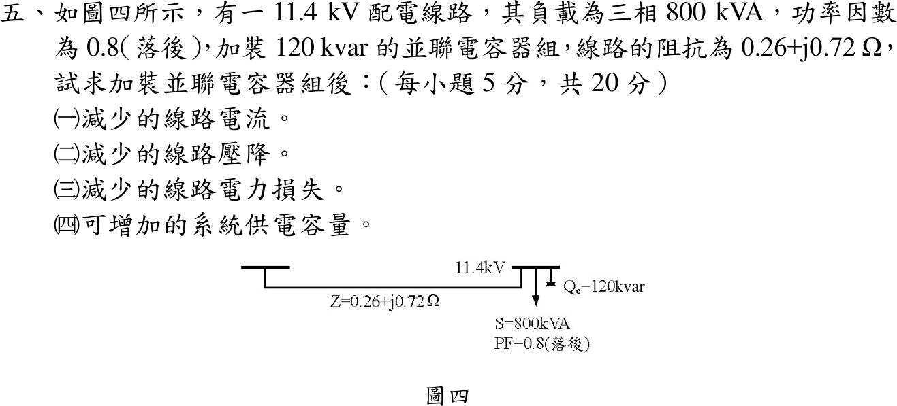

# 108 年電機工程技師｜工業配電逐題詳解

> 本頁由題級 canonical 筆記組合；每題保留 QID、官方裁切、校驗狀態與完整得分型解答。

## 題目導覽
- [[#一、108 年工業配電第 1 題｜電容式比壓器比壓式|第 1 題：電容式比壓器比壓式]]
- [[#二、108 年工業配電第 2 題｜電弧爐電壓突降與串聯電抗器|第 2 題：電弧爐電壓突降與串聯電抗器]]
- [[#三、108 年工業配電第 3 題｜V-V 連接三相四線式燈力併供|第 3 題：V-V 連接三相四線式燈力併供]]
- [[#四、108 年工業配電第 4 題｜F 點三相短路|第 4 題：F 點三相短路]]
- [[#五、108 年工業配電第 5 題｜並聯電容器的效益|第 5 題：並聯電容器的效益]]

---

## 一、108 年工業配電第 1 題｜電容式比壓器比壓式

> 題級識別：`EE-108-06-1`
> canonical 來源：`canonical/EE-108-06-1.md`
> 題級校驗狀態：`verified`

![[01_原始試題/依考科/06_工業配電/images/questions/PE_108年_工業配電_Q01.png]]

> 官方裁切來源：`01_原始試題/依考科/06_工業配電/images/questions/PE_108年_工業配電_Q01.png`

### 已知與所求

圖一：\(V_1\) 加在串聯的 \(C_1\)（上）與 \(C_2\)（下）兩端，下端接地；\(C_1\)、\(C_2\) 的中點經補償電抗器 \(L\) 串接負擔 \(Z_B\) 到地，輸出 \(V_2\) 跨在 \(Z_B\) 兩端。求比壓式 \(V_2/V_1\)。

### 考場標準作答

**解題邏輯**：所求比壓式是 \(V_2/V_1\)。前提：正弦穩態（相量、\(s=j\omega\)），\(C_1\)、\(C_2\)、\(L\) 為理想元件（不計 \(L\) 的電阻與電容漏電），\(Z_B\) 為任意負擔阻抗。
1. \(C_1\)、\(C_2\) 構成電容分壓器，中點 \(a\) 經補償電抗器 \(L\) 串接負擔 \(Z_B\) 到地；把 \(L\)–\(Z_B\) 支路拿掉，對中點 \(a\) 作戴維寧等效（\(V_{th}\)、\(Z_{th}\)）。
2. 再接回 \(L\)、\(Z_B\) 串聯支路，\(V_2\) 就是 \(Z_B\) 上的分壓。依序先求 \(V_{th}\)，再求 \(Z_{th}\)。
3. 求 \(V_2/V_1\) 並化簡成 \(s\) 多項式。
4. 求工頻下補償電抗的條件。

#### 步驟 1：等效電路畫法與阻抗符號

- 由圖一：\(V_1\) 跨在 \(C_1\)（上）與 \(C_2\)（下）串聯兩端，下端接地；\(C_1\)、\(C_2\) 的接點記為 \(a\)。
- \(a\) 點經 \(L\) 再串 \(Z_B\) 到地，\(V_2\) 取 \(Z_B\) 兩端（上正下地），\(L\) 與 \(Z_B\) 是**串聯**，不是並聯。
- 在 \(a\) 點把 \(L\)–\(Z_B\) 支路斷開，左側電容網路化成 \(V_{th}\) 串 \(Z_{th}\)（步驟 2、3 求出後畫成圖 1 右）。

阻抗符號：
\[
Z_1=\frac{1}{sC_1},\qquad Z_2=\frac{1}{sC_2},\qquad Z_L=sL
\]

#### 步驟 2：戴維寧電壓 \(V_{th}\)

\(a\) 點開路時，\(V_1\) 只在 \(C_1\)、\(C_2\) 上分壓，\(V_{th}\) 為 \(Z_2\) 上的電壓：
\[
V_{th}=V_1\frac{Z_2}{Z_1+Z_2}=V_1\frac{\dfrac{1}{sC_2}}{\dfrac{1}{sC_1}+\dfrac{1}{sC_2}}
\]
分子分母同乘 \(sC_1C_2\)：
\[
V_{th}=V_1\frac{C_1}{C_2+C_1}=V_1\frac{C_1}{C_1+C_2}
\]

#### 步驟 3：戴維寧阻抗 \(Z_{th}\)

\(V_1\) 短路（電壓源置零），從 \(a\) 看入 \(Z_1\)、\(Z_2\) 並聯：
\[
Z_{th}=\frac{Z_1Z_2}{Z_1+Z_2}
\]
分子（乘積）與分母（和）分別通分：
\[
Z_1Z_2=\frac{1}{sC_1}\cdot\frac{1}{sC_2}=\frac{1}{s^2C_1C_2},\qquad
Z_1+Z_2=\frac{1}{sC_1}+\frac{1}{sC_2}=\frac{C_1+C_2}{sC_1C_2}
\]
相除：
\[
Z_{th}=\frac{1/(s^2C_1C_2)}{(C_1+C_2)/(sC_1C_2)}
\]
\[
Z_{th}=\frac{1}{s(C_1+C_2)}
\]
即一個電容量 \(C_1+C_2\) 的等效電容。

#### 比壓式（20 分）

**邏輯**：接回 \(L\)、\(Z_B\) 後，等效電路是 \(V_{th}\) 串 \(Z_{th}\)、\(sL\)、\(Z_B\) 的單一迴路，\(V_2\) 由串聯分壓求得；再把 \(V_{th}\) 換回 \(V_1\) 並化簡。

串聯分壓：
\[
V_2=V_{th}\frac{Z_B}{Z_{th}+sL+Z_B}
\]
代入 \(V_{th}\)：
\[
\frac{V_2}{V_1}=\frac{C_1}{C_1+C_2}\cdot\frac{Z_B}{\dfrac{1}{s(C_1+C_2)}+sL+Z_B}
\]
第二個分式的分子分母同乘 \(s(C_1+C_2)\)：
\[
\frac{V_2}{V_1}=\frac{C_1}{C_1+C_2}\cdot\frac{s(C_1+C_2)Z_B}{1+s^2L(C_1+C_2)+s(C_1+C_2)Z_B}
\]
約去 \(C_1+C_2\)：
\[
\boxed{\frac{V_2}{V_1}=\frac{sC_1Z_B}{1+s(C_1+C_2)Z_B+s^2L(C_1+C_2)}}
\]

**補償電抗的作用**：工頻 \(s=j\omega\)，\(s^2=-\omega^2\)，分母為
\[
1-\omega^2L(C_1+C_2)+j\omega(C_1+C_2)Z_B
\]
令實部 \(1-\omega^2L(C_1+C_2)=0\)：
\[
L=\frac{1}{\omega^2(C_1+C_2)}
\]
此時 \(j\omega L=-Z_{th}\)（\(L\) 與等效電容 \(C_1+C_2\) 串聯諧振），比壓式化為
\[
\frac{V_2}{V_1}=\frac{j\omega C_1Z_B}{j\omega(C_1+C_2)Z_B}=\frac{C_1}{C_1+C_2}
\]
與 \(Z_B\) 無關，負擔變動不再造成比差與相角差。

### 驗算

直接對中點 \(a\) 列 KCL（與上面的戴維寧法不同）：
\[
\frac{V_a-V_1}{Z_1}+\frac{V_a}{Z_2}+\frac{V_a}{sL+Z_B}=0,\qquad V_2=V_a\frac{Z_B}{sL+Z_B}
\]
解得 \(V_2/V_1=\dfrac{Z_2Z_B}{Z_1Z_2+(Z_1+Z_2)(sL+Z_B)}\)，分子分母同乘 \(s^2C_1C_2\) 即得上式。極限 \(Z_B\to\infty\) 時 \(V_2/V_1\to C_1/(C_1+C_2)\)，為理想電容分壓。

### 失分點

- 把 \(L\) 與 \(Z_B\) 畫成並聯；圖中兩者串聯在同一支路。
- 以電容值直接分壓寫成 \(C_2/(C_1+C_2)\)；阻抗分壓 \(Z_2/(Z_1+Z_2)\) 化簡後是 \(C_1/(C_1+C_2)\)。
- 只寫 \(C_1/(C_1+C_2)\)，沒有交代它只在 \(Z_B\to\infty\) 或補償諧振時成立。

---

## 二、108 年工業配電第 2 題｜電弧爐電壓突降與串聯電抗器

> 題級識別：`EE-108-06-2`
> canonical 來源：`canonical/EE-108-06-2.md`
> 題級校驗狀態：`verified`

![[01_原始試題/依考科/06_工業配電/images/questions/PE_108年_工業配電_Q02.png]]

> 官方裁切來源：`01_原始試題/依考科/06_工業配電/images/questions/PE_108年_工業配電_Q02.png`

### 已知與所求

電源短路容量 \(2500\,\mathrm{MVA}\)；測定點位於 69 kV 電源側、主變壓器之前；69 kV 線路 \(Z_L=j0.405\,\Omega\)；主變壓器 \(30\,\mathrm{MVA}\)、69/11.4 kV、\(Z=7\%\)；爐用變壓器 \(15\,\mathrm{MVA}\)、11.4 kV/300 V、\(Z=6\%\)；電弧爐 \(12.5\,\mathrm{MVA}\)、\(Z_F=8\%\)。以主變額定 \(S_b=30\,\mathrm{MVA}\) 為基準，求（一）系統阻抗圖（6 分）；（二）電弧爐運轉的電壓突降百分率（6 分）；（三）突降超過 1.5% 時，11.4 kV 側串聯電抗器之 \(\Omega\)/相（8 分）。

### 考場標準作答

**解題邏輯**：前提：題圖只給電抗，忽略全部電阻；電源視為理想電動勢串短路電抗。
1. （一）把單線圖每個設備換成同一基準（\(S_b=30\,\mathrm{MVA}\)）的標么電抗，串成「電源—測定點—線路—主變—11.4 kV 母線—爐變—電弧爐」的阻抗圖。
2. （二）電弧爐以其標示阻抗 \(Z_F=8\%\) 當定阻抗負載，測定點電壓 \(V_M\) 是電源電動勢 \(E=1\angle0^\circ\) 在測定點下游總電抗上的分壓，突降百分率 \(=X_S/(X_S+X_{down})\)。
3. （三）串聯電抗器裝在 11.4 kV 側，屬測定點下游，只增加分母。
4. 令突降 \(=1.5\%\) 解出 \(X_R\)，再乘 11.4 kV 側阻抗基準換成歐姆。

#### （一）系統阻抗圖（6 分）

**邏輯**：串聯在同一路徑上的設備必須在同一基準下才能相加；電源用 \(X_S=S_b/S_{sc}\)，線路用 \(X=Z_\Omega/Z_b\)，變壓器與電弧爐用 \(X_{new}=X_{old}\,S_{b,new}/S_{b,old}\)。

阻抗基準 \(Z_b=V_b^2/S_b\)：
\[
Z_{b,69}=\frac{69^2}{30}=\frac{4761}{30}=158.7\,\Omega
\]
\[
Z_{b,11.4}=\frac{11.4^2}{30}=\frac{129.96}{30}=4.332\,\Omega
\]
電源（短路容量 2500 MVA）：
\[
X_S=\frac{S_b}{S_{sc}}=\frac{30}{2500}=0.012\ \mathrm{pu}
\]
69 kV 線路：
\[
X_L=\frac{0.405}{Z_{b,69}}=\frac{0.405}{158.7}=0.002552\ \mathrm{pu}
\]
主變壓器（30 MVA，已在基準上）：
\[
X_{T1}=0.07\ \mathrm{pu}
\]
爐用變壓器（15 MVA → 30 MVA）：
\[
X_{T2}=0.06\times\frac{30}{15}=0.12\ \mathrm{pu}
\]
電弧爐（12.5 MVA → 30 MVA）：
\[
X_F=0.08\times\frac{30}{12.5}=0.08\times2.4=0.192\ \mathrm{pu}
\]

畫法：電動勢 \(E=1\angle0^\circ\) 在左，依單線圖由電源往負載串 \(jX_S\) →（測定點，69 kV）→ \(jX_L\) → \(jX_{T1}\) →（11.4 kV 母線）→ \(jX_{T2}\) → \(jX_F\) → 回路線；測定點標在 \(X_S\) 與 \(X_L\) 之間，\(V_M\) 取測定點對回路線；虛線 \(jX_R\) 為（三）加裝位置。

\[
\boxed{X_S=0.012,\ X_L=0.002552,\ X_{T1}=0.07,\ X_{T2}=0.12,\ X_F=0.192\ \mathrm{pu}}
\]

#### （二）電弧爐運轉的電壓突降（6 分）

**邏輯**：測定點上游只有 \(X_S\)，其餘電抗都在下游；\(V_M=E\cdot X_{down}/(X_S+X_{down})\)，故突降 \(\Delta V/E=1-V_M/E=X_S/(X_S+X_{down})\)。

測定點下游總電抗：
\[
X_{down}=X_L+X_{T1}+X_{T2}+X_F=0.002552+0.07+0.12+0.192=0.3846\ \mathrm{pu}
\]
總電抗：
\[
X_S+X_{down}=0.012+0.3846=0.3966\ \mathrm{pu}
\]
突降百分率：
\[
\frac{\Delta V}{E}=\frac{X_S}{X_S+X_{down}}=\frac{0.012}{0.3966}=0.03026
\]
\[
\boxed{\frac{\Delta V}{E}=3.03\%}
\]
超過標準 1.5%，需加裝串聯電抗器。

#### （三）11.4 kV 側串聯電抗器（8 分）

**邏輯**：\(X_R\) 在測定點下游，加進分母使突降變小；令 \(X_S/(X_S+X_{down}+X_R)=1.5\%\) 解 \(X_R\)，裝在 11.4 kV 側，故用 \(Z_{b,11.4}\) 換回歐姆。

條件式：
\[
\frac{X_S}{X_S+X_{down}+X_R}=0.015
\]
移項：
\[
X_R=\frac{X_S}{0.015}-(X_S+X_{down})
\]
代入：
\[
X_R=\frac{0.012}{0.015}-0.3966=0.8-0.3966=0.4034\ \mathrm{pu}
\]
換成歐姆：
\[
X_{R,\Omega}=X_R\,Z_{b,11.4}=0.4034\times4.332=1.7475\ \Omega
\]
\[
\boxed{X_{R,\Omega}=1.75\ \Omega/\text{相}}
\]

### 驗算

不經標么，全部折算到 11.4 kV 側歐姆值：
- 電源：\(11.4^2/2500=0.05198\,\Omega\)
- 下游：線路 \(0.405(11.4/69)^2=0.01106\)、主變 \(0.07\times4.332=0.3032\)、爐變 \(0.06\times11.4^2/15=0.5198\)、電弧爐 \(0.08\times11.4^2/12.5=0.8317\)，合計 \(1.6658\,\Omega\)
- 突降：\(0.05198/(0.05198+1.6658)=0.05198/1.7178=3.03\%\)
- 降到 1.5% 需總電抗 \(0.05198/0.015=3.4653\,\Omega\)，\(X_R=3.4653-1.7178=1.7475\,\Omega\approx1.75\,\Omega\)

與標么法相同。

### 失分點

- 把測定點放到主變二次側，上游阻抗與分壓位置全錯；圖上 × 在 69 kV 電源之後、主變之前。
- 15 MVA 爐用變壓器與 12.5 MVA 電弧爐阻抗未換到 30 MVA 基準。
- 串聯電抗器裝在 11.4 kV 側，屬測定點下游，應加進分母；只加到 \(X_S\) 會得到相反方向的結果。

### 條件與疑義

題圖只給電抗值，全部忽略電阻；突降定義為測定點（source/PCC）電壓相對於電源電動勢的下降，電弧爐以其標示阻抗 \(Z_F=8\%\) 的定阻抗負載代表，所得 3.03% 為此模型值，並非閃爍（flicker）量測值。

---

## 三、108 年工業配電第 3 題｜V-V 連接三相四線式燈力併供

> 題級識別：`EE-108-06-3`
> canonical 來源：`canonical/EE-108-06-3.md`
> 題級校驗狀態：`verified`

![[01_原始試題/依考科/06_工業配電/images/questions/PE_108年_工業配電_Q03.png]]

> 官方裁切來源：`01_原始試題/依考科/06_工業配電/images/questions/PE_108年_工業配電_Q03.png`

### 已知與所求

低壓用戶以兩台單相變壓器作 V-V 連接，自台電三相 \(11.4\,\mathrm{kV}\) 配電線路取電，供三相 220 V、單相 220 V、單相 110 V，為三相四線式燈力併供。繪出變壓器與配電線路複線圖，並標示電壓。

### 考場標準作答

**解題邏輯**：V-V（開放三角）只用兩台單相變壓器：一次側分別跨在兩組不同的線間電壓上，二次側首尾串接，使兩個二次電壓相差 \(120^\circ\)，第三個線電壓由 KVL 自動補足，得三相 220 V；其中一台二次繞組取中點抽頭當中性線 \(N\)，得單相 110 V／220 V。前提：兩台理想單相變壓器，額定 \(11.4\,\mathrm{kV}/220\text{–}110\,\mathrm V\)（二次 220 V 繞組附中點抽頭），減極性（\(H_1\)、\(X_1\) 同名端），一次側為正相序 \(A\text{–}B\text{–}C\)，無載（不計漏阻抗壓降）。
1. 決定接線（一次跨哪兩線、二次如何串接、\(N\) 從哪裡引出）。
2. 以相量求各端子間電壓（含高腳相）。
3. 畫複線圖並標電壓。

#### 步驟 1：接線方式

**邏輯**：兩台一次側必須接在不同的線間電壓上，二次電壓才有 \(120^\circ\) 相位差；中性線只能取自一台的中點，否則兩個中點之間有電位差而形成環流。

- \(T_1\)：一次 \(H_1\) 接 \(A\)、\(H_2\) 接 \(B\)（跨 \(V_{AB}\)）；二次 \(X_1\) 引出端子 \(X\)、\(X_2\) 引出端子 \(Y\)，中點抽頭引出 \(N\) 並接地。
- \(T_2\)：一次 \(H_1\) 接 \(B\)、\(H_2\) 接 \(C\)（跨 \(V_{BC}\)）；二次 \(X_1\) 接到 \(Y\)（與 \(T_1\) 的 \(X_2\) 共接）、\(X_2\) 引出端子 \(Z\)。
- \(X\)、\(Z\) 之間不接繞組（開口），輸出四線 \(X\)、\(Y\)、\(Z\)、\(N\)。
- \(T_1\) 兼供單相 110 V 燈插負載，容量通常選得比 \(T_2\) 大。

#### 步驟 2：二次側各端子電壓（相量）

**邏輯**：減極性下二次電壓與所接的一次線電壓同相，\(\widetilde V_{BC}\) 落後 \(\widetilde V_{AB}\) \(120^\circ\)，所以兩個二次電壓相差 \(120^\circ\)；其餘端子電壓由 KVL 求。

雙下標約定：\(\widetilde V_{XY}=\widetilde V_X-\widetilde V_Y\)（第一下標相對第二下標的電位），故 \(\widetilde V_{ZN}=\widetilde V_{ZY}+\widetilde V_{YN}\)；以下 \(\widetilde V\) 表相量，不加波浪號的 \(V\) 表大小。

一次正相序（以 \(V_{AN}\) 為 \(0^\circ\)）：\(\widetilde V_{AB}=11.4\angle30^\circ\ \mathrm{kV}\)、\(\widetilde V_{BC}=11.4\angle{-90^\circ}\ \mathrm{kV}\)，相差 \(30^\circ-(-90^\circ)=120^\circ\)。

改以 \(T_1\) 二次為參考（整體轉 \(-30^\circ\)，不影響大小）：
\[
\widetilde V_{XY}=220\angle0^\circ\ \mathrm V
\]
\(T_2\) 二次跟隨 \(\widetilde V_{BC}\)，落後 \(120^\circ\)：
\[
\widetilde V_{YZ}=220\angle{-120^\circ}\ \mathrm V
\]
換成直角座標（實部 \(220\cos(-120^\circ)\)、虛部 \(220\sin(-120^\circ)\)）：
\[
\widetilde V_{YZ}=-110-j110\sqrt3\ \mathrm V
\]

開口端 \(Z\)–\(X\)（KVL：\(\widetilde V_{XY}+\widetilde V_{YZ}+\widetilde V_{ZX}=0\)）：
\[
\widetilde V_{ZX}=-(\widetilde V_{XY}+\widetilde V_{YZ})=-[220+(-110-j110\sqrt3)]
\]
\[
\widetilde V_{ZX}=-(110-j110\sqrt3)=-110+j110\sqrt3\ \mathrm V
\]
大小與角度：
\[
|\widetilde V_{ZX}|=\sqrt{110^2+(110\sqrt3)^2}=\sqrt{4(110)^2}=220\ \mathrm V
\]
\[
\angle\widetilde V_{ZX}=180^\circ-\tan^{-1}\sqrt3=180^\circ-60^\circ=120^\circ
\]
三個線電壓都是 220 V、互差 \(120^\circ\)，為平衡三相。

中點抽頭把 \(T_1\) 二次分成兩半：
\[
\widetilde V_{XN}=\frac{\widetilde V_{XY}}{2}=110\angle0^\circ\ \mathrm V,\qquad
\widetilde V_{YN}=-\frac{\widetilde V_{XY}}{2}=110\angle180^\circ\ \mathrm V
\]

高腳相 \(Z\)–\(N\)（經 \(Y\) 走）：
\[
\widetilde V_{ZY}=-\widetilde V_{YZ}=110+j110\sqrt3\ \mathrm V
\]
\[
\widetilde V_{ZN}=\widetilde V_{ZY}+\widetilde V_{YN}=(110+j110\sqrt3)+(-110)=j110\sqrt3\ \mathrm V
\]
大小與角度：
\[
|\widetilde V_{ZN}|=110\sqrt3=190.53\ \mathrm V,\qquad \angle\widetilde V_{ZN}=90^\circ
\]

#### 複線圖與電壓標示（20 分）

**邏輯**：把步驟 1 的接線畫成複線圖（一次三線、兩台變壓器、二次四線），端子間標上步驟 2 求得的電壓並註明用途；\(Z\)–\(N\) 為 190.53 V，不可接 110 V 負載。

| 端子 | 電壓 | 用途 |
|---|---:|---|
| \(X\)–\(Y\)、\(Y\)–\(Z\)、\(Z\)–\(X\) | 220 V | 三相 220 V 動力；任兩線間為單相 220 V |
| \(X\)–\(N\)、\(Y\)–\(N\) | 110 V | 單相 110 V 燈與插座 |
| \(Z\)–\(N\) | 190.53 V | 高腳相，不接 110 V 負載 |

\[
\boxed{V_{XY}=V_{YZ}=V_{ZX}=220\,\mathrm V,\quad V_{XN}=V_{YN}=110\,\mathrm V,\quad V_{ZN}=110\sqrt3=190.53\,\mathrm V}
\]

### 驗算

三個線電壓之和 \(220+(-110-j110\sqrt3)+(-110+j110\sqrt3)=0\)，KVL 閉合。另由幾何：\(N\) 為正三角形 \(XYZ\) 底邊中點，\(ZN\) 是高，\(|V_{ZN}|=220\sin60^\circ=190.53\,\mathrm V\)，與相量結果一致；\(|V_{ZN}|^2=36300=3(110)^2\)。

### 失分點

- 兩台一次側接成同一對線電壓，二次側失去 \(120^\circ\) 相位，合成不出三相。
- 把兩個二次中點同時接成 \(N\)；中性線只能取自一台的中點。
- 把 \(Z\)–\(N\) 當成 110 V 使用，或漏標 190.53 V 的高腳相。

---

## 四、108 年工業配電第 4 題｜F 點三相短路

> 題級識別：`EE-108-06-4`
> canonical 來源：`canonical/EE-108-06-4.md`
> 題級校驗狀態：`verified`

![[01_原始試題/依考科/06_工業配電/images/questions/PE_108年_工業配電_Q04.png]]

> 官方裁切來源：`01_原始試題/依考科/06_工業配電/images/questions/PE_108年_工業配電_Q04.png`

### 已知與所求

11.4 kV 電源短路容量 \(20\,\mathrm{MVA}\)；主變壓器 \(5\,\mathrm{MVA}\)、11,400/480 V、\(X=5.5\%\)；F 點（480 V 母線）接集總電機 \(750\,\mathrm{kVA}\)、\(X''_d=25\%\)；\(V_{b1}=11.4\,\mathrm{kV}\)，低壓側 \(V_{b2}=480\,\mathrm V\)。求（一）標么阻抗圖；（二）F 點三相短路對稱故障電流；（三）\(K=1.25\) 時的非對稱故障電流。基準容量的讀法見「條件與疑義」。

### 考場標準作答

**解題邏輯**：標么法：取 \(S_b=20\,\mathrm{MVA}\)，把電源（由短路容量）、主變壓器、集總電機的電抗換到同一基準。前提：故障前無載，電源與電機內電勢皆為 \(E''=1\angle0^\circ\,\mathrm{pu}\)；電機用次暫態電抗 \(X''_d\)。
1. F 點三相短路時，電源支路（\(X_S\) 串 \(X_T\)）與電機支路 \(X_M\) 各自向 F 供電、在 F 並聯。
2. 總標么電流乘 480 V 側基準電流得對稱值。
3. 再乘 \(K\) 得非對稱值。
4. 高壓側基準電壓 \(V_{b1}=11.4\,\mathrm{kV}\) 只用於高壓側；F 在 480 V 母線，電流換算用 \(V_{b2}=480\,\mathrm V\)。

#### （一）系統標么阻抗圖（6 分）

**邏輯**：換基準 \(X_{pu,new}=X_{pu,old}\dfrac{S_b}{S_{old}}\)；電源電抗 \(X_S=S_b/S_{sc}\)。各元件額定電壓即基準電壓，不需電壓換算。

電源：
\[
X_S=\frac{S_b}{S_{sc}}=\frac{20}{20}=1.00\ \mathrm{pu}
\]
主變壓器：
\[
X_T=0.055\times\frac{S_b}{S_T}=0.055\times\frac{20}{5}=0.22\ \mathrm{pu}
\]
集總電機：
\[
X_M=0.25\times\frac{S_b}{S_M}=0.25\times\frac{20}{0.75}=\frac{20}{3}=6.6667\ \mathrm{pu}
\]
畫法：
- 電源支路：\(E''=1\angle0^\circ\) 接參考線，串 \(jX_S\)、\(jX_T\) 到 F 點（480 V 母線）。
- 電機支路：\(E''=1\angle0^\circ\) 接參考線，串 \(jX_M\) 到 F 點。
- 三相故障 = F 點對參考線短路；兩支路在 F 並聯。

\[
\boxed{X_S=1.00,\ X_T=0.22,\ X_M=\tfrac{20}{3}\approx6.67\ \mathrm{pu}}
\]

#### （二）F 點對稱故障電流（6 分）

**邏輯**：從 F 看入的戴維寧電抗 = 電源支路串聯值與電機支路並聯；標么電流 \(=E''/X_{th}\)，乘 480 V 側 \(I_b\) 換成安培。

電源支路串聯：
\[
X_S+X_T=1.00+0.22=1.22\ \mathrm{pu}
\]
與電機支路並聯：
\[
X_{th}=\frac{(X_S+X_T)X_M}{(X_S+X_T)+X_M}=\frac{1.22\times6.6667}{1.22+6.6667}
\]
\[
X_{th}=\frac{8.1334}{7.8867}=1.03128\ \mathrm{pu}
\]
標么故障電流：
\[
I_{f,pu}=\frac{E''}{X_{th}}=\frac{1}{1.03128}=0.9697\ \mathrm{pu}
\]
480 V 側基準電流：
\[
I_b=\frac{S_b}{\sqrt3\,V_{b2}}=\frac{20\times10^6}{\sqrt3(480)}=\frac{20\times10^6}{831.4}=24\,056\ \mathrm A
\]
換成安培：
\[
I_{f,sym}=I_{f,pu}\,I_b=0.9697\times24\,056=23\,327\ \mathrm A
\]
\[
\boxed{I_{f,sym}=23.33\ \mathrm{kA}}
\]

#### （三）非對稱故障電流（8 分）

**邏輯**：非對稱係數 \(K\) 計入直流偏移，非對稱（RMS）電流 = \(K\times\) 對稱電流，只乘一次。
\[
I_{f,asym}=K\,I_{f,sym}=1.25\times23\,327\ \mathrm A=29\,158.75\ \mathrm A
\]
\[
\boxed{I_{f,asym}=29.16\ \mathrm{kA}}
\]

### 驗算

各支路標么電流相加（KCL）：電源支路 \(I_S=1/1.22=0.8197\)、電機支路 \(I_M=1/6.6667=0.1500\)，和 \(I_S+I_M=0.9697\ \mathrm{pu}\)，與 \(1/X_{th}\) 相同。改用 480 V 側歐姆：\(X_S=480^2/20\mathrm{M}=11.52\ \mathrm{m\Omega}\)、\(X_T=0.055(480^2)/5\mathrm{M}=2.534\ \mathrm{m\Omega}\)、\(X_M=0.25(480^2)/750\mathrm{k}=76.80\ \mathrm{m\Omega}\)；相電壓 \(480/\sqrt3=277.13\ \mathrm V\)；電源支路 \(X_S+X_T=11.52+2.534=14.05\ \mathrm{m\Omega}\)，電流 \(277.13/14.05\ \mathrm{m\Omega}=19.72\ \mathrm{kA}\)，電機支路 \(277.13/76.80\ \mathrm{m\Omega}=3.608\ \mathrm{kA}\)，相加 \(19.72+3.608=23.33\ \mathrm{kA}\)，與標么法一致。

### 失分點

- 用 11.4 kV 的基準電流 \(1.013\ \mathrm{kA}\)（\(20\,\mathrm{MVA}\)）回答；F 點在 480 V 側，須乘 480 V 的 \(I_b\)。
- 電機 \(25\%\) 是以 750 kVA 為基準，要乘 \(S_b/0.75\,\mathrm{MVA}\) 換算；漏換會使電機支路電抗偏小。
- 把電源支路與電機支路串聯；故障時兩者各自供電，在 F 並聯。

### 條件與疑義

題幹將共同基準容量 \(S_b\) 印成 \(20\,\mathrm{kVA}\)，但電源短路容量為 \(20\,\mathrm{MVA}\)，本解讀為 \(S_b=20\,\mathrm{MVA}\)。基準容量只是換算尺度：以 \(20\,\mathrm{kVA}\) 為基準時 \(X_S=1.000\times10^{-3}\)、\(X_T=2.200\times10^{-4}\)、\(X_M=6.667\times10^{-3}\ \mathrm{pu}\)，\(I_b=24.06\ \mathrm A\)，故障電流同為 \(23.33\ \mathrm{kA}\)，答案不受影響。

題幹文字寫「集總電機（M）供應的短路容量為 750 kVA，電抗為 25%」；依附圖標註「750 kVA、\(X''_d=25\%\)」，本解把 750 kVA 讀成電機額定容量、25% 是以它為基準的次暫態電抗（\(X_M=0.25\times20/0.75\)）。若照字面把 750 kVA 當成電機供給的短路容量，則 \(X_M=S_b/0.75\,\mathrm{MVA}=26.67\ \mathrm{pu}\)，答案會不同；此讀法不採用，答案維持上列值。

---

## 五、108 年工業配電第 5 題｜並聯電容器的效益

> 題級識別：`EE-108-06-5`
> canonical 來源：`canonical/EE-108-06-5.md`
> 題級校驗狀態：`verified`

![[01_原始試題/依考科/06_工業配電/images/questions/PE_108年_工業配電_Q05.png]]

> 官方裁切來源：`01_原始試題/依考科/06_工業配電/images/questions/PE_108年_工業配電_Q05.png`

### 已知與所求

11.4 kV 配電線路，負載三相 \(800\,\mathrm{kVA}\)、功因 0.8 落後，並聯 \(Q_c=120\,\mathrm{kvar}\) 電容器組，線路阻抗 \(Z=0.26+j0.72\,\Omega\)（取為每相值）。求加裝後（一）減少的線路電流；（二）減少的線路壓降；（三）減少的線路損失；（四）可增加的系統供電容量（各 5 分）。

### 考場標準作答

**解題邏輯**：並聯電容器只供應無功、不改變有功，所以先求補償前後的 \(P\)、\(Q\)、\(S\)（步驟 1），四個小題都由它們算出：（一）線電流 \(I=S/(\sqrt3V_{LL})\)；（二）線路壓降 \(\Delta V=\sqrt3I(R\cos\phi+X\sin\phi)=(PR+QX)/V_{LL}\)；（三）三相線路損失 \(3I^2R=S^2R/V_{LL}^2\)；（四）供電設備受視在功率限制，\(S\) 減少的量即可再供應的容量。前提：三相平衡、線路阻抗 \(0.26+j0.72\,\Omega\) 為每相值、受電端線電壓補償前後都取 11.4 kV。

#### 步驟 1：補償前後的功率

等效電路：電源經每相 \(Z=0.26+j0.72\,\Omega\) 接 11.4 kV 負載母線，母線並聯負載 800 kVA（PF 0.8 落後）與 120 kvar 電容器；電容器的 \(Q_c\) 抵銷負載的落後無功。

補償前（\(\sin\phi_1=\sqrt{1-0.8^2}=0.6\)）：
\[
P=S_1\cos\phi_1=800(0.8)=640\ \mathrm{kW}
\]
\[
Q_1=S_1\sin\phi_1=800(0.6)=480\ \mathrm{kvar}
\]
補償後 \(P\) 不變、無功減 \(Q_c\)：
\[
Q_2=Q_1-Q_c=480-120=360\ \mathrm{kvar}
\]
\[
S_2^2=P^2+Q_2^2=640^2+360^2=409\,600+129\,600=539\,200\ \mathrm{kVA^2}
\]
\[
S_2=\sqrt{539\,200}=734.3\ \mathrm{kVA}
\]

#### （一）減少的線路電流（5 分）

**邏輯**：線電壓不變，線電流與視在功率成正比，\(I=S/(\sqrt3V_{LL})\)，補償前後各算一次再相減。

分母：
\[
\sqrt3V_{LL}=\sqrt3(11\,400)=19\,745.4\ \mathrm V
\]
\[
I_1=\frac{S_1}{\sqrt3V_{LL}}=\frac{800\,000}{19\,745.4}=40.52\ \mathrm A
\]
\[
I_2=\frac{S_2}{\sqrt3V_{LL}}=\frac{734\,300}{19\,745.4}=37.19\ \mathrm A
\]
\[
\Delta I=I_1-I_2=40.52-37.19
\]
\[
\boxed{\Delta I=3.33\ \mathrm A}
\]

#### （二）減少的線路壓降（5 分）

**邏輯**：線間壓降取沿電壓軸分量 \(\Delta V=\sqrt3I(R\cos\phi+X\sin\phi)\)；因 \(\sqrt3V_{LL}I\cos\phi=P\)、\(\sqrt3V_{LL}I\sin\phi=Q\)，可直接寫成 \((PR+QX)/V_{LL}\)，用步驟 1 的精確 \(P\)、\(Q\) 計算，不受電流捨入影響。

補償前：
\[
\Delta V_1=\frac{PR+Q_1X}{V_{LL}}=\frac{640\,000(0.26)+480\,000(0.72)}{11\,400}
\]
\[
\Delta V_1=\frac{166\,400+345\,600}{11\,400}=\frac{512\,000}{11\,400}=44.91\ \mathrm V
\]
補償後：
\[
\Delta V_2=\frac{PR+Q_2X}{V_{LL}}=\frac{640\,000(0.26)+360\,000(0.72)}{11\,400}
\]
\[
\Delta V_2=\frac{166\,400+259\,200}{11\,400}=\frac{425\,600}{11\,400}=37.33\ \mathrm V
\]
\[
\Delta V_1-\Delta V_2=44.91-37.33
\]
\[
\boxed{\Delta V_1-\Delta V_2=7.58\ \mathrm V}
\]

#### （三）減少的線路電力損失（5 分）

**邏輯**：三相損失 \(3I^2R\)，代入 \(I=S/(\sqrt3V_{LL})\) 得 \(S^2R/V_{LL}^2\)；用步驟 1 的 \(S_2^2=539\,200\ \mathrm{kVA^2}\)，避免平方已捨入的電流。

\[
P_{loss}=3I^2R=3\left(\frac{S}{\sqrt3V_{LL}}\right)^2R=\frac{S^2R}{V_{LL}^2}
\]
分母 \(V_{LL}^2=11\,400^2=1.2996\times10^8\ \mathrm{V^2}\)。補償前：
\[
P_{loss,1}=\frac{(800\times10^3)^2(0.26)}{1.2996\times10^8}=\frac{1.664\times10^{11}}{1.2996\times10^8}=1280.39\ \mathrm W
\]
補償後：
\[
P_{loss,2}=\frac{(539\,200\times10^6)(0.26)}{1.2996\times10^8}=\frac{1.40192\times10^{11}}{1.2996\times10^8}=1078.73\ \mathrm W
\]
\[
\Delta P_{loss}=1280.39-1078.73
\]
\[
\boxed{\Delta P_{loss}=201.66\ \mathrm W}
\]

#### （四）可增加的系統供電容量（5 分）

**邏輯**：供電設備（變壓器、線路）受視在功率限制；有功 640 kW 不變而 \(S\) 由 800 kVA 降為 \(S_2\)，釋出的 kVA 即可再供應的容量。

\[
\Delta S=S_1-S_2=800-734.3
\]
\[
\boxed{\Delta S=65.70\ \mathrm{kVA}}
\]

### 驗算

- （一）電流與 \(S\) 成正比：\(\Delta I=\Delta S/(\sqrt3V_{LL})=65\,698/19\,745.4=3.33\,\mathrm A\)，一致。
- （二）\(P\) 項補償前後相同而相消，只剩 \(\Delta Q\cdot X/V_{LL}=120\,000(0.72)/11\,400=86\,400/11\,400=7.58\,\mathrm V\)，一致。
- （三）\(\Delta P_{loss}=(800^2-539\,200)\times10^6(0.26)/1.2996\times10^8=(100\,800\times10^6)(0.26)/1.2996\times10^8=201.66\,\mathrm W\)，一致。

### 失分點

- 把 120 kvar 加到 480 kvar 上；電容器供應落後負載所需的無功，應相減。
- 補償後壓降仍用 \(\sin\phi_1=0.6\)；應改用 \(Q_2=360\,\mathrm{kvar}\)（即 \(\sin\phi_2=360/734.3=0.4903\)）。
- 三相電流漏掉 \(\sqrt3\)，或把損失寫成單相的 \(I^2R\)（少乘 3）。

### 條件與疑義

「可增加的系統供電容量」題幹未定義；本解取設備電流上限不變、有功負載不變時釋出的 kVA。若改定義為在 800 kVA 上限內再加掛功因 0.8 的負載，可增加 66.22 kVA（新增 52.98 kW）。線路阻抗取為每相值，壓降採標準近似式（沿電壓軸分量），端電壓視為定值 11.4 kV。
