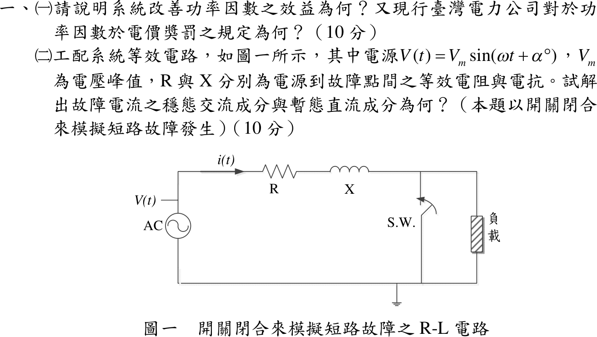
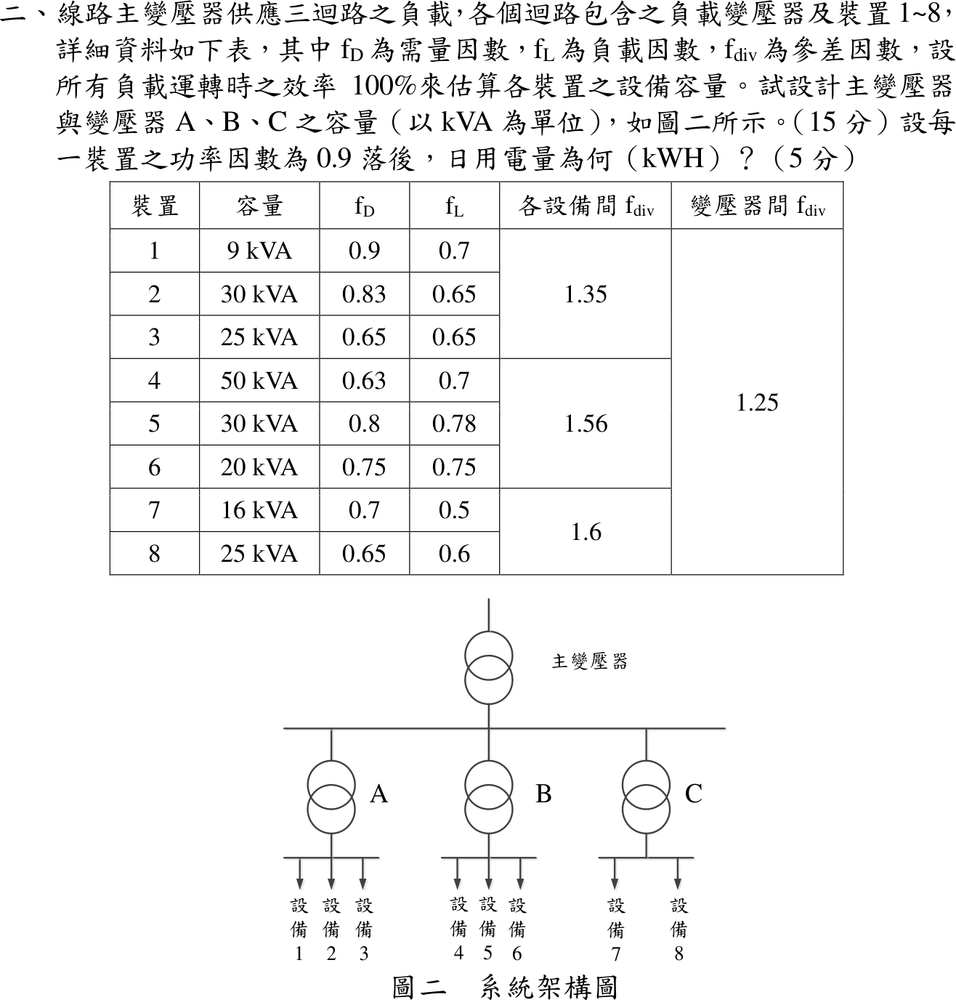
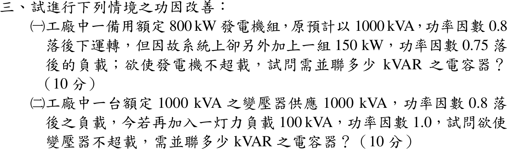
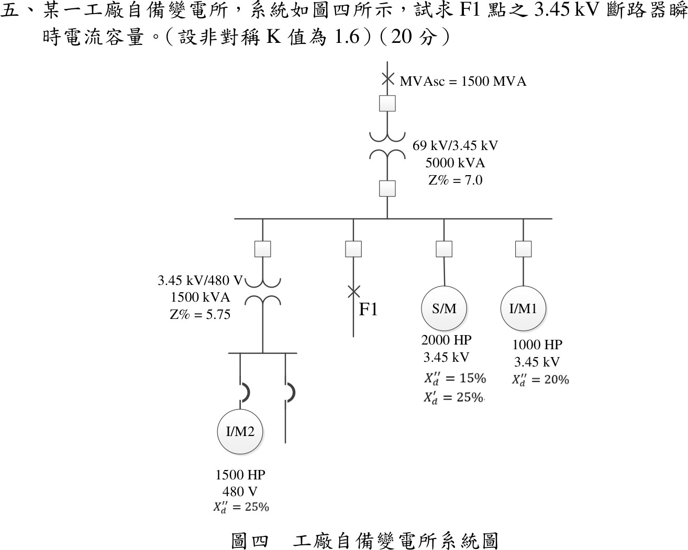

# 110 年電機工程技師｜工業配電逐題詳解

> 本頁由題級 canonical 筆記組合；每題保留官方裁切圖、校驗狀態與可追溯的推導。

## 題目導覽
- [[#一、110 年第 1 題｜功率因數改善與短路暫態|第 1 題：功率因數改善與短路暫態]]
- [[#二、110 年工業配電第 2 題：變壓器容量與日用電量|第 2 題：110 年工業配電第 2 題：變壓器容量與日用電量]]
- [[#三、110 年工業配電第 3 題：功率因數改善與容量約束（含不可行條件證明）|第 3 題：110 年工業配電第 3 題：功率因數改善與容量約束（含不可行條件證明）]]
- [[#四、110 年工業配電第 4 題：電弧爐電壓閃爍|第 4 題：110 年工業配電第 4 題：電弧爐電壓閃爍]]
- [[#五、110 年工業配電第 5 題｜F1 短路與馬達貢獻|第 5 題：F1 短路與馬達貢獻]]

---

## 一、110 年第 1 題｜功率因數改善與短路暫態

> 題級識別：EE-110-06-1
> canonical 來源：[[canonical/EE-110-06-1.md]]
> 題級校驗狀態：verified

### 已知與所求

（一）說明改善功率因數的效益及台電功率因數電價獎罰規定。（二）圖一 R-L 電路，電源 \(v(t)=V_m\sin(\omega t+\alpha)\)，\(R\)、\(X\) 為電源至故障點的等效電阻與電抗，以開關閉合模擬短路，求故障電流的穩態交流成分與暫態直流成分。

### 考場標準作答

#### （一）效益與電價規定（10 分）

同一有功功率下：
\[
I=\frac{P}{\sqrt3\,V\,\mathrm{pf}}
\]
提高功因使電流下降：

1. 線路與變壓器銅損 \(3I^2R\) 降低。
2. 電壓降 \(\Delta V\approx\sqrt3I(R\cos\phi+X\sin\phi)\) 降低，末端電壓改善。
3. 同一變壓器、饋線、開關釋出可用 kVA 容量，可延後擴充。
4. 減少功因附加費並取得電費減收。

台電規定（契約容量適用用戶）：以月平均功因 80% 為基準，

\[
\boxed{\text{每低於 80\% 一個百分點，電費加 0.1\%；每高於 80\% 一個百分點，電費減 0.1\%，超過 95\% 部分不再減}}
\]

#### 步驟 1：閉合後的等效電路與方程式

- 開關 S.W. 跨接在負載兩端，閉合後負載被短路（兩端電壓為 0），負載支路不再分流，故障電流全部經 \(R\)、\(X\) 流回電源。
- 參考方向：\(i(t)\) 由電源正端經 \(R\)、\(X\) 流向故障點（與題圖一致）。
- \(X=\omega L\)，即 \(L=X/\omega\)。

KVL（\(t\ge0\)）：
\[
L\frac{di}{dt}+Ri=V_m\sin(\omega t+\alpha)
\]
初始條件：電感電流不能突變，故障前故障支路電流取 0：
\[
i(0^+)=i(0^-)=0
\]
全解拆成兩部分：
\[
i(t)=i_{ac}(t)+i_{dc}(t)
\]

#### （二）穩態交流成分與暫態直流成分（10 分）

**穩態交流成分**（特解）。故障阻抗寫成極式，大小與角度各一行：
\[
\mathbf Z=R+jX
\]
\[
|\mathbf Z|=\sqrt{R^2+X^2}
\]
\[
\theta=\tan^{-1}\frac{X}{R}
\]
電源相量（以峰值表示）\(\mathbf V=V_m\angle\alpha\)，電流相量：
\[
\mathbf I=\frac{\mathbf V}{\mathbf Z}=\frac{V_m\angle\alpha}{\sqrt{R^2+X^2}\angle\theta}=\frac{V_m}{\sqrt{R^2+X^2}}\angle(\alpha-\theta)
\]
換回時域：
\[
\boxed{i_{ac}(t)=\frac{V_m}{\sqrt{R^2+X^2}}\sin(\omega t+\alpha-\theta)}
\]

**暫態直流成分**（齊次解）。齊次方程：
\[
L\frac{di_{dc}}{dt}+Ri_{dc}=0
\]
\[
i_{dc}(t)=Ke^{-t/\tau},\qquad \tau=\frac{L}{R}=\frac{X}{\omega R}
\]
代入 \(i(0^+)=0\)：
\[
i(0)=\frac{V_m}{\sqrt{R^2+X^2}}\sin(\alpha-\theta)+K=0
\]
\[
K=-\frac{V_m}{\sqrt{R^2+X^2}}\sin(\alpha-\theta)
\]
\[
\boxed{i_{dc}(t)=-\frac{V_m}{\sqrt{R^2+X^2}}\sin(\alpha-\theta)\,e^{-Rt/L}}
\]
直流成分大小由閉合瞬間的角度決定：\(\alpha=\theta\) 時 \(K=0\)，無直流偏移；\(\alpha-\theta=\pm90^\circ\) 時 \(|K|=V_m/\sqrt{R^2+X^2}\)，偏移最大。

### 驗算

令 \(I_m=V_m/|\mathbf Z|\)，代回原式：\(L\,di_{ac}/dt+Ri_{ac}=|\mathbf Z|I_m\sin(\omega t+\alpha-\theta+\theta)=V_m\sin(\omega t+\alpha)\)；\(L\,di_{dc}/dt+Ri_{dc}=0\)；\(i_{ac}(0)+i_{dc}(0)=I_m\sin(\alpha-\theta)-I_m\sin(\alpha-\theta)=0\)。電價條文：PF 70% 加 1.0%，PF 99% 只減到 95% 的 1.5%。

### 失分點

- 直流項漏負號或寫成 \(\sin\alpha\)；起始值需同時扣除相角 \(\theta\)。
- 時間常數寫成 \(R/L\)。
- 罰則寫成每 1% 加 0.3%；台電條文為 0.1%，且減收算到 95% 為止。

### 條件與疑義

題圖開關跨接負載，閉合前若負載電流 \(i_0\) 不可忽略，直流項改為 \([i_0-I_m\sin(\alpha-\theta)]e^{-Rt/L}\)；本解依短路分析慣例取故障前電流 0。

電價規定出處：台電「電價表」（114 年 11 月 17 日經濟部經授能字第 11400334600 號函同意備查）各類用電的「功率因數」條。低壓電力為三相供應、裝置契約容量 20 瓩以上或需量契約容量 30 瓩以上的用戶；高壓、特高壓用戶全部適用。調整對象是「該月份電費」，但按戶計收的基本電費不列計功率因數調整費；超約部分的基本電費也不給功率因數扣減。以上依現行版本查核，110 年考試當時的版本未另行核對。

---

## 二、110 年工業配電第 2 題：變壓器容量與日用電量

> 題級識別：EE-110-06-2
> canonical 來源：[[canonical/EE-110-06-2.md]]
> 題級校驗狀態：verified

### 已知與所求

主變壓器供 A（裝置 1～3，設備間 \(f_{div}=1.35\)）、B（4～6，1.56）、C（7～8，1.6），變壓器間 \(f_{div}=1.25\)；各裝置容量、\(f_D\)、\(f_L\) 如表，效率 100%。求（一）主變壓器與 A、B、C 容量（kVA）；（二）PF 0.9 落後時日用電量。

### 考場標準作答

#### 步驟 1：各裝置最大需量 \(D_i=S_if_{D,i}\)

需量因數 \(f_D=\)最大需量 ÷ 裝置容量，故：

| 裝置 | 1 | 2 | 3 | 4 | 5 | 6 | 7 | 8 |
|---|---:|---:|---:|---:|---:|---:|---:|---:|
| \(S_i\times f_{D,i}\) | \(9\times0.9\) | \(30\times0.83\) | \(25\times0.65\) | \(50\times0.63\) | \(30\times0.8\) | \(20\times0.75\) | \(16\times0.7\) | \(25\times0.65\) |
| \(D_i\)（kVA） | 8.10 | 24.90 | 16.25 | 31.50 | 24.00 | 15.00 | 11.20 | 16.25 |

#### （一）主變壓器與 A、B、C 容量（15 分）

同一變壓器下各裝置尖峰不同時，群組需量＝\(\sum D_i\) ÷ 設備間 \(f_{div}\)。A 群（裝置 1～3，\(f_{div}=1.35\)）：
\[
\sum D_i=8.10+24.90+16.25=49.25\ \mathrm{kVA}
\]
\[
S_A=\frac{49.25}{1.35}=\boxed{36.48\,\mathrm{kVA}}
\]
B 群（裝置 4～6，\(f_{div}=1.56\)）：
\[
\sum D_i=31.50+24.00+15.00=70.50\ \mathrm{kVA}
\]
\[
S_B=\frac{70.50}{1.56}=\boxed{45.19\,\mathrm{kVA}}
\]
C 群（裝置 7～8，\(f_{div}=1.6\)）：
\[
\sum D_i=11.20+16.25=27.45\ \mathrm{kVA}
\]
\[
S_C=\frac{27.45}{1.6}=\boxed{17.16\,\mathrm{kVA}}
\]
主變壓器（三群組需量相加後再除以變壓器間參差因數）：
\[
S_A+S_B+S_C=36.48+45.19+17.16=98.83\ \mathrm{kVA}
\]
\[
S_{main}=\frac{98.83}{1.25}=\boxed{79.06\,\mathrm{kVA}}
\]
選用標準容量：A、B 各 50 kVA，C 20 kVA，主變壓器 100 kVA。

#### （二）日用電量（5 分）

各裝置平均負載 \(D_if_{L,i}\)（kVA）：
\[
\begin{aligned}
&\text{裝置 1：}8.10\times0.7=5.67,\quad \text{裝置 2：}24.90\times0.65=16.185,\quad \text{裝置 3：}16.25\times0.65=10.5625\\
&\text{裝置 4：}31.50\times0.7=22.05,\quad \text{裝置 5：}24.00\times0.78=18.72,\quad \text{裝置 6：}15.00\times0.75=11.25\\
&\text{裝置 7：}11.20\times0.5=5.60,\quad \text{裝置 8：}16.25\times0.6=9.75
\end{aligned}
\]
\[
\sum D_if_{L,i}=5.67+16.185+10.5625+22.05+18.72+11.25+5.60+9.75=99.7875\ \mathrm{kVA}
\]
平均負載是時間平均，直接相加、不除參差因數；設效率 100%，乘 PF 0.9 得平均有功功率：
\[
P_{avg}=\mathrm{PF}\times\sum D_if_{L,i}=0.9\times99.7875=89.80875\ \mathrm{kW}
\]
\[
E=24P_{avg}=24\times89.80875=2155.41\ \mathrm{kWh}
\]
\[
\boxed{E=2155.41\ \mathrm{kWh}}
\]

### 驗算

分群加總：A \(5.67+16.185+10.5625=32.4175\)、B \(22.05+18.72+11.25=52.02\)、C \(5.60+9.75=15.35\)（kVA）；\(24\times0.9=21.6\)，\(21.6\times32.4175=700.218\)、\(21.6\times52.02=1123.632\)、\(21.6\times15.35=331.56\)，合計 \(2155.41\,\mathrm{kWh}\)。

### 失分點

- 參差因數用乘的；\(f_{div}\ge1\)，群組需量應除以它。
- 主變壓器用標準額定（50+50+20）再除 1.25；應以計算需量相加。
- 日用電量漏乘負載因數或功因。

### 條件與疑義

標準容量級距假設為三相 10、15、20、30、50、75、100 kVA；若級距含 37.5 kVA，A 可選 37.5 kVA。

---

## 三、110 年工業配電第 3 題：功率因數改善與容量約束（含不可行條件證明）

> 題級識別：EE-110-06-3
> canonical 來源：[[canonical/EE-110-06-3.md]]
> 題級校驗狀態：needs_manual_review
> [!WARNING] 本題仍有官方資料缺口或事件定義歧義；請以 canonical 條件式解答為準。

### 已知與所求

（一）額定 800 kW 備用發電機組，原以 1000 kVA、PF 0.8 落後運轉，另加 150 kW、PF 0.75 落後負載，求使發電機不超載的並聯電容 kvar。（二）1000 kVA 變壓器供 1000 kVA、PF 0.8 落後負載，再加 100 kVA、PF 1.0 燈力負載，求使變壓器不超載的電容 kvar。

### 考場標準作答

#### （一）發電機（10 分）

並聯電容只供無效功率、不改變 \(P\)；發電機以電樞 1000 kVA 為容量限制。原負載（1000 kVA、PF 0.8 落後）：
\[
P_1=1000\times0.8=800\,\mathrm{kW},\qquad Q_1=\sqrt{1000^2-800^2}=\sqrt{360000}=600\,\mathrm{kvar}
\]
新增負載（150 kW、PF 0.75 落後）：
\[
S_2=\frac{150}{0.75}=200\,\mathrm{kVA},\qquad Q_2=\sqrt{200^2-150^2}=\sqrt{17500}=132.3\,\mathrm{kvar}
\]
合成：
\[
P=800+150=950\,\mathrm{kW},\qquad Q=600+\sqrt{17500}=732.3\,\mathrm{kvar}
\]
額定圓上容許的無效功率：
\[
Q_{allow}=\sqrt{1000^2-950^2}=\sqrt{1000000-902500}=\sqrt{97500}=312.2\,\mathrm{kvar}
\]
電容量：
\[
Q_c=Q-Q_{allow}=600+\sqrt{17500}-\sqrt{97500}
\]
\[
\boxed{Q_c=420.04\,\mathrm{kvar}}
\]

補償後 PF \(=950/1000=0.95\) 落後，發電機電流回到 1000 kVA 額定內。但 \(950\,\mathrm{kW}>800\,\mathrm{kW}\)，原動機有功仍超載，電容無法改善，須卸載 150 kW 或改用較大機組。

#### （二）變壓器（10 分）

燈力負載 PF 1.0 只增加 \(P\)；以變壓器 1000 kVA 為限制。原負載與燈力負載：
\[
P=1000\times0.8+100\times1.0=800+100=900\,\mathrm{kW}
\]
\[
Q=\sqrt{1000^2-800^2}+0=600\,\mathrm{kvar}
\]
容許無效功率：
\[
Q_{allow}=\sqrt{1000^2-900^2}=\sqrt{1000000-810000}=\sqrt{190000}=435.9\,\mathrm{kvar}
\]
電容量：
\[
Q_c=Q-Q_{allow}=600-\sqrt{190000}
\]
\[
\boxed{Q_c=164.11\,\mathrm{kvar}}
\]

### 驗算

（一）補償後 \(Q'=Q-Q_c=\sqrt{97500}\)，\(|S'|=\sqrt{950^2+97500}=\sqrt{902500+97500}=1000\,\mathrm{kVA}\)。（二）\(Q'=\sqrt{190000}\)，\(|S'|=\sqrt{810000+190000}=1000\,\mathrm{kVA}\)，PF \(=900/1000=0.90\) 落後。

### 失分點

- 新增負載的 \(Q\) 用 \(150\times0.75\)；應為 \(\sqrt{200^2-150^2}=150\tan(\cos^{-1}0.75)=132.3\,\mathrm{kvar}\)。
- 把「改善到某 PF」當目標；本題限制是額定 kVA，所需 PF 由 \(P/S_{rated}\) 決定。

### 條件與疑義

（一）題幹同時給 800 kW 與 1000 kVA。依題意「並聯多少 kvar」取 1000 kVA 為發電機（電樞）容量限制得 420.04 kvar；若「不超載」指原動機 800 kW，則任何電容皆不可行，作答時兩點都要寫明。

---

## 四、110 年工業配電第 4 題：電弧爐電壓閃爍

> 題級識別：EE-110-06-4
> canonical 來源：[[canonical/EE-110-06-4.md]]
> 題級校驗狀態：verified

### 已知與所求

69 kV 受電，\(\mathrm{MVA_{sc}}=1500\,\mathrm{MVA}\)；基準 \(69\,\mathrm{kV}\)、\(12.5\,\mathrm{MVA}\)。饋線 \(Z_L=j4.0\,\Omega\)，主變壓器 \(8\%\)、爐用變壓器 \(7\%\)（已在同一基準），電弧爐與引線 \(Z_F=j0.35\,\mathrm{pu}\)。官方圖說 A 點在 69 kV 母線上（饋線 \(Z_L\) 之前）。求（一）A 點閃爍電壓變動率；（二）控制在 1.5% 以下所需串聯電抗器 pu 值。

### 考場標準作答

#### 步驟 1：各段電抗換成 \(12.5\,\mathrm{MVA}\) 基準

取電極短路（最嚴重的閃爍狀態）計算，故障前電壓 \(1\,\mathrm{pu}\)，基準 \(69\,\mathrm{kV}\)、\(12.5\,\mathrm{MVA}\)。電源電抗（由短路容量）：
\[
X_S=\frac{S_b}{\mathrm{MVA_{sc}}}=\frac{12.5}{1500}=0.008333\ \mathrm{pu}
\]
饋線（歐姆值除以基準阻抗）：
\[
Z_b=\frac{V_b^2}{S_b}=\frac{69^2}{12.5}=\frac{4761}{12.5}=380.88\ \Omega
\]
\[
X_L=\frac{4.0}{Z_b}=\frac{4.0}{380.88}=0.01050\ \mathrm{pu}
\]
主變壓器 \(X_{T1}=0.08\)、爐用變壓器 \(X_{T2}=0.07\)、爐與引線 \(X_F=0.35\)（題目已在同一基準）。

#### 步驟 2：電抗分壓電路

- 理想電源 \(1\angle0^\circ\) 依序串 \(X_S\) → A 點（69 kV 母線）→ \(X_L\) → \(X_{T1}\) → \(X_{T2}\) → B 點 → \(X_F\)；電極短路即爐端接到參考線。
- A 點電壓 \(V_A\) 量在 A 點與參考線之間；A 點上游只有 \(X_S\)，其餘都在 A 點下游。

電源至爐總電抗：
\[
X_{all}=X_S+X_L+X_{T1}+X_{T2}+X_F=0.008333+0.01050+0.08+0.07+0.35=0.5188\ \mathrm{pu}
\]

#### （一）A 點閃爍電壓變動率（10 分）

A 點在饋線 \(Z_L\) 之前，壓降只發生在 \(X_S\)，變動率為純電抗串聯的分壓比：
\[
I_{arc}=\frac{1}{X_{all}},\qquad \Delta V_A=X_S\,I_{arc}=\frac{X_S}{X_{all}}
\]
\[
\Delta V_A=\frac{0.008333}{0.5188}=0.01606
\]
\[
\boxed{1.61\%}
\]

#### （二）串聯電抗器（10 分）

\(X_R\) 裝在 A 點下游的電弧爐回路，只加大分母，令 \(X_S/(X_{all}+X_R)\le1.5\%\)：
\[
\frac{X_S}{X_{all}+X_R}\le0.015
\]
\[
X_{all}+X_R\ge\frac{X_S}{0.015}=\frac{0.008333}{0.015}=0.5555\ \mathrm{pu}
\]
\[
X_R\ge0.5555-0.5188=0.0367\ \mathrm{pu}
\]
\[
\boxed{X_R\ge0.0367\,\mathrm{pu}}
\]

### 驗算

取 \(X_R=0.0367\) 以相量 KVL 回算：總電抗 \(0.5188+0.0367=0.5555\)，
\[
\dot I=\frac{1}{j0.5555}=-j1.800\ \mathrm{pu}:\quad |\dot I|=1.800,\ \angle\dot I=-90^\circ
\]
\[
\dot V_A=1-jX_S\dot I=1-(j0.008333)(-j1.800)=1-0.01500=0.9850\ \mathrm{pu}:\quad |\dot V_A|=0.9850,\ \angle\dot V_A=0^\circ
\]
變動率 \(1-0.9850=1.50\%\)，恰在限值。

### 失分點

- 把 \(Z_L\) 與主變壓器算進 A 點上游；A 點在饋線之前。
- \(j4\,\Omega\) 未除以 \(Z_b=380.88\,\Omega\) 直接與 pu 相加。
- 電抗器加在分子；串聯電抗是增大分母、降低爐電流。

### 條件與疑義

題目未指定串聯電抗器位置；本解裝在 A 點下游。若裝在 A 點上游，A 點變動率為 \((X_S+X_R)/(X_{all}+X_R)\)，反而變大。

#### 另一觀測點分支：圖示 B 點

若觀測點改為爐用變壓器低壓側 B 點：\(X_{up,B}=X_S+X_L+X_{T1}+X_{T2}=0.168835329\,\mathrm{pu}\)，\(\Delta V_B=0.168835/0.518835=32.5412\%\)，降到 1.5% 需 \(X_R\ge10.736853\,\mathrm{pu}\)。另以 \(X_S+X_L+X_{T1}=0.098835\) 為上游所得的 19.05%／6.07 pu 對應兩變壓器之間的假想觀測點，既非 A 點，也非圖示 B 點。

---

## 五、110 年工業配電第 5 題｜F1 短路與馬達貢獻

> 題級識別：EE-110-06-5
> canonical 來源：[[canonical/EE-110-06-5.md]]
> 題級校驗狀態：reference_book_verified

### 已知與所求

圖四：\(\mathrm{MVA_{sc}}=1500\,\mathrm{MVA}\)；T1 \(69/3.45\,\mathrm{kV}\)、\(5000\,\mathrm{kVA}\)、\(Z=7\%\)；3.45 kV 母線接 S/M \(2000\,\mathrm{HP}\)（\(X_d''=15\%\)）、I/M1 \(1000\,\mathrm{HP}\)（\(X_d''=20\%\)），並經 T2 \(3.45\,\mathrm{kV}/480\,\mathrm V\)、\(1500\,\mathrm{kVA}\)、\(Z=5.75\%\) 接 I/M2 \(1500\,\mathrm{HP}\)（\(X_d''=25\%\)）；F1 在母線饋線上。非對稱 \(K=1.6\)，求 F1 點 3.45 kV 斷路器瞬時電流容量。

### 考場標準作答

#### 步驟 1：各來源電抗換成 \(100\,\mathrm{MVA}\) 基準

取基準 \(100\,\mathrm{MVA}\)、\(3.45\,\mathrm{kV}\)，採 1 HP≈1 kVA，各來源以內電勢 \(E''=1\angle0^\circ\,\mathrm{pu}\) 串次暫態電抗表示。換基準：\(X_{new}=X_{old}\dfrac{S_b}{S_{rated}}\)（額定電壓即基準電壓）；電網以短路容量換算 \(X=S_b/\mathrm{MVA_{sc}}\)。

電力公司＋T1（串聯）：
\[
X_{src}=\frac{100}{1500}+0.07\times\frac{100}{5}=\frac{1}{15}+1.4=\frac{22}{15}=1.467\,\mathrm{pu}
\]
S/M（\(2000\,\mathrm{HP}\approx2\,\mathrm{MVA}\)）：
\[
X_{SM}=0.15\times\frac{100}{2}=7.50\,\mathrm{pu}
\]
I/M1（\(1000\,\mathrm{HP}\approx1\,\mathrm{MVA}\)）：
\[
X_{IM1}=0.20\times\frac{100}{1}=20\,\mathrm{pu}
\]
T2＋I/M2（\(1500\,\mathrm{HP}\approx1.5\,\mathrm{MVA}\)，480 V 側馬達經 T2 串聯回饋）：
\[
X_{T2}=0.0575\times\frac{100}{1.5}=3.833\,\mathrm{pu},\qquad X_{IM2}''=0.25\times\frac{100}{1.5}=16.67\,\mathrm{pu}
\]
\[
X_{T2}+X_{IM2}''=3.833+16.67=20.50\,\mathrm{pu}
\]

#### 步驟 2：F1 故障的並聯電抗圖

- 瞬時（第一週波）容量用次暫態 \(X_d''\)，故 S/M 的 \(X_d'=25\%\) 不用；480 V 母線另一饋線無電源，不貢獻故障電流。
- 各來源一端為內電勢 \(E''=1\angle0^\circ\)（接參考線），另一端經各自電抗接到 3.45 kV 母線；F1 經饋線斷路器接母線，故障即母線對參考線短路。
- I/M2 先串 \(X_{T2}\) 再並入，不可與 T2 並聯。
- 每條支路電流 \(=E''/X=1/X\)（母線電壓為 0），F1 電流 \(I_{F1}\) 為四支路之和。

| 來源 | 電抗 \(X\)（pu） | 支路電流 \(I=1/X\)（pu） |
|---|---:|---:|
| 電力公司＋T1 | \(X_{src}=22/15=1.467\) | \(I_{src}=15/22=0.6818\) |
| S/M | \(X_{SM}=7.50\) | \(I_{SM}=1/7.50=0.1333\) |
| I/M1 | \(X_{IM1}=20\) | \(I_{IM1}=1/20=0.05\) |
| T2＋I/M2 | \(X_{T2}+X_{IM2}''=20.50\) | \(I_{IM2}=1/20.50=0.04878\) |

\[
I_{F1}=I_{src}+I_{SM}+I_{IM1}+I_{IM2}=0.6818+0.1333+0.05+0.04878=0.9139\,\mathrm{pu}
\]

#### F1 點 3.45 kV 斷路器瞬時電流容量（20 分）

基準電流分母：
\[
\sqrt3V_b=\sqrt3\times3.45=5.976\,\mathrm{kV}
\]
對稱短路電流：
\[
I_{sym}=I_{F1}\cdot\frac{S_b}{\sqrt3V_b}=\frac{0.9139\times100}{5.976}=\frac{91.39}{5.976}
\]
\[
I_{sym}=\boxed{15.29\,\mathrm{kA}}
\]
瞬時（非對稱）電流容量＝\(K\times\) 對稱電流，\(K\) 只乘一次：
\[
I_{mom}=K\,I_{sym}=\frac{1.6\times91.39}{5.976}=\frac{146.224}{5.976}
\]
\[
I_{mom}=\boxed{24.47\,\mathrm{kA}}
\]
參考書四捨五入寫成 15.30 kA／24.48 kA。

### 驗算

改用 \(5\,\mathrm{MVA}\) 基準：各支路電抗 \(5/1500+0.07=0.07333\)、\(0.15\times2.5=0.375\)、\(0.20\times5=1.000\)、\((0.0575+0.25)\times5/1.5=1.025\)（pu），導納和 \(13.64+2.667+1.000+0.9756=18.28\,\mathrm{pu}\)；\(I_{sym}=18.28\times5/5.976=91.40/5.976=15.29\,\mathrm{kA}\)，與 100 MVA 基準一致（導納和恰為 \(0.9139\times20\)）。

### 失分點

- 漏掉 480 V 側 I/M2：其經 T2 的反饋仍流到 F1。
- T2 與 I/M2 電抗並聯；兩者應串聯後再與其他來源並聯。
- \(K\) 只乘一次，不得再乘 \(\sqrt2\) 或重複套用。

### 條件與疑義

題目未給 \(K\) 的定義：若 \(K\) 是 RMS 非對稱倍率，24.47 kA 為非對稱 RMS 值；若 \(K\) 是峰值倍率，同一數值為峰值。須先確認是 RMS 非對稱倍率或峰值倍率，不得把同一個 \(K\) 再乘一次。

效率／功因參數化：題目只給 HP，未給效率與功因。若 \(S_i=0.000746\,\mathrm{HP}_i/k_i\)（MVA，\(k=\eta\,\mathrm{pf}\)），三台取相同 \(k\)：

| \(k\) | \(I_{sym}\)（kA） | \(1.6I_{sym}\)（kA） |
|---:|---:|---:|
| 0.80 | 15.0420 | 24.0672 |
| 0.85 | 14.8360 | 23.7376 |
| 0.90 | 14.6522 | 23.4435 |
| 1.00 | 14.3382 | 22.9411 |

1 HP≈1 kVA 相當於 \(k=0.746\)，故主解略大於上表各列。

---
