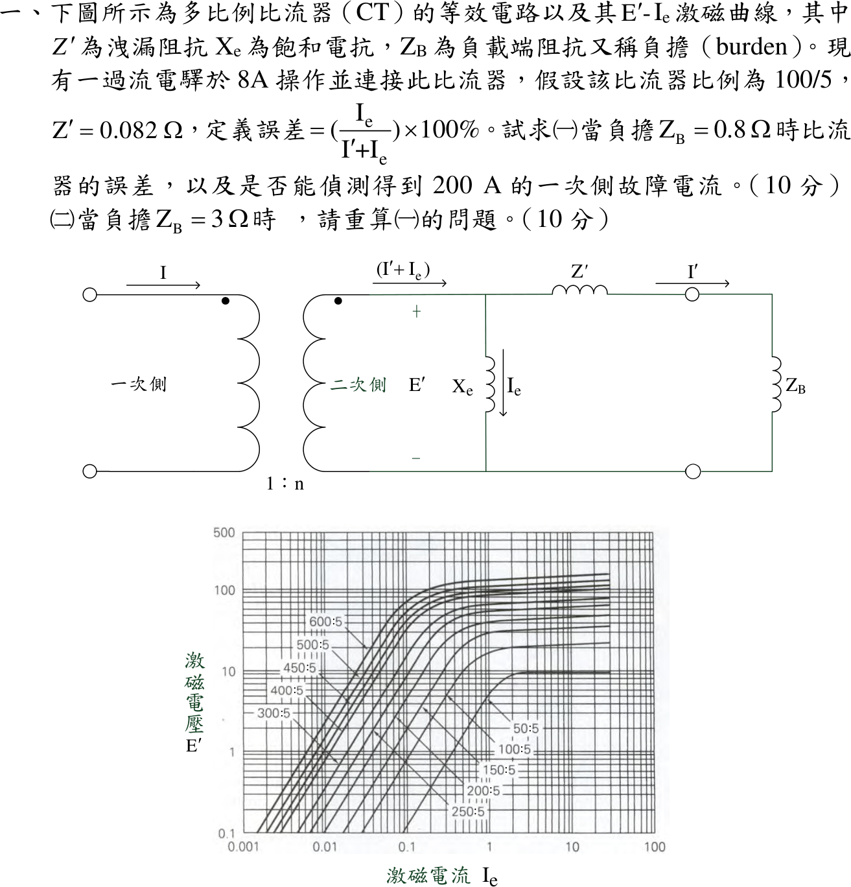
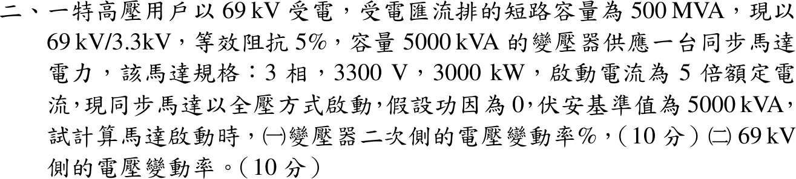
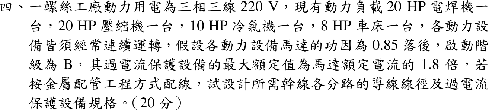

# 111 年電機工程技師｜工業配電逐題詳解

> 本頁由題級 canonical 筆記組合；每題保留官方裁切圖、校驗狀態與可追溯的推導。

## 題目導覽
- [[#一、111 年工業配電第 1 題｜CT 激磁特性與負擔誤差|第 1 題：CT 激磁特性與負擔誤差]]
- [[#二、111 年第 2 題｜同步馬達全壓啟動電壓變動率|第 2 題：同步馬達全壓啟動電壓變動率]]
- [[#三、111 年第 3 題｜汽電共生系統三相短路與斷路器電流|第 3 題：汽電共生系統三相短路與斷路器電流]]
- [[#四、111 年工業配電第 4 題｜多台連續運轉馬達配線與保護|第 4 題：多台連續運轉馬達配線與保護]]
- [[#五、111 年第 5 題｜低電阻接地電阻器額定與短路電流比例|第 5 題：低電阻接地電阻器額定與短路電流比例]]

---

## 一、111 年工業配電第 1 題｜CT 激磁特性與負擔誤差

> 題級識別：EE-111-06-1
> canonical 來源：[[canonical/EE-111-06-1.md]]
> 題級校驗狀態：reference_book_verified

### 已知與所求

CT 變比 \(100/5\)（\(n=20\)），漏阻抗 \(Z'=0.082\,\Omega\)，過流電驛於 \(I'=8\,\mathrm A\) 動作；誤差 \(=I_e/(I'+I_e)\times100\%\)。用圖中 100:5 激磁曲線，求（一）\(Z_B=0.8\,\Omega\)、（二）\(Z_B=3\,\Omega\) 時的 CT 誤差，並判斷能否偵測 \(200\,\mathrm A\) 一次側故障電流。

### 考場標準作答

#### 步驟 1：兩種負擔的激磁電壓 \(E'\)

過流電驛恰動作時 \(I'=8\,\mathrm A\)；\(Z'\) 與 \(Z_B\) 只給大小，視為同相直接相加。\(E'\) 為激磁支路兩端電壓，等於負擔支路電流乘其總阻抗：
\[
E'=I'(Z'+Z_B)
\]
\(Z_B=0.8\,\Omega\)：
\[
E'=8(0.082+0.8)=8(0.882)=7.056\,\mathrm V
\]
\(Z_B=3\,\Omega\)：
\[
E'=8(0.082+3)=8(3.082)=24.656\,\mathrm V
\]

#### 步驟 2：在 100:5 曲線讀 \(I_e\)

曲線讀值以參考書數值（0.4 A、30 A）為主解。

- 100:5 是圖中由右數第二條曲線，飽和段約 20～22 V，曲線畫到 \(I_e=30\,\mathrm A\) 為止（末端 \(E'\approx22\,\mathrm V\)）。
- \(E'=7.056\,\mathrm V\)：水平線與曲線交於 \(I_e\approx0.40\,\mathrm A\)（數位化讀值 0.37～0.40 A）。
- \(E'=24.656\,\mathrm V\)：高於曲線末端的 22 V，水平線與曲線無交點；要撐到這個電壓，\(I_e\) 必須超過圖上最大值，故只能寫 \(I_e\ge30\,\mathrm A\)。

#### （一）\(Z_B=0.8\,\Omega\)（10 分）

誤差：
\[
\text{誤差}=\frac{I_e}{I'+I_e}\times100\%=\frac{0.40}{8+0.40}\times100\%=\frac{0.40}{8.40}\times100\%
\]
\[
\boxed{\text{誤差}=4.76\%}
\]
電驛恰動作時二次總電流為 \(I'+I_e\)，乘匝比 \(n=100/5=20\) 得一次側最小動作電流：
\[
I_p=n(I'+I_e)=20(8+0.40)=20(8.40)
\]
\[
\boxed{I_p=168\,\mathrm A}
\]
\(168\,\mathrm A<200\,\mathrm A\)，200 A 故障時二次負擔電流大於 8 A：
\[
\boxed{\text{可偵測 200 A 故障}}
\]

#### （二）\(Z_B=3\,\Omega\)（10 分）

誤差與 \(I_p\) 都隨 \(I_e\) 增大，以下限 \(I_e=30\,\mathrm A\) 算出的是「至少」值，結論不受影響。誤差（下限）：
\[
\text{誤差}\ge\frac{30}{8+30}\times100\%=\frac{30}{38}\times100\%
\]
\[
\boxed{\text{誤差}\ge78.95\%}
\]
一次側最小動作電流（下限）：
\[
I_p\ge n(I'+I_e)=20(8+30)=20(38)
\]
\[
\boxed{I_p\ge760\,\mathrm A}
\]
\(760\,\mathrm A>200\,\mathrm A\)，200 A 故障時 CT 已深度飽和，送到電驛的電流不足 8 A：
\[
\boxed{\text{不能偵測 200 A 故障}}
\]

### 驗算

改用「一次側 200 A 已知」的路線：二次總電流 \(I'+I_e=200/20=10\,\mathrm A\)，負載線 \(E'=(Z'+Z_B)(10-I_e)\) 與曲線聯立。

- \(Z_B=0.8\)：交點 \(I_e\approx0.43\,\mathrm A\)，\(I'\approx9.57\,\mathrm A\ge8\)，動作。
- \(Z_B=3\)：交點 \(I_e\approx3.50\,\mathrm A\)（\(E'\approx20\,\mathrm V\)），\(I'\approx6.50\,\mathrm A<8\)，不動作。

動作門檻為 \(I'\ge8\iff I_e\le2.0\,\mathrm{A}\)，兩條路線結論相同。

### 失分點

- 讀成 50:5 曲線（飽和約 10 V）；100:5 是由右數第二條，飽和約 20～22 V。
- 誤差分母用 \(I'\) 而非 \(I'+I_e\)，（一）會寫成 5.0%。
- （二）在圖外硬讀一個 \(I_e\)；應寫「超出曲線，\(I_e\ge30\,\mathrm A\)」並以下限判斷。

### 條件與疑義

曲線讀值（對數座標，每十倍約 297 px，判讀誤差約 ±2.5%）：

| \(E'\)（V） | 6.4 | 7.06 | 8.5 | 12.5 | 16.6 | 19.3 | 19.7 | 20.3 | 21.9 |
|---|---:|---:|---:|---:|---:|---:|---:|---:|---:|
| \(I_e\)（A） | 0.36 | 0.38 | 0.43 | 0.62 | 0.90 | 1.9 | 3.2 | 5.6 | 29 |

（一）讀值區間 \(0.37\sim0.40\,\mathrm A\)，誤差 \(4.4\sim4.8\%\)、\(I_p=167\sim168\,\mathrm A\)，均小於 200 A。200 A 路線的數位化交點讀值為 \(I_e=0.42\sim0.44\,\mathrm A\)（\(I'=9.56\sim9.58\,\mathrm A\)）與 \(I_e=3.4\sim3.7\,\mathrm A\)（\(I'=6.3\sim6.6\,\mathrm A\)）。兩個區間分別遠低於與遠高於門檻 \(I_e\le2.0\,\mathrm{A}\)，故偵測結論不受圖解誤差影響，受影響的只有誤差百分比的末位。

---

## 二、111 年第 2 題｜同步馬達全壓啟動電壓變動率

> 題級識別：EE-111-06-2
> canonical 來源：[[canonical/EE-111-06-2.md]]
> 題級校驗狀態：reference_book_verified

### 已知與所求

69 kV 受電匯流排短路容量 \(500\,\mathrm{MVA}\)；變壓器 \(69/3.3\,\mathrm{kV}\)、\(5000\,\mathrm{kVA}\)、\(Z=5\%\)；同步馬達 \(3300\,\mathrm V\)、\(3000\,\mathrm{kW}\)，全壓啟動電流 \(5\) 倍額定，啟動功因為 0；基準 \(5000\,\mathrm{kVA}\)。求啟動時（一）變壓器二次側、（二）69 kV 側電壓變動率。

### 考場標準作答

#### 步驟 1：電源與變壓器電抗

題給啟動功因為 0，各元件只剩電抗；設啟動前系統無載，電源內電動勢與各母線電壓皆為 \(1\angle0^\circ\ \mathrm{pu}\)，電壓變動率 \(=1-|V|\)（pu），69 kV 受電點以上的電源以理想電壓源串短路電抗表示。電源電抗由受電匯流排短路容量換算：
\[
X_s=\frac{S_b}{S_{sc}}=\frac{5}{500}=0.01\ \mathrm{pu}
\]
變壓器容量 5000 kVA 與基準相同，阻抗百分比直接是標么值（純電抗）：
\[
X_T=5\%=0.05\ \mathrm{pu}
\]

#### 步驟 2：馬達啟動電抗 \(X_M\)

題幹只給 kW，依參考書取 \(\eta\,\mathrm{pf}=0.85\)，馬達額定容量：
\[
S_M=\frac{P}{\eta\,\mathrm{pf}}=\frac{3000}{0.85}=3529.41\ \mathrm{kVA}
\]
全壓啟動電流為 5 倍額定，額定電壓下的啟動容量：
\[
S_{start}=5S_M=5(3529.41)=17647.05\ \mathrm{kVA}=17.65\ \mathrm{MVA}
\]
啟動支路在額定電壓下吸收 \(S_{start}\)，等值電抗：
\[
X_M=\frac{S_b}{S_{start}}=\frac{5}{17.65}=0.2833\ \mathrm{pu}
\]

#### 步驟 3：等效電路與啟動電流

畫法：
- 理想電源 \(E=1\angle0^\circ\ \mathrm{pu}\) 在左；上方導線依序串 \(jX_s\) → 69 kV 母線 → \(jX_T\) → 3.3 kV 母線（變壓器二次側）；3.3 kV 母線對回路線接馬達啟動電抗 \(jX_M\)。
- 電流 \(I\) 參考方向：由電源流向馬達；\(V_{69}\)、\(V_2\) 都是母線對回路線的電壓。

電源至馬達總電抗（三者串聯）：
\[
X_{tot}=X_s+X_T+X_M=0.01+0.05+0.2833=0.3433\ \mathrm{pu}
\]
啟動電流大小：
\[
I=\frac{E}{X_{tot}}=\frac{1}{0.3433}=2.913\ \mathrm{pu}
\]

#### （一）變壓器二次側電壓變動率（10 分）

3.3 kV 母線位於 \(X_s\)、\(X_T\) 之後，上游電抗：
\[
X_s+X_T=0.01+0.05=0.06\ \mathrm{pu}
\]
壓降（\(I=1/X_{tot}\) 代入即為分壓比）：
\[
\Delta V_2=I(X_s+X_T)=\frac{X_s+X_T}{X_{tot}}=\frac{0.06}{0.3433}=0.1748\ \mathrm{pu}
\]
\[
\boxed{\Delta V_2=17.48\%}
\]

#### （二）69 kV 側電壓變動率（10 分）

69 kV 受電匯流排在變壓器之前，上游只有 \(X_s\)：
\[
\Delta V_{69}=IX_s=\frac{X_s}{X_{tot}}=\frac{0.01}{0.3433}=0.02913\ \mathrm{pu}
\]
\[
\boxed{\Delta V_{69}=2.91\%}
\]

參考書將 \(X_M\) 取 0.283，寫成 17.5% 與 2.92%。

### 驗算

相量 KVL（純電抗，\(E=1\angle0^\circ\)）：
\[
\underline I=\frac{1}{j0.3433}=-j2.913\ \mathrm{pu}
\]
\[
\underline V_2=1-j(0.06)(-j2.913)=1-0.1748=0.8252\ \mathrm{pu}
\]
\[
\underline V_{69}=1-j(0.01)(-j2.913)=1-0.02913=0.9709\ \mathrm{pu}
\]
兩者皆為實數（與電源同相），\(1-0.8252=17.48\%\)、\(1-0.9709=2.91\%\)，與分壓比一致；且 \(\Delta V_{69}/\Delta V_2=0.01/0.06=1/6\)。

### 失分點

- 未寫明 \(\eta\,\mathrm{pf}\) 假設即逕取 3000 kVA；若採 \(k=1\)（\(X_M=0.3333\)）須註明，結果為 15.25%／2.54%。
- 69 kV 側把變壓器電抗也算在上游；69 kV 母線只跨 \(X_s\)。
- 用額定電流而非 5 倍啟動電流換算 \(X_M\)。

### 條件與疑義

題幹只給 \(3000\,\mathrm{kW}\)，未給額定功因與效率；啟動功因為 0 只說明啟動支路為純電抗，不能代替額定運轉功因。令 \(k=\eta\,\mathrm{pf}_n\)，\(X_M=k/3\)，參數化敏感度如下（主解取參考書 \(k=0.85\)）：

\[
\Delta V_2(k)=\frac{0.06}{0.06+k/3},\qquad \Delta V_{69}(k)=\frac{0.01}{0.06+k/3}
\]

| \(k=\eta\,\mathrm{pf}_n\) | \(\Delta V_2\) | \(\Delta V_{69}\) |
|---:|---:|---:|
| 0.80 | 18.3673% | 3.0612% |
| 0.85 | 17.4757% | 2.9126% |
| 0.90 | 16.6667% | 2.7778% |
| 1.00 | 15.2542% | 2.5424% |

---

## 三、111 年第 3 題｜汽電共生系統三相短路與斷路器電流

> 題級識別：EE-111-06-3
> canonical 來源：[[canonical/EE-111-06-3.md]]
> 題級校驗狀態：reference_book_verified

### 已知與所求

發電機 \(25\,\mathrm{MW}\)、\(22.8\,\mathrm{kV}\)、\(X_d''=12\%\)；電動機 \(6000\,\mathrm{kW}\)、\(3.3\,\mathrm{kV}\)、\(X_d''=15\%\)（\(X_d'=25\%\)）；變壓器 \(25\,\mathrm{MVA}\)、\(22.8/3.3\,\mathrm{kV}\)、\(X_T=8\%\)。單線圖：G—變壓器—斷路器 A—3.3 kV 母線，母線接三個 M 支路，F 在中間馬達支路的斷路器之後。基準 \(25\,\mathrm{MVA}\)、\(22.8/3.3\,\mathrm{kV}\)。求（一）F 點、（二）斷路器 A 點的次暫態故障電流。

### 考場標準作答

#### 步驟 1：各支路電抗（\(25\,\mathrm{MVA}\) 基準）

各電源以內電勢 \(E''=1\,\mathrm{pu}\) 串次暫態電抗 \(X_d''\)（不用 \(X_d'\)）；採 25 MW 視同 25 MVA（\(PF_G=1\)）、每台馬達 6000 kW≈6 MVA。發電機與變壓器已是 25 MVA、額定電壓即基準電壓，直接串聯：
\[
X_G+X_T=0.12+0.08=0.20\,\mathrm{pu}
\]
馬達換基準（\(S_{rated}=6\,\mathrm{MVA}\)）：
\[
X_M''=X_{d}''\frac{S_b}{S_M}=0.15\times\frac{25}{6}=0.625\,\mathrm{pu}
\]
3.3 kV 側基準電流（分母先算）：
\[
\sqrt3V_b=\sqrt3\times3.3=5.716\,\mathrm{kV},\qquad I_b=\frac{S_b}{\sqrt3V_b}=\frac{25}{5.716}\,\mathrm{kA}
\]

#### 步驟 2：次暫態電抗圖

- 3.3 kV 母線為共同節點；發電機支路 \(1\angle0^\circ\) 串 \(j0.20\)，經斷路器 A 接母線；三個 M 支路各 \(1\angle0^\circ\) 串 \(j0.625\) 接母線。
- F 在中間馬達斷路器之後，饋線阻抗不計，故障即母線對參考線短路：中間馬達電流直接進 F，其餘支路電流經母線流向 F。
- 斷路器 A 串在發電機支路上，只看到發電機支路電流。

#### （一）故障點 F 之次暫態故障電流（10 分）

母線電壓為 0，各支路電流 \(=E''/X=1/X\)，F 點為四支路電流相加（疊加原理）：
\[
I_G=\frac{1}{X_G+X_T}=\frac{1}{0.20}=5\,\mathrm{pu},\qquad I_{M}=\frac{1}{X_M''}=\frac{1}{0.625}=1.6\,\mathrm{pu}\ (\text{每台})
\]
\[
I_F''^{pu}=I_G+3I_M=5+3\times1.6=5+4.8=9.8\,\mathrm{pu}
\]
換成安培：
\[
I_F''=I_F''^{pu}\,I_b=9.8\times\frac{25}{5.716}=\frac{245}{5.716}
\]
\[
\boxed{I_F''=42.86\ \mathrm{kA}}
\]

#### （二）斷路器 A 點之次暫態故障電流（10 分）

A 點量測的是發電機支路電流；馬達反饋由各 M 支路經母線流向 F，不穿過 A：
\[
I_A''^{pu}=\frac{1-0}{X_G+X_T}=\frac{1}{0.20}=5\,\mathrm{pu}
\]
\[
I_A''=5\times\frac{25}{5.716}=\frac{125}{5.716}
\]
\[
\boxed{I_A''=21.87\ \mathrm{kA}}
\]
參考書以 \(I_b=4.37\,\mathrm{kA}\) 寫成 \(9.8\times4.37=42.83\)／\(5\times4.37=21.85\) kA（42.83 kA、21.85 kA）。

### 驗算

戴維寧：\(Z_{th}=0.20\parallel\dfrac{0.625}{3}=\dfrac{1}{5+4.8}=\dfrac{1}{9.8}\,\mathrm{pu}\)，\(I_F''=I_b/Z_{th}=9.8\times25/5.716=42.86\,\mathrm{kA}\)，與支路相加一致。\(I_F''-I_A''=4.8\,I_b=120/5.716=20.99\,\mathrm{kA}\)，即三台馬達各 \(1.6\,\mathrm{pu}\)，全部只經母線流向 F、不經 A。

### 失分點

- 不得把馬達反饋分量加到 A 點；馬達電流由各 M 支路經母線流向 F，不穿過 A。
- 只算一台馬達（\(6.6\times25/5.716=28.87\,\mathrm{kA}\)）；圖中三個 M 支路都要列入。
- 用暫態電抗 \(X_d'=25\%\) 求次暫態電流。

### 條件與疑義

題目給的是 \(25\,\mathrm{MW}\) 與 \(6000\,\mathrm{kW}\)，未給額定功因／效率；\(25\,\mathrm{MVA}\) 只是題目指定的基準。圖面確認三個 M 支路，支路數量 N_M=3 已確認。若 \(S_G=25/PF_G\)，則 \(X_G=0.12PF_G\)，A 點條件分支：

| \(PF_G\) | 1.0 | 0.9 | 0.8 |
|---|---:|---:|---:|
| \(I_A''=I_b/(0.12PF_G+0.08)\)（kA） | 21.8693 | 23.2652 | 24.8515 |

若馬達 \(\eta\,\mathrm{pf}_n=0.9\)，\(X_M''=0.15\times25/(6/0.9)=0.5625\)，\(I_F''=(5+3/0.5625)I_b=\tfrac{31}{3}\times\tfrac{25}{\sqrt3\times3.3}=45.20\,\mathrm{kA}\)。主解採 \(PF_G=1\)、馬達 1 kW≈1 kVA 的參考書慣例。

---

## 四、111 年工業配電第 4 題｜多台連續運轉馬達配線與保護

> 題級識別：EE-111-06-4
> canonical 來源：[[canonical/EE-111-06-4.md]]
> 題級校驗狀態：reference_book_verified

### 已知與所求

三相三線 \(220\,\mathrm V\)；20 HP 電焊機、20 HP 壓縮機、10 HP 冷氣機、8 HP 車床各一台，均經常連續運轉；功因 0.85 落後，啟動階級 B，過電流保護最大額定為馬達額定電流 1.8 倍；金屬配管。求幹線與各分路的導線線徑及過電流保護規格。滿載電流、安培容量與 AT 級距須查表，所用表值列於「條件與疑義」。

### 考場標準作答

#### 步驟 1：各台額定電流

額定電流採參考書慣例 1 HP≈1 kVA，\(I=S/(\sqrt3\,V)\)；四台均連續運轉，啟動階級 B 的保護上限題目已定為 \(1.8I\)。中間值保留 6 位有效數字。
\[
I=\frac{S}{\sqrt3\,V}
\]
\[
I_{20}=\frac{20\times10^3}{\sqrt3(220)}=\frac{20\,000}{381.051}=52.4864\ \mathrm A
\]
\[
I_{10}=\frac{10\times10^3}{\sqrt3(220)}=\frac{10\,000}{381.051}=26.2432\ \mathrm A
\]
\[
I_{8}=\frac{8\times10^3}{\sqrt3(220)}=\frac{8\,000}{381.051}=20.9946\ \mathrm A
\]
\[
\boxed{I_{20}=52.49\,\mathrm A,\quad I_{10}=26.24\,\mathrm A,\quad I_{8}=20.99\,\mathrm A}
\]

#### 分路導線線徑及過電流保護

每台馬達一條分路，導線安培容量 \(\ge1.25I\)，保護取與導線安培容量相同的標準 AT，並檢核 \(1.25I\le\mathrm{AT}\le1.8I\)。

20 HP（兩台各一）：
\[
I_{w,20}=1.25I_{20}=1.25(52.4864)=65.6080\ \mathrm A\ \Rightarrow\ 22\,\mathrm{mm^2}\ (70\,\mathrm A)
\]
\[
1.8I_{20}=1.8(52.4864)=94.4755\ \mathrm A,\qquad 65.61\le70\le94.48\ \Rightarrow\ 70\,\mathrm{AT}
\]
10 HP：
\[
I_{w,10}=1.25I_{10}=1.25(26.2432)=32.8040\ \mathrm A\ \Rightarrow\ 8\,\mathrm{mm^2}\ (40\,\mathrm A)
\]
\[
1.8I_{10}=1.8(26.2432)=47.2378\ \mathrm A,\qquad 32.80\le40\le47.24\ \Rightarrow\ 40\,\mathrm{AT}
\]
8 HP：
\[
I_{w,8}=1.25I_{8}=1.25(20.9946)=26.2433\ \mathrm A\ \Rightarrow\ 5.5\,\mathrm{mm^2}\ (30\,\mathrm A)
\]
\[
1.8I_{8}=1.8(20.9946)=37.7903\ \mathrm A,\qquad 26.24\le30\le37.79\ \Rightarrow\ 30\,\mathrm{AT}
\]

| 分路 | \(1.25I\)（A） | 導線 | \(1.8I\)（A） | 保護 |
|---|---:|---|---:|---|
| 20 HP（兩台各一） | 65.61 | 22 mm²（70 A） | 94.48 | 70 AT |
| 10 HP | 32.80 | 8 mm²（40 A） | 47.24 | 40 AT |
| 8 HP | 26.24 | 5.5 mm²（30 A） | 37.79 | 30 AT |

\[
\boxed{\text{20 HP 分路 }22\,\mathrm{mm^2}/70\,\mathrm{AT}；\ 10\text{ HP 分路 }8\,\mathrm{mm^2}/40\,\mathrm{AT}；\ 8\text{ HP 分路 }5.5\,\mathrm{mm^2}/30\,\mathrm{AT}}
\]

#### 幹線導線線徑及過電流保護

125% 裕度只乘最大一台（任一台 20 HP），其餘三台以額定電流計入；保護上限向下取標準 AT（往上取會超過上限）。其餘三台（另一台 20 HP、10 HP、8 HP）額定電流和：
\[
\sum I_{其他}=I_{20}+I_{10}+I_{8}=52.4864+26.2432+20.9946=99.7242\ \mathrm A
\]
導線需求：
\[
I_{w,\mathrm{main}}\ge1.25I_{20}+\sum I_{其他}=65.6080+99.7242=165.3322\ \mathrm A
\]
保護上限：
\[
\mathrm{AT}_{\mathrm{main}}\le1.8I_{20}+\sum I_{其他}=94.4755+99.7242=194.1997\ \mathrm A\ \Rightarrow\ 175\,\mathrm{AT}
\]
（標準級距 175 AT 之上為 200 AT，已超過 \(194.20\,\mathrm A\)。）

導線並須不小於幹線保護 175 A（參考書準則，見條件與疑義），故導線需求取兩者較大值：
\[
\max(165.33,\ 175)=175\ \mathrm A\ \Rightarrow\ 125\,\mathrm{mm^2}\ (220\,\mathrm A)
\]
框架容量取不小於 175 AT 的標準 AF：225 AF。

\[
\boxed{\text{幹線 }125\,\mathrm{mm^2}\ (220\,\mathrm A)，\ 175\,\mathrm{AT}/225\,\mathrm{AF}}
\]

### 驗算

由第一原理：\(P=\sqrt3VI\,\mathrm{pf}\,\eta\)。1 HP≈1 kVA 相當於 \(\eta\,\mathrm{pf}=746\ \mathrm W/1000\ \mathrm{VA}=0.746\)，pf 0.85 下 \(\eta=0.746/0.85=87.76\%\)；代回 \(I_{20}=\dfrac{20(746)}{\sqrt3(220)(0.746)}=\dfrac{20\,000}{\sqrt3(220)}=52.49\,\mathrm A\)，與步驟 1 相同。保護協調：\(175\ge70\) AT（幹線大於最大分路）、\(175\le194.20\)、\(175\le220\,\mathrm A\)（導線受保護）。

### 失分點

- 幹線只加總滿載電流（152.21 A）；最大一台須乘 1.25。
- 幹線保護直接取 200 AT：超過 \(1.8I_{\max}+\sum I_{\text{其他}}=194.20\,\mathrm A\) 上限。
- 電焊機與壓縮機各自一分路，不能兩台 20 HP 合用一條 22 mm²。

### 條件與疑義

表值假設（須以屋內線路裝置規則核對）：滿載電流取 1 HP≈1 kVA；金屬管 3 線安培容量 5.5 mm² 30 A、8 mm² 40 A、14 mm² 55 A、22 mm² 70 A、80 mm² 150 A、100 mm² 170 A、125 mm² 220 A（80／100 mm² 為使參考書選 125 mm² 成立的假設值）；標準 AT 含 30、40、70、150、175、200、225。

「幹線導線不小於幹線保護 AT」是參考書的設計準則，不是題給條件；電動機幹線保護主要作短路保護，若只依 \(165.33\,\mathrm A\) 選線，100 mm²（假設 170 A）即足夠。參考書表 100 mm² 以下安培容量 <175 A，故取 125 mm²；若 100 mm² 安培容量 ≥175 A，可取 100 mm²。

效率缺口的參數化結果：若改由題給 pf 0.85 與未知效率 \(\eta\) 換算，\(I_{20}=46.0645/\eta\)、\(I_{10}=23.0323/\eta\)、\(I_{8}=18.4258/\eta\ \mathrm A\)（\(\eta=1\) 時即 46.0645、23.0323、18.4258 A），幹線 \(I_{w,\mathrm{main}}\ge145.1033/\eta\)，保護 \(I_{\mathrm{OCP,max,main}}\le170.4387/\eta\)。

年度解讀 B 採表列 54／28／22 A：幹線 \(\ge171.5\,\mathrm A\)，保護上限 \(1.8(54)+54+28+22=201.2\,\mathrm{A}\)，對應 80 mm²／200 AT。現行表 258-3 只有 7.5 HP（21 A），8 HP 的 22 A 僅是年度解讀 B 的代用值，不得把 7.5 HP 表列值直接套成 8 HP。

---

## 五、111 年第 5 題｜低電阻接地電阻器額定與短路電流比例

> 題級識別：EE-111-06-5
> canonical 來源：[[canonical/EE-111-06-5.md]]
> 題級校驗狀態：verified

### 已知與所求

161 kV 受電，系統短路容量 \(10000\,\mathrm{MVA}\)；主變壓器 \(161/33\,\mathrm{kV}\)、\(100\,\mathrm{MVA}\)、\(Z=12\%\)；二次側中性點經 \(18\,\Omega\) 電阻接地。電阻器額定電流為二次側短路電流的 5%～20% 即符合低電阻接地。求（一）電阻器電壓與電流額定；（二）以 100 MVA 為基準判斷是否符合。

### 考場標準作答

#### （一）電阻器的電壓與電流額定（10 分）

a 相接地時故障電流經大地回到中性點；電阻遠大於變壓器與系統阻抗，後兩者忽略，\(R\) 兩端即相電壓。電壓額定（相電壓）：
\[
V_R=\frac{V_{LL}}{\sqrt3}=\frac{33}{\sqrt3}=19.0526\ \mathrm{kV}
\]
\[
\boxed{V_R=19.05\,\mathrm{kV}}
\]
電流額定（歐姆定律）：
\[
I_R=\frac{V_R}{R}=\frac{19\,052.6\ \mathrm V}{18\ \Omega}=1058.48\ \mathrm A
\]
\[
\boxed{I_R=1058.48\,\mathrm A}
\]

#### （二）是否符合低電阻接地（10 分）

低電阻接地的判準為 \(I_R\) 佔主變二次側三相短路電流的 5%～20%。設系統為無限大匯流排串 \(X_s\)、故障前電壓為額定。標么電抗（\(S_b=100\,\mathrm{MVA}\)，主變 100 MVA 已在基準上）：
\[
X_s=\frac{S_b}{S_{sc}}=\frac{100}{10\,000}=0.01\ \mathrm{pu},\qquad X_T=0.12\ \mathrm{pu}
\]
二次側基準電流：
\[
I_b=\frac{S_b}{\sqrt3\,V_b}=\frac{100\times10^6}{\sqrt3(33\times10^3)}=\frac{100\times10^6}{57\,157.7}=1749.55\ \mathrm A
\]
三相短路電流：
\[
I_{sc}=\frac{I_b}{X_s+X_T}=\frac{1749.55}{0.01+0.12}=\frac{1749.55}{0.13}=13\,458.08\ \mathrm A
\]
\[
\boxed{I_{sc}=13.46\,\mathrm{kA}}
\]
比值：
\[
\frac{I_R}{I_{sc}}=\frac{1058.48}{13\,458.08}=0.078650
\]
\[
\boxed{\frac{I_R}{I_{sc}}=7.87\%}\in[5\%,20\%]\ \Rightarrow\ \boxed{\text{符合低電阻接地}}
\]

### 驗算

以對稱分量求經電阻的單線接地電流（主變 Δ–Y，\(Z_0=jX_T+3R\)）：\(Z_b=33^2/100=10.89\,\Omega\)，\(3R/Z_b=54/10.89=4.9587\,\mathrm{pu}\)。
\[
Z_1+Z_2+Z_0=4.9587+j(0.13+0.13+0.12)=4.9587+j0.38
\]
\[
|Z_1+Z_2+Z_0|=\sqrt{4.9587^2+0.38^2}=4.9732
\]
\[
I_{SLG}=\frac{3I_b}{|Z_1+Z_2+Z_0|}=\frac{3(1749.55)}{4.9732}=\frac{5248.65}{4.9732}=1055.39\ \mathrm A
\]
與 \(V_R/R=1058.48\,\mathrm A\) 相差 0.29%，確認電阻主導接地電流，（一）忽略變壓器與系統阻抗的前提成立。比值也可寫成精確式：
\[
\frac{I_R}{I_{sc}}=\frac{V_{LL}/(\sqrt3R)}{S_b/[\sqrt3V_{LL}(X_s+X_T)]}=\frac{V_{LL}^2(X_s+X_T)}{R\,S_b}=\frac{33^2(0.13)}{18(100)}=\frac{141.57}{1800}=7.865\%
\]
與上式一致。

### 失分點

- 電阻器電壓用線電壓 33 kV；中性點只承受相電壓。
- 漏掉系統電抗 0.01，二次短路電流變為 14.58 kA，比例 7.26%（結論仍符合，但數值錯）。

---
