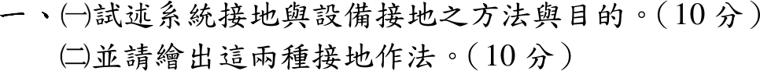
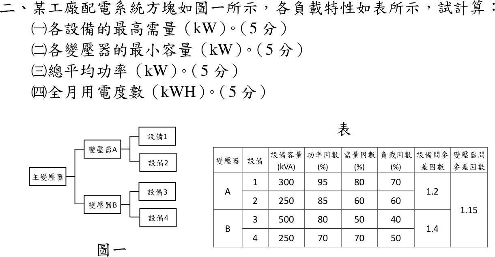
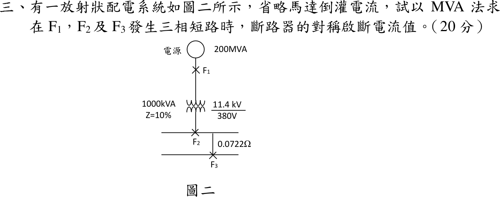
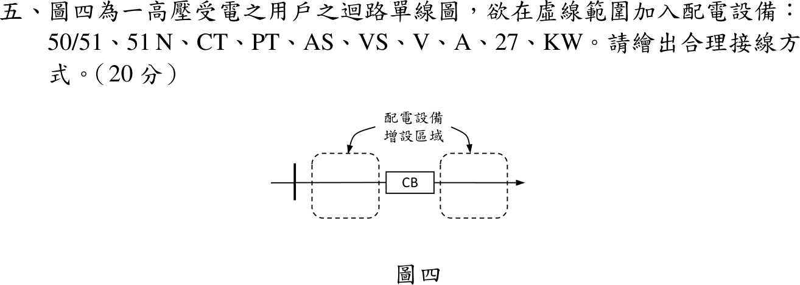

# 112 年電機工程技師｜工業配電逐題詳解

> 本頁由題級 canonical 筆記組合；每題保留官方裁切圖、校驗狀態與可追溯的推導。

## 題目導覽
- [[#一、112 年工業配電第 1 題｜系統接地與設備接地|第 1 題：系統接地與設備接地]]
- [[#二、112 年工業配電第 2 題｜負載特性與需量計算|第 2 題：負載特性與需量計算]]
- [[#三、112 年工業配電第 3 題：放射狀系統三相短路|第 3 題：112 年工業配電第 3 題：放射狀系統三相短路]]
- [[#四、112 年工業配電第 4 題｜低壓側三相短路與反時性電驛|第 4 題：低壓側三相短路與反時性電驛]]
- [[#五、112 年工業配電第 5 題｜高壓受電保護與計量接線|第 5 題：高壓受電保護與計量接線]]

---

## 一、112 年工業配電第 1 題｜系統接地與設備接地

> 題級識別：EE-112-06-1
> canonical 來源：[[canonical/EE-112-06-1.md]]
> 題級校驗狀態：verified

### 已知與所求

（一）試述系統接地與設備接地之方法與目的（10 分）；（二）繪出兩種接地作法（10 分）。

### 考場標準作答

**解題邏輯**：兩種接地的差別在「接地對象」：系統接地接的是電源（發電機或變壓器）的中性點，管的是系統對地電位與接地故障電流；設備接地接的是正常不帶電的金屬外殼，管的是人員安全與故障回路。（一）分別寫方法（接法、接地方式種類）與目的；（二）把兩者畫在同一張接線圖上，並以碰殼故障電流的路徑說明兩者如何合作。以低壓 Y 接系統、中性點經電阻接地為例（直接接地或電抗接地只換掉圖中 \(R_N\)）。

#### （一）方法與目的（10 分）

**邏輯**：按「接地對象 → 接法 → 目的」分開寫兩種接地，目的各對應一個工程效果（電位、故障電流、人身安全）。

**系統接地**

- 方法：將發電機或變壓器的中性點（無中性點時以接地變壓器建立人工中性點）接至接地電極。依中性點對地阻抗分為直接（低阻抗）接地、低電阻接地、高電阻接地、電抗接地；另有不接地系統（須配絕緣監視）。
- 目的：
  - 固定系統對地電位，抑制中性點漂移與間歇性接地造成的暫態過電壓；
  - 限制並確定接地故障電流大小，使接地電驛（51N 等）能選擇性跳脫；
  - 作為絕緣協調與避雷器額定電壓選定的依據。

**設備接地**

- 方法：以連續、截面足夠的設備接地導線（PE）把馬達外殼、配電盤體、金屬管槽、電纜鎧裝等正常不帶電的金屬部分連到接地母排與接地電極，並作等電位連結。
- 目的：
  - 絕緣破壞時降低外殼對地電壓，防止感電；
  - 提供低阻抗故障回路，使斷路器、熔絲或漏電斷路器迅速動作；
  - 降低接觸電壓與跨步電壓，減少火災與電弧危害。

\[
\boxed{\text{系統接地：中性點接地，控制系統電位與故障電流；設備接地：外殼經 PE 接地，保護人員並促成跳脫}}
\]

#### （二）兩種接地作法（10 分）

**邏輯**：圖上要看得出兩種接地的接地對象不同——系統接地由電源中性點引出，設備接地由負載外殼引出——並畫出兩者在電源端單點相連，碰殼電流才有回路。

畫法（對照圖 1）：

- 系統接地：變壓器二次 Y 接，三繞組一端共接成中性點 N；由 N 向下經接地電阻 \(R_N\) 接到接地母排 \(G\)，再接系統接地極。N 另以中性線引至單相負載（正常帶負載電流）。
- 設備接地：三相線 L1、L2、L3 接馬達；馬達金屬外殼以 PE 線接回接地母排 \(G\)，PE 線上另設設備接地極。
- N 與 PE 只在電源端接地母排 \(G\) 單點相連，下游不再互接。
- 碰殼故障（以 L3 碰殼為例）：故障電流 \(I_g\) 依 L3 → 外殼 → PE → \(G\) → \(R_N\) → N → 繞組流回，兩種接地共同構成故障回路。

\[
\boxed{\text{系統接地：中性點 N 經 }R_N\text{ 接地；設備接地：外殼以 PE 連至接地母排與電極}}
\]

### 驗算

故障路徑檢查（圖 1 紅箭頭）：相線碰殼時電流 L3 → 外殼 → PE → 接地母排 \(G\) → \(R_N\) → 變壓器中性點 → 回到電源，迴路閉合；若缺系統接地，碰殼電流沒有金屬回路（只剩經對地電容的小電流），保護不動作、故障持續存在；若缺設備接地，外殼對地電壓接近相電壓。

### 失分點

- 把中性線 N 當作 PE 使用；N 正常有負載電流，PE 正常無電流。
- 只寫「接地」而未分開接地對象（中性點 vs. 外殼）。
- 圖中在下游多處重複連接 N 與 PE，形成並聯迴流路徑。

---

## 二、112 年工業配電第 2 題｜負載特性與需量計算

> 題級識別：EE-112-06-2
> canonical 來源：[[canonical/EE-112-06-2.md]]
> 題級校驗狀態：verified

### 已知與所求

| 變壓器 | 設備 | kVA | PF | 需量因數 | 負載因數 | 設備間參差因數 |
|---|---|---:|---:|---:|---:|---:|
| A | 1 | 300 | 0.95 | 0.80 | 0.70 | 1.2 |
| A | 2 | 250 | 0.85 | 0.60 | 0.60 | 1.2 |
| B | 3 | 500 | 0.80 | 0.50 | 0.40 | 1.4 |
| B | 4 | 250 | 0.70 | 0.70 | 0.50 | 1.4 |

變壓器間參差因數 1.15。求（一）各設備最高需量 kW；（二）各變壓器最小容量 kW；（三）總平均功率 kW；（四）全月用電度數。

### 考場標準作答

**解題邏輯**：四個小題沿同一條「設備 → 變壓器 → 主變壓器」需量鏈往上算。（一）設備尖峰 = 連接容量（kVA × PF 換成 kW）× 需量因數；（二）同一變壓器下各設備尖峰不同時，群組尖峰 = 設備尖峰和 ÷ 設備間參差因數，主變壓器再 ÷ 變壓器間參差因數；（三）平均功率 = 尖峰 × 負載因數，平均值可直接相加、不除參差因數；（四）電能 = 平均功率 × 全月時數。

#### （一）各設備的最高需量（5 分）

**邏輯**：需量因數 = 最高需量 ÷ 連接負載，連接負載以 kW 計為 \(S\times\mathrm{PF}\)，故 \(P_{\max}=S\times\mathrm{PF}\times\mathrm{DF}\)。

\[
P_{\max}=S\times\mathrm{PF}\times\mathrm{DF}
\]
\[
P_1=300\times0.95\times0.80=285\times0.80=228\ \mathrm{kW}
\]
\[
P_2=250\times0.85\times0.60=212.5\times0.60=127.50\ \mathrm{kW}
\]
\[
P_3=500\times0.80\times0.50=400\times0.50=200\ \mathrm{kW}
\]
\[
P_4=250\times0.70\times0.70=175\times0.70=122.50\ \mathrm{kW}
\]
\[
\boxed{P_1=228,\ P_2=127.50,\ P_3=200,\ P_4=122.50\ \mathrm{kW}}
\]

#### （二）各變壓器的最小容量（5 分）

**邏輯**：變壓器只需承擔所屬設備的「合成尖峰」；參差因數 = 個別尖峰和 ÷ 合成尖峰 \(\ge1\)，所以用除的。主變壓器以 A、B 的合成尖峰再除變壓器間參差因數。

變壓器 A（設備 1、2，\(F_{d,A}=1.2\)）：
\[
P_A=\frac{P_1+P_2}{F_{d,A}}=\frac{228+127.50}{1.2}=\frac{355.50}{1.2}=296.25\ \mathrm{kW}
\]
變壓器 B（設備 3、4，\(F_{d,B}=1.4\)）：
\[
P_B=\frac{P_3+P_4}{F_{d,B}}=\frac{200+122.50}{1.4}=\frac{322.50}{1.4}=\frac{3225}{14}=230.36\ \mathrm{kW}
\]
主變壓器（\(F_{d,T}=1.15\)，\(P_B\) 保留分數形式往下算）。先把 \(P_A\) 化成同分母：
\[
P_A=296.25=\frac{296.25\times14}{14}=\frac{4147.5}{14}
\]
\[
P_A+P_B=\frac{4147.5}{14}+\frac{3225}{14}=\frac{7372.5}{14}
\]
\[
P_{\text{主}}=\frac{P_A+P_B}{F_{d,T}}=\frac{7372.5}{14\times1.15}=\frac{7372.5}{16.1}=457.92\ \mathrm{kW}
\]
\[
\boxed{P_A=296.25\ \mathrm{kW},\ P_B=230.36\ \mathrm{kW},\ P_{\text{主}}=457.92\ \mathrm{kW}}
\]

#### （三）總平均功率（5 分）

**邏輯**：負載因數 = 平均功率 ÷ 最高需量，故 \(P_{avg,i}=P_i\times\mathrm{LF}_i\)；平均功率是能量的時間平均，全廠平均 = 各設備平均直接相加，參差因數只影響尖峰。

\[
P_{avg,i}=P_i\times\mathrm{LF}_i
\]
\[
P_{avg,1}=228\times0.70=159.60\ \mathrm{kW},\qquad P_{avg,2}=127.50\times0.60=76.50\ \mathrm{kW}
\]
\[
P_{avg,3}=200\times0.40=80\ \mathrm{kW},\qquad P_{avg,4}=122.50\times0.50=61.25\ \mathrm{kW}
\]
\[
P_{avg}=P_{avg,1}+P_{avg,2}+P_{avg,3}+P_{avg,4}=159.60+76.50+80+61.25
\]
\[
\boxed{P_{avg}=377.35\ \mathrm{kW}}
\]

#### （四）全月用電度數（5 分）

**邏輯**：電能 = 平均功率 × 時間；題目未給全月日數，以 30 日、每日 24 h 計（31 日分支見條件與疑義）。

\[
E=P_{avg}\times24\times30=377.35\times720
\]
\[
\boxed{E=271\,692\ \mathrm{kWh}}
\]

### 驗算

逐設備月電量（\(720\ \mathrm h\)）：\(159.60\times720=114\,912\)、\(76.50\times720=55\,080\)、\(80\times720=57\,600\)、\(61.25\times720=44\,100\ \mathrm{kWh}\)，加總 \(114\,912+55\,080+57\,600+44\,100=271\,692\ \mathrm{kWh}\)，與（四）一致。系統負載因數 \(377.35/457.92=0.8241<1\)，合理。

### 失分點

- 平均功率再除以參差因數；參差因數只用於尖峰需量。
- 變壓器容量用 kVA 作答；題目指定 kW。
- 全月只乘 24 h（漏乘日數）。

### 條件與疑義

「全月」日數題目未給，此處取 30 日；若取 31 日則 \(377.35\times744=280\,748.40\ \mathrm{kWh}\)。

---

## 三、112 年工業配電第 3 題：放射狀系統三相短路

> 題級識別：EE-112-06-3
> canonical 來源：[[canonical/EE-112-06-3.md]]
> 題級校驗狀態：verified

### 已知與所求

放射狀系統（圖二）：電源短路容量 \(200\,\mathrm{MVA}\)；F1 位於電源與變壓器之間（11.4 kV 側）；變壓器 \(1000\,\mathrm{kVA}\)、\(Z=10\%\)、\(11.4\,\mathrm{kV}/380\,\mathrm V\)，二次側母線為 F2；F2 母線經 \(0.0722\,\Omega\) 線路接到 F3 母線（380 V）。省略馬達倒灌電流。以 MVA 法求 F1、F2、F3 三相短路時斷路器的對稱啟斷電流（20 分）。

### 考場標準作答

**解題邏輯**：MVA 法把每個元件換成「自身短路容量」\(\mathrm{MVA}_i\)，串聯元件依 \(1/\mathrm{MVA}=\sum 1/\mathrm{MVA}_i\) 合成（如同電阻並聯），得故障點短路容量 \(\mathrm{MVA}_F\)，再以故障點所在電壓 \(I=\mathrm{MVA}_F/(\sqrt3\,\mathrm{kV})\) 換成對稱啟斷電流。三個故障點共用同一串元件，所以先求各元件 MVA、再由電源往下逐點累積合成，最後分點換算電流。省略馬達倒灌，系統只有上游電源一個饋入點，故障點下游元件不貢獻短路電流。

#### 步驟 1：單線圖化為 MVA 串聯鏈

- 電源以「無限大母線串一個 \(200\,\mathrm{MVA}\) 元件」表示。
- 依圖二由上而下：電源 S → F1 → 變壓器 T → F2 → 線路 L → F3，三元件串成一條。
- 某故障點的短路容量 = 該點**上游**所有元件串聯合成；下游元件無電源，不計入。

#### 步驟 2：各元件的短路 MVA

電源（題目直接給定）：
\[
\mathrm{MVA}_S=200\,\mathrm{MVA}
\]
變壓器：額定容量除以標么阻抗，\(1000\,\mathrm{kVA}=1\,\mathrm{MVA}\)：
\[
\mathrm{MVA}_T=\frac{\mathrm{MVA}_{\mathrm{rated}}}{Z_{\mathrm{pu}}}=\frac{1}{0.10}=10\,\mathrm{MVA}
\]
線路：以歐姆值換算，電壓取線路所在的 380 V（\(0.38\,\mathrm{kV}\)）：
\[
\mathrm{MVA}_L=\frac{\mathrm{kV}^2}{Z_\Omega}=\frac{0.38^2}{0.0722}=\frac{0.1444}{0.0722}=2\,\mathrm{MVA}
\]

#### 步驟 3：逐點串聯合成故障點短路容量

（以完整精度往下算，只顯示兩位小數。）

F1 上游只有電源：
\[
\mathrm{MVA}_{F1}=\mathrm{MVA}_S=200\,\mathrm{MVA}
\]
F2 上游為 S、T 串聯：
\[
\frac{1}{\mathrm{MVA}_{F2}}=\frac{1}{200}+\frac{1}{10}=0.005+0.1=0.105
\]
\[
\mathrm{MVA}_{F2}=\frac{1}{0.105}=\frac{200\times10}{200+10}=\frac{2000}{210}=9.52\,\mathrm{MVA}
\]
F3 上游為 S、T、L 串聯（等於 \(\mathrm{MVA}_{F2}\) 再串 \(\mathrm{MVA}_L\)）：
\[
\frac{1}{\mathrm{MVA}_{F3}}=\frac{1}{200}+\frac{1}{10}+\frac{1}{2}=0.105+0.5=0.605
\]
\[
\mathrm{MVA}_{F3}=\frac{1}{0.605}=1.65\,\mathrm{MVA}
\]

電流換算分母：\(\sqrt3\times11.4=19.75\)、\(\sqrt3\times0.38=0.66\)（顯示兩位小數；下列各式以完整精度的 \(\mathrm{MVA}_F\) 與分母計算）。

#### F1 對稱啟斷電流

**邏輯**：F1 在變壓器一次側，故障點電壓為 11.4 kV，以 \(\mathrm{MVA}_{F1}\) 除以 \(\sqrt3\times11.4\)。

\[
I_{F1}=\frac{\mathrm{MVA}_{F1}}{\sqrt3\,\mathrm{kV}}=\frac{200}{\sqrt3(11.4)}=\frac{200}{19.75}
\]
\[
\boxed{I_{F1}=10.13\,\mathrm{kA}}
\]

#### F2 對稱啟斷電流

**邏輯**：F2 在變壓器二次側 380 V 母線，短路容量受變壓器限制，換算電流必須用 0.38 kV。

\[
I_{F2}=\frac{\mathrm{MVA}_{F2}}{\sqrt3\,\mathrm{kV}}=\frac{9.52}{\sqrt3(0.38)}
\]
\[
\boxed{I_{F2}=14.47\,\mathrm{kA}}
\]

#### F3 對稱啟斷電流

**邏輯**：F3 同在 380 V，但再多串線路 \(2\,\mathrm{MVA}\)，短路容量最小，同樣以 0.38 kV 換算。

\[
I_{F3}=\frac{\mathrm{MVA}_{F3}}{\sqrt3\,\mathrm{kV}}=\frac{1.65}{\sqrt3(0.38)}
\]
\[
\boxed{I_{F3}=2.51\,\mathrm{kA}}
\]

### 驗算

改用歐姆法，全部阻抗換到 380 V 側：
- 電源：\(Z_S=\dfrac{0.38^2}{200}=7.22\times10^{-4}\,\Omega\)
- 變壓器：\(Z_T=0.10\times\dfrac{0.38^2}{1}=1.44\times10^{-2}\,\Omega\)
- F2：\(Z_S+Z_T=1.52\times10^{-2}\,\Omega\)，\(I_{F2}=\dfrac{380}{\sqrt3\times1.52\times10^{-2}}=14.47\,\mathrm{kA}\)
- F3：\(Z_S+Z_T+0.0722=8.74\times10^{-2}\,\Omega\)，\(I_{F3}=\dfrac{380}{\sqrt3\times8.74\times10^{-2}}=2.51\,\mathrm{kA}\)

兩點皆與 MVA 法一致。

### 失分點

- 串聯元件 MVA 直接相加；MVA 法串聯取倒數和，且只串故障點上游元件（F1 只有電源 \(200\,\mathrm{MVA}\)，不含下游 T、L）。
- F2、F3 用 11.4 kV 換算電流；應用故障點所在 380 V。
- 線路 \(0.0722\,\Omega\) 未換成 \(V^2/Z=2\,\mathrm{MVA}\) 就與其他 MVA 合成。

---

## 四、112 年工業配電第 4 題｜低壓側三相短路與反時性電驛

> 題級識別：EE-112-06-4
> canonical 來源：[[canonical/EE-112-06-4.md]]
> 題級校驗狀態：verified

### 已知與所求

11.4 kV 受電，電源三相短路容量 \(500\,\mathrm{MVA}\)；變壓器 \(750\,\mathrm{kVA}\)、\(11400\,\mathrm V/220\text{-}380\,\mathrm V\)、\(Z\%=5.7\%\)；CT \(200/5\) 與 CO 電驛在高壓側；F 點在低壓側三相短路，忽略線路電阻。求（一）對稱故障電流（8 分）；（二）始動電流 \(135\%\) 滿載、\(0.3\,\mathrm s\) 動作時的 \(k\)（至小數第 2 位，12 分）。

#### 官方題目公式

\[
T_s=\dfrac{k\times80}{(I/I_s)^2-1}\times\dfrac{1}{0.808}
\]

### 考場標準作答

**解題邏輯**：（一）用標么法：取 \(S_b=750\,\mathrm{kVA}\)，電源電抗由短路容量換算、再串變壓器電抗，故障電流 = 低壓側基準電流 ÷ 總電抗；低壓側線電壓取 380 V（220 V 是相電壓）。（二）CT 與 CO 電驛裝在 11.4 kV 側，故 \(I/I_s\) 必須在同一側比較：把故障電流依電壓比換到高壓側，始動電流取高壓側滿載電流的 135%，代入題目公式解 \(k\)。

#### 步驟 1：標么電抗圖

- 電源以 \(1\,\mathrm{pu}\) 電壓源串 \(X_{src}\) 表示，經 CB、CT（高壓側）後串變壓器 \(X_T\) 到低壓側故障點 F，F 對參考點短路。
- 忽略線路電阻，全以電抗相加。

電源電抗（短路容量換算）：
\[
X_{src}=\frac{S_b}{S_{sc}}=\frac{0.75}{500}=0.0015\,\mathrm{pu}
\]
變壓器（額定即 750 kVA）：
\[
X_T=5.7\%=0.057\,\mathrm{pu}
\]
\[
X=X_{src}+X_T=0.0015+0.057=0.0585\,\mathrm{pu}
\]

#### （一）對稱故障電流（8 分）

**邏輯**：三相故障、故障前電壓取 \(1\,\mathrm{pu}\)，\(I_F=I_b/X\)；F 在 380 V 側，基準電流用 380 V 線電壓計算。

\[
I_b=\frac{S_b}{\sqrt3V_b}=\frac{750\,000}{\sqrt3\times380}=\frac{750\,000}{658.179}=1139.51\,\mathrm A
\]
\[
I_F=\frac{I_b}{X}=\frac{1139.51}{0.0585}=19\,478.75\,\mathrm A
\]
\[
\boxed{I_F=19.48\,\mathrm{kA}}
\]

#### （二）\(k\) 值（12 分）

**邏輯**：電驛看到的是高壓側 CT 電流，\(I\) 與 \(I_s\) 都要用 11.4 kV 側值；把 \(T_s=0.3\,\mathrm s\) 與 \((I/I_s)^2-1\) 代入題目公式反解 \(k\)。

故障電流換到高壓側（電流與電壓比成反比）：
\[
I_{F,H}=I_F\times\frac{380}{11\,400}=\frac{19\,478.75}{30}=649.29\,\mathrm A
\]
高壓側滿載電流與始動電流：
\[
I_{rated,H}=\frac{750\,000}{\sqrt3\times11\,400}=\frac{750\,000}{19\,745.38}=37.984\,\mathrm A
\]
\[
I_s=1.35\times37.984=51.278\,\mathrm A
\]
倍數與公式中的分母：
\[
\frac{I}{I_s}=\frac{649.29}{51.278}=12.662
\]
\[
\left(\frac{I}{I_s}\right)^2=12.662^2=160.33
\]
\[
\left(\frac{I}{I_s}\right)^2-1=159.33
\]
由 \(T_s=\dfrac{k\times80}{(I/I_s)^2-1}\times\dfrac{1}{0.808}\) 移項：
\[
k=\frac{T_s\times0.808\times\left[(I/I_s)^2-1\right]}{80}
\]
\[
k=\frac{0.3\times0.808\times159.33}{80}=\frac{0.2424\times159.33}{80}=\frac{38.622}{80}=0.4828
\]
\[
\boxed{0.48}
\]

### 驗算

歐姆法（380 V 側）：\(X_s=380^2/(500\times10^6)=2.888\times10^{-4}\,\Omega\)、\(X_T=0.057\times380^2/750\,000=0.010974\,\Omega\)，和 \(=0.011263\,\Omega\)，\(I_F=380/(\sqrt3\times0.011263)=380/0.019508=19\,479\,\mathrm A\approx19.48\,\mathrm{kA}\)。比值與側別無關：\(I/I_s=1/(0.0585\times1.35)=1/0.078975=12.662\)；回代 \(k=0.48\)：\(T_s=\dfrac{0.48\times80}{159.33}\times\dfrac{1}{0.808}=\dfrac{38.4}{159.33}\times\dfrac{1}{0.808}=0.24101\times1.2376=0.2983\,\mathrm s\approx0.3\,\mathrm s\)。

### 失分點

- 用相電壓 220 V 計算三相故障電流（會放大 \(\sqrt3\) 倍）。
- 故障電流用低壓側、始動電流用高壓側，\(I/I_s\) 差 30 倍。
- 把 \(\times\dfrac{1}{0.808}\) 看成 \(\times0.808\)。

---

## 五、112 年工業配電第 5 題｜高壓受電保護與計量接線

> 題級識別：EE-112-06-5
> canonical 來源：[[canonical/EE-112-06-5.md]]
> 題級校驗狀態：verified

### 已知與所求

圖四：母線—虛線區—CB—虛線區—負載。在虛線範圍加入 50/51、51N、CT、PT、AS、VS、V、A、27、kW，繪出合理接線（20 分）。

### 考場標準作答

**解題邏輯**：先決定一次側位置——電壓取樣（PT）放在 CB 電源側，CB 跳脫後仍能監視電源電壓並供低電壓電驛 27 判斷；電流取樣（CT）放在 CB 負載側，使 CB 以下的線路落在保護區內。再依二次側電源性質接線：CT 二次是電流源，所有電流元件（A、50/51、51N、kW 電流線圈）串聯；PT 二次是電壓源，所有電壓元件（V、27、kW 電壓線圈）並聯。最後把各保護電驛接點並聯接到 CB 跳脫線圈。前提：三相三線受電、CT 二次 5 A 三只接 Y、PT 二次 110 V 採 V-V 接線。

#### 合理接線（20 分）

**邏輯**：串聯／並聯由二次側是電流源還是電壓源決定；51N 要量零序，只能接在三只 CT 星形點的殘流路徑；kW 表三相三線用兩瓦特計法，所以只取 a、c 相電流與 \(V_{ab}\)、\(V_{cb}\)。

1. 一次側配置（圖 1 上方）：母線 → PT（經電力熔絲 PF 接在 CB 電源側）→ CB → CT ×3（CB 負載側）→ 負載。
2. CT 二次（電流迴路，全部串聯）：
   - a、b、c 三線依序穿過 AS（電流切換開關，接 A 表）、各相 50/51、kW 電流線圈（只在 a、c 相）；
   - 三線在電驛後方接成星形點，星形點經 51N 回到 CT 共點 n，51N 流過殘流 \(I_a+I_b+I_c=3I_0\)；
   - n 單點接地；AS 切換時須先短路被切離的 CT，不得開路。
3. PT 二次（電壓迴路，全部並聯）：
   - a、b、c 三線各經熔絲成 110 V 三線母線，b 線單點接地；
   - VS（電壓切換開關，選 \(V_{ab}\)、\(V_{bc}\)、\(V_{ca}\)）接 V 表、27、kW 電壓線圈（\(V_{ab}\)、\(V_{cb}\)）都跨接在這三線上。
4. 跳脫迴路：50/51、51N、27 的動作接點並聯，串 CB 輔助接點 52a 與跳脫線圈 TC，接到直流控制電源。

\[
\boxed{\text{PT 在 CB 電源側、CT 在負載側；CT 二次串接 A、50/51、51N（殘流）、kW；PT 二次並接 V（經 VS）、27、kW}}
\]

### 驗算

兩瓦特計檢查：\(P=V_{ab}I_a\cos(30^\circ+\phi)+V_{cb}I_c\cos(30^\circ-\phi)=\sqrt3V_LI_L\cos\phi\)，確認 kW 表取 a、c 相電流與 \(V_{ab}\)、\(V_{cb}\) 的接法正確。51N 正常時 \(I_a+I_b+I_c=0\) 不動作，接地故障時殘流 \(3I_0\) 流入，動作邏輯正確。

### 失分點

- CT 二次開路（AS 切換或抽換儀表時），會產生高壓危險；須用短路片。
- 把 V、27 串聯接在 PT 二次；電壓元件必須並聯。
- 51N 接在單相 CT 上；應接殘流路徑或零序 CT。

---
