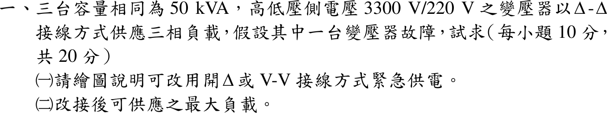
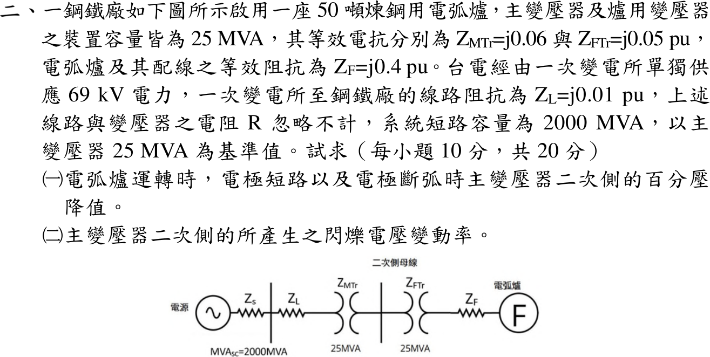
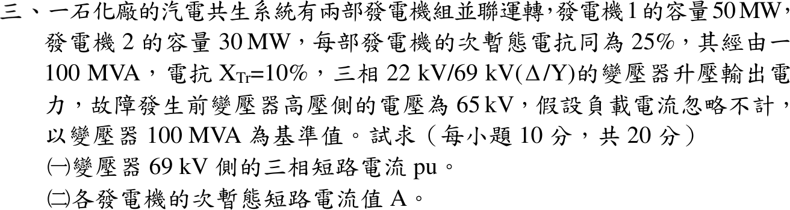
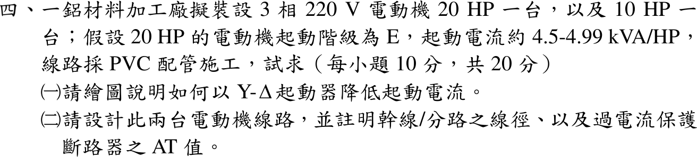
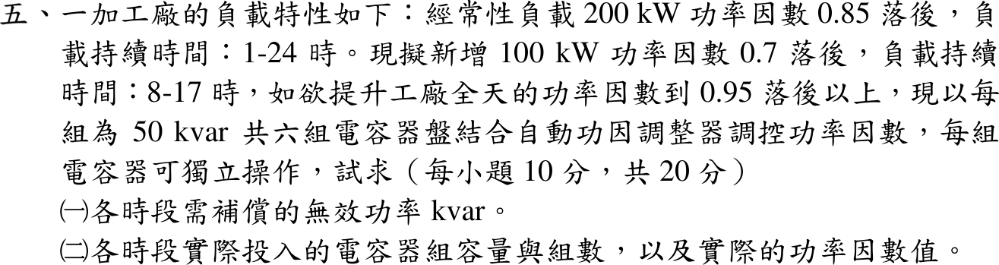

# 114 年電機工程技師｜工業配電逐題詳解

> 本頁由題級 canonical 筆記組合；每題保留 QID、官方裁切、校驗狀態與完整得分型解答。

## 題目導覽
- [[#一、114 年工業配電第 1 題｜開三角（V-V）緊急供電|第 1 題：開三角（V-V）緊急供電]]
- [[#二、114 年工業配電第 2 題｜電弧爐壓降與閃爍電壓變動|第 2 題：電弧爐壓降與閃爍電壓變動]]
- [[#三、114 年工業配電第 3 題｜汽電共生系統三相短路|第 3 題：汽電共生系統三相短路]]
- [[#四、114 年工業配電第 4 題｜Y-Δ 起動與電動機線路設計|第 4 題：Y-Δ 起動與電動機線路設計]]
- [[#五、114 年工業配電第 5 題｜APFR 電容器分段投入|第 5 題：APFR 電容器分段投入]]

---

## 一、114 年工業配電第 1 題｜開三角（V-V）緊急供電

> 題級識別：`EE-114-06-1`
> canonical 來源：`canonical/EE-114-06-1.md`
> 題級校驗狀態：`verified`

![[01_原始試題/依考科/06_工業配電/images/questions/PE_114年_工業配電_Q01.png]]

> 官方裁切來源：`01_原始試題/依考科/06_工業配電/images/questions/PE_114年_工業配電_Q01.png`

### 已知與所求

三台單相變壓器各 \(50\,\mathrm{kVA}\)、\(3300/220\,\mathrm{V}\)，原為 \(\Delta\text{-}\Delta\) 供三相負載；其中一台故障。求（一）繪圖說明改接開 \(\Delta\)（V-V）；（二）改接後可供應之最大負載。

### 考場標準作答

#### （一）開三角（V-V）接線（10 分）

設兩台為規格相同的理想變壓器，負載平衡，一次為正相序（\(A\to B\to C\)），以二次側 \(220\,\mathrm V\) 計算。接線畫法：
- 拆除故障的 \(T_3\)（原跨一次 \(CA\)、二次 \(ca\)），一次、二次兩處都保持開路，不可短接。
- \(T_1\) 一次 \(H_1\)–\(H_2\) 接 \(A\)–\(B\)，\(T_2\) 一次 \(H_1\)–\(H_2\) 接 \(B\)–\(C\)；二次 \(T_1\) 的 \(X_1\) 引出 a，\(T_1\) 的 \(X_2\) 與 \(T_2\) 的 \(X_1\) 相接引出 b，\(T_2\) 的 \(X_2\) 引出 c。
- 每台 \(3300/220\,\mathrm{V}\)，故 \(|V_{ab}|=|V_{bc}|=220\,\mathrm V\)。

每台二次電壓與其一次所跨的線電壓同相（減極性、同名端對應），兩台二次首尾相接後，第三邊電壓由 KVL 補出。兩個由繞組提供的線電壓（以 \(V_{ab}\) 為參考，正相序 \(V_{bc}\) 落後 \(120^\circ\)）：
\[
V_{ab}=220\angle0^\circ\,\mathrm V,\qquad V_{bc}=220\angle-120^\circ\,\mathrm V
\]
沿 \(a\to b\to c\to a\) 的 KVL：
\[
V_{ab}+V_{bc}+V_{ca}=0\ \Rightarrow\ V_{ca}=-(V_{ab}+V_{bc})
\]
化成直角座標相加（\(220\sin120^\circ=110\sqrt3\)）：
\[
V_{bc}=220(\cos120^\circ-j\sin120^\circ)=-110-j110\sqrt3\,\mathrm V
\]
\[
V_{ab}+V_{bc}=220+(-110-j110\sqrt3)=110-j110\sqrt3\,\mathrm V
\]
\[
V_{ca}=-(110-j110\sqrt3)=-110+j110\sqrt3\,\mathrm V
\]
換回極座標，大小與角度各一行（\(110\sqrt3\approx190.53\)）：
\[
|V_{ca}|=\sqrt{110^2+(110\sqrt3)^2}=110\sqrt{1+3}=220\,\mathrm V
\]
\[
\angle V_{ca}=180^\circ-\tan^{-1}\frac{110\sqrt3}{110}=180^\circ-60^\circ=120^\circ
\]

三個線電壓 \(220\angle0^\circ\)、\(220\angle-120^\circ\)、\(220\angle120^\circ\,\mathrm V\) 大小相等、互差 \(120^\circ\)，為平衡三相。

\[
\boxed{\text{兩台單相變壓器接成開 }\Delta\text{（V-V），第三邊開路，仍輸出三相 }220\,\mathrm{V}}
\]

#### （二）改接後可供應之最大負載（10 分）

開三角的線 a 只接 \(T_1\)、線 c 只接 \(T_2\)，線電流上限＝單台繞組額定電流。單台二次額定電流：
\[
I_{2N}=\frac{S_{1\phi}}{V_2}=\frac{50\,000}{220}=227.27\,\mathrm{A}
\]
KCL（圖 1 參考方向：線電流流向負載；繞組電流 \(I_{T1}\) 定義為由 \(T_1\) 的 a 端流出、\(I_{T2}\) 由 \(T_2\) 的 c 端流出）：
\[
\text{節點 a：}I_a=I_{T1},\qquad \text{節點 c：}I_c=I_{T2}
\]
平衡負載 \(|I_a|=|I_b|=|I_c|=I_L\)，故兩繞組電流大小都等於 \(I_L\)，同時達額定：
\[
I_L\le I_{2N}
\]
三相容量（\(I_{2N}\) 以分數 \(50\,000/220\) 代入，\(220\) 約去）：
\[
S_{3\phi,\max}=\sqrt3\,V_LI_{2N}=\sqrt3(220)\left(\frac{50\,000}{220}\right)=\sqrt3(50\,000)=86\,602.54\,\mathrm{VA}
\]
\[
\boxed{S_{3\phi,\max}=86.60\,\mathrm{kVA}}
\]
與原容量及剩餘設備容量比較（同樣以精確式計算）：
\[
\frac{S_{3\phi,\max}}{3S_{1\phi}}=\frac{\sqrt3(50)}{150}=\frac{1}{\sqrt3}=0.5774=57.74\%
\]
\[
\frac{S_{3\phi,\max}}{2S_{1\phi}}=\frac{\sqrt3(50)}{100}=\frac{\sqrt3}{2}=0.8660=86.60\%
\]
即原 \(150\,\mathrm{kVA}\) 的 \(57.74\%\)，剩餘兩台設備容量 \(100\,\mathrm{kVA}\) 的 \(86.60\%\)。題目未給功率因數，故答案以 kVA 表示，不寫成 kW。

### 驗算

#### 獨立驗算

容量公式 \(S_{VV}=\sqrt3S_{1\phi}=\sqrt3(50)=86.60\,\mathrm{kVA}\)，與繞組電流法一致。平衡線電流 \(I_a=I\angle0^\circ\)、\(I_c=I\angle120^\circ\) 由 KCL 各自全部流經 ab、bc 繞組，兩繞組電流大小皆為 \(I\)，同時達額定，無一台先過載。

### 失分點

- 把剩餘兩台直接相加成 \(100\,\mathrm{kVA}\)；兩台各輸出 \(50\,\mathrm{kVA}\)，但複功率相角差 \(60^\circ\)，合成只得 \(2(50)\cos30^\circ=86.60\,\mathrm{kVA}\)。
- \(57.74\%\) 與 \(86.60\%\) 的分母不同（原三台 \(150\) 與剩餘兩台 \(100\,\mathrm{kVA}\)），須標明。
- 圖中把空缺的第三邊畫成導線，會造成短路。

---

## 二、114 年工業配電第 2 題｜電弧爐壓降與閃爍電壓變動

> 題級識別：`EE-114-06-2`
> canonical 來源：`canonical/EE-114-06-2.md`
> 題級校驗狀態：`needs_manual_review`

![[01_原始試題/依考科/06_工業配電/images/questions/PE_114年_工業配電_Q02.png]]

> 官方裁切來源：`01_原始試題/依考科/06_工業配電/images/questions/PE_114年_工業配電_Q02.png`

> [!WARNING] 本題仍有官方資料缺口或事件定義歧義；以下條件分支不得視為唯一無條件答案。

### 已知與所求

基準 \(25\,\mathrm{MVA}\)；系統短路容量 \(2000\,\mathrm{MVA}\)，\(Z_L=j0.01\)、\(Z_{MTr}=j0.06\)、\(Z_{FTr}=j0.05\)、電弧爐及其配線 \(Z_F=j0.4\,\mathrm{pu}\)，電阻忽略。圖示串聯順序：電源—\(Z_s\)—\(Z_L\)—主變—二次側母線—爐變—\(Z_F\)—爐 F。求（一）電極短路與斷弧時主變二次側百分壓降；（二）二次側閃爍電壓變動率。

本題 \(Z_F\) 在電極短路時剩餘多少未明定，以下為條件主解，見「條件與疑義」。

### 考場標準作答

#### 步驟 1：各元件標么電抗（25 MVA 基準）

電阻忽略，設電源電壓 \(\underline E=1\angle0^\circ\,\mathrm{pu}\)、無其他負載電流；電極短路時 \(Z_F=j0.4\) 全數保留在迴路中；「50 噸」「69 kV」不參與標么計算。電源電抗由短路容量換算：
\[
X_s=\frac{S_b}{S_{sc}}=\frac{25}{2000}=0.0125\ \mathrm{pu}
\]
其餘題給值已在 \(25\,\mathrm{MVA}\) 基準（主變、爐變容量皆為 25 MVA），直接取用：
\[
X_L=0.01\ \mathrm{pu},\qquad X_{MTr}=0.06\ \mathrm{pu},\qquad X_{FTr}=0.05\ \mathrm{pu},\qquad X_F=0.4\ \mathrm{pu}
\]

#### 步驟 2：量測點上、下游合成電抗

量測點是主變二次側母線；母線上游為 \(X_s\)、\(X_L\)、\(X_{MTr}\) 串聯：
\[
X_u=X_s+X_L+X_{MTr}=0.0125+0.01+0.06=0.0825\ \mathrm{pu}
\]
母線下游為 \(X_{FTr}\)、\(X_F\) 串聯：
\[
X_d=X_{FTr}+X_F=0.05+0.4=0.45\ \mathrm{pu}
\]
迴路總電抗：
\[
X_u+X_d=0.0825+0.45=0.5325\ \mathrm{pu}
\]

畫法：電源 \(\underline E\) 在左，上方導線依序串 \(X_s\)、\(X_L\)、\(X_{MTr}\) 到二次側母線，再串 \(X_{FTr}\)、\(X_F\) 到電極；電極以開關表示（短路＝閉合、斷弧＝開路）接回路線。電流參考方向由電源流向電爐；母線電壓 \(\underline V_2\) 取母線對回路線（短路時記 \(\underline V_{2,sc}\)、斷弧時記 \(\underline V_{2,open}\)）。圖中相量以大小符號標示（不加底線）。

#### （一）電極短路與斷弧時的百分壓降（10 分）

電極短路的電流：
\[
\underline I_{sc}=\frac{\underline E}{j(X_u+X_d)}=\frac1{j0.5325}
\]
\[
|\underline I_{sc}|=\frac{1}{0.5325}=1.878\ \mathrm{pu},\qquad \angle\underline I_{sc}=0^\circ-90^\circ=-90^\circ
\]
\[
\underline I_{sc}=-j1.878\ \mathrm{pu}
\]
上游電抗上的壓降：
\[
\underline I_{sc}(jX_u)=(-j1.878)(j0.0825)=1.878\times0.0825=0.1549\ \mathrm{pu}
\]
母線電壓（KVL）：
\[
\underline V_{2,sc}=\underline E-\underline I_{sc}(jX_u)=1-0.1549=0.8451\ \mathrm{pu}
\]
\[
|\underline V_{2,sc}|=0.8451\ \mathrm{pu},\qquad \angle\underline V_{2,sc}=0^\circ
\]
短路時壓降（以額定電壓 \(1\,\mathrm{pu}\) 為分母）：
\[
\Delta V_{sc}=\frac{1-|\underline V_{2,sc}|}{1}\times100\%=(1-0.8451)\times100\%
\]
\[
\Delta V_{sc}=\boxed{15.49\%}
\]
斷弧時迴路開路：
\[
\underline I_{open}=0,\qquad \underline V_{2,open}=\underline E-0\times(jX_u)=1\ \mathrm{pu}
\]
\[
\Delta V_{open}=\frac{1-1}{1}\times100\%=\boxed{0\%}
\]

#### （二）主變二次側閃爍電壓變動率（10 分）

電弧爐在斷弧與電極短路兩極端間反覆切換，變動率取兩狀態母線電壓之差除以額定電壓（1 pu）：
\[
|\underline V_{2,open}|=1\ \mathrm{pu},\qquad |\underline V_{2,sc}|=0.8451\ \mathrm{pu}
\]
\[
\Delta V\%=\frac{|\underline V_{2,open}|-|\underline V_{2,sc}|}{V_{rated}}\times100\%=\frac{1-0.8451}{1}\times100\%
\]
\[
\Delta V\%=0.1549\times100\%
\]
\[
\boxed{\Delta V\%=15.49\%}
\]
此為最大電壓變動率，不是閃爍嚴重度 \(P_{st}\)。

### 驗算

- 分壓式獨立求母線電壓：\(\underline V_{2,sc}=\underline E\dfrac{jX_d}{j(X_u+X_d)}=\dfrac{0.45}{0.5325}=0.8451\ \mathrm{pu}\)，與 KVL 結果相同。
- KVL 全迴路：\(|\underline I_{sc}|(X_u+X_d)=1.878\times0.5325=1.000\ \mathrm{pu}=|\underline E|\)。
- 壓降比例：\(\Delta V_{sc}=\dfrac{X_u}{X_u+X_d}=\dfrac{0.0825}{0.5325}=15.49\%\)。

### 失分點

- \(X_s\) 寫成 \(2000/25\)，或未換到 \(25\,\mathrm{MVA}\) 共同基準。
- 把爐變算在量測點上游；量測點在主變二次側，上游只含 \(X_s+X_L+X_{MTr}\)。
- 把母線電壓誤當電極電壓；短路時電極電壓為零，母線電壓為 \(0.8451\,\mathrm{pu}\)。

### 條件與疑義

原題稱 \(Z_F\) 為「電弧爐及其配線之等效阻抗」，未拆分固定配線與隨電弧狀態改變的部分，因此不能據此宣稱唯一答案。官方圖將 \(Z_F\) 畫在爐 F 前方，且沒有畫出繞過 \(Z_F\) 的短接支路，支持全部保留的條件主解 \(15.49\%\)（總電抗 \(0.5325\,\mathrm{pu}\)）。

令短路時剩餘電抗為 \(X_{F,sc}\)，共同式為
\[
\Delta V\%=\frac{0.0825}{0.0825+0.05+X_{F,sc}}\times100\%
\]
\(X_{F,sc}=0.4\) 得 \(15.49\%\)；\(X_{F,sc}=0\) 得 \(62.26\%\)。兩值都未經官方評分答案確認；取得 \(Z_F\) 的短路定義後應依該證據定案。

---

## 三、114 年工業配電第 3 題｜汽電共生系統三相短路

> 題級識別：`EE-114-06-3`
> canonical 來源：`canonical/EE-114-06-3.md`
> 題級校驗狀態：`needs_manual_review`

![[01_原始試題/依考科/06_工業配電/images/questions/PE_114年_工業配電_Q03.png]]

> 官方裁切來源：`01_原始試題/依考科/06_工業配電/images/questions/PE_114年_工業配電_Q03.png`

> [!WARNING] 本題仍有官方資料缺口或事件定義歧義；以下條件分支不得視為唯一無條件答案。

### 已知與所求

發電機 1 為 \(50\,\mathrm{MW}\)、發電機 2 為 \(30\,\mathrm{MW}\)，\(X''_d\) 均為 \(25\%\)（各自額定基準），並聯後經 \(100\,\mathrm{MVA}\)、\(X_{Tr}=10\%\)、\(22/69\,\mathrm{kV}\ (\Delta/\mathrm Y)\) 變壓器升壓；故障前高壓側 \(65\,\mathrm{kV}\)，忽略負載電流；基準 \(100\,\mathrm{MVA}\)。求（一）69 kV 側三相短路電流 pu；（二）各發電機次暫態短路電流 A。

題目未給額定 MVA 或功率因數；以下主解採 \(c_1=c_2=1.0\)（MW 數值＝MVA）條件，見「條件與疑義」。

### 考場標準作答

#### 步驟 1：換到 \(S_b=100\,\mathrm{MVA}\) 基準

主解採 MW 數值＝MVA（PF = 1）；忽略負載電流，故障前各電源內電勢都等於故障前電壓 \(V_F=65/69\,\mathrm{pu}\)（以 69 kV 為電壓基準）。標么電抗換基準：\(X_{new}=X_{old}\dfrac{S_{b,new}}{S_{rated}}\)（電壓基準與額定相同，不需電壓修正）。
\[
X_1=0.25\times\frac{100}{50}=0.25\times2=0.50\,\mathrm{pu}
\]
\[
X_2=0.25\times\frac{100}{30}=\frac{25}{30}=\frac56=0.8333\,\mathrm{pu}
\]
變壓器額定即 \(100\,\mathrm{MVA}\)，不必換算：\(X_{Tr}=0.10\,\mathrm{pu}\)。

#### 步驟 2：等效電路與戴維寧電抗

- 兩機各以電壓源 \(V_F\) 串 \(jX_1\)、\(jX_2\) 接到 22 kV 發電機母線（兩機並聯）。
- 母線再串 \(jX_{Tr}\) 到 69 kV 側故障點 F；F 對參考點短路。
- Δ/Y 相移只改變相角、不改變電流大小，以大小計算即可。

\[
X_1\parallel X_2=\frac{X_1X_2}{X_1+X_2}=\frac{0.5\times\frac56}{0.5+\frac56}=\frac{5/12}{4/3}=\frac{5}{16}=0.3125\,\mathrm{pu}
\]
\[
X_{th}=X_1\parallel X_2+X_{Tr}=0.3125+0.10=0.4125\,\mathrm{pu}
\]

#### （一）變壓器 69 kV 側三相短路電流 pu（10 分）

\[
V_F=\frac{65}{69}=0.94203\,\mathrm{pu}
\]
\[
I_{sc}=\frac{V_F}{X_{th}}=\frac{0.94203}{0.4125}=2.2837\,\mathrm{pu}
\]
\[
\boxed{I_{sc}=2.28\,\mathrm{pu}}
\]

#### （二）各發電機次暫態短路電流 A（10 分）

機組在 22 kV 側，以 22 kV 側基準電流換成安培：
\[
I_b=\frac{S_b}{\sqrt3V_b}=\frac{100\times10^6}{\sqrt3\times22\times10^3}=\frac{100\times10^6}{38\,105.12}=2624.32\,\mathrm A
\]
兩機並聯、內電勢相同，故障電流依電抗反比分配，分流比：
\[
\frac{I_{G1}}{I_{sc}}=\frac{X_2}{X_1+X_2}=\frac{5/6}{4/3}=\frac58=0.625,\qquad
\frac{I_{G2}}{I_{sc}}=\frac{X_1}{X_1+X_2}=\frac{0.5}{4/3}=\frac38=0.375
\]
發電機 1（以完整精度的 \(I_{sc}=2.2837066\) 相乘）：
\[
I_{G1,pu}=0.625\times2.2837066=1.4273166\,\mathrm{pu}
\]
\[
I_{G1}=1.4273166\times2624.3194=3745.73\,\mathrm A
\]
\[
\boxed{I_{G1}=3745.73\,\mathrm A}
\]
發電機 2：
\[
I_{G2,pu}=0.375\times2.2837066=0.8563900\,\mathrm{pu}
\]
\[
I_{G2}=0.8563900\times2624.3194=2247.44\,\mathrm A
\]
\[
\boxed{I_{G2}=2247.44\,\mathrm A}
\]

### 驗算

節點法：69 kV 側短路時，發電機母線電壓 \(V_g=I_{sc}X_{Tr}=2.2837\times0.10=0.22837\,\mathrm{pu}\)；各機電流 \((V_F-V_g)/X_i\)：\(V_F-V_g=0.94203-0.22837=0.71366\)，\(0.71366/0.5=1.4273\,\mathrm{pu}\)、\(0.71366/0.8333=0.8564\,\mathrm{pu}\)，和 \(=2.2837\,\mathrm{pu}=I_{sc}\)，KCL 成立；換算成安培 \(3745.73+2247.44=5993.17\,\mathrm A\approx I_{sc}I_b=2.2837066\times2624.3194=5993.18\,\mathrm A\)（差在末位進位）。

### 失分點

- 兩機直接以 \(0.25\,\mathrm{pu}\) 並聯，未換到 \(100\,\mathrm{MVA}\) 基準。
- 用 \(V_F=1\) 而忽略 \(65/69=0.94\,\mathrm{pu}\)。
- 發電機電流用 69 kV 基準電流 \(836.74\,\mathrm A\) 換算；機組電流應在 22 kV 側。

### 條件與疑義

標么電抗的機組基準是額定 MVA，但題面只給 \(50\,\mathrm{MW}\)、\(30\,\mathrm{MW}\)。若額定 MVA 為 \(S_1,S_2\)：
\[
I_{sc}=\frac{65/69}{0.1+25/(S_1+S_2)},\qquad I_{Gi}=\frac{S_i}{S_1+S_2}I_{sc}I_b
\]

| 額定功率因數假設 | \((S_1,S_2)\) | \(I_{sc}\) | \(I_{G1}\) | \(I_{G2}\) |
| --- | --- | ---: | ---: | ---: |
| \(c_1=c_2=1.0\) | \((50,30)\,\mathrm{MVA}\) | \(2.2837\,\mathrm{pu}\) | \(3745.7\,\mathrm A\) | \(2247.4\,\mathrm A\) |
| \(c_1=c_2=0.8\) | \((62.5,37.5)\,\mathrm{MVA}\) | \(2.6915\,\mathrm{pu}\) | \(4414.6\,\mathrm A\) | \(2648.8\,\mathrm A\) |

未取得額定功率因數前，不選任一列為唯一答案。

---

## 四、114 年工業配電第 4 題｜Y-Δ 起動與電動機線路設計

> 題級識別：`EE-114-06-4`
> canonical 來源：`canonical/EE-114-06-4.md`
> 題級校驗狀態：`needs_manual_review`

![[01_原始試題/依考科/06_工業配電/images/questions/PE_114年_工業配電_Q04.png]]

> 官方裁切來源：`01_原始試題/依考科/06_工業配電/images/questions/PE_114年_工業配電_Q04.png`

> [!WARNING] 本題仍有官方資料缺口或事件定義歧義；以下條件分支不得視為唯一無條件答案。

### 已知與所求

三相 \(220\,\mathrm V\) 電動機 \(20\,\mathrm{HP}\) 與 \(10\,\mathrm{HP}\) 各一台；20 HP 起動階級 E，起動 \(4.5\text{–}4.99\,\mathrm{kVA/HP}\)；PVC 配管。求（一）繪圖說明 Y-Δ 起動降低起動電流；（二）設計兩台線路，註明幹線／分路線徑與過電流保護斷路器 AT。滿載電流、安培容量與保護倍率須查表，所用表值列於「條件與疑義」。

### 考場標準作答

#### （一）Y-Δ 起動降低起動電流（10 分）

設電動機為 Δ 接額定 220 V、引出 6 條線（\(U_1V_1W_1\)、\(U_2V_2W_2\)）的機型，Y-Δ 起動才適用。起動器主電路畫法：
- 電源 \(L_1\)、\(L_2\)、\(L_3\) 經主接觸器 MC、積熱電驛 OL 接到電動機繞組首端 \(U_1\)、\(V_1\)、\(W_1\)；OL 位於 MC-Δ 分接點之前，運轉時通過的是線電流，標置值取 \(I_{FL}\)（若 OL 串在繞組內則取 \(I_{FL}/\sqrt3\)）。
- 繞組尾端 \(U_2\)、\(V_2\)、\(W_2\) 經 MC-Y 短接成 Y 點（即圖 2 的中性點 \(N\)，起動）。
- 尾端另經 MC-Δ 接回電源線：\(W_2\to L_1\)、\(U_2\to L_2\)、\(V_2\to L_3\)，使 \(U\) 繞組跨 \(L_1L_2\)、\(V\) 繞組跨 \(L_2L_3\)、\(W\) 繞組跨 \(L_3L_1\)（運轉）。
- 動作順序：MC＋MC-Y 閉合起動 → 計時器延時 → MC-Y 斷開 → MC-Δ 閉合；MC-Y 與 MC-Δ 須機械＋電氣互鎖，不得同時閉合（否則電源經 Y 點短路）。

Δ 接（全壓）時，繞組電壓 \(V_{w,\Delta}=V_L\)，線電流為繞組電流的 \(\sqrt3\) 倍：
\[
I_{w,\Delta}=\frac{V_L}{Z_w},\qquad I_{L,\Delta}=\sqrt3\,I_{w,\Delta}=\frac{\sqrt3\,V_L}{Z_w}
\]
Y 接時，繞組電壓為相電壓 \(V_{w,Y}=V_L/\sqrt3\)，線電流＝繞組電流：
\[
I_{L,Y}=I_{w,Y}=\frac{V_L/\sqrt3}{Z_w}=\frac{V_L}{\sqrt3\,Z_w}
\]
兩式相除，\(V_L\)、\(Z_w\) 約去：
\[
\frac{I_{L,Y}}{I_{L,\Delta}}=\frac{V_L/(\sqrt3Z_w)}{\sqrt3V_L/Z_w}=\frac{1}{\sqrt3\cdot\sqrt3}=\frac13
\]
轉矩與繞組電壓平方成正比，故 \(T_Y/T_\Delta=(1/\sqrt3)^2=1/3\)（起動轉矩同樣降為 1/3）。

起動 kVA/HP 為全壓（Δ 接）堵轉值，20 HP 全壓起動容量為 \((4.5\text{–}4.99)\,\mathrm{kVA/HP}\times20\,\mathrm{HP}\)，換算全壓起動線電流。分母 \(\sqrt3(220)=381.05\)：
\[
I_{st,\Delta}=\frac{S_{st}}{\sqrt3\,V_L}=\frac{(4.5\text{–}4.99)(20)\times10^3}{\sqrt3(220)}=\frac{90\,000\text{–}99\,800}{381.05}=236.19\text{–}261.91\,\mathrm A
\]
Y 起動線電流為全壓的 \(1/3\)：
\[
I_{st,Y}=\frac{I_{st,\Delta}}{3}=\frac{236.19\text{–}261.91}{3}
\]
\[
\boxed{I_{st,Y}=78.73\text{–}87.30\,\mathrm A}
\]

#### （二）兩台電動機線路設計（10 分）

滿載電流（表值，見條件與疑義）：\(I_{20}=54\,\mathrm A\)、\(I_{10}=28\,\mathrm A\)。

每台一條分路、兩台共用一條幹線，導線依連續電流選。20 HP 分路導線：
\[
I_{c,20}=1.25I_{20}=1.25(54)=67.50\,\mathrm A\ \Rightarrow\ 22\,\mathrm{mm^2}\ (70\,\mathrm A)
\]
10 HP 分路導線：
\[
I_{c,10}=1.25I_{10}=1.25(28)=35\,\mathrm A\ \Rightarrow\ 8\,\mathrm{mm^2}\ (40\,\mathrm A)
\]
幹線導線（最大一台 20 HP 乘 1.25，10 HP 以滿載計入）：
\[
I_{c,F}=1.25I_{20}+I_{10}=67.50+28=95.50\,\mathrm A\ \Rightarrow\ 38\,\mathrm{mm^2}\ (100\,\mathrm A)
\]
分路斷路器作短路保護，倍率乘滿載電流後向上取標準 AT（往下取會在起動時誤跳）；電動機過載由 OL 保護，故斷路器 AT 可大於導線安培容量。20 HP 分路斷路器（起動階級 E，倍率 200%）：
\[
I_{OC,20}=2.00I_{20}=2.00(54)=108\,\mathrm A\ \Rightarrow\ 125\,\mathrm{AT}
\]
10 HP 分路斷路器（題目未給起動階級，取 250%）：
\[
I_{OC,10}=2.50I_{10}=2.50(28)=70\,\mathrm A\ \Rightarrow\ 75\,\mathrm{AT}
\]
幹線斷路器向下取標準 AT，上限（最大分路 125 AT＋10 HP 滿載）：
\[
I_{OC,F}\le\mathrm{AT}_{20}+I_{10}=125+28=153\,\mathrm A\ \Rightarrow\ 150\,\mathrm{AT}\ \text{（向下取標準值）}
\]
並檢核 \(150\,\mathrm{AT}\ge125\,\mathrm{AT}\)（幹線不小於最大分路，協調成立）。

\[
\boxed{\text{20 HP 分路 }22\,\mathrm{mm^2}\text{、}125\,\mathrm{AT}；\ \text{10 HP 分路 }8\,\mathrm{mm^2}\text{、}75\,\mathrm{AT}；\ \text{幹線 }38\,\mathrm{mm^2}\text{、}150\,\mathrm{AT}}
\]

### 驗算

Y 接相阻抗 \(Z_w\) 不變：Δ 全壓線電流 \(\sqrt3V_L/Z_w\)，Y 接線電流 \((V_L/\sqrt3)/Z_w\)，比值 \(1/3\)；\(261.91/3=87.30\,\mathrm A\)。另以功率核對：Y 接每相繞組電壓 \(1/\sqrt3\)、電流 \(1/\sqrt3\)，三相起動 kVA 為全壓的 \(1/3\)，與電流比一致。幹線 \(150\,\mathrm{AT}\ge125\,\mathrm{AT}\) 分路，且 \(\le153\,\mathrm A\) 上限，保護協調成立。

### 失分點

- Y 起動線電流寫成 \(1/\sqrt3\)；漏掉 Δ 線電流為繞組電流 \(\sqrt3\) 倍，正確為 \(1/3\)。
- 幹線斷路器取「往上」標準值（175 AT）會超過分路保護＋其他滿載的上限。
- 以起動電流選導線；導線依滿載電流 125%，起動電流只影響斷路器倍率。

### 條件與疑義

題幹未附屋內線路裝置規則的表格，下列為假設值（須以規則表核對），作答時應註明所依表別：

| 項目 | 假設值 |
|---|---|
| 220 V 三相滿載電流 | 20 HP：\(54\,\mathrm A\)；10 HP：\(28\,\mathrm A\) |
| PVC 管內 3 線安培容量 | \(5.5\,\mathrm{mm^2}\)：30 A；\(8\)：40 A；\(14\)：55 A；\(22\)：70 A；\(30\)：90 A；\(38\)：100 A |
| 反時限斷路器倍率 | 起動階級 B–E：200%；F–V：250%；10 HP 未給階級取 250% |
| 標準 AT | 50、60、75、100、125、150、175、200 |

選線取安培容量不小於需求的最小線徑：\(35\,\mathrm A\to8\,\mathrm{mm^2}\)（\(5.5\) 僅 30 A）、\(67.50\,\mathrm A\to22\,\mathrm{mm^2}\)（\(14\) 僅 55 A）、\(95.50\,\mathrm A\to38\,\mathrm{mm^2}\)（\(30\) 僅 90 A）。若 10 HP 同為階級 E，則 \(56\,\mathrm A\to60\,\mathrm{AT}\)，幹線仍為 150 AT。查表值不同時，線徑與 AT 須依同一方法重選。

---

## 五、114 年工業配電第 5 題｜APFR 電容器分段投入

> 題級識別：`EE-114-06-5`
> canonical 來源：`canonical/EE-114-06-5.md`
> 題級校驗狀態：`verified`

![[01_原始試題/依考科/06_工業配電/images/questions/PE_114年_工業配電_Q05.png]]

> 官方裁切來源：`01_原始試題/依考科/06_工業配電/images/questions/PE_114年_工業配電_Q05.png`

### 已知與所求

經常性負載 \(200\,\mathrm{kW}\)、PF \(0.85\) 落後（1–24 時）；新增 \(100\,\mathrm{kW}\)、PF \(0.7\) 落後（8–17 時）。目標全天 PF \(\ge0.95\) 落後；電容器 \(6\times50\,\mathrm{kvar}\) 可獨立投切。求（一）各時段需補償 kvar；（二）各時段實際投入組數、容量與實際 PF。

### 考場標準作答

#### 步驟 1：各功率因數對應的 \(\tan\theta\)

\(Q=P\tan\theta\)，\(\tan\theta=\dfrac{\sqrt{1-\mathrm{PF}^2}}{\mathrm{PF}}\)（以下 \(Q\) 一律由此精確式直接計算，\(\tan\theta\) 的 4 位有效數字僅供參考）：
\[
\tan\theta_{0.85}=\frac{\sqrt{1-0.85^2}}{0.85}=\frac{\sqrt{0.2775}}{0.85}=0.6197
\]
\[
\tan\theta_{0.7}=\frac{\sqrt{1-0.7^2}}{0.7}=\frac{\sqrt{0.51}}{0.7}=1.020
\]
\[
\tan\theta_{0.95}=\frac{\sqrt{1-0.95^2}}{0.95}=\frac{\sqrt{0.0975}}{0.95}=0.3287
\]

#### 步驟 2：兩時段的 \(P\)、\(Q_{old}\)

8–17 時以外（1–8 時、17–24 時）只有經常性負載：
\[
P=200\,\mathrm{kW},\qquad Q_{old}=200\tan\theta_{0.85}=\frac{200\sqrt{0.2775}}{0.85}=123.95\,\mathrm{kvar}
\]
8–17 時兩組負載同時運轉，有效、無效功率分別相加：
\[
Q_{new\,load}=100\tan\theta_{0.7}=\frac{100\sqrt{0.51}}{0.7}=102.02\,\mathrm{kvar}
\]
\[
P=200+100=300\,\mathrm{kW},\qquad Q_{old}=123.95+102.02=225.97\,\mathrm{kvar}
\]

#### （一）各時段需補償的無效功率（10 分）

並聯電容器不改變 \(P\)，需補償量＝現有 \(Q\) − PF 0.95 時容許的 \(Q\)：
\[
Q_c=Q_{old}-Q_{allow}=Q_{old}-P\tan\theta_{0.95}
\]

**8–17 時以外**：
\[
Q_{allow}=200\tan\theta_{0.95}=\frac{200\sqrt{0.0975}}{0.95}=65.74\,\mathrm{kvar}
\]
\[
Q_c=123.95-65.74=\boxed{58.21\,\mathrm{kvar}}
\]

**8–17 時**：
\[
Q_{allow}=300\tan\theta_{0.95}=\frac{300\sqrt{0.0975}}{0.95}=98.61\,\mathrm{kvar}
\]
\[
Q_c=225.97-98.61=\boxed{127.36\,\mathrm{kvar}}
\]

#### （二）實際投入組數、容量與功率因數（10 分）

每組 50 kvar 只能整組投切，取 \(n\ge Q_c/50\) 的最小整數（且 \(Q'>0\) 不過補償），實際 \(\mathrm{PF}=P/\sqrt{P^2+Q'^2}\)。

**8–17 時以外**：
\[
\frac{Q_c}{50}=\frac{58.21}{50}=1.164\Rightarrow n=2
\]
\[
\boxed{n=2\text{ 組}},\qquad \boxed{Q_{cap}=2\times50=100\,\mathrm{kvar}}
\]
\[
Q'=123.95-100=23.95\,\mathrm{kvar}
\]
\[
\sqrt{P^2+Q'^2}=\sqrt{200^2+23.95^2}=\sqrt{40000+573.6}=\sqrt{40573.6}=201.4\,\mathrm{kVA}
\]
\[
\mathrm{PF}=\frac{200}{201.4}=0.9930\Rightarrow\boxed{\mathrm{PF}=0.99\text{ 落後}}
\]

**8–17 時**：
\[
\frac{Q_c}{50}=\frac{127.36}{50}=2.547\Rightarrow n=3
\]
\[
\boxed{n=3\text{ 組}},\qquad \boxed{Q_{cap}=3\times50=150\,\mathrm{kvar}}
\]
\[
Q'=225.97-150=75.97\,\mathrm{kvar}
\]
\[
\sqrt{P^2+Q'^2}=\sqrt{300^2+75.97^2}=\sqrt{90000+5771}=\sqrt{95771}=309.5\,\mathrm{kVA}
\]
\[
\mathrm{PF}=\frac{300}{309.5}=0.9693\Rightarrow\boxed{\mathrm{PF}=0.97\text{ 落後}}
\]

### 驗算

少投一組：200 kW 時 \(Q'=73.95\,\mathrm{kvar}\)，\(\sqrt{40000+5469}=213.2\)，\(\mathrm{PF}=200/213.2=0.9381<0.95\)；300 kW 時 \(Q'=125.97\,\mathrm{kvar}\)，\(\sqrt{90000+15870}=325.4\)，\(\mathrm{PF}=300/325.4=0.9219<0.95\)。故 2 組、3 組為最少組數，且 \(Q'>0\) 未過補償。

### 失分點

- 8–17 時只算新增 100 kW 的 kvar，漏掉原 200 kW 的 \(123.95\,\mathrm{kvar}\)。
- 把 \(127.36\) 四捨五入成 2 組（100 kvar），PF 僅 \(0.92\)，未達 0.95。
- 只答理論 kvar，未答實際組數與投入後 PF。
