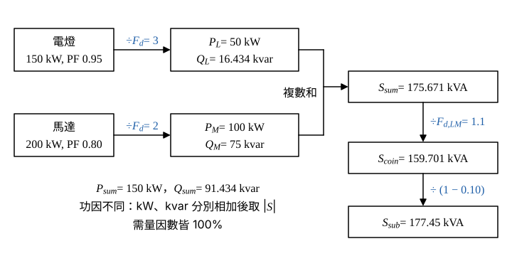

# 104 年工業配電第 2 題｜參差因數與變電站容量

## 已知與所求

三相配電線路，馬達與電燈負載間參差因數 \(1.1\)，配電線路電力損失 \(10\%\)。裝接負載表：

| 負載 | 設備容量 | 需量因數 | 參差因數 | 功因（滯後） |
| --- | --- | --- | --- | --- |
| 電燈 | 150 kW | 100% | 3 | 0.95 |
| 馬達 | 200 kW | 100% | 2 | 0.80 |

求變電站應備 kVA 容量（20 分）。

## 考場標準作答

### 步驟 1：各類負載的最大需量

表內參差因數 3、2 為各類負載內部的參差因數（個別最大需量和 ÷ 群組同時最大需量），類別最大需量：
\[
P=\frac{P_{inst}\times DF}{F_d}
\]
電燈（150 kW、需量因數 100%、參差因數 3、功因 0.95）：
\[
P_L=\frac{150\times1.0}{3}=50\ \mathrm{kW}
\]
\[
\tan(\cos^{-1}0.95)=\frac{\sqrt{1-0.95^2}}{0.95}=\frac{0.31225}{0.95}=0.32868
\]
\[
Q_L=P_L\tan(\cos^{-1}0.95)=50\times0.32868=16.434\ \mathrm{kvar}
\]
馬達（200 kW、需量因數 100%、參差因數 2、功因 0.80）：
\[
P_M=\frac{200\times1.0}{2}=100\ \mathrm{kW}
\]
\[
\tan(\cos^{-1}0.80)=\frac{0.60}{0.80}=0.75
\]
\[
Q_M=P_M\tan(\cos^{-1}0.80)=100\times0.75=75\ \mathrm{kvar}
\]

### 步驟 2：兩類需量的複數功率和

兩類功因不同，\(P\)、\(Q\) 分別相加再取 \(|S|\)：
\[
P_{sum}=P_L+P_M=50+100=150\ \mathrm{kW}
\]
\[
Q_{sum}=Q_L+Q_M=16.434+75=91.434\ \mathrm{kvar}
\]
大小：
\[
S_{sum}=\sqrt{P_{sum}^2+Q_{sum}^2}=\sqrt{150^2+91.434^2}=\sqrt{22\,500+8360.2}=\sqrt{30\,860.2}=175.671\ \mathrm{kVA}
\]
角度（合成功因）：
\[
\theta=\tan^{-1}\frac{91.434}{150}=31.36^\circ,\qquad \cos\theta=\frac{150}{175.671}=0.8539
\]

### 變電站應備 kVA 容量（20 分）

兩類之間的同時最大需量（保留 6 位有效數字，避免最後一位進位誤差）：
\[
S_{coin}=\frac{S_{sum}}{F_{d,LM}}=\frac{175.671}{1.1}=159.701\ \mathrm{kVA}
\]
線路損失 10% 取變電站輸出的 10%，負載只得到輸出的 90%，計入線路損失：
\[
S_{sub}=\frac{S_{coin}}{1-0.10}=\frac{159.701}{0.90}=177.446\ \mathrm{kVA}
\]
\[
\boxed{S_{sub}=177.45\ \mathrm{kVA}}
\]
選用時向上取標準容量（例如 200 kVA）。

## 驗算

分別算 kW 與 kvar（\(1.1\times0.90=0.99\)）：\(P=150/0.99=151.52\ \mathrm{kW}\)，\(Q=91.434/0.99=92.358\ \mathrm{kvar}\)，\(\sqrt{151.52^2+92.358^2}=177.45\ \mathrm{kVA}\)，與主解相同。
上限檢查：各類 kVA 直接相加 \((50/0.95+100/0.80)/0.99=(52.632+125)/0.99=179.43\ \mathrm{kVA}\) 大於 177.45，符合「相量和不大於算術和」。

## 失分點

- 漏用表內參差因數 3 與 2、以 350 kW 的設備容量直接計算，會得 406.84 kVA，為正確值的 2.29 倍。
- 將電燈與馬達的 kVA 以算術和相加（\(50/0.95+100/0.80\)，再除 \(1.1\times0.90\) 得 179.43 kVA），忽略兩者功因角不同，結果偏大。
- 1.1 是參差因數，須除而非乘；誤乘會得 \(175.671\times1.1/0.90=214.71\ \mathrm{kVA}\)，反而偏大。

## 條件與疑義

1. 題目未定義表內「參差因數 3、2」；本解採通用定義：參差因數 \(=\) 各負載最大需量總和 \(\div\) 該群同時最大需量，故表內值為各類負載內部的參差因數，1.1 為電燈與馬達兩群之間的參差因數。
2. 「電力損失 10%」未說明分母。本解取變電站輸出的 10%（\(\div0.90\)）；若指負載端需量的 10%（\(\times1.1\)），則為 \(159.701\times1.1=175.67\ \mathrm{kVA}\)。
