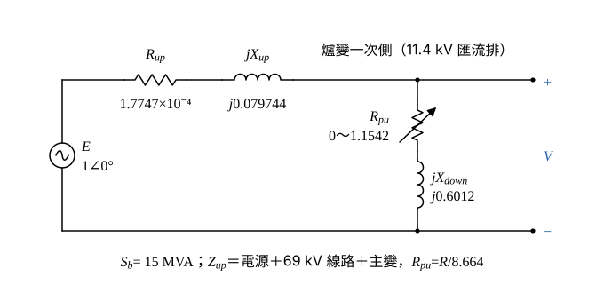

# 104 年工業配電第 3 題｜電弧爐熔化期電壓變動

## 已知與所求

30 噸煉鋼電弧爐；主變壓器 \(15\,\mathrm{MVA}\)、\(X=6.7\%\)、\(69/11.4\,\mathrm{kV}\)；爐用變壓器 \(12.5\,\mathrm{MVA}\)、\(X=6.1\%\)，二次側以下電抗 \(44\%\)。69 kV 饋線 477 MCM 鋁線、\(0.131+j0.405\,\Omega/\mathrm{km}\)、長 430 m；電源端短路容量 \(1230\,\mathrm{MVA}\)。熔化期電弧爐電阻在爐變一次側量測為 \(0\sim10\,\Omega\)。求熔化期電壓變動百分標么值。

## 考場標準作答

**解題邏輯**：電壓變動是電弧電阻由 0 變到 10 Ω 時，爐變一次側（11.4 kV）匯流排電壓大小的差。模型：理想電源 \(E=1\angle0^\circ\,\mathrm{pu}\)（電源端短路容量換成串聯電抗）經上游阻抗 \(Z_{up}\)（電源＋69 kV 線路＋主變）供電，匯流排對地接爐側阻抗 \(R_{pu}+jX_{down}\)，以分壓式求 \(|V|\)。依序求：共同基準 → \(Z_{up}\) → \(X_{down}\) 與 \(R_{pu}\) → \(|V(0)|\)、\(|V(10)|\) → 相減。前提：電源電動勢固定為 \(E=1\angle0^\circ\,\mathrm{pu}\)，忽略電弧爐以外的負載電流（本題沒有故障，只有電弧電阻變動）；饋線上的「其他用戶」題目未給負載資料，不納入模型（只影響量測點讀法，見條件與疑義）；「30 噸」「477 MCM 鋁線」只說明設備，不參與計算。

### 步驟 1：共同基準

取主變容量 \(S_b=15\,\mathrm{MVA}\)，阻抗基準 \(Z_b=V_b^2/S_b\)：
\[
Z_{b,69}=\frac{69^2}{15}=\frac{4761}{15}=317.4\,\Omega
\]
\[
Z_{b,11.4}=\frac{11.4^2}{15}=\frac{129.96}{15}=8.664\,\Omega
\]

（本題兩個電壓相減，差值只有約 0.088；此計算鏈的四捨五入中間值保留 5 位有效數字，4 位會使結果末位差 0.01。）

### 步驟 2：上游阻抗 \(Z_{up}\)

線路長 430 m \(=0.43\,\mathrm{km}\)：
\[
Z_{line}=0.43(0.131+j0.405)=0.05633+j0.17415\,\Omega
\]
換成標么（69 kV 基準）：
\[
R_{line}=\frac{0.05633}{317.4}=1.7747\times10^{-4}\ \mathrm{pu}
\]
\[
X_{line}=\frac{0.17415}{317.4}=5.4868\times10^{-4}\ \mathrm{pu}
\]
電源電抗由短路容量換算：
\[
X_S=\frac{S_b}{S_{sc}}=\frac{15}{1230}=0.012195\ \mathrm{pu}
\]
主變 15 MVA 與 \(S_b\) 相同，直接取 \(X_{T1}=0.067\ \mathrm{pu}\)。電阻只有線路有（電源與主變只給電抗）：
\[
R_{up}=R_{line}=1.7747\times10^{-4}\ \mathrm{pu}
\]
電抗三者串聯：
\[
X_{up}=X_{line}+X_S+X_{T1}=5.4868\times10^{-4}+0.012195+0.067=0.079744\ \mathrm{pu}
\]
\[
Z_{up}=R_{up}+jX_{up}=1.7747\times10^{-4}+j0.079744\ \mathrm{pu}
\]

### 步驟 3：爐側阻抗 \(X_{down}\) 與 \(R_{pu}\)

爐變漏抗 6.1% 與其二次側以下電抗 44% 都在 12.5 MVA 基準，先相加再換到 15 MVA：
\[
X_{down}=(0.061+0.44)\frac{15}{12.5}=0.501(1.2)=0.6012\ \mathrm{pu}
\]
電弧電阻在爐變一次側（11.4 kV）量測，用 \(Z_{b,11.4}\) 換算：
\[
R_{pu}=\frac{R}{Z_{b,11.4}}=\frac{R}{8.664}
\]
\[
R=0:\ R_{pu}=0,\qquad R=10\,\Omega:\ R_{pu}=\frac{10}{8.664}=1.1542\ \mathrm{pu}
\]

畫法：電源 \(E\) 左側，上方導線串 \(R_{up}\)、\(jX_{up}\) 到 11.4 kV 匯流排；匯流排對回路線接 \(R_{pu}\)（可變）串 \(jX_{down}\)；量測電壓 \(V\) 取匯流排對回路線。

### 熔化期電壓變動（20 分）

**邏輯**：匯流排電壓是 \(E\) 在「爐側阻抗」上的分壓；電弧電阻 0 與 10 Ω 兩個極端各算一次 \(|V|\)，兩者之差即電壓變動。

分壓公式（\(E=1\)）：
\[
|V(R)|=\frac{|R_{pu}+jX_{down}|}{|Z_{up}+R_{pu}+jX_{down}|}
\]

\(R=0\)：分母的實部與虛部
\[
Z_{up}+jX_{down}=1.7747\times10^{-4}+j(0.079744+0.6012)=1.7747\times10^{-4}+j0.68094
\]
\[
|Z_{up}+jX_{down}|=\sqrt{(1.7747\times10^{-4})^2+0.68094^2}=0.68094
\]
\[
|V(0)|=\frac{0.6012}{0.68094}=0.88290\ \mathrm{pu}
\]

\(R=10\,\Omega\)：分子
\[
|1.1542+j0.6012|=\sqrt{1.1542^2+0.6012^2}=\sqrt{1.3322+0.36144}=1.3014
\]
分母的實部與虛部
\[
Z_{up}+R_{pu}+jX_{down}=(1.7747\times10^{-4}+1.1542)+j0.68094=1.1544+j0.68094
\]
\[
|1.1544+j0.68094|=\sqrt{1.1544^2+0.68094^2}=\sqrt{1.3326+0.46368}=1.3403
\]
\[
|V(10)|=\frac{1.3014}{1.3403}=0.97098\ \mathrm{pu}
\]

電壓變動：
\[
\Delta V=|V(10)|-|V(0)|=0.97098-0.88290=0.08808\ \mathrm{pu}
\]
\[
\boxed{\Delta V=8.81\%}
\]

## 驗算

歐姆法（全部在 11.4 kV 側，乘 \(Z_{b,11.4}=8.664\,\Omega\)）：\(Z_{up}=1.5376\times10^{-3}+j0.69090\,\Omega\)，\(X_{down}=5.2088\,\Omega\)。
\[
|V(0)|=\frac{5.2088}{|1.5376\times10^{-3}+j5.8997|}=\frac{5.2088}{5.8997}=0.88289
\]
\[
|V(10)|=\frac{|10+j5.2088|}{|10.0015+j5.8997|}=\frac{11.275}{11.612}=0.97098
\]
差值 \(0.08809\ \mathrm{pu}=8.81\%\)，與標么法一致。忽略線路電阻只取 \(jX_{up}\) 時 \(\Delta V=8.82\%\)，相差 0.01 個百分點，線路電阻影響可忽略但保留較完整。

## 失分點

- 430 m 未換成 0.43 km；短路容量 1230 MVA 直接當阻抗，未用 \(X=S_b/S_{sc}\)。
- 44% 與 6.1% 只取其一；兩者皆為爐用變壓器（12.5 MVA）基準，須同乘 \(15/12.5\) 後相加。
- 10 Ω 以 69 kV 側基準換算，或只比較電壓的實部而未取大小。

## 條件與疑義

量測點取爐變一次側（主變 11.4 kV 側）匯流排；電源視為理想電壓源串聯短路電抗，忽略電弧爐以外的負載電流；電壓變動定義為 \(R=10\,\Omega\) 與 \(R=0\) 兩端的電壓大小差。電抗與電阻依題意視為「44% 在爐變二次側以下」且「電阻在爐變一次側量測」，若改以 44% 已含爐變漏抗，結果會不同（約 10.41%）。

題幹提到 69 kV 饋線上尚有其他用戶，若改以 69 kV 受電點（公共耦合點，電源電抗之後、線路之前）計算，\(|V(0)|=0.9821\)、\(|V(10)|=0.9954\)，\(\Delta V\approx1.33\%\)。本解取 11.4 kV 匯流排為主解，因為電弧電阻在爐用變壓器一次側量測，該匯流排即爐變供電點，也是電弧爐電壓閃爍最直接的量測位置。
