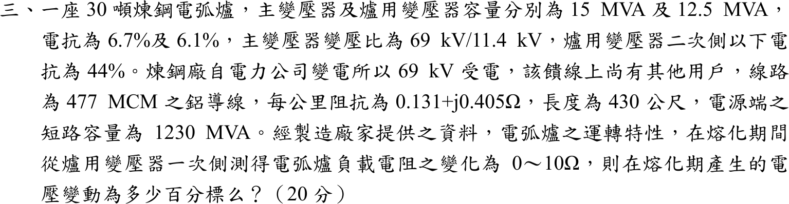

# 104 年工業配電第 3 題｜電弧爐熔化期電壓變動

## 已知與所求

30 噸煉鋼電弧爐；主變壓器 \(15\,\mathrm{MVA}\)、\(X=6.7\%\)、\(69/11.4\,\mathrm{kV}\)；爐用變壓器 \(12.5\,\mathrm{MVA}\)、\(X=6.1\%\)，二次側以下電抗 \(44\%\)。69 kV 饋線 477 MCM 鋁線、\(0.131+j0.405\,\Omega/\mathrm{km}\)、長 430 m；電源端短路容量 \(1230\,\mathrm{MVA}\)。熔化期電弧爐電阻在爐變一次側量測為 \(0\sim10\,\Omega\)。求熔化期電壓變動百分標么值。

## 考場標準作答

### 基準與上游阻抗

電弧爐電壓變動是電源經上游阻抗供電時，電弧電阻由 0 變到 10 Ω 造成的匯流排電壓差，故用「電源—上游阻抗—爐側負載」的串聯分壓模型。畫法：理想電源 \(1\angle0^\circ\,\mathrm{pu}\) 接 \(Z_{up}\)（電源電抗＋69 kV 線路＋主變），其後接到爐變一次側（11.4 kV）匯流排，匯流排對地接爐側負載 \(R_{pu}+jX_{down}\)，量測的是負載端電壓大小。

取 \(S_b=15\,\mathrm{MVA}\)：
\[
Z_{b,69}=\frac{69^2}{15}=317.40\,\Omega,\qquad Z_{b,11.4}=\frac{11.4^2}{15}=8.66\,\Omega
\]
線路（430 m \(=0.43\,\mathrm{km}\)）阻抗與標么值：
\[
Z_{line}=0.43(0.131+j0.405)=5.63\times10^{-2}+j1.74\times10^{-1}\,\Omega
\]
\[
Z_{line,pu}=\frac{Z_{line}}{317.40}=1.77\times10^{-4}+j5.49\times10^{-4}\ \mathrm{pu}
\]
電源電抗與主變：
\[
X_S=\frac{S_b}{S_{sc}}=\frac{15}{1230}=1.22\times10^{-2},\qquad X_{T1}=0.067\ (\text{主變 }15\ \mathrm{MVA}\text{，已在 }S_b\text{ 基準})
\]
上游阻抗：
\[
Z_{up}=Z_{line,pu}+j(X_S+X_{T1})=1.77\times10^{-4}+j\left(5.49\times10^{-4}+1.22\times10^{-2}+0.067\right)=1.77\times10^{-4}+j7.97\times10^{-2}\ \mathrm{pu}
\]
爐變（12.5 MVA）與其二次側以下電抗都在 12.5 MVA 基準，須同乘 \(15/12.5\)：
\[
X_{down}=(0.061+0.44)\frac{15}{12.5}=0.60\ \mathrm{pu}
\]
電弧電阻在爐變一次側（11.4 kV）量測，故用 \(Z_{b,11.4}\) 換算：\(R_{pu}=R/8.66\)，\(R=10\,\Omega\) 時 \(R_{pu}=1.15\)。

### 匯流排電壓與電壓變動

分壓公式：
\[
V(R)=\left|\frac{R_{pu}+jX_{down}}{Z_{up}+R_{pu}+jX_{down}}\right|
\]
\(R=0\)（短路）：
\[
|V(0)|=\frac{|j0.60|}{|1.77\times10^{-4}+j6.81\times10^{-1}|}=\frac{6.01\times10^{-1}}{6.81\times10^{-1}}=8.83\times10^{-1}
\]
\(R=10\,\Omega\)：
\[
|V(10)|=\frac{|1.15+j0.60|}{|1.15+j6.81\times10^{-1}|}=\frac{1.30}{1.34}=9.71\times10^{-1}
\]
電壓變動為兩者之差：
\[
\boxed{\Delta V=9.71\times10^{-1}-8.83\times10^{-1}=8.81\times10^{-2}\ \mathrm{pu}=8.81\%}
\]

## 驗算

歐姆法（11.4 kV 側）：\(Z_{up}=1.54\times10^{-3}+j0.69\,\Omega\)，\(X_{down}=5.21\,\Omega\)。
\[
|V(0)|=\frac{5.21}{|1.54\times10^{-3}+j5.90|}=8.83\times10^{-1},\qquad
|V(10)|=\frac{|10+j5.21|}{|10.00+j5.90|}=\frac{11.28}{11.61}=9.71\times10^{-1}
\]
忽略線路電阻只取 \(jX_{up}\) 時 \(\Delta V=8.82\%\)，與 8.81% 相差 0.01 個百分點，線路電阻影響可忽略但保留較完整。

## 失分點

- 430 m 未換成 0.43 km；短路容量 1230 MVA 直接當阻抗，未用 \(X=S_b/S_{sc}\)。
- 44% 與 6.1% 只取其一；兩者皆為爐用變壓器（12.5 MVA）基準，須同乘 \(15/12.5\) 後相加。
- 10 Ω 以 69 kV 側基準換算，或只比較電壓的實部而未取大小。

## 條件與疑義

量測點取爐變一次側（主變 11.4 kV 側）匯流排；電源視為理想電壓源串聯短路電抗，忽略故障前負載電流；電壓變動定義為 \(R=10\,\Omega\) 與 \(R=0\) 兩端的電壓大小差。電抗與電阻依題意視為「44% 在爐變二次側以下」且「電阻在爐變一次側量測」，若改以 44% 已含爐變漏抗，結果會不同（約 10.41%）。

題幹提到 69 kV 饋線上尚有其他用戶，若改以 69 kV 受電點（公共耦合點，電源電抗之後、線路之前）計算，\(|V(0)|=9.82\times10^{-1}\)、\(|V(10)|=9.95\times10^{-1}\)，\(\Delta V\approx1.33\%\)。本解取 11.4 kV 匯流排為主解，因為電弧電阻在爐用變壓器一次側量測，該匯流排即爐變供電點，也是電弧爐電壓閃爍最直接的量測位置。
