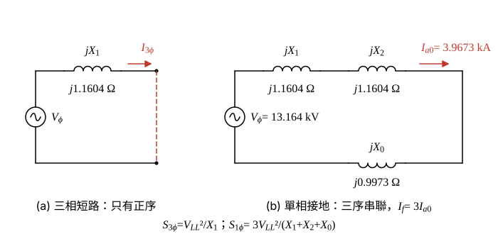

# 104 年工業配電第 4 題｜短路容量與對稱成分等效阻抗

## 已知與所求

供電電壓 \(22.8\,\mathrm{kV}\)，三相短路容量 \(448\,\mathrm{MVA}\)，單相（接地）短路容量 \(470\,\mathrm{MVA}\)；電阻忽略。求正序、負序、零序等效阻抗。

## 考場標準作答

**解題邏輯**：兩種故障容量各對應一種序網路接法。三相短路為平衡故障，只有正序網路，由 \(S_{3\phi}\) 解出 \(Z_1\)；供電系統為靜止元件，負序阻抗等於正序 \(Z_2=Z_1\)。單相接地短路時正、負、零序網路串聯，由 \(S_{1\phi}\) 解出三序阻抗和，再扣掉 \(Z_1+Z_2\) 得 \(Z_0\)。前提：電阻忽略（各序阻抗為純電抗 \(jX\)）、故障前無載、電源電壓為額定 22.8 kV、故障阻抗為零；單相短路容量依 \(S_{1\phi}=\sqrt3\,V_{LL}I_f\) 定義。

### 步驟 1：故障容量與序網路的關係

- 三相短路：電源相電壓 \(V_\phi\) 只接正序阻抗 \(Z_1\) 後短路，\(I_{3\phi}=V_\phi/Z_1\)。
- 單相接地短路：正、負、零序網路首尾串聯，\(I_{a1}=I_{a2}=I_{a0}=V_\phi/(Z_1+Z_2+Z_0)\)，故障電流 \(I_f=3I_{a0}\)。

三相短路容量（\(V_\phi=V_{LL}/\sqrt3\)）：
\[
S_{3\phi}=\sqrt3\,V_{LL}I_{3\phi}=\sqrt3\,V_{LL}\cdot\frac{V_{LL}}{\sqrt3\,Z_1}=\frac{V_{LL}^2}{Z_1}
\]
單相短路容量：
\[
S_{1\phi}=\sqrt3\,V_{LL}I_f=\sqrt3\,V_{LL}\cdot\frac{3V_{LL}/\sqrt3}{Z_1+Z_2+Z_0}=\frac{3V_{LL}^2}{Z_1+Z_2+Z_0}
\]
共用的電壓平方（kV 與 MVA 相除得 Ω）：
\[
V_{LL}^2=22.8^2=519.84\ \mathrm{kV^2}
\]

### 正序與負序阻抗

**邏輯**：三相短路只經正序網路，\(X_1=V_{LL}^2/S_{3\phi}\)；靜止的供電網路正、負序阻抗相同，\(Z_2=Z_1\)。

\[
X_1=\frac{V_{LL}^2}{S_{3\phi}}=\frac{519.84}{448}=1.1604\ \Omega
\]
\[
\boxed{Z_1=Z_2=j1.16\ \Omega}
\]

### 零序阻抗

**邏輯**：單相接地時三序串聯，由 \(S_{1\phi}=3V_{LL}^2/(Z_1+Z_2+Z_0)\) 解出三序和，再減去 \(2X_1\)。

三序電抗和：
\[
X_1+X_2+X_0=\frac{3V_{LL}^2}{S_{1\phi}}=\frac{3\times519.84}{470}=\frac{1559.52}{470}=3.3181\ \Omega
\]
正序與負序合計：
\[
X_1+X_2=2\times1.1604=2.3208\ \Omega
\]
零序電抗：
\[
X_0=3.3181-2.3208=0.9973\ \Omega
\]
\[
\boxed{Z_0=j1.00\ \Omega}
\]

## 驗算

故障電流反推容量：\(V_\phi=22.8/\sqrt3=13.164\ \mathrm{kV}\)，\(I_{a0}=13.164/3.3181=3.9673\ \mathrm{kA}\)，\(I_f=3\times3.9673=11.902\ \mathrm{kA}\)，\(S_{1\phi}=\sqrt3\times22.8\times11.902=470.02\ \mathrm{MVA}\)，與題給 470 MVA 一致。

標么法（\(S_b=100\,\mathrm{MVA}\)、\(Z_b=22.8^2/100=5.1984\,\Omega\)）：\(X_1=100/448=0.22321\ \mathrm{pu}\)，\(X_0=300/470-2\times0.22321=0.63830-0.44642=0.19188\ \mathrm{pu}\)；換回歐姆 \(X_1=0.22321\times5.1984=1.1603\,\Omega\)、\(X_0=0.19188\times5.1984=0.9975\,\Omega\)，與歐姆法一致。

## 失分點

- 單相短路容量漏掉因數 3（寫成 \(V^2/S_{1\phi}\)），會得 \(Z_1+Z_2+Z_0=1.11\,\Omega<2Z_1=2.32\,\Omega\)，零序為負值，不合理。
- 把三相短路容量用 \(V_{LL}^2/S\) 時誤用相電壓。
- 忘記負序阻抗等於正序，只扣一次 \(Z_1\)。

## 條件與疑義

單相短路容量依 \(S_{1\phi}=\sqrt3V_{LL}I_f\) 定義，其中 \(I_f\) 為單相接地短路電流。
