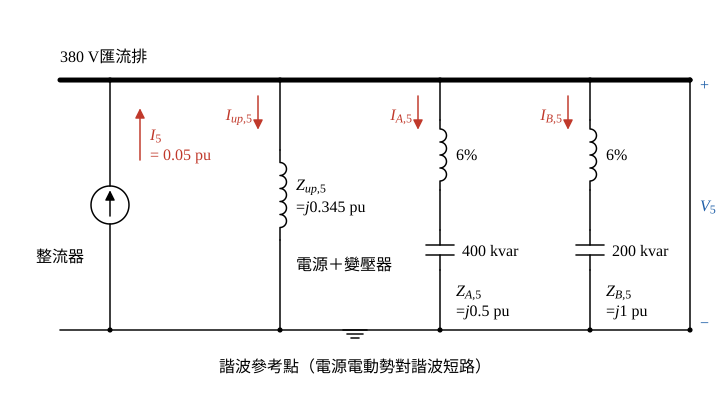

# 104 年工業配電第 5 題｜六脈波整流器第 5 次諧波

## 已知與所求

380 V 匯流排；電源 11.4 kV、短路容量 \(250\,\mathrm{MVA}\)；變壓器 \(2000\,\mathrm{kVA}\)、\(11.4\,\mathrm{kV}/380\,\mathrm V\)、\(X=6.1\%\)；A 組電容器 \(400\,\mathrm{kvar}\)、B 組 \(200\,\mathrm{kvar}\)，各串聯 6% 電抗器；新設 500 kW 六脈波整流器，第 5 次諧波電流為額定電流的 20%。求（一）匯流排諧波電壓、（二）電源幹線諧波電流、（三）A 組、（四）B 組分路諧波電流（各 5 分）。

基準分支（題目未給功因與效率，詳見「條件與疑義」）：500 kW 為 AC 側有功輸入、\(\mathrm{pf}_1=1\)，電阻忽略。

## 考場標準作答

**解題邏輯**：六脈波整流器對系統是第 5 次諧波**電流源** \(I_5\)；從它注入的 380 V 匯流排看出去，有「電源＋變壓器」「A 組（電抗器＋電容器）」「B 組」三條支路並聯到諧波參考點（電源電動勢對諧波視為短路）。先把三條支路換成第 5 次阻抗（電感 \(\times h\)、電容 \(\div h\)），再求注入電流 \(I_5\) 與並聯阻抗 \(Z_{bus,5}\)，得匯流排諧波電壓 \(V_5=I_5Z_{bus,5}\)；三條支路都跨在 \(V_5\) 上，各支路電流 \(=V_5/Z\)。前提：電阻忽略；基準分支為「500 kW 為 AC 側有功輸入、\(\mathrm{pf}_1=1\)」，「額定電流」取 AC 側基波線電流（其他分支見「條件與疑義」）；電容器 kvar 取 \(X_C=V^2/Q_C\)。

### 步驟 1：標么基準

取 \(S_b=2\,\mathrm{MVA}\)（變壓器額定）、\(V_b=380\,\mathrm V\)：
\[
I_b=\frac{S_b}{\sqrt3\,V_b}=\frac{2\times10^6}{\sqrt3(380)}=3038.69\ \mathrm A
\]

### 步驟 2：各支路的第 5 次諧波阻抗

電源短路阻抗（\(S_{sc}=250\,\mathrm{MVA}\)）：
\[
X_s=\frac{S_b}{S_{sc}}=\frac{2}{250}=0.008\ \mathrm{pu}
\]
變壓器 \(X_T=6.1\%=0.061\ \mathrm{pu}\)（額定即基準，不必換算）。兩者串聯：
\[
X_s+X_T=0.008+0.061=0.069\ \mathrm{pu}
\]
\[
Z_{up,5}=j\,h(X_s+X_T)=j\,5(0.069)=j0.345\ \mathrm{pu}
\]
A 組電容器與 6% 串聯電抗器（\(X_{L}=0.06X_C\)）：
\[
X_{C,A}=\frac{S_b}{Q_A}=\frac{2}{0.4}=5\ \mathrm{pu},\qquad X_{L,A}=0.06(5)=0.3\ \mathrm{pu}
\]
\[
Z_{A,5}=j\left(hX_{L,A}-\frac{X_{C,A}}{h}\right)=j\left(5(0.3)-\frac{5}{5}\right)=j(1.5-1)=j0.5\ \mathrm{pu}
\]
B 組：
\[
X_{C,B}=\frac{S_b}{Q_B}=\frac{2}{0.2}=10\ \mathrm{pu},\qquad X_{L,B}=0.06(10)=0.6\ \mathrm{pu}
\]
\[
Z_{B,5}=j\left(hX_{L,B}-\frac{X_{C,B}}{h}\right)=j\left(5(0.6)-\frac{10}{5}\right)=j(3-2)=j1\ \mathrm{pu}
\]
兩組在第 5 次都是 \(hX_L>X_C/h\)，為淨感性，三條支路阻抗同為 \(+j\)。

### 步驟 3：整流器注入的第 5 次電流

AC 側基波額定線電流（基準分支 \(\mathrm{pf}_1=1\)）：
\[
I_{1,\mathrm{AC}}=\frac{P}{\sqrt3\,V_{LL}}=\frac{500\times10^3}{\sqrt3(380)}=759.67\ \mathrm A
\]
\[
I_5=0.2\,I_{1,\mathrm{AC}}=0.2(759.67)=151.93\ \mathrm A
\]
換成標么（\(I_5/I_b=0.2\times500/2000\)，為精確值）：
\[
I_5=\frac{151.93}{3038.69}=0.05\ \mathrm{pu}
\]

### 步驟 4：諧波等效電路與匯流排阻抗

- 整流器畫成電流源 \(I_5\)，由參考點注入 380 V 匯流排。
- 匯流排對參考點並聯三支路 \(Z_{up,5}\)、\(Z_{A,5}\)、\(Z_{B,5}\)；支路電流參考方向一律由匯流排流向參考點。
- 電源電動勢只含基波，對第 5 次諧波視為短路，所以電源支路下端接參考點。

三支路並聯，先加導納再取倒數（三者皆 \(+j\)，可直接以電抗值計算）：
\[
\frac1{Z_{bus,5}}=\frac1{j0.345}+\frac1{j0.5}+\frac1{j1}=-j\left(\frac1{0.345}+2+1\right)
\]
為了讓後續各行照字面對得上，改寫成精確分式：
\[
Z_{bus,5}=j\,\frac{1}{\dfrac1{0.345}+3}=j\,\frac{0.345}{1+3(0.345)}=j\,\frac{0.345}{2.035}=j0.169533\ \mathrm{pu}
\]

### （一）380 V 匯流排諧波電壓（5 分）

**邏輯**：諧波電流源 \(I_5\) 流入匯流排看進去的並聯阻抗 \(Z_{bus,5}\)，歐姆定律得 \(V_5=I_5Z_{bus,5}\)。

\[
V_5=I_5\,|Z_{bus,5}|=0.05(0.169533)=0.0084767\ \mathrm{pu}
\]
\[
V_5=0.0084767\,V_b=0.0084767(380\ \mathrm V)
\]
\[
\boxed{V_5=3.22\ \mathrm V}
\]

### （二）電源幹線諧波電流（5 分）

**邏輯**：電源＋變壓器支路兩端就是匯流排與參考點，承受整個 \(V_5\)，所以 \(I_{up,5}=V_5/Z_{up,5}\)。

\[
I_{up,5}=\frac{V_5}{|Z_{up,5}|}=\frac{0.0084767}{0.345}=0.024570\ \mathrm{pu}
\]
\[
I_{up,5}=0.024570\,I_b=0.024570(3038.69\ \mathrm A)
\]
\[
\boxed{I_{up,5}=74.66\ \mathrm A}
\]

### （三）A 組電容器分路諧波電流（5 分）

**邏輯**：A 組支路同樣跨在 \(V_5\) 上，第 5 次阻抗為淨感性 \(j0.5\)，電流 \(=V_5/Z_{A,5}\)。

\[
I_{A,5}=\frac{V_5}{|Z_{A,5}|}=\frac{0.0084767}{0.5}=0.0169534\ \mathrm{pu}
\]
\[
I_{A,5}=0.0169534\,I_b=0.0169534(3038.69\ \mathrm A)
\]
\[
\boxed{I_{A,5}=51.52\ \mathrm A}
\]

### （四）B 組電容器分路諧波電流（5 分）

**邏輯**：B 組支路阻抗 \(j1\)，電流 \(=V_5/Z_{B,5}\)，標么值與 \(V_5\) 相同。

\[
I_{B,5}=\frac{V_5}{|Z_{B,5}|}=\frac{0.0084767}{1}=0.0084767\ \mathrm{pu}
\]
\[
I_{B,5}=0.0084767\,I_b=0.0084767(3038.69\ \mathrm A)
\]
\[
\boxed{I_{B,5}=25.76\ \mathrm A}
\]

三條支路在第 5 次均為感性，電流同相，大小可直接相加（見驗算）。

## 驗算

KCL：\(I_{up,5}+I_{A,5}+I_{B,5}=74.66+51.52+25.76=151.94\ \mathrm A\approx I_5=151.93\ \mathrm A\)（差 0.01 A 為各值兩位小數捨入）。
電流分配法：\(I_{A,5}=I_5\dfrac{|Z_{bus,5}|}{|Z_{A,5}|}=151.934\left(\dfrac{0.169533}{0.5}\right)=51.52\ \mathrm A\)，與（三）一致。

## 失分點

- 6% 串聯電抗器在第 5 次使 \(hX_L>X_C/h\)（A 組 \(5X_{L,A}=1.5>X_{C,A}/5=1\)），支路為淨感性 \(j0.5\ \mathrm{pu}\)；若把支路當純電容 \(-jX_C/5\)，符號與大小皆錯。
- 電源側阻抗須乘 \(h=5\)（\(0.069\to0.345\ \mathrm{pu}\)），且要含電源短路阻抗 \(X_s=0.008\ \mathrm{pu}\)，不可只用變壓器 \(X_T\)。
- 電流基準要用 380 V 側 \(I_b=3038.69\ \mathrm A\)；誤用 11.4 kV 側基準電流會小 30 倍（電壓比 \(11.4/0.38=30\)）。

## 條件與疑義

題目沒有說明 500 kW 是整流器 DC 輸出或 AC 側有功輸入，也未給基波功因 \(\mathrm{pf}_1\) 與效率 \(\eta\)，更未明定「額定電流」的分母是 AC 基波、AC 總 RMS 或 DC 額定電流。上列為「500 kW 為 AC 側有功、\(\mathrm{pf}_1=1\)」的基準分支。

500 kW 若為 DC 輸出，由 DC 功率反推的仍是 AC 輸入側線電流，不是 DC 電流：
\[
I_{L,\mathrm{AC,in}}^{(P_{DC})}=\frac{500\,\mathrm{kW}}{\eta\,\mathrm{pf}_1\sqrt3(380\,\mathrm V)},\qquad I_5=0.2I_{L,\mathrm{AC,in}}^{(P_{DC})}
\]
因網路與支路阻抗不變，所有四個輸出依同一比例縮放。（500 kW 為 AC 側有功時除以 \(\mathrm{pf}_1\)；為 DC 輸出時除以 \(\eta\,\mathrm{pf}_1\)。）令基準向量 \(\mathbf y_0=(|V_5|,|I_{source,5}|,|I_{A,5}|,|I_{B,5}|)=(3.2211,74.6606,51.5158,25.7579)\)，則
\[
\mathbf y=\frac{\mathbf y_0}{\mathrm{pf}_1}\ \ (\text{AC 側有功}),\qquad
\mathbf y=\frac{\mathbf y_0}{\eta\,\mathrm{pf}_1}\ \ (\text{DC 輸出})
\]
即所有輸出乘 \(1/\mathrm{pf}_1\) 或 \(1/(\eta\,\mathrm{pf}_1)\)。例：500 kW 為 AC 側有功、\(\mathrm{pf}_1=0.95\) 時為 \((3.3907\ \mathrm V,\,78.5901,\,54.2272,\,27.1136\ \mathrm A)\)；500 kW 為 DC 輸出、\(\eta=0.90\)、\(\mathrm{pf}_1=0.95\) 時為 \((3.7674\ \mathrm V,\,87.3223,\,60.2524,\,30.1262\ \mathrm A)\)。

另一個題面未定的量是電容器標示 kvar：本解取 \(X_C=V^2/Q_C\)；若 400／200 kvar 為串聯電抗器後的淨輸出（\(X_C-X_L=V^2/Q\)），\(Z_{A,5}=j0.5319\)、\(Z_{B,5}=j1.0638\)，基準分支的輸出約為 \(3.32\ \mathrm V\)、\(77.0\)、\(49.9\)、\(25.0\ \mathrm A\)。

因上述條件未唯一指定，維持人工複核。
