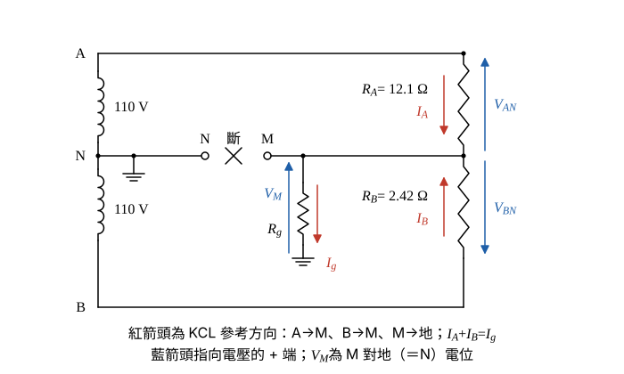

# 105 年工業配電第 1 題｜單相三線中性線開路與接地電阻

## 已知與所求

單相三線 110／220 V，A、B 為電阻性負載 1 kW 與 5 kW（額定 110 V）；線路阻抗忽略。中性線端子 N 與 M 斷開，M（負載中點）經 \(R_g\) 接地，變壓器中心抽頭 N 接地。求（一）\(R_g=0\)、（二）\(R_g=1000\,\Omega\) 時負載電壓 \(V_{AN}\)、\(V_{BN}\)（圖中 A 在上、B 在下，各量取負載兩端電壓）並說明結果。

## 考場標準作答

**解題邏輯**：N–M 斷開後，負載中點 M 的電位不再被中性線鉗住，兩負載的實際電壓由 M 點電位 \(V_M\) 決定。以變壓器中心抽頭 N（接地）為參考，A 端 \(+110\,\mathrm V\)、B 端 \(-110\,\mathrm V\)，在 M 點列 KCL 求 \(V_M\)，再由 \(V_{AN}=110-V_M\)、\(V_{BN}=-110-V_M\) 得兩負載兩端電壓。前提：線路阻抗忽略、變壓器二次側兩半繞組為理想 110 V 電源、負載為定電阻（\(R=V^2/P\)）、N 接地與 \(R_g\) 接地之間的大地電阻不計。

### 步驟 1：負載電阻

額定 110 V 下的電阻：
\[
R=\frac{V^2}{P}
\]
\[
R_A=\frac{110^2}{1000}=\frac{12\,100}{1000}=12.1\ \Omega
\]
\[
R_B=\frac{110^2}{5000}=\frac{12\,100}{5000}=2.42\ \Omega
\]

### 步驟 2：M 點節點方程式

畫法：
- 參考節點為 N（接地）；A 端 \(+110\,\mathrm V\)、B 端 \(-110\,\mathrm V\)。
- \(R_A\) 接在 A 與 M 之間、\(R_B\) 接在 M 與 B 之間，M 經 \(R_g\) 入地。
- 參考方向：電流由 A、B 兩端流向 M，再經 \(R_g\) 入地。

M 點 KCL（流入 = 流出）：
\[
\frac{110-V_M}{R_A}+\frac{-110-V_M}{R_B}=\frac{V_M}{R_g}
\]

### （一）\(R_g=0\,\Omega\)（10 分）

**邏輯**：\(R_g=0\) 時 M 點直接接地，\(V_M=0\)，與 N 同電位，等於用接地線補回中性線。

\[
V_M=0
\]
\[
V_{AN}=110-V_M=110-0
\]
\[
V_{BN}=-110-V_M=-110-0
\]
\[
\boxed{V_{AN}=+110\,\mathrm V},\qquad \boxed{V_{BN}=-110\,\mathrm V}
\]
說明：兩負載皆承受額定 110 V（大小），N–M 斷開但 \(R_g=0\) 等同接地線補回中性線，負載不受影響。此時兩負載的不平衡電流 \(110/R_B-110/R_A=45.455-9.0909=36.364\ \mathrm A\) 全部改走接地線與大地回路，實務上不能以接地線代替中性線。

### （二）\(R_g=1000\,\Omega\)（10 分）

**邏輯**：\(R_g\) 很大時接地路徑幾乎斷開，M 點電位由步驟 2 的 KCL 決定；把含 \(V_M\) 的項移到左邊解出 \(V_M\)，再求兩負載電壓。

整理 KCL：
\[
V_M\left(\frac1{R_A}+\frac1{R_B}+\frac1{R_g}\right)=\frac{110}{R_A}-\frac{110}{R_B}
\]
左側各電導：
\[
\frac1{R_A}=\frac1{12.1}=0.082645\ \mathrm S,\qquad \frac1{R_B}=\frac1{2.42}=0.41322\ \mathrm S,\qquad \frac1{R_g}=\frac1{1000}=0.001\ \mathrm S
\]
\[
\frac1{R_A}+\frac1{R_B}+\frac1{R_g}=0.082645+0.41322+0.001=0.49687\ \mathrm S
\]
右側：
\[
\frac{110}{12.1}=9.0909\ \mathrm A,\qquad \frac{110}{2.42}=45.455\ \mathrm A
\]
\[
\frac{110}{R_A}-\frac{110}{R_B}=9.0909-45.455=-36.364\ \mathrm A
\]
解出 M 點電位：
\[
V_M=\frac{-36.364}{0.49687}=-73.186\ \mathrm V
\]
負載 A 兩端電壓：
\[
V_{AN}=110-V_M=110-(-73.186)=183.186\ \mathrm V
\]
負載 B 兩端電壓：
\[
V_{BN}=-110-V_M=-110-(-73.186)=-36.814\ \mathrm V
\]
\[
\boxed{V_{AN}=183.19\ \mathrm V},\qquad \boxed{V_{BN}=-36.81\ \mathrm V}
\]
說明：A 負載承受 183.19 V（約額定的 \(183.19/110=1.67\) 倍，過電壓），B 負載僅 36.81 V（欠電壓）。輕載 A 過壓、重載 B 欠壓，是中性線開路、接地回路阻抗過大的典型危險。

## 驗算

支路電流（實際方向）：\(I_A=183.186/12.1=15.139\ \mathrm A\)（A→M），\(I_B=36.814/2.42=15.212\ \mathrm A\)（M→B），接地電流 \(I_g=73.186/1000=0.073186\ \mathrm A\)（由地流入 M）。M 點 KCL：\(I_A+I_g=15.139+0.073186=15.212\ \mathrm A=I_B\)，成立。
極限：\(R_g\to\infty\) 時為單純串聯分壓 \(220\times12.1/(12.1+2.42)=183.33\ \mathrm V\)，\(R_g=1000\,\Omega\) 的 183.19 V 略低且趨近此值。

## 失分點

- \(R_g=0\) 時仍照浮接串聯分壓（183.33 V／36.67 V），忽略接地線已把 M 點鉗位在 0 V。
- KCL 中 \(R_g\) 電流方向反號會得 \(183.48\,\mathrm V\)／\(36.52\,\mathrm V\)，且比 \(R_g=\infty\) 的 183.33 V 還大，不合物理。
- 只寫大小不說明 A 過壓、B 欠壓。

## 條件與疑義

若 \(V_{AN}\)、\(V_{BN}\) 解讀為變壓器端子 A、B 對中心抽頭 N 的電壓，則恆為 \(\pm110\,\mathrm V\)；題意著眼於負載是否承受額定電壓，故本解取負載兩端電壓。
