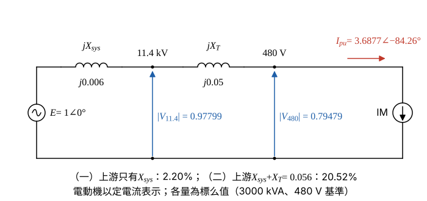

# 105 年工業配電第 2 題｜感應電動機啟動電壓降與標么值

## 已知與所求

11.4 kV 供電，責任分界點短路容量 \(500\,\mathrm{MVA}\)；主變壓器 \(3000\,\mathrm{kVA}\)、\(11.4\,\mathrm{kV}/480\,\mathrm V\)、\(Z_T=5\%\)；三相感應電動機 \(2000\,\mathrm{HP}\)、\(\eta=0.9\)、\(\cos\theta=0.86\)、額定電壓 \(460\,\mathrm V\)。基準 \(\mathrm{kVA}_b=3000\)、\(V_b=480\,\mathrm V\)。啟動電流為額定 5.5 倍、啟動功因 0.1（滯後）。求啟動時（一）11.4 kV 側、（二）480 V 側的電壓降百分比（各 10 分）。

## 考場標準作答

**解題邏輯**：電壓降由「啟動電流流過上游電抗」產生。先由電動機輸出功率、效率、功因與 460 V 額定電壓求額定電流，乘 5.5 得啟動電流，再除以 480 V 側基準電流化成標么相量（落後 \(\cos^{-1}0.1\)）；接著把系統短路容量與主變壓器換成同一基準的標么電抗，畫成「電源 → \(jX_{sys}\) → 11.4 kV 母線 → \(jX_T\) → 480 V 母線 → 電動機」的串聯圖，依序以 \(V=1-jXI\) 求兩母線電壓。前提：責任分界點上游電源電壓 \(E=1\angle0^\circ\ \mathrm{pu}\)（啟動前無載）；題目只給電抗、未給 \(X/R\)，系統與變壓器視為純電抗；單線圖中的 CB、MS 為開關設備，阻抗忽略；電動機以題給啟動電流（定電流）表示；電壓降百分比取 \((1-|V|)\times100\%\)。

### 步驟 1：啟動電流的標么相量

電動機額定輸入視在功率（\(1\ \mathrm{HP}=0.746\ \mathrm{kW}\)）：
\[
P_{out}=2000\times0.746=1492\ \mathrm{kW}
\]
\[
S_{rated}=\frac{P_{out}}{\eta\cos\theta}=\frac{1492}{0.9\times0.86}=\frac{1492}{0.774}=1927.65\ \mathrm{kVA}
\]
額定電流用電動機額定電壓 460 V：
\[
I_{rated}=\frac{S_{rated}}{\sqrt3\,V_{rated}}=\frac{1927.65}{\sqrt3\times0.46}=\frac{1927.65}{0.79674}=2419.42\ \mathrm A
\]
啟動電流：
\[
I_{start}=5.5I_{rated}=5.5\times2419.42=13\,306.81\ \mathrm A
\]
480 V 側基準電流：
\[
I_b=\frac{\mathrm{kVA}_b}{\sqrt3\,V_b}=\frac{3000}{\sqrt3\times0.48}=\frac{3000}{0.831384}=3608.44\ \mathrm A
\]
標么大小：
\[
|I_{pu}|=\frac{I_{start}}{I_b}=\frac{13\,306.81}{3608.44}=3.6877\ \mathrm{pu}
\]
啟動功因 0.1（滯後），電流角度：
\[
\phi=-\cos^{-1}(0.1)=-84.26^\circ,\qquad \sin\left|\phi\right|=\sqrt{1-0.1^2}=0.99499
\]
化成直角座標：
\[
\mathrm{Re}=|I_{pu}|\cos\phi=3.6877\times0.1=0.36877
\]
\[
\mathrm{Im}=-|I_{pu}|\sin\left|\phi\right|=-3.6877\times0.99499=-3.6692
\]
\[
I_{pu}=3.6877\angle\left[-\cos^{-1}(0.1)\right]=0.36877-j3.6692\ \mathrm{pu}
\]
標么值不受變壓比影響，同一個 \(I_{pu}\) 也流過 11.4 kV 側的 \(X_{sys}\)。

### 步驟 2：上游標么電抗與等效電路

系統（責任分界點短路容量 500 MVA）：
\[
X_{sys}=\frac{\mathrm{kVA}_b}{\mathrm{kVA}_{sc}}=\frac{3000}{500\,000}=0.006\ \mathrm{pu}
\]
主變壓器容量即基準容量、電壓同基準，不必換算：
\[
X_T=5\%=0.05\ \mathrm{pu}
\]
畫法：
- 電源 \(E=1\angle0^\circ\) 為參考相量，接 \(jX_{sys}\) 到 11.4 kV 母線（電壓 \(V_{11.4}\)），再接 \(jX_T\) 到 480 V 母線（電壓 \(V_{480}\)）。
- 啟動電流 \(I_{pu}\) 由電源經兩段電抗流入電動機；各母線電壓 = \(E\) − 上游電抗壓降。

### （一）11.4 kV 側電壓降百分比（10 分）

**邏輯**：11.4 kV 母線上游只有 \(X_{sys}\)，\(V_{11.4}=E-jX_{sys}I_{pu}\)，壓降百分比 \(=(1-|V_{11.4}|)\times100\%\)。

電抗壓降：
\[
jX_{sys}I_{pu}=j0.006\times(0.36877-j3.6692)
\]
\[
=0.006\times3.6692+j0.006\times0.36877=0.022015+j0.0022126\ \mathrm{pu}
\]
母線電壓：
\[
V_{11.4}=1-(0.022015+j0.0022126)=0.977985-j0.0022126\ \mathrm{pu}
\]
大小：
\[
|V_{11.4}|=\sqrt{0.977985^2+0.0022126^2}=\sqrt{0.95645+0.0000049}=\sqrt{0.95646}=0.97799\ \mathrm{pu}
\]
角度：
\[
\angle V_{11.4}=-\tan^{-1}\frac{0.0022126}{0.977985}=-0.13^\circ
\]
電壓降百分比：
\[
\%\Delta V_{11.4}=(1-|V_{11.4}|)\times100\%=(1-0.97799)\times100\%
\]
\[
\boxed{\%\Delta V_{11.4}=2.20\%}
\]

### （二）480 V 側電壓降百分比（10 分）

**邏輯**：480 V 母線在變壓器之後，同一啟動電流流過串聯的 \(X_{sys}+X_T\)，\(V_{480}=E-j(X_{sys}+X_T)I_{pu}\)。

串聯電抗：
\[
X_{sys}+X_T=0.006+0.05=0.056\ \mathrm{pu}
\]
電抗壓降：
\[
j0.056\times(0.36877-j3.6692)=0.056\times3.6692+j0.056\times0.36877=0.20548+j0.020651\ \mathrm{pu}
\]
母線電壓：
\[
V_{480}=1-(0.20548+j0.020651)=0.79452-j0.020651\ \mathrm{pu}
\]
大小：
\[
|V_{480}|=\sqrt{0.79452^2+0.020651^2}=\sqrt{0.63126+0.00042646}=\sqrt{0.63169}=0.79479\ \mathrm{pu}
\]
角度：
\[
\angle V_{480}=-\tan^{-1}\frac{0.020651}{0.79452}=-1.49^\circ
\]
電壓降百分比：
\[
\%\Delta V_{480}=(1-|V_{480}|)\times100\%=(1-0.79479)\times100\%
\]
\[
\boxed{\%\Delta V_{480}=20.52\%}
\]

## 驗算

壓降近似式 \(\Delta V\approx X|I|\sin|\phi|\)（\(R=0\)）：\(0.006\times3.6877\times0.99499=0.022015\)，即 2.20%；\(0.056\times3.6877\times0.99499=0.20548\)，即 20.55%，與相量解 2.20%、20.52% 相符（後者差 0.03% 來自 \(V\) 的虛部）。串聯 KVL：\(X_{sys}\) 佔 2.20%，變壓器再增加 \(20.52-2.20=18.32\%\)，合計 20.52%。

## 失分點

- 額定電流須以 460 V 電動機額定電壓計算，標么化時才以 480 V、3000 kVA 為基準電流。
- 11.4 kV 側只含 \(X_{sys}\)，480 V 側含 \(X_{sys}+X_T\)。
- 啟動電流要帶落後 \(84.26^\circ\) 的角度；當成同相電流會使壓降幾乎為零。

## 條件與疑義

圖中只給系統短路容量，未給 \(X/R\)，故將電源與變壓器視為純電抗並忽略開關、電纜阻抗；若取得 \(X/R\) 或變壓器電阻，應改用完整 \(R+jX\) 相量。電壓降以受電端電壓大小 \(1-|V|\) 定義；若取壓降向量大小 \(X|I|\)，則為 \(0.006\times3.6877=0.022126\)（2.2126%）與 \(0.056\times3.6877=0.20651\)（20.651%）。

若把電動機視為定阻抗 \(Z_m=\dfrac{460/480}{3.6877}\angle84.26^\circ=0.2599\angle84.26^\circ\ \mathrm{pu}\) 與系統串聯，啟動電流降為約 3.17 pu，壓降為 \(1.89\%\)／\(17.67\%\)；本解依題意取指定的啟動電流 \(5.5I_{rated}\)（定電流）。
