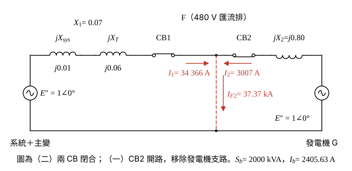

# 105 年工業配電第 3 題｜低壓匯流排三相短路與電源並聯

## 已知與所求

22.8 kV 受電，責任分界點短路容量 \(200\,\mathrm{MVA}\)；主變 \(2000\,\mathrm{kVA}\)、\(22.8\,\mathrm{kV}/480\,\mathrm V\)、\(Z_T=6\%\)；發電機 \(500\,\mathrm{kVA}\)、\(480\,\mathrm V\)、\(Z_G''=20\%\)。F 點為 480 V 匯流排三相短路，基準 \(2000\,\mathrm{kVA}\)、\(480\,\mathrm V\)。求（一）CB1 閉合、CB2 開路，（二）CB1、CB2 皆閉合時的對稱故障電流（kA）（各 10 分）。

## 考場標準作答

### 步驟 1：基準電流

設故障前無載、各電源內電勢 \(E''=1\angle0^\circ\ \mathrm{pu}\)，只計電抗、不計電阻。F 在 480 V 匯流排，基準電流用 480 V（線電壓）：
\[
I_b=\frac{S_b}{\sqrt3\,V_b}=\frac{2000\ \mathrm{kVA}}{\sqrt3(0.48\ \mathrm{kV})}=\frac{2000}{0.831384}=2405.63\ \mathrm A
\]

### 步驟 2：兩條支路的標么電抗

系統（短路容量 200 MVA）：
\[
X_{sys}=\frac{S_b}{S_{sc}}=\frac{2000}{200\,000}=0.01\ \mathrm{pu}
\]
主變壓器容量即 2000 kVA、電壓同基準，\(X_T=0.06\ \mathrm{pu}\) 不必換算。CB1 支路（系統串主變）：
\[
X_1=X_{sys}+X_T=0.01+0.06=0.07\ \mathrm{pu}
\]
CB2 支路（發電機 500 kVA 換到 2000 kVA 基準）：
\[
X_2=X_G''\,\frac{S_b}{S_G}=0.20\times\frac{2000}{500}=0.80\ \mathrm{pu}
\]

畫法：兩個 \(E''=1\angle0^\circ\) 電源各串自己的支路電抗（\(X_1\) 經 CB1、\(X_2\) 經 CB2），接到 F 點；三相故障＝F 對參考線短路。

### （一）CB1 閉合、CB2 開路（10 分）

CB2 開路時發電機支路不存在，F 點只剩 CB1 支路：
\[
X_{th}=X_1=0.07\ \mathrm{pu}
\]
\[
I_{F1}=\frac{E''}{X_{th}}\,I_b=\frac{I_b}{X_1}=\frac{2405.63}{0.07}=34\,366\ \mathrm A
\]
\[
\boxed{I_{F1}=34.37\ \mathrm{kA}}
\]

### （二）CB1、CB2 皆閉合（10 分）

兩支路內電勢相同、同接 F 點，並聯電抗：
\[
X_{eq}=\frac{X_1X_2}{X_1+X_2}=\frac{0.07\times0.80}{0.07+0.80}=\frac{0.056}{0.87}=0.06437\ \mathrm{pu}
\]
標么故障電流：
\[
I_{F2,pu}=\frac{1}{X_{eq}}=\frac{0.87}{0.056}=15.536\ \mathrm{pu}
\]
換成安培：
\[
I_{F2}=I_{F2,pu}\,I_b=15.536\times2405.63=37\,374\ \mathrm A
\]
\[
\boxed{I_{F2}=37.37\ \mathrm{kA}}
\]

## 驗算

支路電流相加（KCL，與並聯電抗法不同路線）：CB1 支路 \(I_1=I_b/X_1=34\,366\ \mathrm A\)，發電機支路 \(I_2=I_b/X_2=2405.63/0.80=3007\ \mathrm A\)，合計 \(I_1+I_2=34\,366+3007=37\,373\ \mathrm A=37.37\ \mathrm{kA}\)，與（二）相同；標么值 \(1/0.07+1/0.80=14.286+1.25=15.536\ \mathrm{pu}\) 也等於 \(1/X_{eq}\)。

## 失分點

- 未先換到題給 2000 kVA 基準就把標么電抗相加；發電機 20% 須乘 \(2000/500\)。
- CB2 開路時仍把發電機電抗併入，或兩斷路器閉合時忘記並聯。
- 480 V 為線電壓，基準電流用 \(S_b/(\sqrt3V_b)\)。

## 條件與疑義

題目只給電抗，採正序純電抗、故障前各電源內電勢皆為 \(1\angle0^\circ\,\mathrm{pu}\)、不計負載電流；若需計入電阻或電源相角差，應以完整相量重算。
