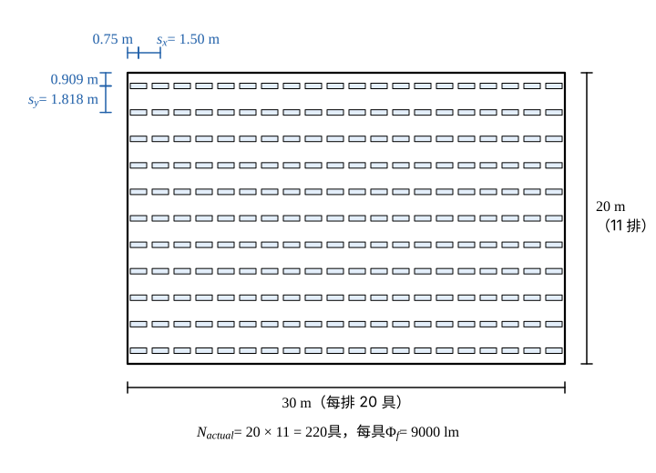

# 105 年工業配電第 4 題｜流明法照明設計與燈具配置

## 已知與所求

廠房 \(30\ \mathrm m\times20\ \mathrm m\)，天花板高 6 m，吊裝距離工作面 4 m；要求照度 \(E=1500\ \mathrm{lx}\)；照明率 \(C_u=0.7\)、維護係數 \(M=0.65\)；每組燈具為 3-40 W 日光燈（每支 3000 lm）。求（一）初始總流明及燈具數（5 分）、（二）低成本且合格的配置圖與實際燈具數（10 分）、（三）實際照度（5 分）。

## 考場標準作答

### 步驟 1：共用量

天花板、牆壁反射率已反映在 \(C_u=0.7\)，不再另用。工作面面積：
\[
A=30\times20=600\ \mathrm{m^2}
\]
每組燈具 3 支 40 W 日光燈，每支 3000 lm：
\[
\Phi_f=3\times3000=9000\ \mathrm{lm}
\]
照明率與維護係數的乘積：
\[
C_uM=0.7\times0.65=0.455
\]

### （一）初始總流明及燈具數（5 分）

\[
\Phi_{total}=\frac{EA}{C_uM}=\frac{1500(600)}{0.455}=\frac{900{,}000}{0.455}
\]
\[
\boxed{\Phi_{total}=1{,}978{,}021.98\ \mathrm{lm}}
\]
（約 \(1{,}978{,}022\ \mathrm{lm}\)。）燈具數：
\[
N=\frac{\Phi_{total}}{\Phi_f}=\frac{1{,}978{,}021.98}{9000}=219.78
\]
\[
\boxed{N=220\ \text{具}}
\]
（219.78 無條件進位；219 具不足照度，見驗算。）

### （二）配置圖與實際燈具數（10 分）

成本最低即具數維持（一）的最小值 220，排成兩方向間距相近、都不超過吊裝高度 4 m 的矩形陣列 \(n_x\times n_y\ge220\)。

1. 房間長寬比 \(30/20=1.5\)，令 \(n_x/n_y\approx1.5\)：
\[
n_y\approx\sqrt{\frac{220}{1.5}}=\sqrt{146.7}=12.11,\qquad n_x\approx1.5(12.11)=18.17
\]
2. 在附近找乘積恰為 220 的整數組合：\(20\times11=220\)、\(22\times10=220\)。比較兩方向間距：
\[
20\times11:\quad s_x=\frac{30}{20}=1.50\ \mathrm m,\qquad s_y=\frac{20}{11}=1.818\ \mathrm m,\qquad \frac{s_y}{s_x}=\frac{1.818}{1.5}=1.21
\]
\[
22\times10:\quad s_x=\frac{30}{22}=1.364\ \mathrm m,\qquad s_y=\frac{20}{10}=2.00\ \mathrm m,\qquad \frac{s_y}{s_x}=\frac{2}{1.364}=1.47
\]
取間距較接近的 \(20\times11\)：沿 30 m 方向 20 具、沿 20 m 方向 11 排。
3. 牆邊各留半個間距：
\[
\frac{s_x}{2}=\frac{1.50}{2}=0.75\ \mathrm m,\qquad \frac{s_y}{2}=\frac{1.818}{2}=0.909\ \mathrm m
\]
4. 間距檢核：最大間距 \(s_y=1.818\ \mathrm m\le\) 吊裝高度 \(4\ \mathrm m\)（\(1.818/4=0.45\)），照度均勻。

\[
\boxed{N_{actual}=20\times11=220\ \text{具}}
\]

### （三）實際照度（5 分）

\[
E_{actual}=\frac{N_{actual}\Phi_fC_uM}{A}=\frac{220(9000)(0.455)}{600}
\]
實裝總流明：
\[
N_{actual}\Phi_f=220(9000)=1{,}980{,}000\ \mathrm{lm}
\]
到達工作面的有效流明：
\[
N_{actual}\Phi_fC_uM=1{,}980{,}000(0.455)=900{,}900\ \mathrm{lm}
\]
\[
E_{actual}=\frac{900{,}900}{600}
\]
\[
\boxed{E_{actual}=1501.50\ \mathrm{lx}}
\]
\(1501.50\ \mathrm{lx}\ge1500\ \mathrm{lx}\)，符合要求。

## 驗算

反向檢查最小具數：219 具時 \(E=\dfrac{219(9000)(0.455)}{600}=\dfrac{896{,}805}{600}=1494.68\ \mathrm{lx}<1500\ \mathrm{lx}\)，故 220 具為最小合格數。

## 失分點

- 每組燈具含 3 支燈管，光通量為 9000 lm 而非 3000 lm（若用 3000 lm 會得 660 具）。
- 燈具數無條件進位（219.78 取 220），不可四捨五入成不足照度的 219。
- 配置須整數具數且均勻排列；矩形陣列只需 \(n_xn_y\ge220\)，取 \(20\times11=220\) 最省。

## 條件與疑義

房間比率 3、\(C_u=0.7\)、\(M=0.65\) 均為題目給定，不另查表；配置圖的行列數不唯一，凡 \(n_x n_y\ge220\) 且間距不超過約 1～1.5 倍吊裝高度均可，取 220 具最省。
