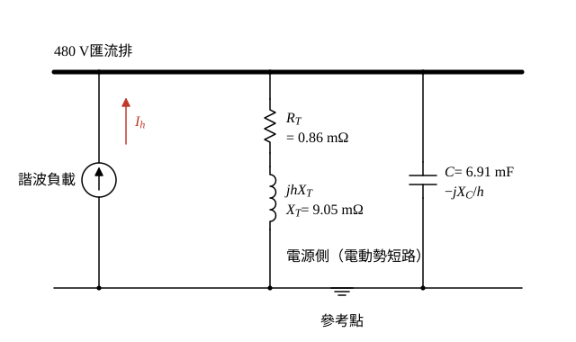

# 105 年工業配電第 5 題｜諧波等效電路與並聯共振

## 已知與所求

責任分界點短路容量 \(100\,\mathrm{MVA}\)、\(X/R=2.5\)；主變壓器 \(2000\,\mathrm{kVA}\)、\(11.4\,\mathrm{kV}/480\,\mathrm V\)、\(Z_T=j0.06\,\mathrm{pu}\)；低壓側功因補償電容 \(600\,\mathrm{kvar}\)。求（一）諧波等效電路並標示 \(R_T\)、\(jX_T\)、\(C\)（10 分）；（二）並聯共振頻率 \(f_r\) 與諧波階次（10 分）。

## 考場標準作答

**解題邏輯**：諧波負載是匯流排上的**諧波電流源**；電源電動勢只含基波，對諧波視為短路，所以從諧波源看出去只有兩條支路並聯：電源側（系統短路阻抗 \(R_S+jX_S\) 串主變壓器 \(jX_{Tr}\)）合成的 \(R_T+jX_T\)，以及功因電容器 \(C\)。（一）把系統與變壓器折算到 480 V 側求 \(R_T\)、\(X_T\)、\(C\)，畫出等效電路；（二）第 \(h\) 次時電感抗 \(hX_T\)、電容抗 \(X_C/h\)，兩者相等即並聯共振，解出 \(h_r\) 與 \(f_r=h_rf_1\)。前提：\(f_1=60\ \mathrm{Hz}\)；變壓器電阻未給，視為零（\(Z_T=j0.06\)）；一般負載不計入諧波網路；共振時 \(R_T\) 影響可忽略（見驗算）。

### （一）諧波等效電路並標示 \(R_T\)、\(jX_T\)、\(C\)（10 分）

**邏輯**：題目要的 \(R_T\)、\(X_T\) 是諧波源看到的電源側總阻抗，所以先以標么值把系統短路阻抗（由短路容量與 \(X/R\) 拆成 \(R_S\)、\(X_S\)）加上變壓器電抗，再乘 480 V 側基準阻抗換成歐姆；電容器由 kvar 換成 \(X_C\) 與 \(C\)。

1. 基準：\(S_b=2\,\mathrm{MVA}\)、\(V_b=480\ \mathrm V\)：
\[
Z_b=\frac{V_b^2}{S_b}=\frac{0.48^2}{2}=\frac{0.2304}{2}=0.1152\ \Omega
\]
2. 系統短路阻抗（\(S_{sc}=100\ \mathrm{MVA}\)）：
\[
|Z_S|=\frac{S_b}{S_{sc}}=\frac{2}{100}=0.02\ \mathrm{pu}
\]
由 \(X_S=2.5R_S\)，\(|Z_S|=\sqrt{R_S^2+X_S^2}=R_S\sqrt{1+2.5^2}\)：
\[
\sqrt{1+2.5^2}=\sqrt{7.25}=2.6926
\]
\[
R_S=\frac{|Z_S|}{2.6926}=\frac{0.02}{2.6926}=0.007428\ \mathrm{pu}
\]
\[
X_S=2.5R_S=2.5(0.007428)=0.01857\ \mathrm{pu}
\]
3. 串上變壓器 \(X_{Tr}=0.06\ \mathrm{pu}\)（額定 2000 kVA 即基準，不必換算）：
\[
R_T=R_S=0.007428\ \mathrm{pu},\qquad X_T=X_S+X_{Tr}=0.01857+0.06=0.07857\ \mathrm{pu}
\]
4. 換成 480 V 側歐姆值（乘 \(Z_b\)）：
\[
R_T=0.007428(0.1152)=0.0008557\ \Omega
\]
\[
X_T=0.07857(0.1152)=0.009051\ \Omega
\]
5. 電容器（三相 kvar 以線電壓計）：
\[
X_C=\frac{V_{LL}^2}{Q_C}=\frac{0.48^2}{0.6}=\frac{0.2304}{0.6}=0.384\ \Omega
\]
\[
C=\frac1{2\pi f_1X_C}=\frac1{2\pi(60)(0.384)}=\frac1{144.76}=0.006908\ \mathrm F
\]
6. 等效電路畫法：
   - 諧波負載畫成電流源 \(I_h\)，由參考點注入 480 V 匯流排。
   - 電源電動勢對諧波短路，電源側只剩 \(R_T+jhX_T\) 一條支路接到參考點。
   - 電容器 \(C\)（第 \(h\) 次電抗 \(-jX_C/h\)）與之並聯在匯流排與參考點之間。

\[
\boxed{R_T=0.86\ \mathrm{m\Omega},\quad X_T=9.05\ \mathrm{m\Omega},\quad C=6.91\ \mathrm{mF}}
\]
（標么：\(R_T=0.007428\)、\(X_T=0.07857\ \mathrm{pu}\)；\(X_C=0.384\ \Omega\)。）

### （二）並聯共振頻率與諧波階次（10 分）

**邏輯**：從諧波源看，\(jhX_T\) 與 \(-jX_C/h\) 並聯；兩者大小相等時並聯阻抗趨於極大（並聯共振），由 \(hX_T=X_C/h\) 解 \(h_r\)。

共振條件：
\[
h_rX_T=\frac{X_C}{h_r}\quad\Rightarrow\quad h_r=\sqrt{\frac{X_C}{X_T}}
\]
代入（4 位有效會使 \(f_r\) 末位不符，此鏈多留一位）：
\[
\frac{X_C}{X_T}=\frac{0.384}{0.009051}=42.426
\]
\[
h_r=\sqrt{42.426}=6.5135
\]
\[
\boxed{h_r=6.51}
\]
共振頻率：
\[
f_r=h_rf_1=6.5135(60)
\]
\[
\boxed{f_r=390.81\ \mathrm{Hz}}
\]
\(h_r=6.51\) 介於 6、7 次之間且略大於 6.5，最接近的整數特徵諧波為**第 7 次**（六脈波負載的 \(6k\pm1\) 特徵諧波 5、7 之一），應防第 7 次諧波被放大。

## 驗算

kVA 公式：匯流排短路容量 \(S_{sc,bus}=\dfrac{S_b}{X_T}=\dfrac{2000}{0.07857}=25{,}455.01\ \mathrm{kVA}\)，\(h_r=\sqrt{\dfrac{S_{sc,bus}}{Q_C}}=\sqrt{\dfrac{25{,}455.01}{600}}=\sqrt{42.425}=6.51\)，與（二）一致。含 \(R_T\) 時令導納虛部為零，\(h_r\) 無可辨差異（\(R_T^2\ll X_TX_C\)）。

## 失分點

- 只用變壓器 \(X_{Tr}=0.06\ \mathrm{pu}\)（\(0.06\times0.1152=0.006912\ \Omega\)）而漏掉系統電抗 \(X_S=0.01857\ \mathrm{pu}\)，\(h_r\) 會高估為 \(\sqrt{0.384/0.006912}=7.45\)。
- \(X_C\) 須以線電壓 \(V_{LL}^2/Q_C\) 計算，不可混用相電壓。
- 只寫 \(f_r\) 不說明階次與第 7 次特徵諧波的關係。

## 條件與疑義

變壓器電阻未給，視為零；\(R_T\) 僅來自系統 \(X/R\)。\(h_r=6.51\) 恰超過 6.5，視為最接近第 7 次，但實務上 6 次與 7 次附近均有放大風險。
