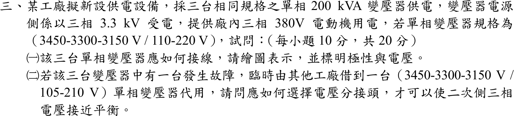
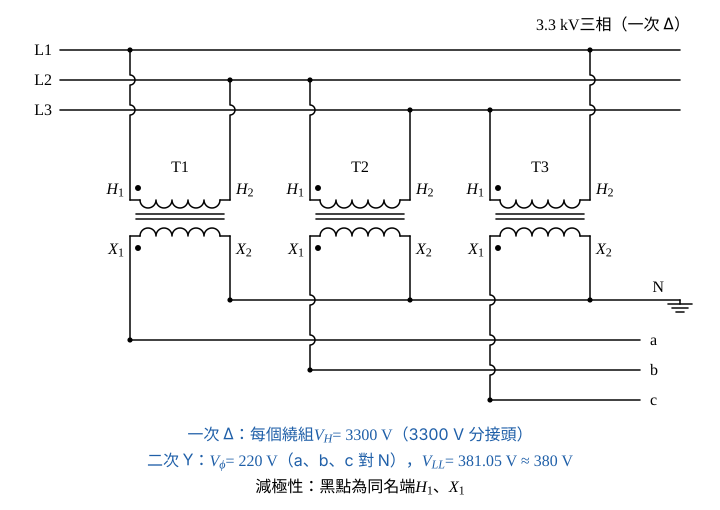

# 106 年工業配電第 3 題｜三相變壓器組接線與分接頭選擇

## 已知與所求

三台相同單相 \(200\,\mathrm{kVA}\) 變壓器，規格 \((3450\text{-}3300\text{-}3150)\,\mathrm V/(110\text{-}220)\,\mathrm V\)，電源側三相 \(3.3\,\mathrm{kV}\)，供三相 \(380\,\mathrm V\) 電動機。求（一）接線圖、極性與電壓；（二）一台故障，借用 \((3450\text{-}3300\text{-}3150)\,\mathrm V/(105\text{-}210)\,\mathrm V\) 單相變壓器代用時，如何選分接頭使二次側三相電壓接近平衡（各 10 分）。

## 考場標準作答

### 步驟 1：原機匝比

設變壓器為理想（不計阻抗壓降與各台阻抗差異），三相平衡與否只看匝比。匝比由銘牌分接頭電壓決定：原機一次選 3300 V 分接頭、二次用 220 V（兩個 110 V 串聯）：
\[
a=\frac{V_{H,tap}}{V_{X,tap}}=\frac{3300}{220}=15
\]
一次 Δ 時每個繞組實際承受的電壓 \(V_H\) 等於電源線電壓：
\[
V_H=3300\ \mathrm V
\]

### （一）接線圖、極性與電壓（10 分）

單相變壓器二次最高只有 220 V，故一次接 Δ（繞組承受線電壓 3300 V，選 3300 V 分接頭）、二次接 Y（線電壓 \(\sqrt3\times220\approx380\ \mathrm V\)）。

1. 極性：三台皆為減極性，\(H_1\) 與 \(X_1\) 為同名端（圖中黑點）。
2. 一次 Δ：T1 接 L1–L2、T2 接 L2–L3、T3 接 L3–L1，依序把 T1 的 \(H_2\) 接 T2 的 \(H_1\)、T2 的 \(H_2\) 接 T3 的 \(H_1\)、T3 的 \(H_2\) 接 T1 的 \(H_1\)，首尾相接成閉合 Δ。
3. 二次 Y：三台的 \(X_2\) 共接成中性點 N（可接地），\(X_1\) 分別引出 a、b、c。

二次相電壓：
\[
V_\phi=\frac{V_H}{a}=\frac{3300}{15}=220\ \mathrm V
\]
二次線電壓：
\[
V_{LL}=\sqrt3\,V_\phi=\sqrt3(220)=381.05\ \mathrm V
\]

\[
\boxed{\text{Δ–Y 接線；一次每繞組 }3300\ \mathrm V,\ V_\phi=220\ \mathrm V,\ V_{LL}=381.05\ \mathrm V\approx380\ \mathrm V}
\]

### （二）代用機分接頭選擇（10 分）

代用機接在同一 Δ–Y 位置，一次同樣承受 3300 V；二次相電壓須等於另兩台的 220 V，三相才平衡，即有效匝比須同為 \(a=15\)。

1. 二次分接頭：105 V 只有 210 V 的一半，會使匝比加倍、二次只剩約 110 V，不可用；取 210 V 繞組。
2. 所需一次分接頭（二次分接頭 \(V_{X,tap}=210\ \mathrm V\)）：
\[
V_{H,tap}=a\,V_{X,tap}=15(210)=3150\ \mathrm V
\]
3. 逐一核對三個一次分接頭（一次加 \(V_H=3300\ \mathrm V\)，二次電壓 \(V_2=V_H\,V_{X,tap}/V_{H,tap}\)）：
\[
3450\ \mathrm V:\quad V_2=\frac{3300(210)}{3450}=200.87\ \mathrm V
\]
\[
3300\ \mathrm V:\quad V_2=\frac{3300(210)}{3300}=210\ \mathrm V
\]
\[
3150\ \mathrm V:\quad V_2=\frac{3300(210)}{3150}=220\ \mathrm V
\]
只有 3150 V 分接頭使 \(V_2=220\ \mathrm V\)，與另兩台相同。
\[
\boxed{\text{代用機選 3150 V 一次分接頭、210 V 二次分接頭}}
\]
4. 分接頭電壓檢核：3150 V 分接頭承受 3300 V，
\[
\frac{3300}{3150}=1.0476=104.76\%
\]
在一般 105% 過電壓容許範圍內，可臨時運轉。代用機 kVA 題目未給，本小題只要求三相電壓平衡，故不檢查容量。

## 驗算

選 3150 V 一次分接頭、210 V 二次分接頭時，代用機二次電壓 \(3300\times\dfrac{210}{3150}=220\,\mathrm V\)，與另兩台相等，三個相電壓 \(220\,\mathrm V\)、線電壓 \(381.05\,\mathrm V\) 平衡。若用 3300 V／210 V，一相只有 210 V（低 4.5%），線電壓出現不平衡。

## 失分點

- 一次側接 Y：每繞組只承受 \(3300/\sqrt3=1905.26\,\mathrm V\)，僅額定的 58%，二次電壓不足。
- 代用機仍選 3300 V 一次分接頭，二次只有 210 V，三相電壓不平衡。
- 把 \(\sqrt3\times220=381.05\,\mathrm V\) 寫成 \(220\,\mathrm V\) 線電壓；380 V 動力負載要接線電壓端。
