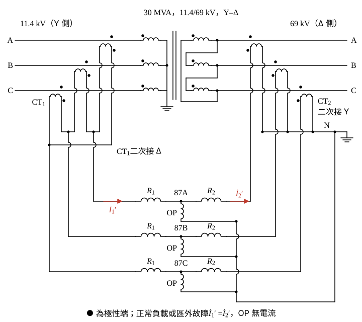

# 106 年工業配電第 4 題｜Y–Δ 變壓器差動保護與 CT 比選定

## 已知與所求

\(30\,\mathrm{MVA}\)、\(11.4/69\,\mathrm{kV}\)、Y–Δ 三相變壓器；\(\mathrm{CT}_1\) 在 11.4 kV 側（Y 繞組），\(\mathrm{CT}_2\) 在 69 kV 側（Δ 繞組），兩者二次接差動電驛 87。求（一）87 的意義（5 分）；（二）整體三相接線圖（10 分）；（三）考慮靈敏度，\(\mathrm{CT}_1\)、\(\mathrm{CT}_2\) 的變流比（5 分）。

## 考場標準作答

**解題邏輯**：差動保護依 KCL 比較保護區兩端電流——正常負載或區外故障時流入＝流出，兩側 CT 二次電流在電驛中相消；區內故障才有差流（一）。Y–Δ 變壓器兩側線電流相差 \(30^\circ\)、大小比為匝比，所以 CT 接法要與變壓器相反（Y 側 CT 接 Δ、Δ 側 CT 接 Y）補償相位（二）。CT 比則由各側額定線電流 \(I=S/(\sqrt3V)\) 決定：一次額定不小於額定電流、額定負載時送進電驛的電流不超過 5 A，取最小標準比以求最高靈敏度；Δ 接 CT 的電驛電流是 CT 二次電流的 \(\sqrt3\) 倍（三）。

### （一）87 的意義（5 分）

**邏輯**：87 是 IEEE／ANSI 裝置編號的差動電驛；本圖兩側 CT 接到同一個 87，是變壓器差動保護（87T）。

\[
I_d=\left|\dot I_1'-\dot I_2'\right|\ge I_{set}\ \Rightarrow\ \text{跳脫兩側斷路器}
\]
（\(\dot I_1'\)、\(\dot I_2'\) 為兩側 CT 送進電驛的電流。）
\[
\boxed{\text{87 為差動保護電驛（變壓器差動 87T）：比較保護區兩端電流，區內故障時差流超過整定值跳脫兩側斷路器}}
\]

### （二）三相接線圖（10 分）

**邏輯**：Y–Δ 使兩側線電流相差 \(30^\circ\)；CT 接法取與變壓器相反，Y 側 CT 二次接 Δ 也產生 \(30^\circ\) 移相，兩側送進電驛的電流同相，正常時差流近似為零。

畫法：
- 主電路：11.4 kV 側 A、B、C 三相各串一只 \(\mathrm{CT}_1\) 進變壓器 Y 繞組；Δ 繞組出 69 kV 側 A、B、C，各串一只 \(\mathrm{CT}_2\)；兩側 CT 極性（●）都朝向變壓器。
- \(\mathrm{CT}_1\) 二次三只繞組接成 Δ，引出三線；\(\mathrm{CT}_2\) 二次接成 Y，中性點 N 接地並引出。
- 87 每相一個元件：抑制線圈 \(R_1\)（接 \(\mathrm{CT}_1\) 側）與 \(R_2\)（接 \(\mathrm{CT}_2\) 側）串聯，動作線圈 OP 由兩者中點接到 N；正常時 \(\dot I_1'=\dot I_2'\)，OP 中無電流。

\[
\boxed{\mathrm{CT}_1\ \text{二次接 }\Delta，\ \mathrm{CT}_2\ \text{二次接 }Y}
\]

### （三）CT 變流比（5 分）

**邏輯**：靈敏度最高＝變比最小；限制為 CT 一次額定 \(\ge\) 額定線電流，且額定負載時電驛電流 \(\le5\,\mathrm A\)。Δ 接的 \(\mathrm{CT}_1\) 送進電驛的是兩只 CT 二次電流的相量差，大小為 \(\sqrt3\) 倍。

額定線電流 \(I=\dfrac{S}{\sqrt3\,V}\)：
\[
I_1=\frac{30\times10^6}{\sqrt3(11\,400)}=\frac{30\times10^6}{19\,745.4}=1519.34\ \mathrm A
\]
\[
I_2=\frac{30\times10^6}{\sqrt3(69\,000)}=\frac{30\times10^6}{119\,511.5}=251.02\ \mathrm A
\]

\(\mathrm{CT}_2\)（Y 接，電驛電流＝CT 二次電流）：標準比 250/5 的一次額定 250 A 小於 251.02 A，取下一級 \(300/5\)：
\[
I_2'=I_2\times\frac{5}{300}=251.02\times\frac{5}{300}=4.184\ \mathrm A\le5\ \mathrm A
\]

\(\mathrm{CT}_1\)（Δ 接）：一次額定 \(N_1\) 須使電驛電流 \(\sqrt3\,I_1\dfrac{5}{N_1}\le5\,\mathrm A\)：
\[
N_1\ge\sqrt3\,I_1=\sqrt3\cdot\frac{S}{\sqrt3\,V_1}=\frac{30\times10^6}{11\,400}=2631.58\ \mathrm A
\]
標準比中大於 2631.58 A 的最小者為 3000，取 \(3000/5\)。CT 二次電流與電驛電流：
\[
I_{1,CT}=I_1\times\frac{5}{3000}=1519.34\times\frac{5}{3000}=2.532\ \mathrm A
\]
\[
I_1'=\sqrt3\,I_{1,CT}=\sqrt3\times2.532=4.386\ \mathrm A\le5\ \mathrm A
\]
\[
\boxed{\mathrm{CT}_1=3000/5,\quad \mathrm{CT}_2=300/5}
\]
兩側電驛電流之比（大小）：
\[
\frac{I_1'}{I_2'}=\sqrt3\cdot\frac{I_1}{I_2}\cdot\frac{300}{3000}=\sqrt3\cdot\frac{69}{11.4}\cdot\frac{1}{10}=\frac{119.51}{114}=1.0483
\]
即差 4.83%，由電驛匹配抽頭吸收。

## 驗算

理想匹配：要使 \(I_1'=I_2'\)，\(\mathrm{CT}_1\) 一次額定須為 \(\sqrt3\times\dfrac{69}{11.4}\times300=3145.04\ \mathrm A\)，標準比 3000/5 最接近，且不使電驛超過 5 A。改選 \(2500/5\)：\(I_1'=2631.58\times5/2500=5.263\,\mathrm A>5\,\mathrm A\)，二次過載；改選 \(2000/5\)：\(I_1'=2631.58\times5/2000=6.579\,\mathrm A\)，比值 \(\sqrt3\cdot\dfrac{69}{11.4}\cdot\dfrac{300}{2000}=\dfrac{119.51}{76}=1.5725\)，失衡 57.25%。

## 失分點

- \(\mathrm{CT}_1\) 選 \(2000/5\)：Δ 接使電驛電流達 6.579 A，超過 5 A 且兩側失衡 57.25%。
- 把 CT 接法與變壓器同型（Y 側接 Y、Δ 側接 Δ），沒有補償 \(30^\circ\)。
- 選 CT 比時忘記 Δ 接多出 \(\sqrt3\)，直接以 \(1519.34/251.02\) 比例配對。

## 條件與疑義

標準 CT 比取 5 A 二次的常用系列（50、100、150、200、250、300、400、500、600、800、1000、1200、1500、2000、2500、3000…）；「恰當」的判準取 CT 一次不小於額定電流、二次不超過 5 A、比值最小。
