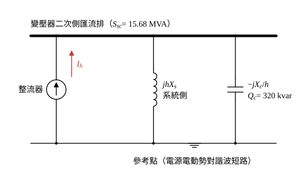

# 106 年工業配電第 5 題｜電容器與系統諧波共振

## 已知與所求

變壓器二次側短路容量 \(S_{sc}=15.68\,\mathrm{MVA}\)，功因電容器組 \(Q_c=320\,\mathrm{kvar}\)，整流器為三相（六脈波）非線性負載。求系統可能發生並聯諧波共振的諧波次數。

## 考場標準作答

**解題邏輯**：三相整流器是諧波**電流源**，注入變壓器二次側匯流排；從它看出去，系統（變壓器二次側短路容量所代表的電感 \(X_s\)）與功因電容器 \(X_c\) 並聯在匯流排上。第 \(h\) 次時電感抗變 \(hX_s\)、電容抗變 \(X_c/h\)，兩者相等即並聯共振；把兩個電抗都寫成 \(V^2/S\) 的形式，電壓消去，得 \(h_r=\sqrt{S_{sc}/Q_c}\)，再判斷 \(h_r\) 是否落在整流器的特徵諧波上。前提：電源電動勢只含基波，對諧波視為短路；電阻忽略；\(S_{sc}\) 與 \(Q_c\) 以同一匯流排電壓計。

### 步驟 1：諧波等效電路

- 整流器畫成電流源 \(I_h\)，由參考點注入匯流排。
- 系統側：電源電動勢短路後只剩 \(jhX_s\)，接在匯流排與參考點之間。
- 電容器組：\(-jX_c/h\)，與系統側並聯。

### 步驟 2：以容量表示兩個電抗

同一匯流排電壓 \(V\) 下：
\[
X_s=\frac{V^2}{S_{sc}},\qquad X_c=\frac{V^2}{Q_c}
\]

### 共振諧波次數（20 分）

**邏輯**：並聯共振條件 \(hX_s=X_c/h\)；代入步驟 2 的兩式後 \(V^2\) 相消，只需短路容量與電容器容量之比。

共振條件：
\[
h_rX_s=\frac{X_c}{h_r}\quad\Rightarrow\quad h_r^2=\frac{X_c}{X_s}
\]
代入步驟 2：
\[
h_r^2=\frac{V^2/Q_c}{V^2/S_{sc}}=\frac{S_{sc}}{Q_c}
\]
單位統一（\(Q_c=320\ \mathrm{kvar}=0.32\ \mathrm{Mvar}\)）：
\[
\frac{S_{sc}}{Q_c}=\frac{15.68}{0.32}=49
\]
\[
h_r=\boxed{\sqrt{49}=7}
\]
六脈波整流器的特徵諧波為 \(6k\pm1\)（\(k=1\) 得 5、7；\(k=2\) 得 11、13…），\(h_r=7\) 恰為其中之一，注入的第 7 次電流會被並聯共振放大，故可能引起共振的是**第 7 次諧波**。

## 驗算

反代：取 \(h=7\)，共振要求 \(7X_s=X_c/7\)，即 \(X_c/X_s=7\times7=49\)；而 \(X_c/X_s=S_{sc}/Q_c=15.68/0.32=49\)，兩者相符。

## 失分點

- 把 \(320\,\mathrm{kvar}\) 與 \(15.68\,\mathrm{MVA}\) 直接相除，單位差 \(10^3\)。
- 忘記開根號而答第 49 次諧波。
