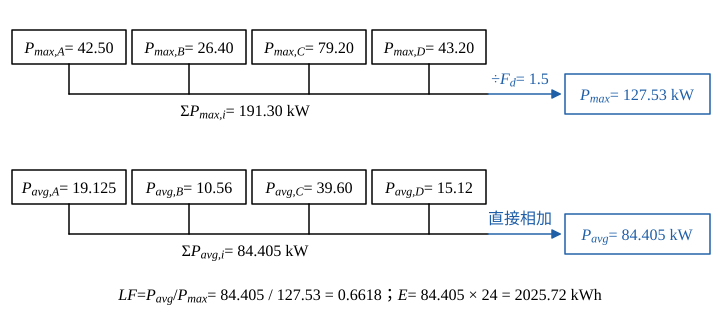

# 107 年工業配電第 1 題｜四用戶負載統計

## 已知與所求

A、B、C、D 四用戶之負載參差因數 \(F_d=1.5\)。設備容量／功率因數（落後）／需量因數／負載因數：A 100 kVA／0.85／50%／45%；B 60／0.80／55%／40%；C 150／0.88／60%／50%；D 120／0.90／40%／35%。求（一）總和最大負載（kW）；（二）總和平均負載（kW）；（三）綜合負載因數；（四）每日用電量（kWh）。

## 考場標準作答

### 步驟 1：各戶最大需量與平均負載

\[
P_{max,i}=S_i\cdot DF_i\cdot\mathrm{pf}_i,\qquad P_{avg,i}=P_{max,i}\cdot LF_i
\]

| 用戶 | \(P_{max,i}=S_i\cdot DF_i\cdot\mathrm{pf}_i\)（kW） | \(P_{avg,i}=P_{max,i}\cdot LF_i\)（kW） |
|---|---:|---:|
| A | \(100(0.50)(0.85)=42.50\) | \(42.50(0.45)=19.125\) |
| B | \(60(0.55)(0.80)=26.40\) | \(26.40(0.40)=10.56\) |
| C | \(150(0.60)(0.88)=79.20\) | \(79.20(0.50)=39.60\) |
| D | \(120(0.40)(0.90)=43.20\) | \(43.20(0.35)=15.12\) |

### （一）總和最大負載（5 分）

個別最大需量合計：
\[
\sum P_{max,i}=42.50+26.40+79.20+43.20=191.30\ \mathrm{kW}
\]
各戶尖峰不同時發生，個別最大需量合計除以參差因數：
\[
P_{max}=\frac{\sum P_{max,i}}{F_d}=\frac{191.30}{1.5}=127.53\ \mathrm{kW}
\]
\[
\boxed{P_{max}=127.53\ \mathrm{kW}}
\]

### （二）總和平均負載（5 分）

平均負載是時間平均，直接相加，不除參差因數：
\[
P_{avg}=P_{avg,A}+P_{avg,B}+P_{avg,C}+P_{avg,D}=19.125+10.56+39.60+15.12
\]
\[
P_{avg}=84.405\ \mathrm{kW}
\]
\[
\boxed{P_{avg}=84.41\ \mathrm{kW}}
\]

### （三）綜合負載因數（5 分）

\[
LF=\frac{P_{avg}}{P_{max}}=\frac{84.405}{127.53}=0.6618
\]
\[
\boxed{LF=0.66=66.18\%}
\]

### （四）每日用電量（5 分）

\[
E=P_{avg}\times24\ \mathrm h=84.405\times24
\]
\[
\boxed{E=2025.72\ \mathrm{kWh/day}}
\]

## 驗算

逐戶日電量 \(E_i=24P_{avg,i}\)：\(E_A=24(19.125)=459.00\)、\(E_B=24(10.56)=253.44\)、\(E_C=24(39.60)=950.40\)、\(E_D=24(15.12)=362.88\ \mathrm{kWh}\)，合計 \(459.00+253.44+950.40+362.88=2025.72\ \mathrm{kWh}\)，與（四）相同。綜合負載因數另由恆等式 \(LF=F_d\dfrac{\sum P_{avg,i}}{\sum P_{max,i}}=1.5\times\dfrac{84.405}{191.30}=0.6618\)，與（三）相同。

## 失分點

- 把設備容量 kVA 直接當 kW；須乘需量因數與功率因數才是各戶最大有功需量。
- 參差因數方向相反：同時最大負載是個別最大合計**除以** 1.5，不是乘 1.5。
- 平均負載應按各戶自己的負載因數算，不可用群組合計再乘單一 \(LF\)；平均負載也不可再除以 \(F_d\)。
