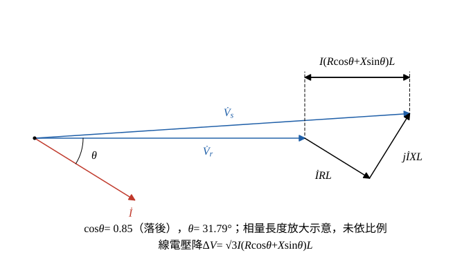

# 107 年工業配電第 2 題｜100 HP 馬達饋線壓降

## 已知與所求

三相 \(220\,\mathrm V\) 供應一台滿載 \(100\,\mathrm{HP}\) 電動機，功率因數 0.85 落後；100 mm² 銅線 PVC 管，每條線長 \(120\,\mathrm m\)；線路阻抗 \(0.195+j0.0909\,\Omega/\mathrm{km}\)，電抗更正係數 1.2。求（一）線路百分壓降；（二）壓降不超過標稱電壓 5% 時的最大容許長度（各 10 分）。題幹未給滿載電流，取值見「條件與疑義」。

## 考場標準作答

### 步驟 1：馬達電流

題幹未給滿載電流，依參考書取 1 HP≈1 kVA；受電端電壓取標稱 220 V。三相視在功率 \(S=\sqrt3\,V I\)，\(S=100\,\mathrm{kVA}\)：
\[
I=\frac{S}{\sqrt3\,V}=\frac{100\ \mathrm{kVA}}{\sqrt3\times0.22\ \mathrm{kV}}=\frac{100\ \mathrm{kVA}}{0.38105\ \mathrm{kV}}=262.43\ \mathrm A
\]

### 步驟 2：每公里的壓降係數 \(K=R\cos\theta+X\sin\theta\)

- 單相等效（每相）：送電端 \(\dot V_s\) 經線路 \((R+jX)L\) 到受電端 \(\dot V_r\)；以 \(\dot V_r\) 為參考，電流 \(\dot I\) 落後 \(\theta\)。
- \(\dot IRL\) 與 \(\dot I\) 同向，\(j\dot IXL\) 超前 \(\dot I\) \(90^\circ\)；兩者投影到 \(\dot V_r\) 方向的長度和 \(I(R\cos\theta+X\sin\theta)L\) 就是相電壓降，乘 \(\sqrt3\) 為線電壓降。

100 mm² 線徑與 PVC 管材只決定題給阻抗與電抗更正係數，短線路只計串聯阻抗、不計線路電容。電抗先乘更正係數 1.2：
\[
X=1.2\times0.0909=0.10908\ \Omega/\mathrm{km}
\]
功率因數角：
\[
\theta=\cos^{-1}0.85=31.79^\circ
\]
功率因數角的正弦：
\[
\sin\theta=\sqrt{1-\cos^2\theta}=\sqrt{1-0.85^2}=\sqrt{0.2775}=0.5268
\]
兩項分量：
\[
R\cos\theta=0.195\times0.85=0.16575\ \Omega/\mathrm{km}
\]
\[
X\sin\theta=0.10908\times0.5268=0.05746\ \Omega/\mathrm{km}
\]
\[
K=R\cos\theta+X\sin\theta=0.16575+0.05746=0.22321\ \Omega/\mathrm{km}
\]

### （一）百分壓降（10 分）

先求每公里線電壓降：
\[
\sqrt3\,I=\sqrt3\times262.43=454.54\ \mathrm A
\]
\[
\sqrt3\,I\,K=454.54\times0.22321=101.46\ \mathrm{V/km}
\]
乘線長 \(L=120\,\mathrm m=0.12\,\mathrm{km}\)：
\[
\Delta V=\sqrt3\,I\,K\,L=101.46\times0.12=12.175\ \mathrm V
\]
百分壓降：
\[
\Delta V\%=\frac{\Delta V}{V}\times100\%=\frac{12.175}{220}\times100\%
\]
\[
\boxed{\Delta V\%=5.53\%}
\]

### （二）最大容許長度（10 分）

\(I\)、\(K\) 不變，壓降與線長成正比。容許壓降：
\[
\Delta V_{allow}=0.05\times220=11\ \mathrm V
\]
最大長度：
\[
L_{max}=\frac{\Delta V_{allow}}{\sqrt3\,I\,K}=\frac{11}{101.46}=0.10842\ \mathrm{km}
\]
\[
\boxed{L_{max}=108.42\ \mathrm m}
\]

## 驗算

相量法（不用近似式）：每相 \(V_r=220/\sqrt3=127.02\ \mathrm V\)、\(\dot I=262.43\angle-31.79^\circ\ \mathrm A\)、\((R+jX)L=0.0234+j0.01309\ \Omega\)，\(\dot I(R+jX)L=7.029-j0.3151\ \mathrm V\)，\(|\dot V_s|=|127.02+7.029-j0.3151|=134.05\ \mathrm V\)，線電壓降 \(\sqrt3(134.05-127.02)=12.18\ \mathrm V\)，與近似式 12.175 V 一致。比例檢查：\(108.42\ \mathrm m\times5.53\%\approx120\ \mathrm m\times5\%\)。

## 失分點

- 電抗忘記乘更正係數 1.2，使 \(K\) 偏小（\(K\) 會降為 \(0.16575+0.0909\times0.5268=0.21364\ \Omega/\mathrm{km}\)，壓降低估約 4%）。
- 用 \(\sqrt3IL(R\cos\theta+X\sin\theta)\) 時把長度寫成 120 而非 0.12 km。
- 最大長度不能直接寫 120 m；壓降與長度成正比，應依 \(11\,\mathrm V/101.46\,\mathrm{V/km}\) 反求，且結果小於 120 m（因 120 m 已超過 5%）。

## 條件與疑義

官方裁切沒有列馬達滿載電流、銘牌效率或輸入功率定義；第 152 條只決定馬達負載電流的取值依據：原則上採銘牌全載電流，一般用電動機才可採國家標準值（經濟部 107 年 7 月 17 日歷史版《用戶用電設備裝置規則》第 152 條，<https://law.moea.gov.tw/LawContentHistory.aspx?hid=50617>），因此不能由 100 HP 與功率因數單獨反推出唯一滿載電流。本題的「壓降 5%」是題目給定的壓降門檻，只用來把同一線路模型反算成 \(L_{max}\)，不是由第 152 條法規推導出的電流值。各取值下的結果為：

| 滿載電流取值 | \(I\) | \(\Delta V\%\) | \(L_{max}\) |
|---|---:|---:|---:|
| 參考書 1 HP≈1 kVA（主解） | 262.43 A | 5.53% | 108.42 m |
| 年度詳解常用值 | \(250\,\mathrm A\) | 5.2720% | 113.81 m |
| 107 年歷史表 163-7-3 | \(I=258\,\mathrm{A}\) | 5.4407% | 110.28 m |
| 現行表 258-3（60 HP 以上可採製造廠資料） | \(238\,\mathrm A\) | 5.0189% | 119.55 m |
| 100 HP＝74.6 kW、效率 1 | 230.32 A | 4.8570% | 123.53 m |

各取值下 120 m 的壓降落在 4.86%–5.53%，是否超過 5% 隨取值而變。題圖未指定表號，故 238 A、250 A、258 A 僅為版本交叉檢查，不取代參考書主解與銘牌值。
