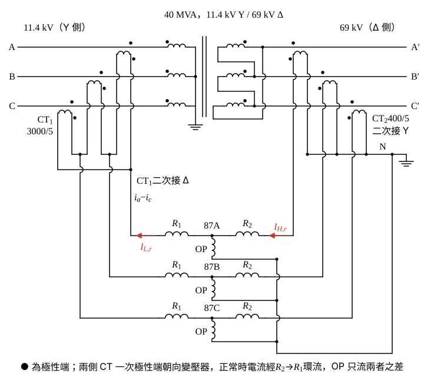

# 107 年工業配電第 3 題｜Δ–Y 變壓器差動保護

## 已知與所求

\(69\,\mathrm{kV}\) Δ／\(11.4\,\mathrm{kV}\) Y、\(40\,\mathrm{MVA}\) 三相變壓器，低壓側相角領先高壓側 \(30^\circ\)；\(11.4\,\mathrm{kV}\) 側多繞組 CT C400：\(3000/5\)，\(69\,\mathrm{kV}\) 側 C400：\(400/5\)。用三具差動電驛（各有兩個制動線圈 R 與一個動作線圈 OP）完成差動保護接線圖，並求兩側電驛電流與電流比值。

## 考場標準作答

### 步驟 1：差動保護接線圖

由題圖讀主變 Δ 接法（● 為各繞組在線端的極性端）：a 相 Δ 繞組極性端接 A′、另一端接 B′；b 相接 B′、C′；c 相接 C′、A′。A′ 點匯集 a 相繞組流出的電流與流入 c 相繞組的電流，故
\[
\dot I_{A'}\propto\dot I_A-\dot I_C
\]
以 \(\dot I_A=1\angle0^\circ\)、\(\dot I_C=1\angle120^\circ\) 檢查相位：
\[
\dot I_A-\dot I_C=1-(-0.5+j0.8660)=1.5-j0.8660
\]
\[
|\dot I_A-\dot I_C|=\sqrt{1.5^2+0.8660^2}=\sqrt{3}=1.732
\]
\[
\angle(\dot I_A-\dot I_C)=\tan^{-1}\frac{-0.8660}{1.5}=-30^\circ
\]
69 kV 線電流滯後 11.4 kV 線電流 \(30^\circ\)，與題給「低壓側領先 \(30^\circ\)」一致。

接法（對照圖 1）：
- 11.4 kV 側 \(\mathrm{CT}_1\)（3000/5）：二次接 Δ，組合與主變 Δ 相同——a 相 CT 極性端接 c 相 CT 非極性端，接點引至 87A，接點與 87A 之間的電流為 \(i_a-i_c\)；同理 \(i_b-i_a\) 引至 87B、\(i_c-i_b\) 引至 87C（\(i_a,i_b,i_c\) 為 \(\mathrm{CT}_1\) 二次電流，參考方向取由 CT 極性端流出；正常負載時一次電流由非極性端流入，實際電流方向如圖 1 的 \(I_{L,r}\)：由 \(R_1\) 流回接點）。三者的相位依序與 \(\dot I_{A'}\)、\(\dot I_{B'}\)、\(\dot I_{C'}\) 相同。
- 69 kV 側 \(\mathrm{CT}_2\)（400/5）：二次接 Y，非極性端共接中性點 N 並接地，極性端分別引至 87A、87B、87C。
- 每具差動電驛：\(\mathrm{CT}_1\) 引線接 \(R_1\)，\(\mathrm{CT}_2\) 引線接 \(R_2\)，\(R_1\)、\(R_2\) 串聯，OP 由兩者中點接回 N。兩側 CT 一次極性端都朝向變壓器，正常時電流由 \(\mathrm{CT}_2\) 經 \(R_2\rightarrow R_1\) 流回 \(\mathrm{CT}_1\) 的 Δ，OP 只流兩者之差。
- 若 \(\mathrm{CT}_1\) 也接 Y，送進 87A 的是 \(i_a\)，與 69 kV 側差 \(30^\circ\)，正常負載即有假差流。

### 步驟 2：兩側額定線電流

設三相平衡、正相序 a-b-c，以 40 MVA 額定負載計算；CT 的 C400 為準確等級，只影響飽和裕度，不進入電流計算。三相額定線電流 \(I=\dfrac{S}{\sqrt3\,V_{LL}}\)：
\[
I_H=\frac{40\ \mathrm{MVA}}{\sqrt3\times69\ \mathrm{kV}}=\frac{40\ \mathrm{MVA}}{119.5115\ \mathrm{kV}}=0.33470\ \mathrm{kA}=334.70\,\mathrm A
\]
\[
I_L=\frac{40\ \mathrm{MVA}}{\sqrt3\times11.4\ \mathrm{kV}}=\frac{40\ \mathrm{MVA}}{19.7454\ \mathrm{kV}}=2.0258\ \mathrm{kA}=2025.79\,\mathrm A
\]

### 兩側電驛電流

電驛電流＝線電流 × CT 二次額定 ÷ CT 一次額定。69 kV 側（CT 接 Y，電驛電流即 CT 二次電流）：
\[
I_{H,r}=I_H\times\frac{5}{400}=334.70\times\frac{5}{400}=4.1838\ \mathrm A
\]
\[
\boxed{I_{H,r}=4.18\ \mathrm A}
\]
11.4 kV 側，先求單只 CT 二次電流：
\[
I_{L,CT}=I_L\times\frac{5}{3000}=2025.79\times\frac{5}{3000}=3.3763\ \mathrm A
\]
再乘 \(\sqrt3\)：
\[
I_{L,r}=\sqrt3\,I_{L,CT}=\sqrt3(3.3763)=5.8479\ \mathrm A
\]
\[
\boxed{I_{L,r}=5.85\ \mathrm A}
\]

### 電流比值

兩側電驛電流同相，比值只看大小：
\[
\frac{I_{L,r}}{I_{H,r}}=\frac{5.8479}{4.1838}=1.3977
\]
\[
\boxed{\frac{I_{L,r}}{I_{H,r}}=1.40}\qquad\left(\frac{I_{H,r}}{I_{L,r}}=\frac{4.1838}{5.8479}=0.72\right)
\]
兩側電驛電流之差：
\[
I_{L,r}-I_{H,r}=5.8479-4.1838=1.6641\ \mathrm A
\]
約為 \(I_{H,r}\) 的 \(1.6641/4.1838=39.77\%\)，須以電驛匹配抽頭或輔助 CT 補償約 1.40 倍，否則正常負載即產生假差流。

## 驗算

比值與變壓器容量無關，可直接由電壓比與 CT 比求（\(I_L/I_H=69/11.4\)）：
\[
\frac{I_{L,r}}{I_{H,r}}=\sqrt3\cdot\frac{5/3000}{5/400}\cdot\frac{69}{11.4}=\sqrt3\cdot\frac{400\times69}{3000\times11.4}=\sqrt3\cdot\frac{27\,600}{34\,200}=1.3978
\]
與上式 1.3977 只差末位的四捨五入，取兩位為 1.40。三相相量計算（\(i_a-i_c\)）亦得電驛 A 兩側電流同相、幅值 5.85 A 與 4.18 A。

## 失分點

- 比值方向要註明：低壓／高壓 \(=1.40\)，高壓／低壓 \(=0.72\)；只寫「1.4」不標方向。
- 11.4 kV 側 Δ-CT 的電驛電流漏乘 \(\sqrt3\)，得到 \(3.38\,\mathrm A\) 而誤判兩側已平衡。
- 兩側 CT 都接 Y，或 \(\mathrm{CT}_1\) 的 Δ 組合接反（送出 \(i_a-i_b\)），兩側相差 \(30^\circ\) 或 \(60^\circ\)，無法抵消。
