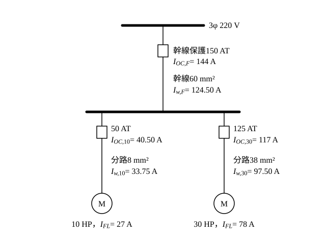

# 107 年工業配電第 4 題｜多台電動機分路與幹線設計

## 已知與所求

三相 \(220\,\mathrm V\) 供電；\(10\,\mathrm{HP}\)、\(30\,\mathrm{HP}\) 電動機各一台，連續運轉，硬質 PVC 管配線，全壓啟動；額定電流 \(27\,\mathrm A\)、\(78\,\mathrm A\)，啟動階級 A，過電流保護額定選用 1.5 倍滿載電流。求（一）分路導線線徑及過電流保護規格；（二）幹線導線線徑及過電流保護規格（各 10 分）。導線安培容量與標準 AT 級距題幹未附，取值見「條件與疑義」。

## 考場標準作答

### （一）分路導線線徑及過電流保護（10 分）

題給額定電流 27 A、78 A 即滿載電流 \(I_{FL}\)；保護倍數題目已定為 1.5 倍，不再依啟動階級查表。分路導線安培容量 \(\ge1.25I_{FL}\)；保護額定非標準值時向上取最接近的標準 AT（往下取會小於題定值，啟動時易誤跳）。

10 HP（\(I_{FL}=27\,\mathrm A\)）導線需求：
\[
I_{w,10}=1.25I_{FL}=1.25\times27=33.75\ \mathrm A\ \Rightarrow\ 8\,\mathrm{mm^2}（40\,\mathrm A）
\]
保護額定：
\[
I_{OC,10}=1.5I_{FL}=1.5\times27=40.50\ \mathrm A\ \Rightarrow\ 50\,\mathrm{AT}
\]

30 HP（\(I_{FL}=78\,\mathrm A\)）導線需求：
\[
I_{w,30}=1.25\times78=97.50\ \mathrm A\ \Rightarrow\ 38\,\mathrm{mm^2}（100\,\mathrm A）
\]
保護額定：
\[
I_{OC,30}=1.5\times78=117\ \mathrm A\ \Rightarrow\ 125\,\mathrm{AT}
\]

\[
\boxed{\text{10 HP：}8\,\mathrm{mm^2}、50\,\mathrm{AT}；\quad \text{30 HP：}38\,\mathrm{mm^2}、125\,\mathrm{AT}}
\]

### （二）幹線導線線徑及過電流保護（10 分）

兩台同時以滿載連續運轉，125% 裕度只乘最大一台（30 HP），其餘以滿載電流計入。導線安培容量需求：
\[
I_{w,F}=1.25I_{30}+I_{10}=1.25\times78+27=97.50+27=124.50\ \mathrm A\ \Rightarrow\ 60\,\mathrm{mm^2}（150\,\mathrm A）
\]
保護額定基準：
\[
I_{OC,F}=1.5I_{30}+I_{10}=1.5\times78+27=117+27=144\ \mathrm A\ \Rightarrow\ 150\,\mathrm{AT}
\]
上限檢核（最大分路保護 125 AT＋10 HP 滿載電流）：
\[
125+27=152\ \mathrm A\ \ge150\,\mathrm{AT}\quad\text{（成立）}
\]
導線保護配合：\(150\,\mathrm{AT}\) 不大於幹線導線容量 \(150\,\mathrm A\)。

\[
\boxed{\text{幹線 }60\,\mathrm{mm^2}、150\,\mathrm{AT}}
\]

## 驗算

保護協調：幹線 \(150\,\mathrm{AT}\ge\) 最大分路 \(125\,\mathrm{AT}\)，且 \(\le152\,\mathrm A\) 上限；幹線保護以未捨入的 \(144\,\mathrm A\) 再取標準值。若改由上限 \(152\,\mathrm A\) 向下取標準值，同樣得 \(150\,\mathrm{AT}\)，兩種讀法結論相同。

## 失分點

- 幹線只取 \(1.25(78+27)=131.25\,\mathrm A\)；連續負載 125% 只乘最大那台。
- 保護 \(40.50\,\mathrm A\) 取 40 AT（往下取）；題目定的是「選用 1.5 倍」，40 AT 小於 \(40.50\,\mathrm A\)，應取 50 AT。
- 以啟動電流選導線；全壓啟動的啟動電流只影響跳脫曲線，導線依滿載電流 125%。

## 條件與疑義

題幹未附屋內線路裝置規則的安培容量表與 AT 級距，下列為假設值（須以規則表核對）：

| 項目 | 假設值 |
|---|---|
| PVC 管內 3 線安培容量 | \(5.5\,\mathrm{mm^2}\)：30 A；8：40 A；14：55 A；22：70 A；30：90 A；38：100 A；50：120 A；60：150 A |
| 標準 AT | 15、20、30、40、50、60、75、100、125、150、175、200、225 |

結論只要求 \(30\,\mathrm{mm^2}\) 容量 \(<97.50\,\mathrm A\le38\,\mathrm{mm^2}\) 容量，以及 \(50\,\mathrm{mm^2}\) 容量 \(<124.50\,\mathrm A\le60\,\mathrm{mm^2}\) 容量；若所用表的 50 mm² 已達 124.50 A 以上，幹線改為 50 mm²，AT 不變。
