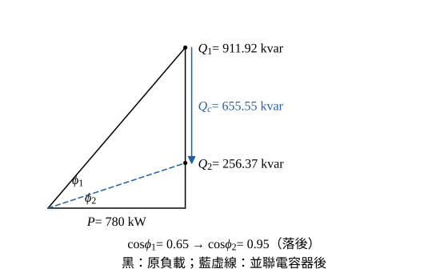
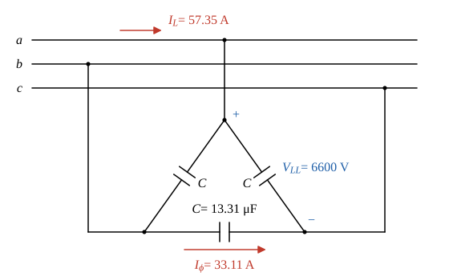

# 107 年工業配電第 5 題｜高壓用戶功率因數改善

## 已知與所求

高壓用戶責任分界點總負載 \(1200\,\mathrm{kVA}\)，功率因數 0.65 落後，改善至 0.95 落後；負載側電壓 \(6.6\,\mathrm{kV}\)、頻率 \(60\,\mathrm{Hz}\)、電容器 Δ 接。求（一）所需電容器容量 \(Q_c\)（kvar）；（二）每相電容 \(C\)（μF），各 10 分。

## 考場標準作答

**解題邏輯**：並聯電容器只抵消無功、不改變有功。（一）由 \(S\) 與 \(\cos\phi_1\) 求 \(P\)、\(Q_1\)；改善後允許的無功 \(Q_2=P\tan\phi_2\)，電容器容量為兩者之差 \(Q_c=Q_1-Q_2\)。（二）Δ 接每相電容直接跨在線電壓上，三相無功 \(Q_c=3\omega CV_{LL}^2\)，由此解出每相 \(C\)。

### （一）所需電容器容量 \(Q_c\)（10 分）

**邏輯**：功率三角形中 \(P\) 固定，\(Q_c=Q_1-P\tan\phi_2\)。

有功功率：
\[
P=S\cos\phi_1=1200(0.65)=780\ \mathrm{kW}
\]
改善前無功（保留 5 位，使 \(Q_c\) 末位對得上）：
\[
\sin\phi_1=\sqrt{1-0.65^2}=\sqrt{0.5775}=0.75993
\]
\[
Q_1=S\sin\phi_1=1200(0.75993)=911.92\ \mathrm{kvar}
\]
改善後允許的無功：
\[
\sin\phi_2=\sqrt{1-0.95^2}=\sqrt{0.0975}=0.31225
\]
\[
\tan\phi_2=\frac{\sin\phi_2}{\cos\phi_2}=\frac{0.31225}{0.95}=0.32868
\]
\[
Q_2=P\tan\phi_2=780(0.32868)=256.37\ \mathrm{kvar}
\]
電容器容量：
\[
Q_c=Q_1-Q_2=911.92-256.37
\]
\[
\boxed{Q_c=655.55\ \mathrm{kvar}}
\]

### （二）Δ 接每相電容 \(C\)（10 分）

**邏輯**：Δ 接每相電容兩端是線電壓 \(V_{LL}=6600\ \mathrm V\)，每相無功 \(\omega CV_{LL}^2\)，三相 \(Q_c=3\omega CV_{LL}^2\)。

角頻率：
\[
\omega=2\pi f=2\pi(60)=376.99\ \mathrm{rad/s}
\]
由 \(Q_c=3\omega CV_{LL}^2\) 解 \(C\)：
\[
C=\frac{Q_c}{3\omega V_{LL}^2}
\]
分母：
\[
3\omega V_{LL}^2=3(376.99)(6600)^2=1130.97\times43\,560\,000=4.9265\times10^{10}
\]
代入：
\[
C=\frac{655.55\times10^3}{4.9265\times10^{10}}=1.3307\times10^{-5}\ \mathrm F
\]
\[
\boxed{C=13.31\ \mu\mathrm F/\text{相}}
\]

## 驗算

相電流路徑：電容器線電流 \(I_L=Q_c/(\sqrt3V_{LL})=655.55/(\sqrt3\times6.6)=57.35\,\mathrm A\)，Δ 相電流 \(I_\phi=I_L/\sqrt3=33.11\,\mathrm A\)，\(C=I_\phi/(\omega V_{LL})=33.11/(376.99\times6600)=13.31\,\mu\mathrm F\)。補償後 \(\tan\phi=(Q_1-Q_c)/P=256.37/780=0.32868\)，與 \(\tan\phi_2\) 相同，即 \(\cos\phi=0.95\)。

## 失分點

- \(Q_c=P(\tan\phi_1-\tan\phi_2)\) 用 \(S=1200\) 當 \(P\)；有功是 \(1200\times0.65=780\,\mathrm{kW}\)。
- Δ 接每相電壓是線電壓 6.6 kV，不是 \(6.6/\sqrt3\,\mathrm{kV}\)；用相電壓會得到 \(3\times13.307=39.92\,\mu\mathrm F\)。
