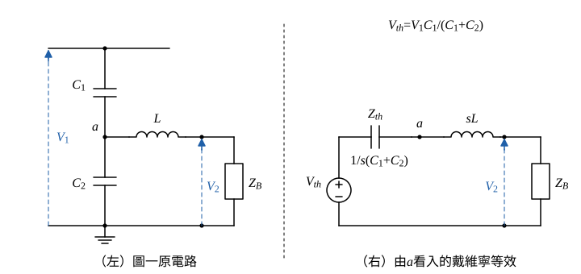

# 108 年工業配電第 1 題｜電容式比壓器比壓式

## 已知與所求

圖一：\(V_1\) 加在串聯的 \(C_1\)（上）與 \(C_2\)（下）兩端，下端接地；\(C_1\)、\(C_2\) 的中點經補償電抗器 \(L\) 串接負載 \(Z_B\) 到地，輸出 \(V_2\) 跨在 \(Z_B\) 兩端。求比壓式 \(V_2/V_1\)。

## 考場標準作答

**解題邏輯**：所求比壓式是 \(V_2/V_1\)。\(C_1\)、\(C_2\) 構成電容分壓器，中點 \(a\) 經補償電抗器 \(L\) 串接負擔 \(Z_B\) 到地；把 \(L\)–\(Z_B\) 支路拿掉，對中點 \(a\) 作戴維寧等效（\(V_{th}\)、\(Z_{th}\)），再接回 \(L\)、\(Z_B\) 串聯支路，\(V_2\) 就是 \(Z_B\) 上的分壓。依序求：\(V_{th}\) → \(Z_{th}\) → \(V_2/V_1\) 並化簡成 \(s\) 多項式 → 工頻下補償電抗的條件。前提：正弦穩態（相量、\(s=j\omega\)），\(C_1\)、\(C_2\)、\(L\) 為理想元件（不計 \(L\) 的電阻與電容漏電），\(Z_B\) 為任意負擔阻抗。

### 步驟 1：等效電路畫法與阻抗符號

- 由圖一：\(V_1\) 跨在 \(C_1\)（上）與 \(C_2\)（下）串聯兩端，下端接地；\(C_1\)、\(C_2\) 的接點記為 \(a\)。
- \(a\) 點經 \(L\) 再串 \(Z_B\) 到地，\(V_2\) 取 \(Z_B\) 兩端（上正下地），\(L\) 與 \(Z_B\) 是**串聯**，不是並聯。
- 在 \(a\) 點把 \(L\)–\(Z_B\) 支路斷開，左側電容網路化成 \(V_{th}\) 串 \(Z_{th}\)（步驟 2、3 求出後畫成圖 1 右）。

阻抗符號：
\[
Z_1=\frac{1}{sC_1},\qquad Z_2=\frac{1}{sC_2},\qquad Z_L=sL
\]

### 步驟 2：戴維寧電壓 \(V_{th}\)

\(a\) 點開路時，\(V_1\) 只在 \(C_1\)、\(C_2\) 上分壓，\(V_{th}\) 為 \(Z_2\) 上的電壓：
\[
V_{th}=V_1\frac{Z_2}{Z_1+Z_2}=V_1\frac{\dfrac{1}{sC_2}}{\dfrac{1}{sC_1}+\dfrac{1}{sC_2}}
\]
分子分母同乘 \(sC_1C_2\)：
\[
V_{th}=V_1\frac{C_1}{C_2+C_1}=V_1\frac{C_1}{C_1+C_2}
\]

### 步驟 3：戴維寧阻抗 \(Z_{th}\)

\(V_1\) 短路（電壓源置零），從 \(a\) 看入 \(Z_1\)、\(Z_2\) 並聯：
\[
Z_{th}=\frac{Z_1Z_2}{Z_1+Z_2}=\frac{\dfrac{1}{s^2C_1C_2}}{\dfrac{C_1+C_2}{sC_1C_2}}
\]
\[
Z_{th}=\frac{1}{s(C_1+C_2)}
\]
即一個電容量 \(C_1+C_2\) 的等效電容。

### 比壓式（20 分）

**邏輯**：接回 \(L\)、\(Z_B\) 後，等效電路是 \(V_{th}\) 串 \(Z_{th}\)、\(sL\)、\(Z_B\) 的單一迴路，\(V_2\) 由串聯分壓求得；再把 \(V_{th}\) 換回 \(V_1\) 並化簡。

串聯分壓：
\[
V_2=V_{th}\frac{Z_B}{Z_{th}+sL+Z_B}
\]
代入 \(V_{th}\)：
\[
\frac{V_2}{V_1}=\frac{C_1}{C_1+C_2}\cdot\frac{Z_B}{\dfrac{1}{s(C_1+C_2)}+sL+Z_B}
\]
第二個分式的分子分母同乘 \(s(C_1+C_2)\)：
\[
\frac{V_2}{V_1}=\frac{C_1}{C_1+C_2}\cdot\frac{s(C_1+C_2)Z_B}{1+s^2L(C_1+C_2)+s(C_1+C_2)Z_B}
\]
約去 \(C_1+C_2\)：
\[
\boxed{\frac{V_2}{V_1}=\frac{sC_1Z_B}{1+s(C_1+C_2)Z_B+s^2L(C_1+C_2)}}
\]

**補償電抗的作用**：工頻 \(s=j\omega\)，\(s^2=-\omega^2\)，分母為
\[
1-\omega^2L(C_1+C_2)+j\omega(C_1+C_2)Z_B
\]
令實部 \(1-\omega^2L(C_1+C_2)=0\)：
\[
\boxed{L=\frac{1}{\omega^2(C_1+C_2)}}
\]
此時 \(j\omega L=-Z_{th}\)（\(L\) 與等效電容 \(C_1+C_2\) 串聯諧振），比壓式化為
\[
\frac{V_2}{V_1}=\frac{j\omega C_1Z_B}{j\omega(C_1+C_2)Z_B}=\frac{C_1}{C_1+C_2}
\]
與 \(Z_B\) 無關，負擔變動不再造成比差與相角差。

## 驗算

直接對中點 \(a\) 列 KCL（與上面的戴維寧法不同）：
\[
\frac{V_a-V_1}{Z_1}+\frac{V_a}{Z_2}+\frac{V_a}{sL+Z_B}=0,\qquad V_2=V_a\frac{Z_B}{sL+Z_B}
\]
解得 \(V_2/V_1=\dfrac{Z_2Z_B}{Z_1Z_2+(Z_1+Z_2)(sL+Z_B)}\)，分子分母同乘 \(s^2C_1C_2\) 即得上式。極限 \(Z_B\to\infty\) 時 \(V_2/V_1\to C_1/(C_1+C_2)\)，為理想電容分壓。

## 失分點

- 把 \(L\) 與 \(Z_B\) 畫成並聯；圖中兩者串聯在同一支路。
- 以電容值直接分壓寫成 \(C_2/(C_1+C_2)\)；阻抗分壓 \(Z_2/(Z_1+Z_2)\) 化簡後是 \(C_1/(C_1+C_2)\)。
- 只寫 \(C_1/(C_1+C_2)\)，沒有交代它只在 \(Z_B\to\infty\) 或補償諧振時成立。
