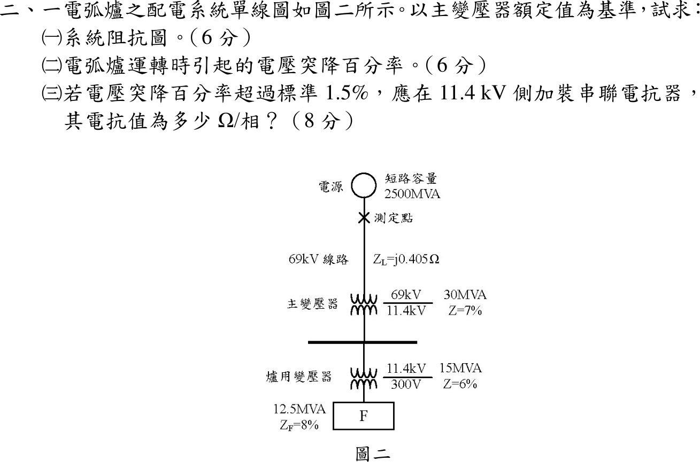
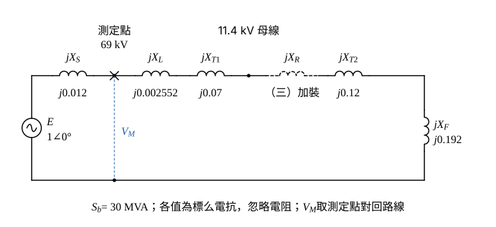

# 108 年工業配電第 2 題｜電弧爐電壓突降與串聯電抗器

## 已知與所求

電源短路容量 \(2500\,\mathrm{MVA}\)；測定點位於 69 kV 電源側、主變壓器之前；69 kV 線路 \(Z_L=j0.405\,\Omega\)；主變壓器 \(30\,\mathrm{MVA}\)、69/11.4 kV、\(Z=7\%\)；爐用變壓器 \(15\,\mathrm{MVA}\)、11.4 kV/300 V、\(Z=6\%\)；電弧爐 \(12.5\,\mathrm{MVA}\)、\(Z_F=8\%\)。以主變額定 \(S_b=30\,\mathrm{MVA}\) 為基準，求（一）系統阻抗圖（6 分）；（二）電弧爐運轉的電壓突降百分率（6 分）；（三）突降超過 1.5% 時，11.4 kV 側串聯電抗器之 \(\Omega\)/相（8 分）。

## 考場標準作答

**解題邏輯**：前提：題圖只給電抗，忽略全部電阻；電源視為理想電動勢串短路電抗。
1. （一）把單線圖每個設備換成同一基準（\(S_b=30\,\mathrm{MVA}\)）的標么電抗，串成「電源—測定點—線路—主變—11.4 kV 母線—爐變—電弧爐」的阻抗圖。
2. （二）電弧爐以其標示阻抗 \(Z_F=8\%\) 當定阻抗負載，測定點電壓 \(V_M\) 是電源電動勢 \(E=1\angle0^\circ\) 在測定點下游總電抗上的分壓，突降百分率 \(=X_S/(X_S+X_{down})\)。
3. （三）串聯電抗器裝在 11.4 kV 側，屬測定點下游，只增加分母。
4. 令突降 \(=1.5\%\) 解出 \(X_R\)，再乘 11.4 kV 側阻抗基準換成歐姆。

### （一）系統阻抗圖（6 分）

**邏輯**：串聯在同一路徑上的設備必須在同一基準下才能相加；電源用 \(X_S=S_b/S_{sc}\)，線路用 \(X=Z_\Omega/Z_b\)，變壓器與電弧爐用 \(X_{new}=X_{old}\,S_{b,new}/S_{b,old}\)。

阻抗基準 \(Z_b=V_b^2/S_b\)：
\[
Z_{b,69}=\frac{69^2}{30}=\frac{4761}{30}=158.7\,\Omega
\]
\[
Z_{b,11.4}=\frac{11.4^2}{30}=\frac{129.96}{30}=4.332\,\Omega
\]
電源（短路容量 2500 MVA）：
\[
X_S=\frac{S_b}{S_{sc}}=\frac{30}{2500}=0.012\ \mathrm{pu}
\]
69 kV 線路：
\[
X_L=\frac{0.405}{Z_{b,69}}=\frac{0.405}{158.7}=0.002552\ \mathrm{pu}
\]
主變壓器（30 MVA，已在基準上）：
\[
X_{T1}=0.07\ \mathrm{pu}
\]
爐用變壓器（15 MVA → 30 MVA）：
\[
X_{T2}=0.06\times\frac{30}{15}=0.12\ \mathrm{pu}
\]
電弧爐（12.5 MVA → 30 MVA）：
\[
X_F=0.08\times\frac{30}{12.5}=0.08\times2.4=0.192\ \mathrm{pu}
\]

畫法：電動勢 \(E=1\angle0^\circ\) 在左，依單線圖由電源往負載串 \(jX_S\) →（測定點，69 kV）→ \(jX_L\) → \(jX_{T1}\) →（11.4 kV 母線）→ \(jX_{T2}\) → \(jX_F\) → 回路線；測定點標在 \(X_S\) 與 \(X_L\) 之間，\(V_M\) 取測定點對回路線；虛線 \(jX_R\) 為（三）加裝位置。

\[
\boxed{X_S=0.012,\ X_L=0.002552,\ X_{T1}=0.07,\ X_{T2}=0.12,\ X_F=0.192\ \mathrm{pu}}
\]

### （二）電弧爐運轉的電壓突降（6 分）

**邏輯**：測定點上游只有 \(X_S\)，其餘電抗都在下游；\(V_M=E\cdot X_{down}/(X_S+X_{down})\)，故突降 \(\Delta V/E=1-V_M/E=X_S/(X_S+X_{down})\)。

測定點下游總電抗：
\[
X_{down}=X_L+X_{T1}+X_{T2}+X_F=0.002552+0.07+0.12+0.192=0.3846\ \mathrm{pu}
\]
總電抗：
\[
X_S+X_{down}=0.012+0.3846=0.3966\ \mathrm{pu}
\]
突降百分率：
\[
\frac{\Delta V}{E}=\frac{X_S}{X_S+X_{down}}=\frac{0.012}{0.3966}=0.03026
\]
\[
\boxed{\frac{\Delta V}{E}=3.03\%}
\]
超過標準 1.5%，需加裝串聯電抗器。

### （三）11.4 kV 側串聯電抗器（8 分）

**邏輯**：\(X_R\) 在測定點下游，加進分母使突降變小；令 \(X_S/(X_S+X_{down}+X_R)=1.5\%\) 解 \(X_R\)，裝在 11.4 kV 側，故用 \(Z_{b,11.4}\) 換回歐姆。

條件式：
\[
\frac{X_S}{X_S+X_{down}+X_R}=0.015
\]
移項：
\[
X_R=\frac{X_S}{0.015}-(X_S+X_{down})
\]
代入：
\[
X_R=\frac{0.012}{0.015}-0.3966=0.8-0.3966=0.4034\ \mathrm{pu}
\]
換成歐姆：
\[
X_{R,\Omega}=X_R\,Z_{b,11.4}=0.4034\times4.332=1.7475\ \Omega
\]
\[
\boxed{X_{R,\Omega}=1.75\ \Omega/\text{相}}
\]

## 驗算

不經標么，全部折算到 11.4 kV 側歐姆值：
- 電源：\(11.4^2/2500=0.05198\,\Omega\)
- 下游：線路 \(0.405(11.4/69)^2=0.01106\)、主變 \(0.07\times4.332=0.3032\)、爐變 \(0.06\times11.4^2/15=0.5198\)、電弧爐 \(0.08\times11.4^2/12.5=0.8317\)，合計 \(1.6658\,\Omega\)
- 突降：\(0.05198/(0.05198+1.6658)=0.05198/1.7178=3.03\%\)
- 降到 1.5% 需總電抗 \(0.05198/0.015=3.4653\,\Omega\)，\(X_R=3.4653-1.7178=1.7475\,\Omega\approx1.75\,\Omega\)

與標么法相同。

## 失分點

- 把測定點放到主變二次側，上游阻抗與分壓位置全錯；圖上 × 在 69 kV 電源之後、主變之前。
- 15 MVA 爐用變壓器與 12.5 MVA 電弧爐阻抗未換到 30 MVA 基準。
- 串聯電抗器裝在 11.4 kV 側，屬測定點下游，應加進分母；只加到 \(X_S\) 會得到相反方向的結果。

## 條件與疑義

題圖只給電抗值，全部忽略電阻；突降定義為測定點（source/PCC）電壓相對於電源電動勢的下降，電弧爐以其標示阻抗 \(Z_F=8\%\) 的定阻抗負載代表，所得 3.03% 為此模型值，並非閃爍（flicker）量測值。
