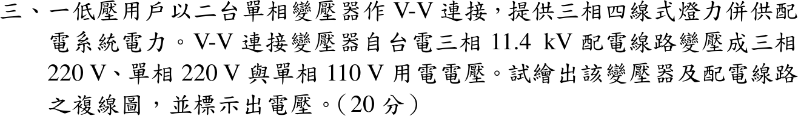
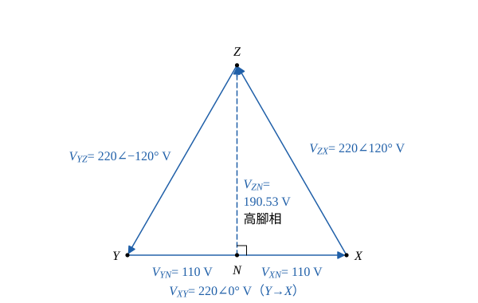
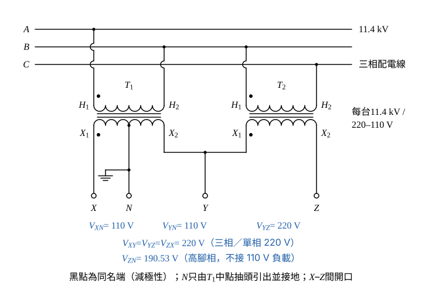

# 108 年工業配電第 3 題｜V-V 連接三相四線式燈力併供

## 已知與所求

低壓用戶以兩台單相變壓器作 V-V 連接，自台電三相 \(11.4\,\mathrm{kV}\) 配電線路取電，供三相 220 V、單相 220 V、單相 110 V，為三相四線式燈力併供。繪出變壓器與配電線路複線圖，並標示電壓。

## 考場標準作答

### 步驟 1：接線方式

設兩台理想單相變壓器（\(11.4\,\mathrm{kV}/220\text{–}110\,\mathrm V\)，二次 220 V 繞組附中點抽頭），減極性（\(H_1\)、\(X_1\) 同名端），一次為正相序 \(A\text{–}B\text{–}C\)，無載。兩台一次接在不同的線間電壓上，二次電壓才有 \(120^\circ\) 相位差；中性線只取自一台的中點，否則兩個中點之間有電位差而形成環流。

- \(T_1\)：一次 \(H_1\) 接 \(A\)、\(H_2\) 接 \(B\)（跨 \(V_{AB}\)）；二次 \(X_1\) 引出端子 \(X\)、\(X_2\) 引出端子 \(Y\)，中點抽頭引出 \(N\) 並接地。
- \(T_2\)：一次 \(H_1\) 接 \(B\)、\(H_2\) 接 \(C\)（跨 \(V_{BC}\)）；二次 \(X_1\) 接到 \(Y\)（與 \(T_1\) 的 \(X_2\) 共接）、\(X_2\) 引出端子 \(Z\)。
- \(X\)、\(Z\) 之間不接繞組（開口），輸出四線 \(X\)、\(Y\)、\(Z\)、\(N\)。
- \(T_1\) 兼供單相 110 V 燈插負載，容量通常選得比 \(T_2\) 大。

### 步驟 2：二次側各端子電壓（相量）

雙下標約定：\(\widetilde V_{XY}=\widetilde V_X-\widetilde V_Y\)（第一下標相對第二下標的電位），故 \(\widetilde V_{ZN}=\widetilde V_{ZY}+\widetilde V_{YN}\)；以下 \(\widetilde V\) 表相量，不加波浪號的 \(V\) 表大小。

一次正相序（以 \(V_{AN}\) 為 \(0^\circ\)）：\(\widetilde V_{AB}=11.4\angle30^\circ\ \mathrm{kV}\)、\(\widetilde V_{BC}=11.4\angle{-90^\circ}\ \mathrm{kV}\)，相差 \(30^\circ-(-90^\circ)=120^\circ\)。

減極性下二次電壓與所接的一次線電壓同相。改以 \(T_1\) 二次為參考（整體轉 \(-30^\circ\)，不影響大小）：
\[
\widetilde V_{XY}=220\angle0^\circ\ \mathrm V
\]
\(T_2\) 二次跟隨 \(\widetilde V_{BC}\)，落後 \(120^\circ\)：
\[
\widetilde V_{YZ}=220\angle{-120^\circ}\ \mathrm V
\]
換成直角座標（實部 \(220\cos(-120^\circ)\)、虛部 \(220\sin(-120^\circ)\)）：
\[
\widetilde V_{YZ}=-110-j110\sqrt3\ \mathrm V
\]

開口端 \(Z\)–\(X\)（KVL：\(\widetilde V_{XY}+\widetilde V_{YZ}+\widetilde V_{ZX}=0\)）：
\[
\widetilde V_{ZX}=-(\widetilde V_{XY}+\widetilde V_{YZ})=-[220+(-110-j110\sqrt3)]
\]
\[
\widetilde V_{ZX}=-(110-j110\sqrt3)=-110+j110\sqrt3\ \mathrm V
\]
大小與角度：
\[
|\widetilde V_{ZX}|=\sqrt{110^2+(110\sqrt3)^2}=\sqrt{4(110)^2}=220\ \mathrm V
\]
\[
\angle\widetilde V_{ZX}=180^\circ-\tan^{-1}\sqrt3=180^\circ-60^\circ=120^\circ
\]
三個線電壓都是 220 V、互差 \(120^\circ\)，為平衡三相。

中點抽頭把 \(T_1\) 二次分成兩半：
\[
\widetilde V_{XN}=\frac{\widetilde V_{XY}}{2}=110\angle0^\circ\ \mathrm V,\qquad
\widetilde V_{YN}=-\frac{\widetilde V_{XY}}{2}=110\angle180^\circ\ \mathrm V
\]

高腳相 \(Z\)–\(N\)（經 \(Y\) 走）：
\[
\widetilde V_{ZY}=-\widetilde V_{YZ}=110+j110\sqrt3\ \mathrm V
\]
\[
\widetilde V_{ZN}=\widetilde V_{ZY}+\widetilde V_{YN}=(110+j110\sqrt3)+(-110)=j110\sqrt3\ \mathrm V
\]
大小與角度：
\[
|\widetilde V_{ZN}|=110\sqrt3=190.53\ \mathrm V,\qquad \angle\widetilde V_{ZN}=90^\circ
\]

### 複線圖與電壓標示（20 分）

| 端子 | 電壓 | 用途 |
|---|---:|---|
| \(X\)–\(Y\)、\(Y\)–\(Z\)、\(Z\)–\(X\) | 220 V | 三相 220 V 動力；任兩線間為單相 220 V |
| \(X\)–\(N\)、\(Y\)–\(N\) | 110 V | 單相 110 V 燈與插座 |
| \(Z\)–\(N\) | 190.53 V | 高腳相，不接 110 V 負載 |

\[
\boxed{V_{XY}=V_{YZ}=V_{ZX}=220\,\mathrm V,\quad V_{XN}=V_{YN}=110\,\mathrm V,\quad V_{ZN}=110\sqrt3=190.53\,\mathrm V}
\]

## 驗算

三個線電壓之和 \(220+(-110-j110\sqrt3)+(-110+j110\sqrt3)=0\)，KVL 閉合。另由幾何：\(N\) 為正三角形 \(XYZ\) 底邊中點，\(ZN\) 是高，\(|V_{ZN}|=220\sin60^\circ=190.53\,\mathrm V\)，與相量結果一致；\(|V_{ZN}|^2=36300=3(110)^2\)。

## 失分點

- 兩台一次側接成同一對線電壓，二次側失去 \(120^\circ\) 相位，合成不出三相。
- 把兩個二次中點同時接成 \(N\)；中性線只能取自一台的中點。
- 把 \(Z\)–\(N\) 當成 110 V 使用，或漏標 190.53 V 的高腳相。
