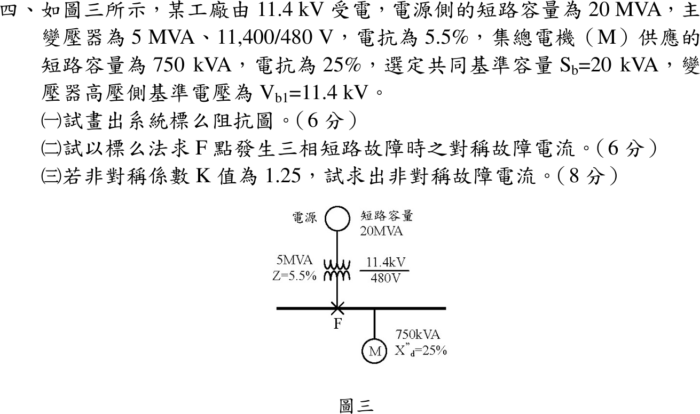

# 108 年工業配電第 4 題｜F 點三相短路



## 已知與所求

11.4 kV 電源短路容量 \(20\,\mathrm{MVA}\)；主變壓器 \(5\,\mathrm{MVA}\)、11,400/480 V、\(X=5.5\%\)；F 點（480 V 母線）接集總電機 \(750\,\mathrm{kVA}\)、\(X''_d=25\%\)；\(V_{b1}=11.4\,\mathrm{kV}\)，低壓側 \(V_{b2}=480\,\mathrm V\)。求（一）標么阻抗圖；（二）F 點三相短路對稱故障電流；（三）\(K=1.25\) 時的非對稱故障電流。基準容量的讀法見「條件與疑義」。

## 考場標準作答

### （一）標么阻抗圖（\(S_b=20\,\mathrm{MVA}\)）

觀念：標么法把各元件的短路容量或百分阻抗換到同一個 \(S_b\)，換算式為 \(X_{pu,new}=X_{pu,old}\dfrac{S_b}{S_{old}}\)；電源以短路容量求其等效電抗 \(X_S=S_b/S_{sc}\)。
\[
X_S=\frac{S_b}{S_{sc}}=\frac{20}{20}=1.00\ \mathrm{pu}
\]
\[
X_T=5.5\%\times\frac{S_b}{S_T}=5.5\%\times\frac{20}{5}=0.22\ \mathrm{pu}
\]
\[
X_M=25\%\times\frac{S_b}{S_M}=25\%\times\frac{20}{0.75}=6.67\ \mathrm{pu}
\]
畫法：電源與電機各以 \(1\angle0^\circ\ \mathrm{pu}\) 電壓源串接自己的電抗；電源支路再串變壓器，兩條支路都接到 F 點（480 V 母線），F 點為共同節點。

```text
E=1∠0° ─ j1.00 ─ j0.22 ─┬─ F（480 V 母線）
(電源)    X_S      X_T   │
E=1∠0° ───── j6.67 ─────┘   (電機 X''d 支路，與電源支路在 F 並聯)
```
\[
\boxed{X_S=1.00,\ X_T=0.22,\ X_M=6.67\ \mathrm{pu}}
\]

### （二）對稱故障電流

觀念：三相對稱短路只看正序網路，從 F 點看進去的戴維寧電抗為兩並聯支路，故障電流為 \(1/X_{th}\) 乘上 480 V 側的基準電流。

電源支路串聯：
\[
X_S+X_T=1.00+0.22=1.22\ \mathrm{pu}
\]
與電機支路並聯：
\[
X_{th}=\frac{(X_S+X_T)X_M}{(X_S+X_T)+X_M}=\frac{1.22\times6.67}{1.22+6.67}=\frac{1.22\times6.67}{7.89}=1.03\ \mathrm{pu}
\]
\[
I_{f,pu}=\frac{1}{X_{th}}=\frac{1}{1.03}=0.97\ \mathrm{pu}
\]
F 點在 480 V 側，基準電流用 480 V：
\[
I_b=\frac{S_b}{\sqrt3\,V_{b2}}=\frac{20\times10^6}{\sqrt3(480)}=24.06\ \mathrm{kA}
\]
（以上為顯示值，下式以完整精度計算）
\[
I_{f,sym}=I_{f,pu}\,I_b=\frac{1}{X_{th}}I_b=23\,326.69\ \mathrm A
\]
\[
\boxed{I_{f,sym}=23.33\ \mathrm{kA}}
\]

### （三）非對稱故障電流

觀念：非對稱係數 \(K\) 計入直流偏移分量，非對稱（最大瞬時有效值）電流為對稱電流乘以 \(K\)。
\[
I_{f,asym}=K\,I_{f,sym}=1.25\times23\,326.69\ \mathrm A=29\,158.36\ \mathrm A
\]
\[
\boxed{I_{f,asym}=29.16\ \mathrm{kA}}
\]

## 驗算

不用標么，直接用 480 V 側歐姆：\(X_S=480^2/20\mathrm{M}=11.52\ \mathrm{m\Omega}\)、\(X_T=5.5\%(480^2)/5\mathrm{M}=2.53\ \mathrm{m\Omega}\)、\(X_M=25\%(480^2)/750\mathrm{k}=76.80\ \mathrm{m\Omega}\)。相電壓 \(480/\sqrt3=277.13\ \mathrm V\)；電源支路電流 \(277.13/14.05\ \mathrm{m\Omega}=19.72\ \mathrm{kA}\)，電機支路 \(277.13/76.80\ \mathrm{m\Omega}=3.61\ \mathrm{kA}\)，KCL 相加 \(=23.33\ \mathrm{kA}\)，與標么法一致。

## 失分點

- 用 11.4 kV 的基準電流 \(1.01\ \mathrm{kA}\)（\(20\,\mathrm{MVA}\)）回答；F 點在 480 V 側，須乘 480 V 的 \(I_b\)。
- 電機 \(25\%\) 是以 750 kVA 為基準，要乘 \(S_b/0.75\,\mathrm{MVA}\) 換算；漏換會使電機支路電抗偏小。
- 把電源支路與電機支路串聯；故障時兩者各自供電，在 F 並聯。

## 條件與疑義

題幹將共同基準容量 \(S_b\) 印成 \(20\,\mathrm{kVA}\)，但電源短路容量為 \(20\,\mathrm{MVA}\)，本解讀為 \(S_b=20\,\mathrm{MVA}\)。基準容量只是換算尺度：以 \(20\,\mathrm{kVA}\) 為基準時 \(X_S=1.00\times10^{-3}\)、\(X_T=2.20\times10^{-4}\)、\(X_M=6.67\times10^{-3}\ \mathrm{pu}\)，\(I_b=24.06\ \mathrm A\)，故障電流同為 \(23.33\ \mathrm{kA}\)，答案不受影響。
