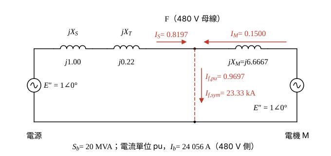

# 108 年工業配電第 4 題｜F 點三相短路

## 已知與所求

11.4 kV 電源短路容量 \(20\,\mathrm{MVA}\)；主變壓器 \(5\,\mathrm{MVA}\)、11,400/480 V、\(X=5.5\%\)；F 點（480 V 母線）接集總電機 \(750\,\mathrm{kVA}\)、\(X''_d=25\%\)；\(V_{b1}=11.4\,\mathrm{kV}\)，低壓側 \(V_{b2}=480\,\mathrm V\)。求（一）標么阻抗圖；（二）F 點三相短路對稱故障電流；（三）\(K=1.25\) 時的非對稱故障電流。基準容量的讀法見「條件與疑義」。

## 考場標準作答

### （一）系統標么阻抗圖（6 分）

取 \(S_b=20\,\mathrm{MVA}\)，設故障前無載，電源與電機內電勢皆為 \(E''=1\angle0^\circ\,\mathrm{pu}\)，電機用次暫態電抗 \(X''_d\)；各元件額定電壓即基準電壓，不需電壓換算。電源：
\[
X_S=\frac{S_b}{S_{sc}}=\frac{20}{20}=1.00\ \mathrm{pu}
\]
主變壓器：
\[
X_T=0.055\times\frac{S_b}{S_T}=0.055\times\frac{20}{5}=0.22\ \mathrm{pu}
\]
集總電機：
\[
X_M=0.25\times\frac{S_b}{S_M}=0.25\times\frac{20}{0.75}=\frac{20}{3}=6.6667\ \mathrm{pu}
\]
畫法：
- 電源支路：\(E''=1\angle0^\circ\) 接參考線，串 \(jX_S\)、\(jX_T\) 到 F 點（480 V 母線）。
- 電機支路：\(E''=1\angle0^\circ\) 接參考線，串 \(jX_M\) 到 F 點。
- 三相故障 = F 點對參考線短路；兩支路在 F 並聯。

\[
\boxed{X_S=1.00,\ X_T=0.22,\ X_M=\tfrac{20}{3}\approx6.67\ \mathrm{pu}}
\]

### （二）F 點對稱故障電流（6 分）

電源支路串聯：
\[
X_S+X_T=1.00+0.22=1.22\ \mathrm{pu}
\]
與電機支路並聯：
\[
X_{th}=\frac{(X_S+X_T)X_M}{(X_S+X_T)+X_M}=\frac{1.22\times6.6667}{1.22+6.6667}
\]
\[
X_{th}=\frac{8.1334}{7.8867}=1.03128\ \mathrm{pu}
\]
標么故障電流：
\[
I_{f,pu}=\frac{E''}{X_{th}}=\frac{1}{1.03128}=0.9697\ \mathrm{pu}
\]
F 在 480 V 母線，基準電流用 \(V_{b2}=480\,\mathrm V\)（\(V_{b1}=11.4\,\mathrm{kV}\) 只用於高壓側）：
\[
I_b=\frac{S_b}{\sqrt3\,V_{b2}}=\frac{20\times10^6}{\sqrt3(480)}=\frac{20\times10^6}{831.4}=24\,056\ \mathrm A
\]
換成安培：
\[
I_{f,sym}=I_{f,pu}\,I_b=0.9697\times24\,056=23\,327\ \mathrm A
\]
\[
\boxed{I_{f,sym}=23.33\ \mathrm{kA}}
\]

### （三）非對稱故障電流（8 分）

非對稱係數 \(K\) 計入直流偏移，只乘一次：
\[
I_{f,asym}=K\,I_{f,sym}=1.25\times23\,327\ \mathrm A=29\,158.75\ \mathrm A
\]
\[
\boxed{I_{f,asym}=29.16\ \mathrm{kA}}
\]

## 驗算

各支路標么電流相加（KCL）：電源支路 \(I_S=1/1.22=0.8197\)、電機支路 \(I_M=1/6.6667=0.1500\)，和 \(I_S+I_M=0.9697\ \mathrm{pu}\)，與 \(1/X_{th}\) 相同。改用 480 V 側歐姆：\(X_S=480^2/20\mathrm{M}=11.52\ \mathrm{m\Omega}\)、\(X_T=0.055(480^2)/5\mathrm{M}=2.534\ \mathrm{m\Omega}\)、\(X_M=0.25(480^2)/750\mathrm{k}=76.80\ \mathrm{m\Omega}\)；相電壓 \(480/\sqrt3=277.13\ \mathrm V\)；電源支路 \(X_S+X_T=11.52+2.534=14.05\ \mathrm{m\Omega}\)，電流 \(277.13/14.05\ \mathrm{m\Omega}=19.72\ \mathrm{kA}\)，電機支路 \(277.13/76.80\ \mathrm{m\Omega}=3.608\ \mathrm{kA}\)，相加 \(19.72+3.608=23.33\ \mathrm{kA}\)，與標么法一致。

## 失分點

- 用 11.4 kV 的基準電流 \(1.013\ \mathrm{kA}\)（\(20\,\mathrm{MVA}\)）回答；F 點在 480 V 側，須乘 480 V 的 \(I_b\)。
- 電機 \(25\%\) 是以 750 kVA 為基準，要乘 \(S_b/0.75\,\mathrm{MVA}\) 換算；漏換會使電機支路電抗偏小。
- 把電源支路與電機支路串聯；故障時兩者各自供電，在 F 並聯。

## 條件與疑義

題幹將共同基準容量 \(S_b\) 印成 \(20\,\mathrm{kVA}\)，但電源短路容量為 \(20\,\mathrm{MVA}\)，本解讀為 \(S_b=20\,\mathrm{MVA}\)。基準容量只是換算尺度：以 \(20\,\mathrm{kVA}\) 為基準時 \(X_S=1.000\times10^{-3}\)、\(X_T=2.200\times10^{-4}\)、\(X_M=6.667\times10^{-3}\ \mathrm{pu}\)，\(I_b=24.06\ \mathrm A\)，故障電流同為 \(23.33\ \mathrm{kA}\)，答案不受影響。

題幹文字寫「集總電機（M）供應的短路容量為 750 kVA，電抗為 25%」；依附圖標註「750 kVA、\(X''_d=25\%\)」，本解把 750 kVA 讀成電機額定容量、25% 是以它為基準的次暫態電抗（\(X_M=0.25\times20/0.75\)）。若照字面把 750 kVA 當成電機供給的短路容量，則 \(X_M=S_b/0.75\,\mathrm{MVA}=26.67\ \mathrm{pu}\)，答案會不同；此讀法不採用，答案維持上列值。
