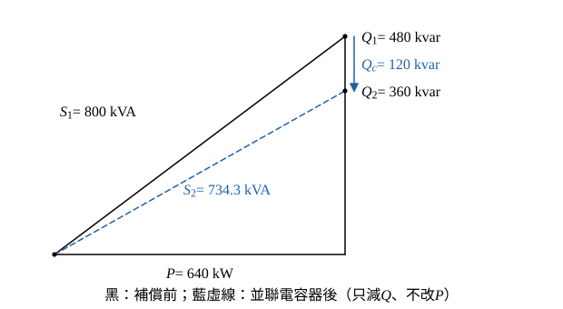

# 108 年工業配電第 5 題｜並聯電容器的效益

## 已知與所求

11.4 kV 配電線路，負載三相 \(800\,\mathrm{kVA}\)、功因 0.8 落後，並聯 \(Q_c=120\,\mathrm{kvar}\) 電容器組，線路阻抗 \(Z=0.26+j0.72\,\Omega\)（取為每相值）。求加裝後（一）減少的線路電流；（二）減少的線路壓降；（三）減少的線路損失；（四）可增加的系統供電容量（各 5 分）。

## 考場標準作答

**解題邏輯**：並聯電容器只供應無功、不改變有功，所以先求補償前後的 \(P\)、\(Q\)、\(S\)（步驟 1），四個小題都由它們算出：（一）線電流 \(I=S/(\sqrt3V_{LL})\)；（二）線路壓降 \(\Delta V=\sqrt3I(R\cos\phi+X\sin\phi)=(PR+QX)/V_{LL}\)；（三）三相線路損失 \(3I^2R=S^2R/V_{LL}^2\)；（四）供電設備受視在功率限制，\(S\) 減少的量即可再供應的容量。前提：三相平衡、線路阻抗 \(0.26+j0.72\,\Omega\) 為每相值、受電端線電壓補償前後都取 11.4 kV。

### 步驟 1：補償前後的功率

等效電路：電源經每相 \(Z=0.26+j0.72\,\Omega\) 接 11.4 kV 負載母線，母線並聯負載 800 kVA（PF 0.8 落後）與 120 kvar 電容器；電容器的 \(Q_c\) 抵銷負載的落後無功。

補償前（\(\sin\phi_1=\sqrt{1-0.8^2}=0.6\)）：
\[
P=S_1\cos\phi_1=800(0.8)=640\ \mathrm{kW}
\]
\[
Q_1=S_1\sin\phi_1=800(0.6)=480\ \mathrm{kvar}
\]
補償後 \(P\) 不變、無功減 \(Q_c\)：
\[
Q_2=Q_1-Q_c=480-120=360\ \mathrm{kvar}
\]
\[
S_2^2=P^2+Q_2^2=640^2+360^2=409\,600+129\,600=539\,200\ \mathrm{kVA^2}
\]
\[
S_2=\sqrt{539\,200}=734.3\ \mathrm{kVA}
\]

### （一）減少的線路電流（5 分）

**邏輯**：線電壓不變，線電流與視在功率成正比，\(I=S/(\sqrt3V_{LL})\)，補償前後各算一次再相減。

分母：
\[
\sqrt3V_{LL}=\sqrt3(11\,400)=19\,745.4\ \mathrm V
\]
\[
I_1=\frac{S_1}{\sqrt3V_{LL}}=\frac{800\,000}{19\,745.4}=40.52\ \mathrm A
\]
\[
I_2=\frac{S_2}{\sqrt3V_{LL}}=\frac{734\,300}{19\,745.4}=37.19\ \mathrm A
\]
\[
\Delta I=I_1-I_2=40.52-37.19
\]
\[
\boxed{\Delta I=3.33\ \mathrm A}
\]

### （二）減少的線路壓降（5 分）

**邏輯**：線間壓降取沿電壓軸分量 \(\Delta V=\sqrt3I(R\cos\phi+X\sin\phi)\)；因 \(\sqrt3V_{LL}I\cos\phi=P\)、\(\sqrt3V_{LL}I\sin\phi=Q\)，可直接寫成 \((PR+QX)/V_{LL}\)，用步驟 1 的精確 \(P\)、\(Q\) 計算，不受電流捨入影響。

補償前：
\[
\Delta V_1=\frac{PR+Q_1X}{V_{LL}}=\frac{640\,000(0.26)+480\,000(0.72)}{11\,400}
\]
\[
\Delta V_1=\frac{166\,400+345\,600}{11\,400}=\frac{512\,000}{11\,400}=44.91\ \mathrm V
\]
補償後：
\[
\Delta V_2=\frac{PR+Q_2X}{V_{LL}}=\frac{640\,000(0.26)+360\,000(0.72)}{11\,400}
\]
\[
\Delta V_2=\frac{166\,400+259\,200}{11\,400}=\frac{425\,600}{11\,400}=37.33\ \mathrm V
\]
\[
\Delta V_1-\Delta V_2=44.91-37.33
\]
\[
\boxed{\Delta V_1-\Delta V_2=7.58\ \mathrm V}
\]

### （三）減少的線路電力損失（5 分）

**邏輯**：三相損失 \(3I^2R\)，代入 \(I=S/(\sqrt3V_{LL})\) 得 \(S^2R/V_{LL}^2\)；用步驟 1 的 \(S_2^2=539\,200\ \mathrm{kVA^2}\)，避免平方已捨入的電流。

\[
P_{loss}=3I^2R=3\left(\frac{S}{\sqrt3V_{LL}}\right)^2R=\frac{S^2R}{V_{LL}^2}
\]
分母 \(V_{LL}^2=11\,400^2=1.2996\times10^8\ \mathrm{V^2}\)。補償前：
\[
P_{loss,1}=\frac{(800\times10^3)^2(0.26)}{1.2996\times10^8}=\frac{1.664\times10^{11}}{1.2996\times10^8}=1280.39\ \mathrm W
\]
補償後：
\[
P_{loss,2}=\frac{(539\,200\times10^6)(0.26)}{1.2996\times10^8}=\frac{1.40192\times10^{11}}{1.2996\times10^8}=1078.73\ \mathrm W
\]
\[
\Delta P_{loss}=1280.39-1078.73
\]
\[
\boxed{\Delta P_{loss}=201.66\ \mathrm W}
\]

### （四）可增加的系統供電容量（5 分）

**邏輯**：供電設備（變壓器、線路）受視在功率限制；有功 640 kW 不變而 \(S\) 由 800 kVA 降為 \(S_2\)，釋出的 kVA 即可再供應的容量。

\[
\Delta S=S_1-S_2=800-734.3
\]
\[
\boxed{\Delta S=65.70\ \mathrm{kVA}}
\]

## 驗算

- （一）電流與 \(S\) 成正比：\(\Delta I=\Delta S/(\sqrt3V_{LL})=65\,698/19\,745.4=3.33\,\mathrm A\)，一致。
- （二）\(P\) 項補償前後相同而相消，只剩 \(\Delta Q\cdot X/V_{LL}=120\,000(0.72)/11\,400=86\,400/11\,400=7.58\,\mathrm V\)，一致。
- （三）\(\Delta P_{loss}=(800^2-539\,200)\times10^6(0.26)/1.2996\times10^8=(100\,800\times10^6)(0.26)/1.2996\times10^8=201.66\,\mathrm W\)，一致。

## 失分點

- 把 120 kvar 加到 480 kvar 上；電容器供應落後負載所需的無功，應相減。
- 補償後壓降仍用 \(\sin\phi_1=0.6\)；應改用 \(Q_2=360\,\mathrm{kvar}\)（即 \(\sin\phi_2=360/734.3=0.4903\)）。
- 三相電流漏掉 \(\sqrt3\)，或把損失寫成單相的 \(I^2R\)（少乘 3）。

## 條件與疑義

「可增加的系統供電容量」題幹未定義；本解取設備電流上限不變、有功負載不變時釋出的 kVA。若改定義為在 800 kVA 上限內再加掛功因 0.8 的負載，可增加 66.22 kVA（新增 52.98 kW）。線路阻抗取為每相值，壓降採標準近似式（沿電壓軸分量），端電壓視為定值 11.4 kV。
