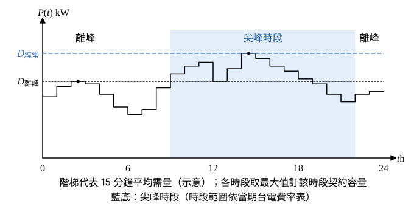

# 109 年工業配電第 1 題｜變壓器容量與契約容量規劃

## 已知與所求

工廠設廠初期擬申請台電高壓電力二段式時間電價。說明（一）如何決定變壓器裝置容量；（二）如何決定契約容量（最大需用電力）。題目無數值資料，屬規劃說明題。

## 考場標準作答

**解題邏輯**：兩小題都從同一份「負載清冊＋生產排程」出發，但求的量不同：（一）變壓器裝置容量是**設備容量（kVA）**，由各負載的視在功率乘需量因數、除參差因數得最大需量，再加擴充裕度取標準額定；（二）契約容量是**台電計費用的最大需量（kW，15 分鐘平均）**，二段式時間電價要分尖峰（經常）與離峰兩個時段各自訂定。兩者單位與意義不同，不可互相代用。

### 步驟 1：負載清冊（兩小題共用）

- 逐台列出設備額定 \(P_i\)（kW）、功因 \(\mathrm{pf}_i\)、需量因數 \(f_{D,i}\)、運轉時段（尖峰／離峰、可否移轉）。
- 視在功率換算：
\[
S_i=\frac{P_i}{\mathrm{pf}_i}
\]
- 依生產排程把各設備的運轉時段疊成全日 15 分鐘需量曲線 \(P(t)\)（kW），供（二）使用。

### （一）變壓器裝置容量（10 分）

**邏輯**：變壓器要承受的是全廠同時出現的最大視在功率，所以用需量因數與參差因數把銘牌加總折算成最大需量，再加裕度。

最大需量（kVA）：
\[
S_{MD}=\frac{\sum_i f_{D,i}\,S_i}{f_{div}}
\]
需量因數 \(f_{D,i}\le1\)、參差因數 \(f_{div}\ge1\)，故 \(S_{MD}\) 小於銘牌加總 \(\sum S_i\)；不可直接加總銘牌容量。

檢核項目（決定是否加大或分台）：

1. 大型馬達啟動壓降（啟動 kVA 對變壓器阻抗造成的電壓降）。
2. 短路容量與斷路器啟斷能力、保護協調。
3. 諧波負載與環境溫度降額。
4. 單台或多台（備援、N−1）配置。

裕度與標準額定：
\[
\boxed{S_{T,\mathrm{rated}}\ge S_{MD}(1+m)}
\]
\(m\) 依 3～5 年擴充計畫訂定，最後取不小於計算值的標準容量。

### （二）契約容量（最大需用電力）（10 分）

**邏輯**：二段式時間電價分時段計算基本電費與超約附加費，因此每個時段的契約容量 = 該時段內 15 分鐘平均 kW 需量的最大值，再依負載移轉與經濟性調整。

1. 由步驟 1 的需量曲線 \(P(t)\) 分時段取最大值：
\[
\boxed{D_{\mathrm{經常}}=\max_{t\in\text{尖峰}}P(t),\qquad D_{\mathrm{離峰}}=\max_{t\in\text{離峰}}P(t)}
\]

2. 經常契約容量取 \(D_{\mathrm{經常}}\)，涵蓋尖峰時段必要負載；可移轉負載（如批次生產、蓄冷、充電）排到離峰，以離峰契約容量涵蓋其增量，降低經常契約。
3. 經濟性檢核：契約過高增加基本電費，過低在超約時加收超約附加費；以當期費率比較年總成本（基本電費 + 超約附加費 + 流動電費），並配合需量控制器卸載。

## 驗算

以示意負載（四台、\(f_D=0.60\sim0.90\)、\(f_{div}=1.30\)）計算，\(S_{MD}\) 低於銘牌加總；隨機 96 點日需量曲線的尖、離峰最大值中較大者即全日最大需量，說明契約容量依時段 kW 最大需量決定，與變壓器 kVA 是不同量。

## 失分點

- 以變壓器 kVA 作為契約容量；契約容量是 kW 最大需量（15 分鐘平均）。
- 未分尖峰、離峰兩段，或未利用負載移轉降低經常契約。
- 變壓器容量直接加總銘牌，未用需量與參差因數。
