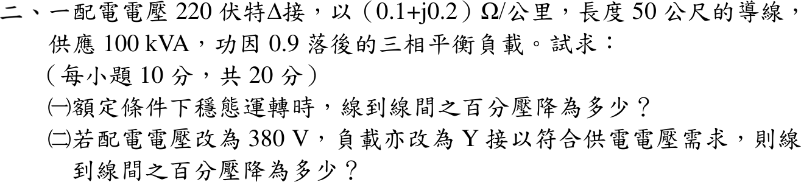
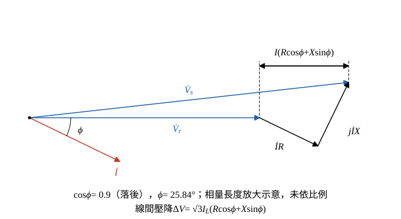

# 109 年工業配電第 2 題｜三相配電線路電壓降

## 已知與所求

220 V、Δ 接，導線 \((0.1+j0.2)\,\Omega/\mathrm{km}\)、長 50 m，供 100 kVA、PF 0.9 落後平衡負載。求（一）額定穩態線間百分壓降；（二）改 380 V、Y 接時的線間百分壓降。

## 考場標準作答

**解題邏輯**：平衡三相負載取單相等效電路，短線路線間壓降用近似式 \(\Delta V\approx\sqrt3\,I_L(R\cos\phi+X\sin\phi)\)（忽略壓降的正交分量），百分壓降再除以額定線電壓。兩小題的線路阻抗與功因相同，只有供電電壓（因而線電流）不同，所以先求共用的每線阻抗與壓降係數 \(K=R\cos\phi+X\sin\phi\)，再各自求線電流與壓降。前提：「額定條件」指受電端線電壓等於標稱值（220 V 或 380 V）、負載取用 100 kVA；短線路只計串聯阻抗、不計線路電容；壓降看**線電流**（Δ 或 Y 只影響負載內部的相電流，不影響線路電流）。

### 步驟 1：每線阻抗

線長 \(50\,\mathrm m=0.05\,\mathrm{km}\)：
\[
R=0.1\times0.05=0.005\ \Omega
\]
\[
X=0.2\times0.05=0.01\ \Omega
\]

### 步驟 2：壓降係數 \(K=R\cos\phi+X\sin\phi\)

- 單相等效（每相）：送電端 \(\dot V_s\) 經 \(R+jX\) 到受電端 \(\dot V_r\)；以 \(\dot V_r\) 為參考，電流 \(\dot I\) 落後 \(\phi\)。
- \(\dot IR\) 與 \(\dot I\) 同向，\(j\dot IX\) 超前 \(\dot I\) \(90^\circ\)；兩者投影到 \(\dot V_r\) 方向的長度和 \(I(R\cos\phi+X\sin\phi)\) 就是相電壓降，乘 \(\sqrt3\) 為線電壓降。

功率因數角與其正弦：
\[
\phi=\cos^{-1}0.9=25.84^\circ
\]
\[
\sin\phi=\sqrt{1-\cos^2\phi}=\sqrt{1-0.9^2}=\sqrt{0.19}=0.4359
\]

兩項分量：
\[
R\cos\phi=0.005\times0.9=0.0045\ \Omega
\]
\[
X\sin\phi=0.01\times0.4359=0.004359\ \Omega
\]
\[
K=R\cos\phi+X\sin\phi=0.0045+0.004359=0.008859\ \Omega
\]

### （一）220 V 線間百分壓降（10 分）

**邏輯**：Δ 接 220 V 供電，線電流由三相視在功率 \(S=\sqrt3V_LI_L\) 求得，代入 \(\Delta V=\sqrt3\,I_LK\)，再除以 220 V。

線電流：
\[
I_L=\frac{S}{\sqrt3\,V_L}=\frac{100\,000}{\sqrt3(220)}=\frac{100\,000}{381.05}=262.43\ \mathrm A
\]
\[
\sqrt3\,I_L=\sqrt3\times262.43=454.54\ \mathrm A
\]
線間壓降：
\[
\Delta V=\sqrt3\,I_LK=454.54\times0.008859=4.0268\ \mathrm V
\]
百分壓降：
\[
\Delta V\%=\frac{\Delta V}{V_L}\times100\%=\frac{4.0268}{220}\times100\%=1.8304\%
\]
\[
\boxed{\Delta V\%=1.83\%}
\]

### （二）380 V（Y 接）線間百分壓降（10 分）

**邏輯**：同一 100 kVA 負載改用 380 V、Y 接，每線阻抗與 \(K\) 不變而線電流降為 \(220/380\) 倍，壓降與電流成正比，百分壓降改除以 380 V。

線電流：
\[
I_L=\frac{100\,000}{\sqrt3(380)}=\frac{100\,000}{658.18}=151.93\ \mathrm A
\]
\[
\sqrt3\,I_L=\sqrt3\times151.93=263.15\ \mathrm A
\]
線間壓降：
\[
\Delta V=\sqrt3\,I_LK=263.15\times0.008859=2.3312\ \mathrm V
\]
百分壓降：
\[
\Delta V\%=\frac{2.3312}{380}\times100\%=0.6135\%
\]
\[
\boxed{\Delta V\%=0.61\%}
\]

## 驗算

精確相量（受電端相電壓 \(220/\sqrt3=127.02\,\mathrm V\) 為參考，220 V 情形）：
\[
\dot I=262.43\angle{-25.84^\circ}:\quad 262.43\cos25.84^\circ=236.19,\quad 262.43\sin25.84^\circ=114.39
\]
\[
\dot I=236.19-j114.39\ \mathrm A
\]
\[
\dot I(R+jX)=(236.19-j114.39)(0.005+j0.01)=2.3249+j1.790\ \mathrm V
\]
\[
\dot V_s=127.02+2.3249+j1.790=129.34+j1.790\ \mathrm V
\]
\[
|\dot V_s|=\sqrt{129.34^2+1.790^2}=129.35\ \mathrm V,\qquad \sqrt3(129.35)=224.04\ \mathrm V
\]
精確壓降 \((224.04-220)/220=1.84\%\)，與近似式 1.83% 相差約 0.5%；380 V 情形同法得 0.61%。另 \(0.6135/1.8304=0.3352\approx(220/380)^2=0.3352\)，與「壓降 ∝ \(1/V^2\)」一致。

## 失分點

- Δ 接誤用相電流 151.52 A 算壓降，只得 2.32 V、1.06%，低估約 42%；線路壓降看線電流。
- 50 m 未換成 0.05 km。
- 只算 \(IR\) 項，漏了 \(X\sin\phi\)（本題電抗項約佔 \(K\) 的一半）。
