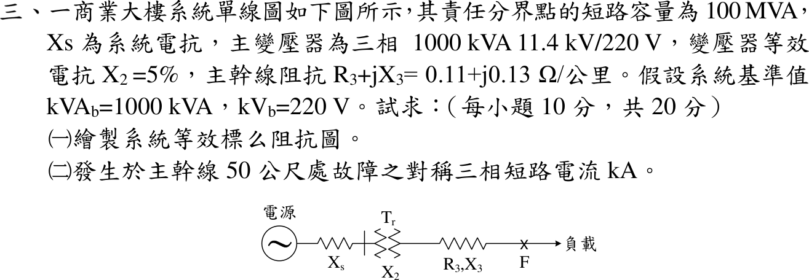
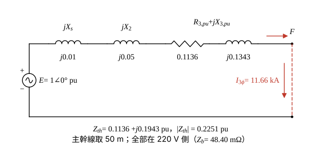

# 109 年工業配電第 3 題｜主幹線三相短路

## 已知與所求

責任分界點短路容量 \(100\,\mathrm{MVA}\)；主變壓器 \(1000\,\mathrm{kVA}\)、\(11.4\,\mathrm{kV}/220\,\mathrm V\)、\(X_2=5\%\)；主幹線 \(0.11+j0.13\,\Omega/\mathrm{km}\)；基準 \(1000\,\mathrm{kVA}\)、\(220\,\mathrm V\)。求（一）等效標么阻抗圖；（二）主幹線 50 m 處對稱三相短路電流。

## 考場標準作答

**解題邏輯**：標么法：把電源（由短路容量求 \(X_s\)）、變壓器 \(X_2\)、主幹線 50 m 的 \(R_3+jX_3\) 都換到同一基準（\(1000\,\mathrm{kVA}\)、\(220\,\mathrm V\)），串成一條戴維寧阻抗。前提：故障前無載，F 點故障前電壓 \(E=1\angle0^\circ\,\mathrm{pu}\)；三相對稱短路只看正序網路。故障電流 \(=I_b/|Z_{th}|\)，其中 \(|Z_{th}|\) 要把線路電阻與總電抗合成大小。

### 步驟 1：基準阻抗與基準電流（220 V 側）

- 變壓器一次 11.4 kV 只決定一次側基準電壓；電源以短路容量換算 \(X_s=S_b/S_{sc}\)，與電壓無關，故全部計算都在 220 V 側進行。
- 題圖 F 點下游的「負載」故障前無載、無電源，不提供故障電流，不畫入阻抗圖。

基準阻抗：
\[
Z_b=\frac{V_b^2}{S_b}=\frac{220^2}{1000\times10^3}=0.0484\ \Omega=48.40\ \mathrm{m\Omega}
\]
基準電流：
\[
I_b=\frac{S_b}{\sqrt3\,V_b}=\frac{1000\ \mathrm{kVA}}{\sqrt3(0.22\ \mathrm{kV})}=2624.32\ \mathrm A
\]

### （一）系統等效標么阻抗圖（10 分）

**邏輯**：各元件換成同一基準的標么值後串聯；電源電抗 \(X_s=S_b/S_{sc}\)，變壓器以自身容量 1000 kVA 為基準所以 5% 直接用，線路歐姆值除以 \(Z_b\)。

電源電抗：
\[
X_s=\frac{S_b}{S_{sc}}=\frac{1000\ \mathrm{kVA}}{100\,000\ \mathrm{kVA}}=0.01\ \mathrm{pu}
\]
變壓器電抗（額定 1000 kVA = 基準，不必換算）：
\[
X_2=5\%=0.05\ \mathrm{pu}
\]
主幹線 50 m（\(0.05\ \mathrm{km}\)）的歐姆值：
\[
R_3+jX_3=(0.11+j0.13)(0.05)=0.0055+j0.0065\ \Omega=5.50+j6.50\ \mathrm{m\Omega}
\]
換成標么：
\[
R_{3,pu}=\frac{5.50\ \mathrm{m\Omega}}{48.40\ \mathrm{m\Omega}}=0.1136\ \mathrm{pu}
\]
\[
X_{3,pu}=\frac{6.50\ \mathrm{m\Omega}}{48.40\ \mathrm{m\Omega}}=0.1343\ \mathrm{pu}
\]
畫法：電源 \(E=1\angle0^\circ\) 接參考線，依單線圖順序串 \(jX_s\)、\(jX_2\)、\(R_{3,pu}+jX_{3,pu}\) 到 F；三相故障 = F 點對參考線短路。

\[
E=1\angle0^\circ\to j0.01\to j0.05\to(0.1136+j0.1343)\to F\quad(\mathrm{pu})
\]
\[
\boxed{E=1\angle0^\circ\to j0.01\to j0.05\to\Big(\frac{5}{44}+j\frac{65}{484}\Big)\to F\quad(\mathrm{pu})}
\]

### （二）主幹線 50 m 處對稱三相短路電流（10 分）

**邏輯**：串聯阻抗直接相加得 \(Z_{th}\)，標么故障電流 \(=E/|Z_{th}|=1/|Z_{th}|\)，乘 220 V 側 \(I_b\) 換成安培。

戴維寧阻抗（實部、虛部分別相加）：
\[
Z_{th}=R_{3,pu}+j(X_s+X_2+X_{3,pu})=0.1136+j(0.01+0.05+0.1343)
\]
\[
Z_{th}=0.1136+j0.1943\ \mathrm{pu}
\]
轉成極式，大小：
\[
|Z_{th}|=\sqrt{0.1136^2+0.1943^2}=\sqrt{0.01290+0.03775}=\sqrt{0.05065}=0.2251\ \mathrm{pu}
\]
角度：
\[
\theta_{th}=\tan^{-1}\frac{0.1943}{0.1136}=\tan^{-1}1.710=59.68^\circ
\]
故障電流（只需大小）：
\[
I_{3\phi}=\frac{E}{|Z_{th}|}I_b=\frac{1}{0.2251}\times2624.32=\frac{2624.32\ \mathrm A}{0.2251}=11\,658.46\ \mathrm A
\]
\[
\boxed{I_{3\phi}=11.66\,\mathrm{kA}}
\]

## 驗算

改用歐姆值（220 V 側，不用標么）：\(R=5.50\ \mathrm{m\Omega}\)，\(X=6.50+(0.01+0.05)(48.40)=6.50+2.904=9.404\ \mathrm{m\Omega}\)，\(|Z|=\sqrt{5.50^2+9.404^2}=10.89\ \mathrm{m\Omega}\)；相電壓 \(220/\sqrt3=127.02\ \mathrm V\)，\(I=\dfrac{127.02\ \mathrm V}{10.89\ \mathrm{m\Omega}}=11.66\,\mathrm{kA}\)，與標么法相同。

## 失分點

- 50 m 未換成 0.05 km，或線路歐姆值未除以 \(Z_b\)。
- 忽略線路電阻只取電抗和，得 \(2624.32/0.1943=13\,506.5\ \mathrm A=13.51\,\mathrm{kA}\)。
- 把標么電流當 kA，漏乘 \(I_b\)；或用 11.4 kV 側的基準電流。
