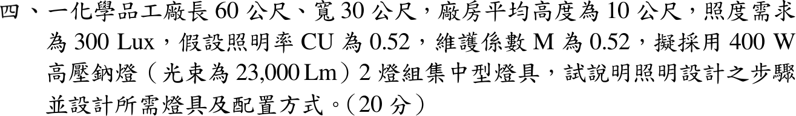
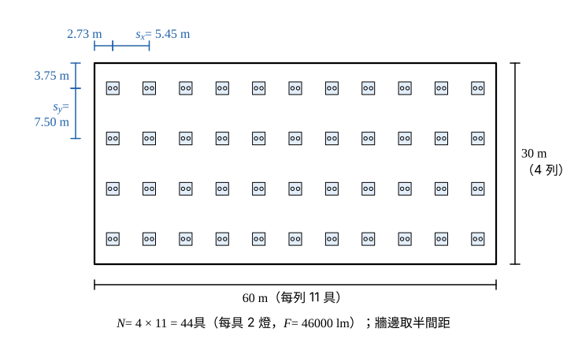

# 109 年工業配電第 4 題｜化學品工廠照明設計

## 已知與所求

廠房 \(60\times30\,\mathrm m\)、平均高 10 m，照度 300 lx，\(CU=0.52\)、\(M=0.52\)；400 W 高壓鈉燈每盞 23000 lm，2 燈組集中型燈具。說明設計步驟並設計燈具數與配置。

## 考場標準作答

**解題邏輯**：題目要「設計步驟」與「燈具數＋配置」。主線用流明法：工作面所需總光通量 \(EA\) 由燈具光通量經照明率 \(CU\) 與維護係數 \(M\) 折減後供應，故 \(N=EA/(F\cdot CU\cdot M)\)；取整後依廠房長寬比排成整數列×行，檢核間距與安裝高度比，最後以實際燈具數回算平均照度不低於 300 lx。前提：\(CU\)、\(M\) 題目已給，不再查表；安裝高度以廠房平均高度 10 m 估算；每具燈具含 2 盞 400 W 高壓鈉燈。

### 設計步驟

**邏輯**：照明設計依「需求 → 光源與燈具 → 數量 → 配置 → 檢核」的順序，每一步的輸出是下一步的輸入。

1. 確認照度需求（300 lx）與工作面，計算面積 \(A\)。
2. 選光源與燈具：400 W 高壓鈉燈 2 燈組集中型；化學品工廠有腐蝕性或可燃性氣體，選防爆、耐腐蝕型燈具。
3. 決定 \(CU\)（由室指數查表，本題給定 0.52）與維護係數 \(M\)（本題 0.52）。
4. 流明法求燈具數 \(N=EA/(F\cdot CU\cdot M)\)，無條件進位。
5. 依長寬比配置成整數列×行，檢核間距／安裝高度比與牆邊距。
6. 以實際燈具數回算平均照度。

### 步驟 1：面積與每具光通量

廠房面積：
\[
A=60\times30=1800\ \mathrm{m^2}
\]
每具 2 盞，每盞 23000 lm：
\[
F=2\times23000=46000\ \mathrm{lm/具}
\]

### 燈具數

**邏輯**：流明法 \(N=EA/(F\cdot CU\cdot M)\)；所得非整數時必須無條件進位，才能保證平均照度不低於需求。

所需工作面光通量：
\[
EA=300\times1800=540\,000\ \mathrm{lm}
\]
每具燈具有效供應到工作面的光通量：
\[
CU\cdot M=0.52\times0.52=0.2704
\]
\[
F\cdot CU\cdot M=46000\times0.2704=12438.4\ \mathrm{lm/具}
\]
燈具數：
\[
N=\frac{EA}{F\cdot CU\cdot M}=\frac{540\,000}{12438.4}=43.41
\]
無條件進位：
\[
\boxed{N=44\text{ 具（88 盞）}}
\]

### 配置方式

**邏輯**：列數與行數須為整數且乘積 \(\ge44\)，比例接近廠房長寬比 \(60:30=2:1\)，間距才接近；靠牆取半間距，使牆邊照度不致過低。

寬向列數（令 \(n_x/n_y\approx2\)、\(n_xn_y=44\)）：
\[
n_y\approx\sqrt{\frac{44}{2}}=\sqrt{22}=4.690\ \Rightarrow\ n_y=4
\]
長向行數：
\[
n_x=\frac{44}{4}=11
\]
長向間距（60 m 分 11 行）：
\[
s_x=\frac{60}{11}=5.45\ \mathrm m,\qquad \text{牆邊距 }\frac{s_x}{2}=2.73\ \mathrm m
\]
寬向間距（30 m 分 4 列）：
\[
s_y=\frac{30}{4}=7.5\ \mathrm m,\qquad \text{牆邊距 }\frac{s_y}{2}=3.75\ \mathrm m
\]
間距／安裝高度比（取較大間距）：
\[
\frac{s_y}{H}=\frac{7.5}{10}=0.75\le1.0
\]
集中型燈具間距不超過安裝高度，照度均勻度可接受。

\[
\boxed{4\text{ 列}\times11\text{ 行}=44\text{ 具；}s_x=5.45\,\mathrm m\text{、}s_y=7.50\,\mathrm m}
\]

### 平均照度回算

**邏輯**：取整後以同一流明法公式反算，確認實際平均照度不低於 300 lx。

\[
E_{avg}=\frac{N\,F\cdot CU\cdot M}{A}=\frac{44\times12438.4}{1800}=\frac{547\,289.6}{1800}
\]
\[
\boxed{E_{avg}=304.05\,\mathrm{lx}}\ \ge300\,\mathrm{lx}
\]

## 驗算

每具負責面積：
\[
\frac{A}{N}=\frac{1800}{44}=40.909\ \mathrm{m^2}\quad(=s_xs_y=5.4545\times7.5)
\]
\[
E=\frac{F\cdot CU\cdot M}{A/N}=\frac{12438.4}{40.909}=304.05\,\mathrm{lx}
\]
與總體回算一致。

## 失分點

- 燈具數 43.41 四捨五入成 43 具，照度只有 297 lx 不足。
- 每具光束用 23000 lm；2 燈組應為 46000 lm。
- 只算數量不給配置與間距檢核，或未提化學品工廠需防爆／耐腐蝕燈具。
