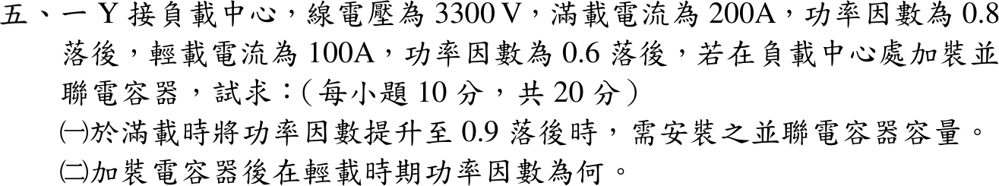
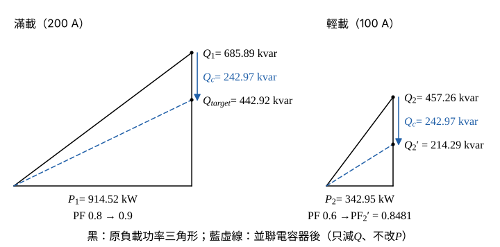

# 109 年工業配電第 5 題｜負載中心功率因數改善

## 已知與所求

Y 接負載中心 \(V_{LL}=3300\,\mathrm V\)；滿載 200 A、PF 0.8 落後；輕載 100 A、PF 0.6 落後；於負載中心並聯電容器。求（一）滿載改善至 PF 0.9 落後所需容量；（二）加裝後輕載功因。

## 考場標準作答

### （一）滿載改善至 PF 0.9 的電容器容量（10 分）

滿載視在功率：
\[
S_1=\sqrt3\,V_{LL}I_1=\sqrt3(3300)(200)=1143.15\ \mathrm{kVA}
\]
有功與無功（\(\cos\phi_1=0.8\)，\(\sin\phi_1=0.6\)）：
\[
P_1=S_1\cos\phi_1=1143.15(0.8)=914.52\ \mathrm{kW}
\]
\[
Q_1=S_1\sin\phi_1=1143.15(0.6)=685.89\ \mathrm{kvar}
\]
目標功因的正切（保留 6 位，否則 \(Q_c\) 末位會差 0.01）：
\[
\tan\phi_t=\frac{\sqrt{1-0.9^2}}{0.9}=\frac{\sqrt{0.19}}{0.9}=\frac{0.435890}{0.9}=0.484322
\]
並聯電容器不改變有功 \(P_1\)，改善後允許的無功：
\[
Q_{\mathrm{target}}=P_1\tan\phi_t=914.52(0.484322)=442.92\ \mathrm{kvar}
\]
電容器容量：
\[
Q_c=Q_1-Q_{\mathrm{target}}=685.89-442.92
\]
\[
\boxed{Q_c=242.97\,\mathrm{kvar}}
\]

### （二）加裝電容器後的輕載功因（10 分）

電容器固定接在負載中心，輕載時電壓仍為 3300 V，輸出同樣的 \(Q_c\)。
輕載視在功率：
\[
S_2=\sqrt3\,V_{LL}I_2=\sqrt3(3300)(100)=571.58\ \mathrm{kVA}
\]
有功與無功（\(\cos\phi_2=0.6\)，\(\sin\phi_2=0.8\)）：
\[
P_2=S_2\cos\phi_2=571.58(0.6)=342.95\ \mathrm{kW}
\]
\[
Q_2=S_2\sin\phi_2=571.58(0.8)=457.26\ \mathrm{kvar}
\]
補償後無功：
\[
Q_2'=Q_2-Q_c=457.26-242.97=214.29\ \mathrm{kvar}
\]
補償後視在功率：
\[
S_2'=\sqrt{P_2^2+Q_2'^2}=\sqrt{342.95^2+214.29^2}
\]
\[
S_2'=\sqrt{117\,614.70+45\,920.20}=\sqrt{163\,534.90}=404.39\ \mathrm{kVA}
\]
功因：
\[
\mathrm{PF}_2'=\frac{P_2}{S_2'}=\frac{342.95}{404.39}=0.8481
\]
\(Q_2'>0\)，仍為落後：
\[
\boxed{\mathrm{PF}_2'=0.85\ \text{落後}}
\]

## 驗算

改用電流驗（一）：電容線電流 \(I_c=242.97\ \mathrm{kvar}/(\sqrt3\times3.3\ \mathrm{kV})=42.51\,\mathrm A\)；滿載電流有功分量 \(200(0.8)=160\,\mathrm A\)、無功分量 \(200(0.6)-42.51=77.49\,\mathrm A\)，補償後 \(I=\sqrt{160^2+77.49^2}=177.78\,\mathrm A=200(0.8/0.9)\)，即 PF 0.9。

## 失分點

- 輕載時誤以為電容也按比例減半；固定電容器仍提供 242.97 kvar。
- 補償後 \(Q_2'>0\)，PF 仍為落後，不可寫成超前。
- 用相電壓 \(3300/\sqrt3\) 乘線電流卻漏乘 3；Y 接三相功率用 \(\sqrt3V_{LL}I\)。
