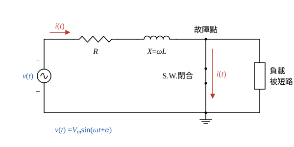

# 110 年工業配電第 1 題｜功率因數改善與短路暫態

## 已知與所求

（一）說明改善功率因數的效益及台電功率因數電價獎罰規定。（二）圖一 R-L 電路，電源 \(v(t)=V_m\sin(\omega t+\alpha)\)，\(R\)、\(X\) 為電源至故障點的等效電阻與電抗，以開關閉合模擬短路，求故障電流的穩態交流成分與暫態直流成分。

## 考場標準作答

### （一）效益與電價規定（10 分）

同一有功功率下：
\[
I=\frac{P}{\sqrt3\,V\,\mathrm{pf}}
\]
提高功因使電流下降：

1. 線路與變壓器銅損 \(3I^2R\) 降低。
2. 電壓降 \(\Delta V\approx\sqrt3I(R\cos\phi+X\sin\phi)\) 降低，末端電壓改善。
3. 同一變壓器、饋線、開關釋出可用 kVA 容量，可延後擴充。
4. 減少功因附加費並取得電費減收。

台電規定（契約容量適用用戶）：以月平均功因 80% 為基準，

\[
\boxed{\text{每低於 80\% 一個百分點，電費加 0.1\%；每高於 80\% 一個百分點，電費減 0.1\%，超過 95\% 部分不再減}}
\]

### 步驟 1：閉合後的等效電路與方程式

- 開關 S.W. 跨接在負載兩端，閉合後負載被短路（兩端電壓為 0），負載支路不再分流，故障電流全部經 \(R\)、\(X\) 流回電源。
- 參考方向：\(i(t)\) 由電源正端經 \(R\)、\(X\) 流向故障點（與題圖一致）。
- \(X=\omega L\)，即 \(L=X/\omega\)。

KVL（\(t\ge0\)）：
\[
L\frac{di}{dt}+Ri=V_m\sin(\omega t+\alpha)
\]
初始條件：電感電流不能突變，故障前故障支路電流取 0：
\[
i(0^+)=i(0^-)=0
\]
全解拆成兩部分：
\[
i(t)=i_{ac}(t)+i_{dc}(t)
\]

### （二）穩態交流成分與暫態直流成分（10 分）

**穩態交流成分**（特解）。故障阻抗寫成極式，大小與角度各一行：
\[
\mathbf Z=R+jX
\]
\[
|\mathbf Z|=\sqrt{R^2+X^2}
\]
\[
\theta=\tan^{-1}\frac{X}{R}
\]
電源相量（以峰值表示）\(\mathbf V=V_m\angle\alpha\)，電流相量：
\[
\mathbf I=\frac{\mathbf V}{\mathbf Z}=\frac{V_m\angle\alpha}{\sqrt{R^2+X^2}\angle\theta}=\frac{V_m}{\sqrt{R^2+X^2}}\angle(\alpha-\theta)
\]
換回時域：
\[
\boxed{i_{ac}(t)=\frac{V_m}{\sqrt{R^2+X^2}}\sin(\omega t+\alpha-\theta)}
\]

**暫態直流成分**（齊次解）。齊次方程：
\[
L\frac{di_{dc}}{dt}+Ri_{dc}=0
\]
\[
i_{dc}(t)=Ke^{-t/\tau},\qquad \tau=\frac{L}{R}=\frac{X}{\omega R}
\]
代入 \(i(0^+)=0\)：
\[
i(0)=\frac{V_m}{\sqrt{R^2+X^2}}\sin(\alpha-\theta)+K=0
\]
\[
K=-\frac{V_m}{\sqrt{R^2+X^2}}\sin(\alpha-\theta)
\]
\[
\boxed{i_{dc}(t)=-\frac{V_m}{\sqrt{R^2+X^2}}\sin(\alpha-\theta)\,e^{-Rt/L}}
\]
直流成分大小由閉合瞬間的角度決定：\(\alpha=\theta\) 時 \(K=0\)，無直流偏移；\(\alpha-\theta=\pm90^\circ\) 時 \(|K|=V_m/\sqrt{R^2+X^2}\)，偏移最大。

## 驗算

令 \(I_m=V_m/|\mathbf Z|\)，代回原式：\(L\,di_{ac}/dt+Ri_{ac}=|\mathbf Z|I_m\sin(\omega t+\alpha-\theta+\theta)=V_m\sin(\omega t+\alpha)\)；\(L\,di_{dc}/dt+Ri_{dc}=0\)；\(i_{ac}(0)+i_{dc}(0)=I_m\sin(\alpha-\theta)-I_m\sin(\alpha-\theta)=0\)。電價條文：PF 70% 加 1.0%，PF 99% 只減到 95% 的 1.5%。

## 失分點

- 直流項漏負號或寫成 \(\sin\alpha\)；起始值需同時扣除相角 \(\theta\)。
- 時間常數寫成 \(R/L\)。
- 罰則寫成每 1% 加 0.3%；台電條文為 0.1%，且減收算到 95% 為止。

## 條件與疑義

題圖開關跨接負載，閉合前若負載電流 \(i_0\) 不可忽略，直流項改為 \([i_0-I_m\sin(\alpha-\theta)]e^{-Rt/L}\)；本解依短路分析慣例取故障前電流 0。

電價規定出處：台電「電價表」（114 年 11 月 17 日經濟部經授能字第 11400334600 號函同意備查）各類用電的「功率因數」條。低壓電力為三相供應、裝置契約容量 20 瓩以上或需量契約容量 30 瓩以上的用戶；高壓、特高壓用戶全部適用。調整對象是「該月份電費」，但按戶計收的基本電費不列計功率因數調整費；超約部分的基本電費也不給功率因數扣減。以上依現行版本查核，110 年考試當時的版本未另行核對。
