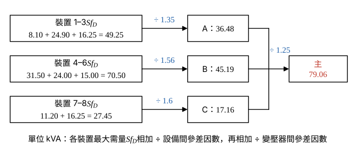

# 110 年工業配電第 2 題｜變壓器容量與日用電量

## 已知與所求

主變壓器供 A（裝置 1～3，設備間 \(f_{div}=1.35\)）、B（4～6，1.56）、C（7～8，1.6），變壓器間 \(f_{div}=1.25\)；各裝置容量、\(f_D\)、\(f_L\) 如表，效率 100%。求（一）主變壓器與 A、B、C 容量（kVA）；（二）PF 0.9 落後時日用電量。

## 考場標準作答

**解題邏輯**：容量沿「裝置 → 變壓器 A／B／C → 主變壓器」往上合成：裝置最大需量 \(D_i=S_if_{D,i}\)；同一變壓器下各裝置尖峰不同時，群組需量 = \(\sum D_i\) ÷ 設備間 \(f_{div}\)，主變壓器 = 三群組需量和 ÷ 變壓器間 \(f_{div}\)。日用電量改走平均值：平均視在負載 \(S_if_{D,i}f_{L,i}\) 直接相加（不除參差因數），效率 100%，乘 PF 0.9 得 kW，再乘 24 h。

### 步驟 1：各裝置最大需量 \(D_i=S_if_{D,i}\)

需量因數 \(f_D=\)最大需量 ÷ 裝置容量，故：

| 裝置 | 1 | 2 | 3 | 4 | 5 | 6 | 7 | 8 |
|---|---:|---:|---:|---:|---:|---:|---:|---:|
| \(S_i\times f_{D,i}\) | \(9\times0.9\) | \(30\times0.83\) | \(25\times0.65\) | \(50\times0.63\) | \(30\times0.8\) | \(20\times0.75\) | \(16\times0.7\) | \(25\times0.65\) |
| \(D_i\)（kVA） | 8.10 | 24.90 | 16.25 | 31.50 | 24.00 | 15.00 | 11.20 | 16.25 |

### （一）主變壓器與 A、B、C 容量（15 分）

**邏輯**：參差因數 = 個別最大需量和 ÷ 合成最大需量 \(\ge1\)，變壓器只需承擔合成需量，所以群組需量用「和 ÷ \(f_{div}\)」；主變壓器以三群組需量相加後再除變壓器間 \(f_{div}=1.25\)。

A 群（裝置 1～3，\(f_{div}=1.35\)）：
\[
\sum D_i=8.10+24.90+16.25=49.25\ \mathrm{kVA}
\]
\[
S_A=\frac{49.25}{1.35}=\boxed{36.48\,\mathrm{kVA}}
\]
B 群（裝置 4～6，\(f_{div}=1.56\)）：
\[
\sum D_i=31.50+24.00+15.00=70.50\ \mathrm{kVA}
\]
\[
S_B=\frac{70.50}{1.56}=\boxed{45.19\,\mathrm{kVA}}
\]
C 群（裝置 7～8，\(f_{div}=1.6\)）：
\[
\sum D_i=11.20+16.25=27.45\ \mathrm{kVA}
\]
\[
S_C=\frac{27.45}{1.6}=\boxed{17.16\,\mathrm{kVA}}
\]
主變壓器（三群組需量相加後再除以變壓器間參差因數）：
\[
S_A+S_B+S_C=36.48+45.19+17.16=98.83\ \mathrm{kVA}
\]
\[
S_{main}=\frac{98.83}{1.25}=\boxed{79.06\,\mathrm{kVA}}
\]
選用標準容量：A、B 各 50 kVA，C 20 kVA，主變壓器 100 kVA。

### （二）日用電量（5 分）

**邏輯**：負載因數 \(f_L=\)平均負載 ÷ 最大需量，故各裝置平均視在負載 \(=D_if_{L,i}\)；平均負載是時間平均，各裝置直接相加（不除參差因數）；效率 100%，乘 PF 0.9 得平均有功功率，再乘 24 h。下列乘積與和都是有限小數的精確值。

各裝置平均負載 \(D_if_{L,i}\)（kVA）：
\[
\begin{aligned}
&\text{裝置 1：}8.10\times0.7=5.67,\quad \text{裝置 2：}24.90\times0.65=16.185,\quad \text{裝置 3：}16.25\times0.65=10.5625\\
&\text{裝置 4：}31.50\times0.7=22.05,\quad \text{裝置 5：}24.00\times0.78=18.72,\quad \text{裝置 6：}15.00\times0.75=11.25\\
&\text{裝置 7：}11.20\times0.5=5.60,\quad \text{裝置 8：}16.25\times0.6=9.75
\end{aligned}
\]
\[
\sum D_if_{L,i}=5.67+16.185+10.5625+22.05+18.72+11.25+5.60+9.75=99.7875\ \mathrm{kVA}
\]
平均有功功率：
\[
P_{avg}=\mathrm{PF}\times\sum D_if_{L,i}=0.9\times99.7875=89.80875\ \mathrm{kW}
\]
\[
E=24P_{avg}=24\times89.80875=2155.41\ \mathrm{kWh}
\]
\[
\boxed{E=2155.41\ \mathrm{kWh}}
\]

## 驗算

分群加總：A \(5.67+16.185+10.5625=32.4175\)、B \(22.05+18.72+11.25=52.02\)、C \(5.60+9.75=15.35\)（kVA）；\(24\times0.9=21.6\)，\(21.6\times32.4175=700.218\)、\(21.6\times52.02=1123.632\)、\(21.6\times15.35=331.56\)，合計 \(2155.41\,\mathrm{kWh}\)。

## 失分點

- 參差因數用乘的；\(f_{div}\ge1\)，群組需量應除以它。
- 主變壓器用標準額定（50+50+20）再除 1.25；應以計算需量相加。
- 日用電量漏乘負載因數或功因。

## 條件與疑義

標準容量級距假設為三相 10、15、20、30、50、75、100 kVA；若級距含 37.5 kVA，A 可選 37.5 kVA。
