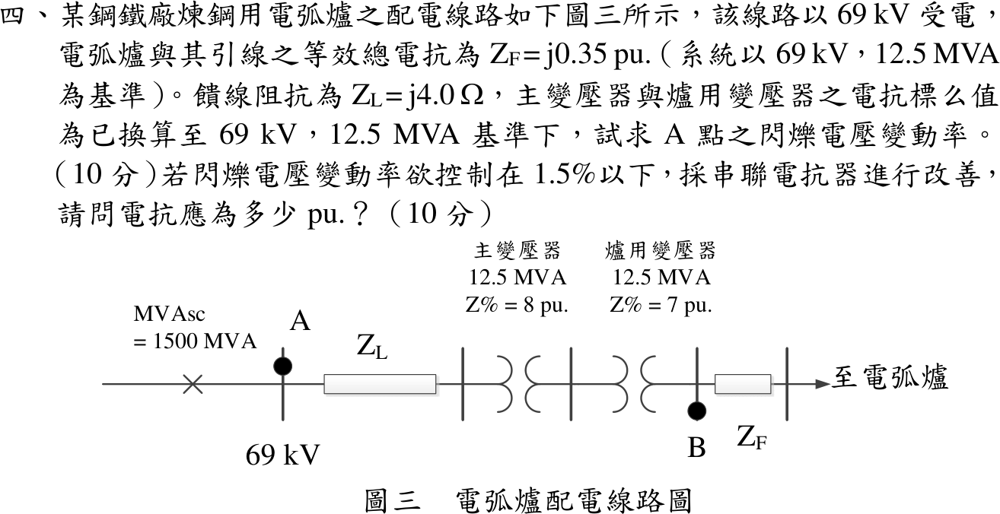
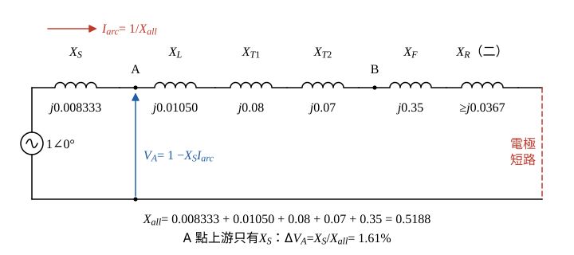

# 110 年工業配電第 4 題｜電弧爐電壓閃爍

## 已知與所求

69 kV 受電，\(\mathrm{MVA_{sc}}=1500\,\mathrm{MVA}\)；基準 \(69\,\mathrm{kV}\)、\(12.5\,\mathrm{MVA}\)。饋線 \(Z_L=j4.0\,\Omega\)，主變壓器 \(8\%\)、爐用變壓器 \(7\%\)（已在同一基準），電弧爐與引線 \(Z_F=j0.35\,\mathrm{pu}\)。官方圖說 A 點在 69 kV 母線上（饋線 \(Z_L\) 之前）。求（一）A 點閃爍電壓變動率；（二）控制在 1.5% 以下所需串聯電抗器 pu 值。

## 考場標準作答

### 步驟 1：各段電抗換成 \(12.5\,\mathrm{MVA}\) 基準

取電極短路（最嚴重的閃爍狀態）計算，故障前電壓 \(1\,\mathrm{pu}\)，基準 \(69\,\mathrm{kV}\)、\(12.5\,\mathrm{MVA}\)。電源電抗（由短路容量）：
\[
X_S=\frac{S_b}{\mathrm{MVA_{sc}}}=\frac{12.5}{1500}=0.008333\ \mathrm{pu}
\]
饋線（歐姆值除以基準阻抗）：
\[
Z_b=\frac{V_b^2}{S_b}=\frac{69^2}{12.5}=\frac{4761}{12.5}=380.88\ \Omega
\]
\[
X_L=\frac{4.0}{Z_b}=\frac{4.0}{380.88}=0.01050\ \mathrm{pu}
\]
主變壓器 \(X_{T1}=0.08\)、爐用變壓器 \(X_{T2}=0.07\)、爐與引線 \(X_F=0.35\)（題目已在同一基準）。

### 步驟 2：電抗分壓電路

- 理想電源 \(1\angle0^\circ\) 依序串 \(X_S\) → A 點（69 kV 母線）→ \(X_L\) → \(X_{T1}\) → \(X_{T2}\) → B 點 → \(X_F\)；電極短路即爐端接到參考線。
- A 點電壓 \(V_A\) 量在 A 點與參考線之間；A 點上游只有 \(X_S\)，其餘都在 A 點下游。

電源至爐總電抗：
\[
X_{all}=X_S+X_L+X_{T1}+X_{T2}+X_F=0.008333+0.01050+0.08+0.07+0.35=0.5188\ \mathrm{pu}
\]

### （一）A 點閃爍電壓變動率（10 分）

A 點在饋線 \(Z_L\) 之前，壓降只發生在 \(X_S\)，變動率為純電抗串聯的分壓比：
\[
I_{arc}=\frac{1}{X_{all}},\qquad \Delta V_A=X_S\,I_{arc}=\frac{X_S}{X_{all}}
\]
\[
\Delta V_A=\frac{0.008333}{0.5188}=0.01606
\]
\[
\boxed{1.61\%}
\]

### （二）串聯電抗器（10 分）

\(X_R\) 裝在 A 點下游的電弧爐回路，只加大分母，令 \(X_S/(X_{all}+X_R)\le1.5\%\)：
\[
\frac{X_S}{X_{all}+X_R}\le0.015
\]
\[
X_{all}+X_R\ge\frac{X_S}{0.015}=\frac{0.008333}{0.015}=0.5555\ \mathrm{pu}
\]
\[
X_R\ge0.5555-0.5188=0.0367\ \mathrm{pu}
\]
\[
\boxed{X_R\ge0.0367\,\mathrm{pu}}
\]

## 驗算

取 \(X_R=0.0367\) 以相量 KVL 回算：總電抗 \(0.5188+0.0367=0.5555\)，
\[
\dot I=\frac{1}{j0.5555}=-j1.800\ \mathrm{pu}:\quad |\dot I|=1.800,\ \angle\dot I=-90^\circ
\]
\[
\dot V_A=1-jX_S\dot I=1-(j0.008333)(-j1.800)=1-0.01500=0.9850\ \mathrm{pu}:\quad |\dot V_A|=0.9850,\ \angle\dot V_A=0^\circ
\]
變動率 \(1-0.9850=1.50\%\)，恰在限值。

## 失分點

- 把 \(Z_L\) 與主變壓器算進 A 點上游；A 點在饋線之前。
- \(j4\,\Omega\) 未除以 \(Z_b=380.88\,\Omega\) 直接與 pu 相加。
- 電抗器加在分子；串聯電抗是增大分母、降低爐電流。

## 條件與疑義

題目未指定串聯電抗器位置；本解裝在 A 點下游。若裝在 A 點上游，A 點變動率為 \((X_S+X_R)/(X_{all}+X_R)\)，反而變大。

### 另一觀測點分支：圖示 B 點

若觀測點改為爐用變壓器低壓側 B 點：\(X_{up,B}=X_S+X_L+X_{T1}+X_{T2}=0.168835329\,\mathrm{pu}\)，\(\Delta V_B=0.168835/0.518835=32.5412\%\)，降到 1.5% 需 \(X_R\ge10.736853\,\mathrm{pu}\)。另以 \(X_S+X_L+X_{T1}=0.098835\) 為上游所得的 19.05%／6.07 pu 對應兩變壓器之間的假想觀測點，既非 A 點，也非圖示 B 點。
