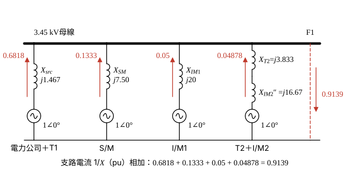

# 110 年工業配電第 5 題｜F1 短路與馬達貢獻

## 已知與所求

圖四：\(\mathrm{MVA_{sc}}=1500\,\mathrm{MVA}\)；T1 \(69/3.45\,\mathrm{kV}\)、\(5000\,\mathrm{kVA}\)、\(Z=7\%\)；3.45 kV 母線接 S/M \(2000\,\mathrm{HP}\)（\(X_d''=15\%\)）、I/M1 \(1000\,\mathrm{HP}\)（\(X_d''=20\%\)），並經 T2 \(3.45\,\mathrm{kV}/480\,\mathrm V\)、\(1500\,\mathrm{kVA}\)、\(Z=5.75\%\) 接 I/M2 \(1500\,\mathrm{HP}\)（\(X_d''=25\%\)）；F1 在母線饋線上。非對稱 \(K=1.6\)，求 F1 點 3.45 kV 斷路器瞬時電流容量。

## 考場標準作答

**解題邏輯**：標么法求 F1 對稱短路電流：F1 在 3.45 kV 母線饋線上，故障時母線電壓為 0，電力公司（經 T1）、S/M、I/M1、I/M2（經 T2）四個來源以「內電勢 \(E''=1\angle0^\circ\,\mathrm{pu}\) 串次暫態電抗」並聯供給 F1，各支路電流 \(1/X\) 相加即得總標么電流。依序：取基準 \(100\,\mathrm{MVA}\)、\(3.45\,\mathrm{kV}\) → 各來源電抗換基準（步驟 1）→ 並聯導納相加（步驟 2）→ 乘基準電流得 \(I_{sym}\)，再乘非對稱倍率 \(K\)。採 1 HP≈1 kVA（見條件與疑義）。

### 步驟 1：各來源電抗換成 \(100\,\mathrm{MVA}\) 基準

換基準：\(X_{new}=X_{old}\dfrac{S_b}{S_{rated}}\)（額定電壓即基準電壓）；電網以短路容量換算 \(X=S_b/\mathrm{MVA_{sc}}\)。

電力公司＋T1（串聯）：
\[
X_{src}=\frac{100}{1500}+0.07\times\frac{100}{5}=\frac{1}{15}+1.4=\frac{22}{15}=1.467\,\mathrm{pu}
\]
S/M（\(2000\,\mathrm{HP}\approx2\,\mathrm{MVA}\)）：
\[
X_{SM}=0.15\times\frac{100}{2}=7.50\,\mathrm{pu}
\]
I/M1（\(1000\,\mathrm{HP}\approx1\,\mathrm{MVA}\)）：
\[
X_{IM1}=0.20\times\frac{100}{1}=20\,\mathrm{pu}
\]
T2＋I/M2（\(1500\,\mathrm{HP}\approx1.5\,\mathrm{MVA}\)，480 V 側馬達經 T2 串聯回饋）：
\[
X_{T2}=0.0575\times\frac{100}{1.5}=3.833\,\mathrm{pu},\qquad X_{IM2}''=0.25\times\frac{100}{1.5}=16.67\,\mathrm{pu}
\]
\[
X_{T2}+X_{IM2}''=3.833+16.67=20.50\,\mathrm{pu}
\]

### 步驟 2：F1 故障的並聯電抗圖

- 瞬時（第一週波）容量用次暫態 \(X_d''\)，故 S/M 的 \(X_d'=25\%\) 不用；480 V 母線另一饋線無電源，不貢獻故障電流。
- 各來源一端為內電勢 \(E''=1\angle0^\circ\)（接參考線），另一端經各自電抗接到 3.45 kV 母線；F1 經饋線斷路器接母線，故障即母線對參考線短路。
- I/M2 先串 \(X_{T2}\) 再並入，不可與 T2 並聯。
- 每條支路電流 \(=E''/X=1/X\)（母線電壓為 0），F1 電流 \(I_{F1}\) 為四支路之和。

| 來源 | 電抗 \(X\)（pu） | 支路電流 \(I=1/X\)（pu） |
|---|---:|---:|
| 電力公司＋T1 | \(X_{src}=22/15=1.467\) | \(I_{src}=15/22=0.6818\) |
| S/M | \(X_{SM}=7.50\) | \(I_{SM}=1/7.50=0.1333\) |
| I/M1 | \(X_{IM1}=20\) | \(I_{IM1}=1/20=0.05\) |
| T2＋I/M2 | \(X_{T2}+X_{IM2}''=20.50\) | \(I_{IM2}=1/20.50=0.04878\) |

\[
I_{F1}=I_{src}+I_{SM}+I_{IM1}+I_{IM2}=0.6818+0.1333+0.05+0.04878=0.9139\,\mathrm{pu}
\]

### F1 點 3.45 kV 斷路器瞬時電流容量（20 分）

**邏輯**：對稱電流 = 總標么電流 \(I_{F1}\) × 基準電流 \(S_b/(\sqrt3V_b)\)；瞬時（非對稱）電流容量 = \(K\times\) 對稱電流，\(K\) 只乘一次。

基準電流分母：
\[
\sqrt3V_b=\sqrt3\times3.45=5.976\,\mathrm{kV}
\]
對稱短路電流：
\[
I_{sym}=I_{F1}\cdot\frac{S_b}{\sqrt3V_b}=\frac{0.9139\times100}{5.976}=\frac{91.39}{5.976}
\]
\[
I_{sym}=\boxed{15.29\,\mathrm{kA}}
\]
瞬時電流容量：
\[
I_{mom}=K\,I_{sym}=\frac{1.6\times91.39}{5.976}=\frac{146.224}{5.976}
\]
\[
I_{mom}=\boxed{24.47\,\mathrm{kA}}
\]
參考書四捨五入寫成 15.30 kA／24.48 kA。

## 驗算

改用 \(5\,\mathrm{MVA}\) 基準：各支路電抗 \(5/1500+0.07=0.07333\)、\(0.15\times2.5=0.375\)、\(0.20\times5=1.000\)、\((0.0575+0.25)\times5/1.5=1.025\)（pu），導納和 \(13.64+2.667+1.000+0.9756=18.28\,\mathrm{pu}\)；\(I_{sym}=18.28\times5/5.976=91.40/5.976=15.29\,\mathrm{kA}\)，與 100 MVA 基準一致（導納和恰為 \(0.9139\times20\)）。

## 失分點

- 漏掉 480 V 側 I/M2：其經 T2 的反饋仍流到 F1。
- T2 與 I/M2 電抗並聯；兩者應串聯後再與其他來源並聯。
- \(K\) 只乘一次，不得再乘 \(\sqrt2\) 或重複套用。

## 條件與疑義

題目未給 \(K\) 的定義：若 \(K\) 是 RMS 非對稱倍率，24.47 kA 為非對稱 RMS 值；若 \(K\) 是峰值倍率，同一數值為峰值。須先確認是 RMS 非對稱倍率或峰值倍率，不得把同一個 \(K\) 再乘一次。

效率／功因參數化：題目只給 HP，未給效率與功因。若 \(S_i=0.000746\,\mathrm{HP}_i/k_i\)（MVA，\(k=\eta\,\mathrm{pf}\)），三台取相同 \(k\)：

| \(k\) | \(I_{sym}\)（kA） | \(1.6I_{sym}\)（kA） |
|---:|---:|---:|
| 0.80 | 15.0420 | 24.0672 |
| 0.85 | 14.8360 | 23.7376 |
| 0.90 | 14.6522 | 23.4435 |
| 1.00 | 14.3382 | 22.9411 |

1 HP≈1 kVA 相當於 \(k=0.746\)，故主解略大於上表各列。
