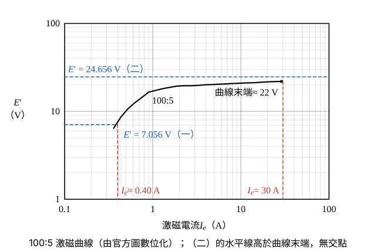

# 111 年工業配電第 1 題｜CT 激磁特性與負擔誤差

## 已知與所求

CT 變比 \(100/5\)（\(n=20\)），漏阻抗 \(Z'=0.082\,\Omega\)，過流電驛於 \(I'=8\,\mathrm A\) 動作；誤差 \(=I_e/(I'+I_e)\times100\%\)。用圖中 100:5 激磁曲線，求（一）\(Z_B=0.8\,\Omega\)、（二）\(Z_B=3\,\Omega\) 時的 CT 誤差，並判斷能否偵測 \(200\,\mathrm A\) 一次側故障電流。

## 考場標準作答

**解題邏輯**：CT 二次側等效為一次電流折算值 \(I/n\) 分成激磁支路 \(I_e\) 與負擔支路 \(I'\)；過流電驛恰動作時 \(I'=8\,\mathrm A\)，負擔支路（\(Z'\) 串 \(Z_B\)）兩端電壓即激磁電壓 \(E'=I'(Z'+Z_B)\)。依序：兩種負擔各求 \(E'\)（步驟 1）→ 在 100:5 激磁曲線讀 \(I_e\)（步驟 2）→ 誤差 \(I_e/(I'+I_e)\) 與一次側最小動作電流 \(I_p=n(I'+I_e)\)，\(I_p\le200\,\mathrm A\) 才偵測得到 200 A 故障。前提：\(Z'\) 與 \(Z_B\) 題目只給大小，視為同相直接相加；曲線讀值以參考書數值（0.4 A、30 A）為主解，判讀區間見條件與疑義。

### 步驟 1：兩種負擔的激磁電壓 \(E'\)

\(E'\) 為激磁支路兩端電壓，等於負擔支路電流乘其總阻抗：
\[
E'=I'(Z'+Z_B)
\]
\(Z_B=0.8\,\Omega\)：
\[
E'=8(0.082+0.8)=8(0.882)=7.056\,\mathrm V
\]
\(Z_B=3\,\Omega\)：
\[
E'=8(0.082+3)=8(3.082)=24.656\,\mathrm V
\]

### 步驟 2：在 100:5 曲線讀 \(I_e\)

- 100:5 是圖中由右數第二條曲線，飽和段約 20～22 V，曲線畫到 \(I_e=30\,\mathrm A\) 為止（末端 \(E'\approx22\,\mathrm V\)）。
- \(E'=7.056\,\mathrm V\)：水平線與曲線交於 \(I_e\approx0.40\,\mathrm A\)（數位化讀值 0.37～0.40 A）。
- \(E'=24.656\,\mathrm V\)：高於曲線末端的 22 V，水平線與曲線無交點；要撐到這個電壓，\(I_e\) 必須超過圖上最大值，故只能寫 \(I_e\ge30\,\mathrm A\)。

### （一）\(Z_B=0.8\,\Omega\)（10 分）

**邏輯**：以步驟 2 的 \(I_e\approx0.40\,\mathrm A\) 代入題給誤差定義；電驛恰動作時二次總電流 \(I'+I_e\)，乘匝比 \(n=100/5=20\) 即一次側最小動作電流。

誤差：
\[
\text{誤差}=\frac{I_e}{I'+I_e}\times100\%=\frac{0.40}{8+0.40}\times100\%=\frac{0.40}{8.40}\times100\%
\]
\[
\boxed{\text{誤差}=4.76\%}
\]
一次側最小動作電流：
\[
I_p=n(I'+I_e)=20(8+0.40)=20(8.40)
\]
\[
\boxed{I_p=168\,\mathrm A}
\]
\(168\,\mathrm A<200\,\mathrm A\)，200 A 故障時二次負擔電流大於 8 A：
\[
\boxed{\text{可偵測 200 A 故障}}
\]

### （二）\(Z_B=3\,\Omega\)（10 分）

**邏輯**：\(E'=24.656\,\mathrm V\) 已超過曲線飽和末端，\(I_e\) 只能取下限 30 A；誤差與 \(I_p\) 都隨 \(I_e\) 增大，所以用下限算出的是「至少」值，判斷結論不受影響。

誤差（下限）：
\[
\text{誤差}\ge\frac{30}{8+30}\times100\%=\frac{30}{38}\times100\%
\]
\[
\boxed{\text{誤差}\ge78.95\%}
\]
一次側最小動作電流（下限）：
\[
I_p\ge n(I'+I_e)=20(8+30)=20(38)
\]
\[
\boxed{I_p\ge760\,\mathrm A}
\]
\(760\,\mathrm A>200\,\mathrm A\)，200 A 故障時 CT 已深度飽和，送到電驛的電流不足 8 A：
\[
\boxed{\text{不能偵測 200 A 故障}}
\]

## 驗算

改用「一次側 200 A 已知」的路線：二次總電流 \(I'+I_e=200/20=10\,\mathrm A\)，負載線 \(E'=(Z'+Z_B)(10-I_e)\) 與曲線聯立。

- \(Z_B=0.8\)：交點 \(I_e\approx0.43\,\mathrm A\)，\(I'\approx9.57\,\mathrm A\ge8\)，動作。
- \(Z_B=3\)：交點 \(I_e\approx3.50\,\mathrm A\)（\(E'\approx20\,\mathrm V\)），\(I'\approx6.50\,\mathrm A<8\)，不動作。

動作門檻為 \(I'\ge8\iff I_e\le2.0\,\mathrm{A}\)，兩條路線結論相同。

## 失分點

- 讀成 50:5 曲線（飽和約 10 V）；100:5 是由右數第二條，飽和約 20～22 V。
- 誤差分母用 \(I'\) 而非 \(I'+I_e\)，（一）會寫成 5.0%。
- （二）在圖外硬讀一個 \(I_e\)；應寫「超出曲線，\(I_e\ge30\,\mathrm A\)」並以下限判斷。

## 條件與疑義

曲線讀值（對數座標，每十倍約 297 px，判讀誤差約 ±2.5%）：

| \(E'\)（V） | 6.4 | 7.06 | 8.5 | 12.5 | 16.6 | 19.3 | 19.7 | 20.3 | 21.9 |
|---|---:|---:|---:|---:|---:|---:|---:|---:|---:|
| \(I_e\)（A） | 0.36 | 0.38 | 0.43 | 0.62 | 0.90 | 1.9 | 3.2 | 5.6 | 29 |

（一）讀值區間 \(0.37\sim0.40\,\mathrm A\)，誤差 \(4.4\sim4.8\%\)、\(I_p=167\sim168\,\mathrm A\)，均小於 200 A。200 A 路線的數位化交點讀值為 \(I_e=0.42\sim0.44\,\mathrm A\)（\(I'=9.56\sim9.58\,\mathrm A\)）與 \(I_e=3.4\sim3.7\,\mathrm A\)（\(I'=6.3\sim6.6\,\mathrm A\)）。兩個區間分別遠低於與遠高於門檻 \(I_e\le2.0\,\mathrm{A}\)，故偵測結論不受圖解誤差影響，受影響的只有誤差百分比的末位。
