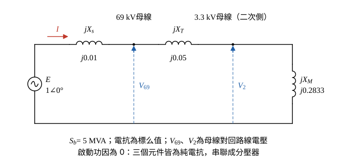

# 111 年工業配電第 2 題｜同步馬達全壓啟動電壓變動率

## 已知與所求

69 kV 受電匯流排短路容量 \(500\,\mathrm{MVA}\)；變壓器 \(69/3.3\,\mathrm{kV}\)、\(5000\,\mathrm{kVA}\)、\(Z=5\%\)；同步馬達 \(3300\,\mathrm V\)、\(3000\,\mathrm{kW}\)，全壓啟動電流 \(5\) 倍額定，啟動功因為 0；基準 \(5000\,\mathrm{kVA}\)。求啟動時（一）變壓器二次側、（二）69 kV 側電壓變動率。

## 考場標準作答

**解題邏輯**：題目給定啟動功因為 0，電源、變壓器與馬達啟動支路都只剩電抗，串成一條純電抗分壓器；某點的電壓變動率就是「該點上游電抗」佔「電源至馬達總電抗」的比例。依序求：各電抗標么值（\(S_b=5\,\mathrm{MVA}\)）→ 馬達啟動電抗 \(X_M\) → 總電抗與啟動電流 → 兩個母線的壓降比例。前提：啟動前系統無載，電源內電動勢與各母線電壓皆為 \(1\angle0^\circ\ \mathrm{pu}\)，電壓變動率 \(=1-|V|\)（pu）；69 kV 受電點以上的電源以「理想電壓源串短路電抗」表示；馬達額定 kVA 依參考書取 \(\eta\,\mathrm{pf}=0.85\)（題幹只給 kW，見條件與疑義）。

### 步驟 1：電源與變壓器電抗

電源電抗由受電匯流排短路容量換算：
\[
X_s=\frac{S_b}{S_{sc}}=\frac{5}{500}=0.01\ \mathrm{pu}
\]
變壓器容量 5000 kVA 與基準相同，阻抗百分比直接是標么值（純電抗）：
\[
X_T=5\%=0.05\ \mathrm{pu}
\]

### 步驟 2：馬達啟動電抗 \(X_M\)

馬達額定容量（\(\eta\,\mathrm{pf}=0.85\)）：
\[
S_M=\frac{P}{\eta\,\mathrm{pf}}=\frac{3000}{0.85}=3529.41\ \mathrm{kVA}
\]
全壓啟動電流為 5 倍額定，額定電壓下的啟動容量：
\[
S_{start}=5S_M=5(3529.41)=17647.05\ \mathrm{kVA}=17.65\ \mathrm{MVA}
\]
啟動支路在額定電壓下吸收 \(S_{start}\)，等值電抗：
\[
X_M=\frac{S_b}{S_{start}}=\frac{5}{17.65}=0.2833\ \mathrm{pu}
\]

### 步驟 3：等效電路與啟動電流

畫法：
- 理想電源 \(E=1\angle0^\circ\ \mathrm{pu}\) 在左；上方導線依序串 \(jX_s\) → 69 kV 母線 → \(jX_T\) → 3.3 kV 母線（變壓器二次側）；3.3 kV 母線對回路線接馬達啟動電抗 \(jX_M\)。
- 電流 \(I\) 參考方向：由電源流向馬達；\(V_{69}\)、\(V_2\) 都是母線對回路線的電壓。

電源至馬達總電抗（三者串聯）：
\[
X_{tot}=X_s+X_T+X_M=0.01+0.05+0.2833=0.3433\ \mathrm{pu}
\]
啟動電流大小：
\[
I=\frac{E}{X_{tot}}=\frac{1}{0.3433}=2.913\ \mathrm{pu}
\]

### （一）變壓器二次側電壓變動率（10 分）

**邏輯**：二次側（3.3 kV）母線位於 \(X_s\)、\(X_T\) 之後，啟動電流在這兩個電抗上的壓降就是該點電壓變動；純電抗串聯時壓降與電源電壓同相，可直接相減。

上游電抗：
\[
X_s+X_T=0.01+0.05=0.06\ \mathrm{pu}
\]
壓降（\(I=1/X_{tot}\) 代入即為分壓比）：
\[
\Delta V_2=I(X_s+X_T)=\frac{X_s+X_T}{X_{tot}}=\frac{0.06}{0.3433}=0.1748\ \mathrm{pu}
\]
\[
\boxed{\Delta V_2=17.48\%}
\]

### （二）69 kV 側電壓變動率（10 分）

**邏輯**：69 kV 受電匯流排在變壓器之前，上游只有電源電抗 \(X_s\)，變壓器電抗不計入。

\[
\Delta V_{69}=IX_s=\frac{X_s}{X_{tot}}=\frac{0.01}{0.3433}=0.02913\ \mathrm{pu}
\]
\[
\boxed{\Delta V_{69}=2.91\%}
\]

參考書將 \(X_M\) 取 0.283，寫成 17.5% 與 2.92%。

## 驗算

相量 KVL（純電抗，\(E=1\angle0^\circ\)）：
\[
\underline I=\frac{1}{j0.3433}=-j2.913\ \mathrm{pu}
\]
\[
\underline V_2=1-j(0.06)(-j2.913)=1-0.1748=0.8252\ \mathrm{pu}
\]
\[
\underline V_{69}=1-j(0.01)(-j2.913)=1-0.02913=0.9709\ \mathrm{pu}
\]
兩者皆為實數（與電源同相），\(1-0.8252=17.48\%\)、\(1-0.9709=2.91\%\)，與分壓比一致；且 \(\Delta V_{69}/\Delta V_2=0.01/0.06=1/6\)。

## 失分點

- 未寫明 \(\eta\,\mathrm{pf}\) 假設即逕取 3000 kVA；若採 \(k=1\)（\(X_M=0.3333\)）須註明，結果為 15.25%／2.54%。
- 69 kV 側把變壓器電抗也算在上游；69 kV 母線只跨 \(X_s\)。
- 用額定電流而非 5 倍啟動電流換算 \(X_M\)。

## 條件與疑義

題幹只給 \(3000\,\mathrm{kW}\)，未給額定功因與效率；啟動功因為 0 只說明啟動支路為純電抗，不能代替額定運轉功因。令 \(k=\eta\,\mathrm{pf}_n\)，\(X_M=k/3\)，參數化敏感度如下（主解取參考書 \(k=0.85\)）：

\[
\Delta V_2(k)=\frac{0.06}{0.06+k/3},\qquad \Delta V_{69}(k)=\frac{0.01}{0.06+k/3}
\]

| \(k=\eta\,\mathrm{pf}_n\) | \(\Delta V_2\) | \(\Delta V_{69}\) |
|---:|---:|---:|
| 0.80 | 18.3673% | 3.0612% |
| 0.85 | 17.4757% | 2.9126% |
| 0.90 | 16.6667% | 2.7778% |
| 1.00 | 15.2542% | 2.5424% |
