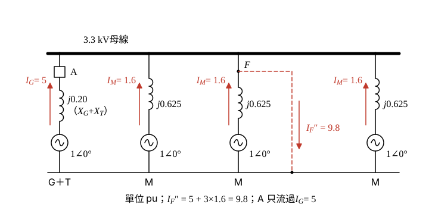

# 111 年工業配電第 3 題｜汽電共生系統三相短路與斷路器電流

## 已知與所求

發電機 \(25\,\mathrm{MW}\)、\(22.8\,\mathrm{kV}\)、\(X_d''=12\%\)；電動機 \(6000\,\mathrm{kW}\)、\(3.3\,\mathrm{kV}\)、\(X_d''=15\%\)（\(X_d'=25\%\)）；變壓器 \(25\,\mathrm{MVA}\)、\(22.8/3.3\,\mathrm{kV}\)、\(X_T=8\%\)。單線圖：G—變壓器—斷路器 A—3.3 kV 母線，母線接三個 M 支路，F 在中間馬達支路的斷路器之後。基準 \(25\,\mathrm{MVA}\)、\(22.8/3.3\,\mathrm{kV}\)。求（一）F 點、（二）斷路器 A 點的次暫態故障電流。

## 考場標準作答

**解題邏輯**：次暫態三相短路用標么法：發電機（經變壓器）與三台馬達都以內電勢 \(E''=1\,\mathrm{pu}\) 串各自的 \(X_d''\) 供給故障電流（不用 \(X_d'\)）。F 在中間馬達饋線上、饋線阻抗不計，故障時 3.3 kV 母線電壓為 0，四條支路電流各為 \(1/X\)。前提：採 \(25\,\mathrm{MW}\) 視同 \(25\,\mathrm{MVA}\)（\(PF_G=1\)）、每台馬達 \(6000\,\mathrm{kW}\approx6\,\mathrm{MVA}\)（條件分支見條件與疑義）。
1. 先換基準求各支路電抗（步驟 1、2）。
2. （一）F 點 = 四支路電流相加。
3. （二）A 點只流過發電機支路電流。

### 步驟 1：各支路電抗（\(25\,\mathrm{MVA}\) 基準）

發電機與變壓器已是 25 MVA、額定電壓即基準電壓，直接串聯：
\[
X_G+X_T=0.12+0.08=0.20\,\mathrm{pu}
\]
馬達換基準（\(S_{rated}=6\,\mathrm{MVA}\)）：
\[
X_M''=X_{d}''\frac{S_b}{S_M}=0.15\times\frac{25}{6}=0.625\,\mathrm{pu}
\]
3.3 kV 側基準電流（分母先算）：
\[
\sqrt3V_b=\sqrt3\times3.3=5.716\,\mathrm{kV},\qquad I_b=\frac{S_b}{\sqrt3V_b}=\frac{25}{5.716}\,\mathrm{kA}
\]

### 步驟 2：次暫態電抗圖

- 3.3 kV 母線為共同節點；發電機支路 \(1\angle0^\circ\) 串 \(j0.20\)，經斷路器 A 接母線；三個 M 支路各 \(1\angle0^\circ\) 串 \(j0.625\) 接母線。
- F 在中間馬達斷路器之後，饋線阻抗不計，故障即母線對參考線短路：中間馬達電流直接進 F，其餘支路電流經母線流向 F。
- 斷路器 A 串在發電機支路上，只看到發電機支路電流。

### （一）故障點 F 之次暫態故障電流（10 分）

**邏輯**：母線電壓為 0，各支路電流 \(=E''/X=1/X\)；F 點同時收到發電機分量與三個 M 支路的馬達反饋（疊加原理），四者相加。

各支路電流標么值：
\[
I_G=\frac{1}{X_G+X_T}=\frac{1}{0.20}=5\,\mathrm{pu},\qquad I_{M}=\frac{1}{X_M''}=\frac{1}{0.625}=1.6\,\mathrm{pu}\ (\text{每台})
\]
\[
I_F''^{pu}=I_G+3I_M=5+3\times1.6=5+4.8=9.8\,\mathrm{pu}
\]
換成安培：
\[
I_F''=I_F''^{pu}\,I_b=9.8\times\frac{25}{5.716}=\frac{245}{5.716}
\]
\[
\boxed{I_F''=42.86\ \mathrm{kA}}
\]

### （二）斷路器 A 點之次暫態故障電流（10 分）

**邏輯**：A 點量測的是發電機支路電流，只含經變壓器流來的發電機分量；馬達反饋由各 M 支路經母線流向 F，不穿過 A。故障時母線電壓為 0，A 的電流等於 \(1\,\mathrm{pu}\) 內電勢除以發電機支路電抗。

\[
I_A''^{pu}=\frac{1-0}{X_G+X_T}=\frac{1}{0.20}=5\,\mathrm{pu}
\]
\[
I_A''=5\times\frac{25}{5.716}=\frac{125}{5.716}
\]
\[
\boxed{I_A''=21.87\ \mathrm{kA}}
\]
參考書以 \(I_b=4.37\,\mathrm{kA}\) 寫成 \(9.8\times4.37=42.83\)／\(5\times4.37=21.85\) kA（42.83 kA、21.85 kA）。

## 驗算

戴維寧：\(Z_{th}=0.20\parallel\dfrac{0.625}{3}=\dfrac{1}{5+4.8}=\dfrac{1}{9.8}\,\mathrm{pu}\)，\(I_F''=I_b/Z_{th}=9.8\times25/5.716=42.86\,\mathrm{kA}\)，與支路相加一致。\(I_F''-I_A''=4.8\,I_b=120/5.716=20.99\,\mathrm{kA}\)，即三台馬達各 \(1.6\,\mathrm{pu}\)，全部只經母線流向 F、不經 A。

## 失分點

- 不得把馬達反饋分量加到 A 點；馬達電流由各 M 支路經母線流向 F，不穿過 A。
- 只算一台馬達（\(6.6\times25/5.716=28.87\,\mathrm{kA}\)）；圖中三個 M 支路都要列入。
- 用暫態電抗 \(X_d'=25\%\) 求次暫態電流。

## 條件與疑義

題目給的是 \(25\,\mathrm{MW}\) 與 \(6000\,\mathrm{kW}\)，未給額定功因／效率；\(25\,\mathrm{MVA}\) 只是題目指定的基準。圖面確認三個 M 支路，支路數量 N_M=3 已確認。若 \(S_G=25/PF_G\)，則 \(X_G=0.12PF_G\)，A 點條件分支：

| \(PF_G\) | 1.0 | 0.9 | 0.8 |
|---|---:|---:|---:|
| \(I_A''=I_b/(0.12PF_G+0.08)\)（kA） | 21.8693 | 23.2652 | 24.8515 |

若馬達 \(\eta\,\mathrm{pf}_n=0.9\)，\(X_M''=0.15\times25/(6/0.9)=0.5625\)，\(I_F''=(5+3/0.5625)I_b=\tfrac{31}{3}\times\tfrac{25}{\sqrt3\times3.3}=45.20\,\mathrm{kA}\)。主解採 \(PF_G=1\)、馬達 1 kW≈1 kVA 的參考書慣例。
