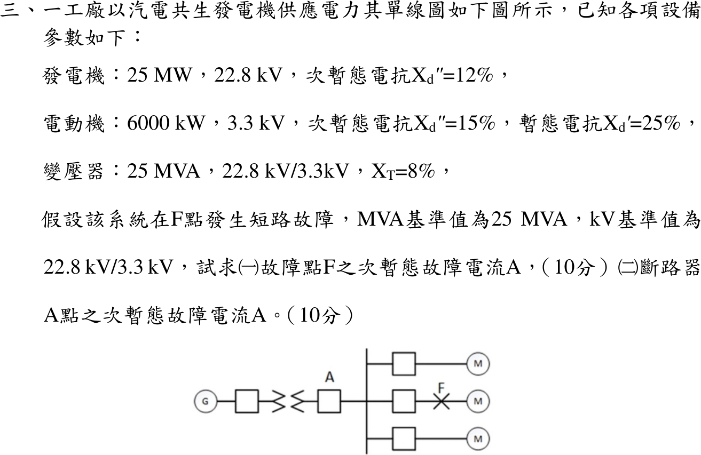

# 111 年工業配電第 3 題｜汽電共生系統三相短路與斷路器電流

## 已知與所求

發電機 \(25\,\mathrm{MW}\)、\(22.8\,\mathrm{kV}\)、\(X_d''=12\%\)；電動機 \(6000\,\mathrm{kW}\)、\(3.3\,\mathrm{kV}\)、\(X_d''=15\%\)（\(X_d'=25\%\)）；變壓器 \(25\,\mathrm{MVA}\)、\(22.8/3.3\,\mathrm{kV}\)、\(X_T=8\%\)。單線圖：G—變壓器—斷路器 A—3.3 kV 母線，母線接三個 M 支路，F 在中間馬達支路的斷路器之後。基準 \(25\,\mathrm{MVA}\)、\(22.8/3.3\,\mathrm{kV}\)。求（一）F 點、（二）斷路器 A 點的次暫態故障電流。

## 考場標準作答

採 \(25\,\mathrm{MW}\) 視同 \(25\,\mathrm{MVA}\)（\(PF_G=1\)）、每台馬達 \(6\,\mathrm{MVA}\)、各內電勢 \(E''=1\,\mathrm{pu}\)（條件分支，見條件與疑義）。次暫態計算用 \(X_d''\)，不用 \(X_d'\)。以下以完整精度計算，括號數字為顯示值。

基準電流與各支路電抗（發電機已是 25 MVA 基準，馬達要換算）：
\[
I_b=\frac{S_b}{\sqrt3\,V_b}=\frac{25\times10^6\ \mathrm{VA}}{\sqrt3(3300\ \mathrm V)}=4373.87\ \mathrm A
\]
\[
X_{G}+X_T=0.12+0.08=0.20\ \mathrm{pu},\qquad X_M''=0.15\frac{25}{6}=6.25\times10^{-1}\ \mathrm{pu}
\]

### （一）F 點

觀念：次暫態短路時，發電機、變壓器與馬達都以 \(E''=1\ \mathrm{pu}\) 串各自的 \(X_d''\) 供應故障點，F 點電流為各支路電流之和（疊加原理）。畫法：3.3 kV 母線經中間馬達斷路器接到 F，故障時母線電壓為 0；從母線接地畫四條並聯支路，一條是 \(1\angle0^\circ\) 串 \(j0.20\)（發電機＋變壓器），另三條各是 \(1\angle0^\circ\) 串 \(j6.25\times10^{-1}\)（三個 M）。F 點同時收到發電機分量與三個 M 支路的馬達反饋（故障支路上的馬達也直接饋入 F）。

各支路電流標么值：
\[
I_G=\frac{1}{0.20}=5.00\ \mathrm{pu},\qquad I_{M}=\frac{1}{6.25\times10^{-1}}=1.60\ \mathrm{pu}\ (\text{每台})
\]
\[
I_F''^{pu}=I_G+3I_M=5.00+3(1.60)=9.80\ \mathrm{pu}
\]
\[
\boxed{I_F''=9.80(4373.87\ \mathrm A)=42.86\ \mathrm{kA}}
\]

### （二）斷路器 A 點

觀念：A 點量測的是發電機支路電流，只含經變壓器流來的發電機分量；馬達反饋由各 M 支路經母線流向 F，不穿過 A。故障時母線電壓為 0，A 的電流等於 \(1\ \mathrm{pu}\) 電壓除以發電機支路電抗。
\[
I_A''^{pu}=\frac{1}{X_G+X_T}=\frac{1}{0.20}=5.00\ \mathrm{pu}
\]
\[
\boxed{I_A''=5.00(4373.87\ \mathrm A)=21.87\ \mathrm{kA}}
\]
參考書以 \(I_b=4.37\,\mathrm{kA}\) 寫成 42.83／21.85 kA。

## 驗算

戴維寧：\(Z_{th}=0.20\parallel(6.25\times10^{-1}/3)=\dfrac{1}{5.00+4.80}=1.02\times10^{-1}\,\mathrm{pu}\)，\(I_F''=I_b/Z_{th}=42.86\,\mathrm{kA}\)（完整精度）。故障時母線電壓為 0，發電機支路電流 \(=(1-0)/0.20=5.00\,\mathrm{pu}\)，與 A 點結果一致；\(I_F''-I_A''=4.80I_b\)，即三台馬達各 \(1.60\,\mathrm{pu}\)。

## 失分點

- 不得把馬達反饋分量加到 A 點；馬達電流由各 M 支路經母線流向 F，不穿過 A。
- 只算一台馬達（\(6.6I_b=28.87\,\mathrm{kA}\)）；圖中三個 M 支路都要列入。
- 用暫態電抗 \(X_d'=25\%\) 求次暫態電流。

## 條件與疑義

題目給的是 \(25\,\mathrm{MW}\) 與 \(6000\,\mathrm{kW}\)，未給額定功因／效率；\(25\,\mathrm{MVA}\) 只是題目指定的基準。圖面確認三個 M 支路，支路數量 N_M=3 已確認。若 \(S_G=25/PF_G\)，則 \(X_G=0.12PF_G\)，A 點條件分支：

| \(PF_G\) | 1.0 | 0.9 | 0.8 |
|---|---:|---:|---:|
| \(I_A''=I_b/(0.12PF_G+0.08)\)（kA） | 21.8693 | 23.2652 | 24.8515 |

若馬達 \(\eta\,\mathrm{pf}_n=0.9\)，\(X_M''=0.5625\)，\(I_F''=10.333I_b=45.20\,\mathrm{kA}\)。主解採 \(PF_G=1\)、馬達 1 kW≈1 kVA 的參考書慣例。
