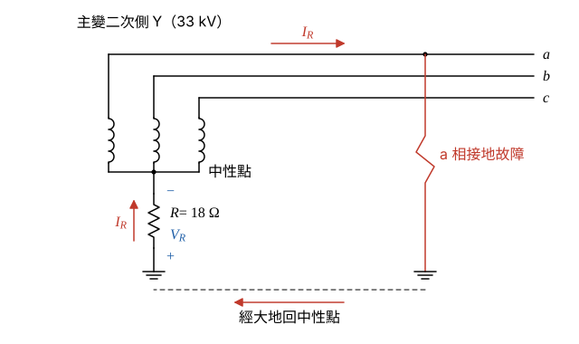

# 111 年工業配電第 5 題｜低電阻接地電阻器額定與短路電流比例

## 已知與所求

161 kV 受電，系統短路容量 \(10000\,\mathrm{MVA}\)；主變壓器 \(161/33\,\mathrm{kV}\)、\(100\,\mathrm{MVA}\)、\(Z=12\%\)；二次側中性點經 \(18\,\Omega\) 電阻接地。電阻器額定電流為二次側短路電流的 5%～20% 即符合低電阻接地。求（一）電阻器電壓與電流額定；（二）以 100 MVA 為基準判斷是否符合。

## 考場標準作答

**解題邏輯**：（一）二次側單線接地故障時，故障電流經大地回到中性點，中性點電阻跨在故障相的相電壓上；忽略變壓器與系統阻抗（電阻遠大於兩者），電阻器電壓額定取相電壓 \(V_{LL}/\sqrt3\)，電流額定由歐姆定律 \(I_R=V_R/R\) 求得。（二）判準是 \(I_R\) 佔主變二次側三相短路電流的 5%～20%：以 100 MVA 為基準，電源短路電抗 \(X_s=S_b/S_{sc}\) 串主變 \(X_T\)，\(I_{sc}=I_b/(X_s+X_T)\)，再取比值。前提：系統為無限大匯流排串 \(X_s\)、主變一次側 Δ（二次 Y 中性點經電阻接地）、故障前電壓為額定。

### （一）電阻器的電壓與電流額定（10 分）

**邏輯**：正常時三相平衡，中性點對地電壓為零；a 相接地時，故障相電源電壓全部加在「大地→\(R\)→中性點」迴路上，\(R\) 兩端即相電壓。

電壓額定（相電壓）：
\[
V_R=\frac{V_{LL}}{\sqrt3}=\frac{33}{\sqrt3}=19.0526\ \mathrm{kV}
\]
\[
\boxed{V_R=19.05\,\mathrm{kV}}
\]
電流額定（歐姆定律）：
\[
I_R=\frac{V_R}{R}=\frac{19\,052.6\ \mathrm V}{18\ \Omega}=1058.48\ \mathrm A
\]
\[
\boxed{I_R=1058.48\,\mathrm A}
\]

### （二）是否符合低電阻接地（10 分）

**邏輯**：低電阻接地的判準是 \(I_R/I_{sc}\in[5\%,20\%]\)；二次側三相短路時電源與主變電抗串聯限制電流，以 100 MVA 基準的標么電抗求 \(I_{sc}\)。

標么電抗（\(S_b=100\,\mathrm{MVA}\)，主變 100 MVA 已在基準上）：
\[
X_s=\frac{S_b}{S_{sc}}=\frac{100}{10\,000}=0.01\ \mathrm{pu},\qquad X_T=0.12\ \mathrm{pu}
\]
二次側基準電流：
\[
I_b=\frac{S_b}{\sqrt3\,V_b}=\frac{100\times10^6}{\sqrt3(33\times10^3)}=\frac{100\times10^6}{57\,157.7}=1749.55\ \mathrm A
\]
三相短路電流：
\[
I_{sc}=\frac{I_b}{X_s+X_T}=\frac{1749.55}{0.01+0.12}=\frac{1749.55}{0.13}=13\,458.08\ \mathrm A
\]
\[
\boxed{I_{sc}=13.46\,\mathrm{kA}}
\]
比值：
\[
\frac{I_R}{I_{sc}}=\frac{1058.48}{13\,458.08}=0.078650
\]
\[
\boxed{\frac{I_R}{I_{sc}}=7.87\%}\in[5\%,20\%]\ \Rightarrow\ \boxed{\text{符合低電阻接地}}
\]

## 驗算

以對稱分量求經電阻的單線接地電流（主變 Δ–Y，\(Z_0=jX_T+3R\)）：\(Z_b=33^2/100=10.89\,\Omega\)，\(3R/Z_b=54/10.89=4.9587\,\mathrm{pu}\)。
\[
Z_1+Z_2+Z_0=4.9587+j(0.13+0.13+0.12)=4.9587+j0.38
\]
\[
|Z_1+Z_2+Z_0|=\sqrt{4.9587^2+0.38^2}=4.9732
\]
\[
I_{SLG}=\frac{3I_b}{|Z_1+Z_2+Z_0|}=\frac{3(1749.55)}{4.9732}=\frac{5248.65}{4.9732}=1055.39\ \mathrm A
\]
與 \(V_R/R=1058.48\,\mathrm A\) 相差 0.29%，確認電阻主導接地電流，（一）忽略變壓器與系統阻抗的前提成立。比值也可寫成精確式：
\[
\frac{I_R}{I_{sc}}=\frac{V_{LL}/(\sqrt3R)}{S_b/[\sqrt3V_{LL}(X_s+X_T)]}=\frac{V_{LL}^2(X_s+X_T)}{R\,S_b}=\frac{33^2(0.13)}{18(100)}=\frac{141.57}{1800}=7.865\%
\]
與上式一致。

## 失分點

- 電阻器電壓用線電壓 33 kV；中性點只承受相電壓。
- 漏掉系統電抗 0.01，二次短路電流變為 14.58 kA，比例 7.26%（結論仍符合，但數值錯）。
